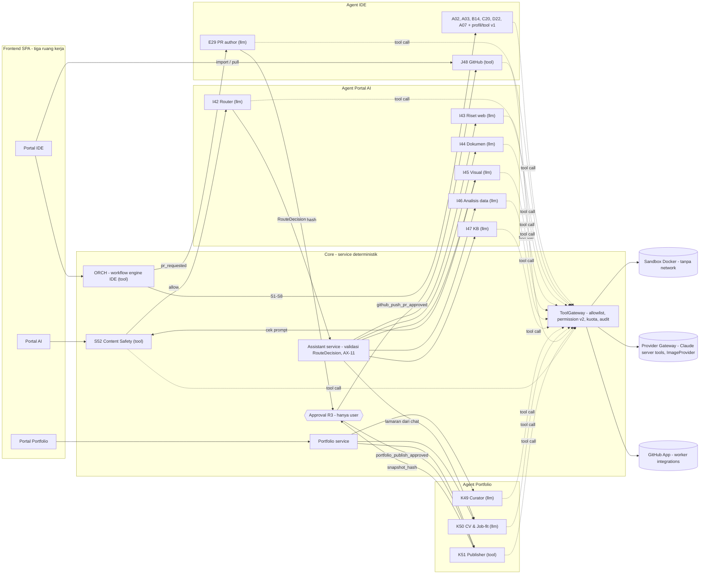

# KodeKantor — Agent Catalog

> **v2 (21 Okt 2026, RANCANGAN — ADR-048):** registry kini `schema_version: 2` dengan **53 entri** (42 lama + 11 agent K2: I42–I47, J48, K49–K51, S52; E29 dipromosikan). Tidak ada agent v2 yang diimplementasikan atau `enabled`. §1–§11 di bawah = baseline v1/MVP dan tetap berlaku untuk 42 entri lama; perluasan v2 ada di **§12**.
>
> **v2.1 (22 Okt 2026, RANCANGAN — KONTRAK v2.1 K9):** SDLC end-to-end dipenuhi dengan **mengaktifkan agent `planned` yang sudah ada** (21 agent: 8 di P13, 13 di P14 — termasuk B08/B11/B12/B15 per amandemen K13; **setelah v2.2:** 8 di P13, 11 di P14, D24 di P15, B11 di P16) dan kontrak output baru A03 `ProgramPlan` — **tanpa agent baru**; registry tetap 53 entri. Lihat **§13**.
>
> **v2.2 (22 Okt 2026, RANCANGAN — KONTRAK v2.2, `POLYGLOT_INTEGRATION_DESIGN.md` §4/§7):** tidak ada agent baru (registry tetap 53). H41 mendeteksi semua pack gelombang 1; B14/C17/C20 mendapat petunjuk & eval per pack; **D24 P14 → P15** (WP-15.10), **B11 P14 → P16** (WP-16.6); C18 menambah contract test lintas service di P16. Lihat **§14**.
>
> Sumber kebenaran v2: `agents/registry.v2.yaml` (divalidasi `python3 scripts/validate_registry.py`). Runtime snapshot tetap memakai `agents/registry.yaml` (schema 1, 42 entri; divalidasi `scripts/validate_registry_v1.py`, di-seed oleh `python -m app.cli seed-agents`) karena loader backend v2 belum ada — penggantian file dilakukan di WP-9.0 (§12.9, ADR-048).
> Dasar: PRD v1.0 §6 (41 specialist + Orchestrator §6.1), §6.2 (registry contract), §7.3.2 (tool-use), §10 (risk & approval), §14.1 #7 ("jangan membuat agent specialist sebagai LLM process jika fungsi deterministik sudah cukup"), R-06 (wave-based rollout); ADR-012 (41 → 6 runtime LLM + tool deterministik), ADR-013 (`submit_result`); `docs/TOOL_CATALOG.md`; `backend/app/agents/contracts.py`.
> Tabel di §5–§6 dan §8 dibangkitkan dari registry (v1: `registry.yaml`; §12: `registry.v2.yaml`); bila berbeda, **registry yang berlaku**.

## 1. Ringkasan

KodeKantor memiliki **42 profil**: 41 specialist PRD (A01–H41) dan Orchestrator (`ORCH`, peran pusat — bukan specialist ke-42). PRD menegaskan bahwa angka 41 adalah *target katalog kapabilitas*; MVP tidak menjalankan 41 LLM agent. Pemetaan runtime MVP (ADR-012):

- **6 runtime LLM** (`mvp_mode: llm`): A02 Requirement Analyst (+A01), A03 Planner (+C16), B14 Code Implementer, C20 Debugger, D22 Code Reviewer, A07 User Proxy.
- **7 profil** (`mvp_mode: profile`) yang memakai runtime & kontrak agent LLM lain dengan prompt/tools/permission berbeda: B09, B10, B13, G35 → B14; C21 → C20; serta A01 → A02 dan C16 → A03 (*absorbed*: fungsinya dikerjakan di dalam run runtime-nya, tidak di-dispatch terpisah).
- **7 tool-mode** (`mvp_mode: tool`): A04, C17, D23, E27, G37, H41, dan ORCH — diwujudkan sebagai kode/tool deterministik, bukan LLM.
- **22 planned** (`mvp_mode: planned`, `enabled: false`): tampil di katalog dengan prioritas PRD, diaktifkan per wave (Phase 8, §10).

Hitungan saat ini: llm = 6, profile = 7, tool = 7, planned = 22 (enabled = 20 dari 42).

## 2. Skema registry (`schema_version: 1`)

> Baseline v1. Skema v2 (field opsional `target_mode`, `phase`, `contract_status`, `notes`, `limits.tool_quota`, permission 8 field) dan aturan validator tambahan ada di §12.2; validator kini hanya menerima `schema_version: 2` dengan 53 entri.

```yaml
schema_version: 1
agents:
  - agent_id: A07            # unik; ^([A-H]\d{2}|ORCH)$ — ID PRD §6
    slug: user_proxy         # snake_case unik (PRD §6.2 memakai slug ini sebagai agent_id)
    name: "User Proxy / User Intent & Acceptance"   # verbatim PRD
    group: planning_intent   # planning_intent | software_development | testing_debugging | quality_security |
                             # git_collaboration | devops_operations | documentation_knowledge |
                             # specialized_engineering | orchestration
    version: 1               # naik bila prompt/kontrak/permission berubah (dicatat di agent_runs.agent_version)
    priority: P0             # P0 | P1 | P2 (dari PRD 'Priority / access')
    mvp_mode: llm            # llm | profile | tool | planned
    runtime_agent: null      # wajib untuk profile: agent llm yang runtime/kontraknya dipakai (mis. B14)
    enabled: true            # true untuk llm/profile/tool; false untuk planned
    model_tier: default      # fast | default | complex → CLAUDE_MODEL_FAST/DEFAULT/COMPLEX
    description: "..."       # verbatim PRD
    purpose: "..."           # turunan (A07: verbatim PRD §6.2)
    triggers: [..]           # event workflow yang memicu agent (§8)
    capabilities: [user_proxy.capture_intent, ...]   # verbatim PRD, urutan sama
    tools: [acceptance.list_criteria, ...]           # HANYA nama di docs/TOOL_CATALOG.md (+ submit_result untuk llm/profile)
    permissions: {filesystem: read_only, sandbox: deny, git: read, network: deny, deployment: deny, approval_grant: deny}
    input_contract: UserProxyInput     # nama kelas di backend/app/agents/contracts.py (profile = milik runtime_agent)
    output_contract: UserProxyOutput
    limits: {max_iterations: 12, timeout_seconds: 300}
    inputs_tools_note: "..."  # verbatim PRD 'Inputs / tools'
    output_note: "..."        # verbatim PRD 'Output'
    access_note: "..."        # verbatim PRD 'Priority / access'
```

| Field | Tipe | Aturan validator (`scripts/validate_registry.py`) |
|---|---|---|
| `agent_id` | string | unik; 41 ID PRD + `ORCH` harus ada; total tepat 42 entri |
| `slug` | string | snake_case, unik |
| `name`, `group`, `capabilities` | string / enum / list | harus sama persis dengan PRD §6 (salinan mekanis tertanam di validator) |
| `version` | int ≥ 1 | — |
| `priority` | `P0`/`P1`/`P2` | — |
| `mvp_mode` | enum | himpunan agent `llm` **harus sama** dengan kunci `OUTPUT_CONTRACTS` di `contracts.py` (A02, A03, B14, C20, D22, A07) |
| `runtime_agent` | string/null | wajib & hanya untuk `profile`; harus menunjuk agent `llm` |
| `enabled` | bool | `true` ⇔ `mvp_mode ≠ planned` |
| `model_tier` | enum | — |
| `triggers` | list snake_case | tidak kosong |
| `tools` | list | ⊆ TOOL_CATALOG; `submit_result` wajib untuk llm/profile dan dilarang untuk tool/planned; tool yang nonaktif di MVP (`git.push`, `deploy.staging`, `deps.install`) dilarang pada agent `enabled` |
| `permissions` | map 6 field | nilai sesuai TOOL_CATALOG; **`approval_grant` selalu `deny`**; prasyarat setiap tool terpenuhi (lihat §3); profil yang dipatok PRD (D22/A07 read-only, C17 `test_only`, G35/G36 `docs_only`, B14 tanpa deploy, dst.); hanya F32 boleh `deployment ≠ deny` |
| `input_contract`, `output_contract` | string/null | llm: sama dengan `contracts.py`; profile: sama dengan milik `runtime_agent`; tool/planned: `null` |
| `limits` | `{max_iterations, timeout_seconds}` | `1 ≤ max_iterations ≤ 40` (`CLAUDE_MAX_TOOL_ITERATIONS`); llm/profile timeout 300–900 s |
| `*_note`, `description`, `purpose` | string | tidak kosong |

**Semantik `limits`.** Untuk llm/profile: `max_iterations` = batas iterasi tool-use loop per run (selain cap global `CLAUDE_MAX_TOOL_ITERATIONS`); `timeout_seconds` = batas wall-clock per run. Untuk tool-mode: `max_iterations: 1` (satu pemanggilan deterministik) dan `timeout_seconds` = batas per pemanggilan. Untuk `ORCH`: `max_iterations: 12` = jumlah maksimum langkah plan yang di-dispatch per iterasi (= `PlanOutput.steps` maks 12) dan `timeout_seconds` = batas per dispatch *(turunan)*. Contoh PRD §6.2 `max_iterations: 3` untuk User Proxy ditafsirkan sebagai batas **siklus revalidation**, bukan iterasi tool-use — siklus itu dibatasi `TASK_AUTO_REMEDIATION_MAX` + permintaan user (lihat `USER_PROXY_ACCEPTANCE.md §7`); registry memakai 12 iterasi tool-use.

**Hubungan dengan PRD §6.2.** Field PRD `input_schema`/`output_schema` diwujudkan sebagai referensi kelas Pydantic (`input_contract`/`output_contract`); `UserProxyInput` memuat `task_id`, `baseline_version` (≈ `requirement_baseline_id`), dan `evidence` (≈ `artifact_refs` + `test_report_refs`); `UserProxyOutput` memuat `status ∈ {passed, needs_changes, blocked, unverified}`, `criteria_results` (masing-masing dengan `evidence_refs`), dan `next_actions`.

## 3. Permission profile & konsistensi tools

Semantik field mengikuti `docs/TOOL_CATALOG.md`. Aturan konsistensi yang ditegakkan validator (dan sekali lagi saat runtime oleh `ToolGateway` — registry bukan satu-satunya pagar):

| Tool | Risk | Prasyarat permission |
|---|---|---|
| `repo.get_tree`, `repo.read_file`, `repo.search_text`, `repo.search_symbol`, `repo.find_related_tests` | R0 | `filesystem ≠ none` |
| `git.status`, `git.diff`, `git.log` | R0 | `git ∈ {read, branch_commit}` |
| `repo.detect_stack`, `tests.list_profiles`, `tests.get_run`, `review.get_task_diff`, `acceptance.*`, `memory.retrieve_context`, `security.scan_secrets` | R0 | — |
| `code.write_file`, `code.apply_patch` | R1 | `filesystem ∈ {test_only, docs_only, scoped_write}` + aturan path |
| `code.delete_file` | R1 | `filesystem = scoped_write` |
| `git.commit_task` | R1 | `git = branch_commit` (branch task saja) |
| `memory.store_decision` | R1 | — (redaksi secret wajib) |
| `tests.run`, `env.inspect_runtime` | R2 | `sandbox = allow` |
| `deps.install` | R2 | `sandbox = allow` & `network = allowlist` & `SANDBOX_EGRESS=allowlist` — **P1, tidak boleh di agent enabled** |
| `git.push` | R3 | `git = branch_commit` + approval — **P2, disabled** |
| `deploy.staging` | R3 | `deployment = staging_with_approval` + approval — **P2** |
| `submit_result` | – | hanya agent llm/profile (ADR-013) |

Profil permission per peran (PRD §7.3.2, access notes, AC-10):

| Peran | Agent | filesystem | sandbox | git |
|---|---|---|---|---|
| Analis/planner | A01, A02, A03, C16, A05, A06 | `read_only` | deny | none/read |
| Reviewer | D22 (+D23 tool) | `read_only` | deny | read/none |
| User Proxy | A07 | `read_only` | **deny** | read |
| Implementer | B14, B09, B10, B13 (+B11, B12, B15, E28, F30, F31, H38–H40 planned) | `scoped_write` | allow | `branch_commit` |
| Debugger | C20, C21 | `scoped_write` | allow | read |
| Test runner | C17 (+C18, C19 planned) | `test_only` | allow | read |
| Dokumentasi | G35 (+B08, G36 planned) | `docs_only` | deny | read/none |
| Git | E27 | `read_only` | deny | `branch_commit` |
| Deploy | F32 (planned) | `read_only` | allow | read · `deployment: staging_with_approval` |
| Orchestrator | ORCH | `none` | deny | none (men-dispatch, tidak memanggil tool sendiri) |

`approval_grant: deny` untuk **semua** profil: tidak ada agent — termasuk Orchestrator dan User Proxy — yang dapat memutuskan approval (PRD §10.4). Approval hanya diputuskan user via `POST /approvals/{id}/decision` (ARCHITECTURE §10).

## 4. Cara kerja tiap `mvp_mode`

### 4.1 `llm`
`AgentRuntime.run(agent_id, …)` (ARCHITECTURE §6.1) memuat profil dari `agent_profiles`, membangun system prompt dari `agents/prompts/<agent_id>.md` (hash isi = `prompt_version`), menyajikan **hanya** tool di allowlist (`ToolGateway.tool_defs_for(profile)`), dan menjalankan tool-use loop sampai `submit_result` valid terhadap `output_contract` (ADR-013), batas `limits`, budget (`BudgetGuard`), atau cancel. Setiap tool call tetap divalidasi ulang oleh `ToolGateway` terhadap `permissions` (allowlist → schema → scope/path → risk/approval → quota).

### 4.2 `profile`
Profil memakai **kelas runtime, kontrak input/output, dan step pipeline** milik `runtime_agent`, tetapi dengan identitas sendiri: `agent_runs.agent_id` = ID profil, prompt `agents/prompts/<profil>.md`, `tools`, `permissions`, `limits`, dan `model_tier` milik profil. Contoh: langkah plan dengan `specialist: "G35"` dijalankan oleh runtime B14 dengan `filesystem: docs_only`, sehingga `code.write_file` ke `src/app.py` ditolak gateway walau runtime-nya sama dengan B14.

Dua profil bersifat **absorbed**: A01 (fungsi klasifikasi intent dikerjakan di dalam run A02 — kontrak `IntakeOutput` sudah memuat `workflow_type/complexity/risk/constraints`) dan C16 (strategi test dikerjakan di dalam run A03 — `PlanOutput.test_plan`). Keduanya tidak di-dispatch terpisah di MVP; entri registry-nya mendokumentasikan kapabilitas dan permission bila kelak dipisah. Planner hanya boleh menugaskan specialist implementer yang enabled (`B14`, `B09`, `B10`, `B13`, `G35`).

### 4.3 `tool`
Kapabilitas diwujudkan sebagai kode deterministik (P7 "deterministic before LLM"). Agent tool-mode tetap punya identitas di registry agar (a) katalog/UI lengkap, (b) tool call yang dijalankan orchestrator atas namanya tercatat dengan `agent_id` yang benar di `tool_calls`/audit, dan (c) permission-nya ditegakkan gateway yang sama. Tidak ada `submit_result` dan kontrak I/O.

### 4.4 `planned`
`enabled: false`; tampil di katalog (`GET /agents`, status `planned`) dengan prioritas PRD. `AgentRuntime` dan Planner menolak mendispatch agent yang tidak enabled. Allowlist tools dan permission planned adalah **provisional** (konservatif, hanya dari tool yang sudah ada); tool baru yang dibutuhkan kapabilitasnya (mis. `browser.*` untuk C19) harus ditambahkan ke TOOL_CATALOG saat aktivasi (§10).

## 5. Tabel pemetaan MVP (42 profil)

| ID | Agent | Grup | Prio | mvp_mode | Runtime | Permissions | Tools (allowlist) |
|---|---|---|---|---|---|---|---|
| A01 | Request & Intent Classifier | planning_intent | P0 | **profile** | A02 | fs:read_only · sbx:deny · git:none | `repo.get_tree`, `repo.detect_stack`, `memory.retrieve_context` + `submit_result` |
| A02 | Requirement Analyst | planning_intent | P0 | **llm** | self | fs:read_only · sbx:deny · git:none | `repo.get_tree`, `repo.read_file`, `repo.search_text`, `repo.search_symbol`, `repo.detect_stack`, `memory.retrieve_context` + `submit_result` |
| A03 | Planner & Task Decomposer | planning_intent | P0 | **llm** | self | fs:read_only · sbx:deny · git:none | `repo.get_tree`, `repo.read_file`, `repo.search_text`, `repo.search_symbol`, `repo.find_related_tests`, `tests.list_profiles`, `memory.retrieve_context` + `submit_result` |
| A04 | Codebase Explorer & Context Engineer | planning_intent | P0 | **tool** | — | fs:read_only · sbx:deny · git:none | `repo.get_tree`, `repo.read_file`, `repo.search_text`, `repo.search_symbol`, `repo.find_related_tests`, `repo.detect_stack`, `memory.retrieve_context` |
| A05 | Software Architect | planning_intent | P1 | **planned** | — | fs:read_only · sbx:deny · git:none | `repo.get_tree`, `repo.read_file`, `repo.search_text`, `repo.search_symbol`, `memory.retrieve_context` |
| A06 | Change Impact & Risk Analyst | planning_intent | P1 | **planned** | — | fs:read_only · sbx:deny · git:read | `repo.get_tree`, `repo.read_file`, `repo.search_text`, `repo.search_symbol`, `repo.find_related_tests`, `git.diff`, `git.log`, `review.get_task_diff` |
| A07 | User Proxy / User Intent & Acceptance | planning_intent | P0 | **llm** | self | fs:read_only · sbx:deny · git:read | `acceptance.list_criteria`, `acceptance.list_evidence`, `tests.get_run`, `review.get_task_diff`, `git.diff`, `repo.read_file`, `repo.search_text` + `submit_result` |
| B08 | UI/UX Designer | software_development | P1 | **planned** | — | fs:docs_only · sbx:deny · git:none | `repo.get_tree`, `repo.read_file`, `repo.search_text`, `repo.search_symbol`, `code.write_file`, `code.apply_patch`, `memory.retrieve_context` |
| B09 | Frontend Developer | software_development | P0 | **profile** | B14 | fs:scoped_write · sbx:allow · git:branch_commit | `repo.get_tree`, `repo.read_file`, `repo.search_text`, `repo.search_symbol`, `repo.find_related_tests`, `code.write_file`, `code.apply_patch`, `code.delete_file`, `git.status`, `git.diff`, `git.commit_task`, `tests.list_profiles`, `tests.run`, `tests.get_run`, `memory.retrieve_context` + `submit_result` |
| B10 | Backend Developer | software_development | P0 | **profile** | B14 | fs:scoped_write · sbx:allow · git:branch_commit | `repo.get_tree`, `repo.read_file`, `repo.search_text`, `repo.search_symbol`, `repo.find_related_tests`, `code.write_file`, `code.apply_patch`, `code.delete_file`, `git.status`, `git.diff`, `git.commit_task`, `tests.list_profiles`, `tests.run`, `tests.get_run`, `memory.retrieve_context` + `submit_result` |
| B11 | API & Integration Specialist | software_development | P1 | **planned** | — | fs:scoped_write · sbx:allow · git:branch_commit | `repo.get_tree`, `repo.read_file`, `repo.search_text`, `repo.search_symbol`, `code.write_file`, `code.apply_patch`, `git.status`, `git.diff`, `tests.list_profiles`, `tests.run`, `tests.get_run` |
| B12 | Database & Data Modeling Specialist | software_development | P1 | **planned** | — | fs:scoped_write · sbx:allow · git:branch_commit | `repo.get_tree`, `repo.read_file`, `repo.search_text`, `repo.search_symbol`, `code.write_file`, `code.apply_patch`, `git.status`, `git.diff`, `tests.list_profiles`, `tests.run`, `tests.get_run` |
| B13 | Authentication & Identity Specialist | software_development | P1 | **profile** | B14 | fs:scoped_write · sbx:allow · git:branch_commit | `repo.get_tree`, `repo.read_file`, `repo.search_text`, `repo.search_symbol`, `repo.find_related_tests`, `code.write_file`, `code.apply_patch`, `git.status`, `git.diff`, `git.commit_task`, `tests.list_profiles`, `tests.run`, `tests.get_run`, `memory.retrieve_context` + `submit_result` |
| B14 | General Code Implementation Agent | software_development | P0 | **llm** | self | fs:scoped_write · sbx:allow · git:branch_commit | `repo.get_tree`, `repo.read_file`, `repo.search_text`, `repo.search_symbol`, `repo.find_related_tests`, `code.write_file`, `code.apply_patch`, `code.delete_file`, `git.status`, `git.diff`, `git.commit_task`, `tests.list_profiles`, `tests.run`, `tests.get_run`, `memory.retrieve_context` + `submit_result` |
| B15 | AI/LLM Application Specialist | software_development | P2 | **planned** | — | fs:scoped_write · sbx:allow · git:branch_commit | `repo.get_tree`, `repo.read_file`, `repo.search_text`, `repo.search_symbol`, `code.write_file`, `code.apply_patch`, `git.status`, `git.diff`, `tests.list_profiles`, `tests.run`, `tests.get_run` |
| C16 | Test Strategy Agent | testing_debugging | P0 | **profile** | A03 | fs:read_only · sbx:deny · git:none | `repo.get_tree`, `repo.search_text`, `repo.find_related_tests`, `tests.list_profiles`, `tests.get_run`, `memory.retrieve_context` + `submit_result` |
| C17 | Unit Testing Agent | testing_debugging | P0 | **tool** | — | fs:test_only · sbx:allow · git:read | `tests.list_profiles`, `tests.run`, `tests.get_run` |
| C18 | Integration & API Testing Agent | testing_debugging | P1 | **planned** | — | fs:test_only · sbx:allow · git:read | `repo.get_tree`, `repo.read_file`, `repo.search_text`, `repo.search_symbol`, `code.write_file`, `code.apply_patch`, `tests.list_profiles`, `tests.run`, `tests.get_run` |
| C19 | E2E & Browser QA Agent | testing_debugging | P1 | **planned** | — | fs:test_only · sbx:allow · git:read | `repo.get_tree`, `repo.read_file`, `repo.search_text`, `repo.search_symbol`, `code.write_file`, `code.apply_patch`, `tests.list_profiles`, `tests.run`, `tests.get_run` |
| C20 | Debugger & Root Cause Analyst | testing_debugging | P0 | **llm** | self | fs:scoped_write · sbx:allow · git:read | `repo.get_tree`, `repo.read_file`, `repo.search_text`, `repo.search_symbol`, `repo.find_related_tests`, `code.write_file`, `code.apply_patch`, `git.status`, `git.diff`, `tests.list_profiles`, `tests.run`, `tests.get_run`, `env.inspect_runtime` + `submit_result` |
| C21 | Environment & Build Troubleshooter | testing_debugging | P1 | **profile** | C20 | fs:scoped_write · sbx:allow · git:read | `repo.get_tree`, `repo.read_file`, `repo.search_text`, `repo.search_symbol`, `code.write_file`, `code.apply_patch`, `git.status`, `git.diff`, `tests.list_profiles`, `tests.run`, `tests.get_run`, `env.inspect_runtime` + `submit_result` |
| D22 | Code Review Agent | quality_security | P0 | **llm** | self | fs:read_only · sbx:deny · git:read | `review.get_task_diff`, `git.diff`, `git.log`, `repo.get_tree`, `repo.read_file`, `repo.search_text`, `repo.search_symbol`, `tests.get_run`, `acceptance.list_criteria`, `memory.retrieve_context` + `submit_result` |
| D23 | Application Security Agent | quality_security | P0 | **tool** | — | fs:read_only · sbx:deny · git:none | `security.scan_secrets`, `review.get_task_diff` |
| D24 | Dependency & Supply Chain Agent | quality_security | P1 | **planned** | — | fs:read_only · sbx:deny · git:none | `repo.get_tree`, `repo.read_file`, `repo.search_text`, `repo.search_symbol`, `review.get_task_diff` |
| D25 | Performance & Scalability Agent | quality_security | P2 | **planned** | — | fs:read_only · sbx:allow · git:none | `repo.get_tree`, `repo.read_file`, `repo.search_text`, `repo.search_symbol`, `tests.list_profiles`, `tests.run`, `tests.get_run` |
| D26 | Accessibility & Compatibility Agent | quality_security | P2 | **planned** | — | fs:read_only · sbx:allow · git:none | `repo.get_tree`, `repo.read_file`, `repo.search_text`, `repo.search_symbol`, `tests.list_profiles`, `tests.run`, `tests.get_run` |
| E27 | Git Workflow Agent | git_collaboration | P0 | **tool** | — | fs:read_only · sbx:deny · git:branch_commit | `git.status`, `git.diff`, `git.log`, `git.commit_task` |
| E28 | Merge Conflict Resolution Agent | git_collaboration | P2 | **planned** | — | fs:scoped_write · sbx:allow · git:branch_commit | `repo.get_tree`, `repo.read_file`, `repo.search_text`, `repo.search_symbol`, `code.write_file`, `code.apply_patch`, `git.status`, `git.diff`, `git.log`, `git.commit_task`, `tests.list_profiles`, `tests.run`, `tests.get_run` |
| E29 | Pull Request & Collaboration Agent | git_collaboration | P2 | **planned** | — | fs:read_only · sbx:deny · git:read | `review.get_task_diff`, `git.diff`, `git.log`, `acceptance.list_criteria` |
| F30 | Build & CI Agent | devops_operations | P1 | **planned** | — | fs:scoped_write · sbx:allow · git:branch_commit | `repo.get_tree`, `repo.read_file`, `repo.search_text`, `repo.search_symbol`, `code.write_file`, `code.apply_patch`, `git.status`, `git.diff`, `tests.list_profiles`, `tests.run`, `tests.get_run` |
| F31 | Infrastructure as Code Agent | devops_operations | P1 | **planned** | — | fs:scoped_write · sbx:allow · git:branch_commit | `repo.get_tree`, `repo.read_file`, `repo.search_text`, `repo.search_symbol`, `code.write_file`, `code.apply_patch`, `git.status`, `git.diff`, `tests.list_profiles`, `tests.run`, `tests.get_run` |
| F32 | Deployment & Release Agent | devops_operations | P2 | **planned** | — | fs:read_only · sbx:allow · git:read · deploy:staging_with_approval | `repo.get_tree`, `repo.read_file`, `tests.list_profiles`, `tests.run`, `tests.get_run`, `deploy.staging` |
| F33 | Observability & SRE Agent | devops_operations | P2 | **planned** | — | fs:read_only · sbx:deny · git:none | `repo.read_file`, `repo.search_text`, `memory.retrieve_context` |
| F34 | Incident Response & Recovery Agent | devops_operations | P2 | **planned** | — | fs:read_only · sbx:deny · git:read | `repo.read_file`, `repo.search_text`, `git.log`, `memory.retrieve_context` |
| G35 | Technical Documentation Agent | documentation_knowledge | P1 | **profile** | B14 | fs:docs_only · sbx:deny · git:read | `repo.get_tree`, `repo.read_file`, `repo.search_text`, `repo.search_symbol`, `code.write_file`, `code.apply_patch`, `git.status`, `git.diff`, `memory.retrieve_context` + `submit_result` |
| G36 | API & Developer Documentation Agent | documentation_knowledge | P2 | **planned** | — | fs:docs_only · sbx:deny · git:none | `repo.get_tree`, `repo.read_file`, `repo.search_text`, `repo.search_symbol`, `code.write_file`, `code.apply_patch` |
| G37 | Project Knowledge & Memory Agent | documentation_knowledge | P1 | **tool** | — | fs:read_only · sbx:deny · git:read | `memory.retrieve_context`, `memory.store_decision` |
| H38 | Data Engineering Agent | specialized_engineering | P2 | **planned** | — | fs:scoped_write · sbx:allow · git:branch_commit | `repo.get_tree`, `repo.read_file`, `repo.search_text`, `repo.search_symbol`, `code.write_file`, `code.apply_patch`, `git.status`, `git.diff`, `tests.list_profiles`, `tests.run`, `tests.get_run` |
| H39 | Migration Specialist | specialized_engineering | P2 | **planned** | — | fs:scoped_write · sbx:allow · git:branch_commit | `repo.get_tree`, `repo.read_file`, `repo.search_text`, `repo.search_symbol`, `code.write_file`, `code.apply_patch`, `git.status`, `git.diff`, `tests.list_profiles`, `tests.run`, `tests.get_run` |
| H40 | Legacy Modernization & Refactoring Agent | specialized_engineering | P2 | **planned** | — | fs:scoped_write · sbx:allow · git:branch_commit | `repo.get_tree`, `repo.read_file`, `repo.search_text`, `repo.search_symbol`, `repo.find_related_tests`, `code.write_file`, `code.apply_patch`, `code.delete_file`, `git.status`, `git.diff`, `git.commit_task`, `tests.list_profiles`, `tests.run`, `tests.get_run` |
| H41 | Language & Framework Specialist | specialized_engineering | P1 | **tool** | — | fs:read_only · sbx:deny · git:none | `repo.detect_stack`, `tests.list_profiles` |
| ORCH | Orchestrator Agent | orchestration | P0 | **tool** | — | fs:none · sbx:deny · git:none | — |

## 6. Katalog per grup

Kolom *PRD priority / access* adalah teks verbatim PRD. Daftar capability lengkap ada di `registry.yaml` dan `docs/PRD.md §6`.

### 6.1 Planning & User Intent (7)

| ID | Agent · deskripsi PRD | PRD priority / access | MVP | Realisasi MVP & catatan |
|---|---|---|---|---|
| A01 | **Request & Intent Classifier** — Mengklasifikasikan tujuan permintaan dan memilih workflow awal. (5 capability) | P0 • read-only. | profile → A02 | Diserap ke run A02 (S1 intake): `IntakeOutput.workflow_type/complexity/risk/constraints/detected_stack_hints`. Tidak di-dispatch terpisah. |
| A02 | **Requirement Analyst** — Mengubah prompt menjadi requirement eksplisit dan dapat diuji. (5 capability) | P0 • read-only. | llm | LLM run S1 intake (`workflow/steps.py::intake`) → requirements + acceptance criteria baseline v1; `clarification_questions.blocking` → `needs_clarification`. |
| A03 | **Planner & Task Decomposer** — Memecah pekerjaan menjadi task, dependensi, dan jadwal eksekusi. (5 capability) | P0 • orchestration only. | llm | LLM run S3 plan → `PlanOutput` (DAG ≤ 12 langkah, `specialist` ∈ {B14, B09, B10, B13, G35}); `test_plan` mewujudkan C16. |
| A04 | **Codebase Explorer & Context Engineer** — Mencari konteks relevan tanpa memuat seluruh repository ke model. (7 capability) | P0 • read-only. | tool | Tool-mode S2 context: `workspace/index.py` + `workspace/stack.py` membangun context package (≤ 60 KB, ADR-011). `repo.detect_entrypoints` = `Stack.entrypoints`; `repo.build_dependency_map` belum ada (P1). |
| A05 | **Software Architect** — Menentukan modul, antarmuka, kontrak, dan trade-off arsitektur. (6 capability) | P1 • read-only/proposal. | planned | Planned (P1). Sinyal `PlanOutput.needs_architect=true` dicatat sebagai risiko; belum ada dispatch. |
| A06 | **Change Impact & Risk Analyst** — Memetakan file terdampak, risiko regresi, dan rollback. (6 capability) | P1 • read-only. | planned | Planned (P1). Sementara, risiko regresi masuk `PlanOutput.risks` dan `ReviewOutput.findings(category=regression_risk)`. |
| A07 | **User Proxy / User Intent & Acceptance** — Merepresentasikan kepentingan pengguna dan memeriksa produk aktual terhadap kebutuhan serta preferensinya. (8 capability) | P0 • mostly read-only; cannot give human approval. | llm | LLM run S8 user proxy → `UserProxyOutput`; backend memverifikasi evidence (`services/acceptance.py`, lihat USER_PROXY_ACCEPTANCE.md). |

### 6.2 Software Development (8)

| ID | Agent · deskripsi PRD | PRD priority / access | MVP | Realisasi MVP & catatan |
|---|---|---|---|---|
| B08 | **UI/UX Designer** — Menerjemahkan kebutuhan menjadi user flow, wireframe, dan design system. (6 capability) | P1 • design artifacts. | planned | Planned (P1). Butuh evidence screenshot (C19) agar bernilai. |
| B09 | **Frontend Developer** — Membangun UI, routing, state, dan integrasi API. (7 capability) | P0/P1 • write scoped workspace. | profile → B14 | Profil B14 (prompt `agents/prompts/B09.md`): dipilih Planner untuk langkah frontend. |
| B10 | **Backend Developer** — Membangun business logic, service layer, middleware, dan API handlers. (7 capability) | P0/P1 • write scoped workspace. | profile → B14 | Profil B14 (prompt `agents/prompts/B10.md`): dipilih Planner untuk langkah backend. |
| B11 | **API & Integration Specialist** — Merancang kontrak API dan integrasi eksternal yang tahan terhadap kegagalan. (7 capability) | P1 • sandboxed write. | planned | Planned (P1). Butuh mock server/OpenAPI tooling di sandbox. |
| B12 | **Database & Data Modeling Specialist** — Merancang skema, query, indeks, transaksi, dan integritas data. (7 capability) | P1 • no production writes. | planned | Planned (P1). Butuh profil sandbox DB uji (PostgreSQL ephemeral). |
| B13 | **Authentication & Identity Specialist** — Membangun login, session, OAuth/SSO, RBAC, dan account recovery. (7 capability) | P1 • sandboxed write. | profile → B14 | Profil B14 (prompt `agents/prompts/B13.md`) untuk langkah auth/identity; tanpa `code.delete_file`. |
| B14 | **General Code Implementation Agent** — Worker utama untuk membuat dan mengubah kode dalam scope task. (7 capability) | P0 • scoped write; no direct deploy. | llm | LLM run S4 implement per langkah plan → `ImplementOutput`; `changed_files` dicocokkan dengan diff worktree nyata. |
| B15 | **AI/LLM Application Specialist** — Membangun fitur aplikasi pengguna yang menggunakan model AI. (8 capability) | P2 • sandboxed write. | planned | Planned (P2). |

### 6.3 Testing & Debugging (6)

| ID | Agent · deskripsi PRD | PRD priority / access | MVP | Realisasi MVP & catatan |
|---|---|---|---|---|
| C16 | **Test Strategy Agent** — Menetapkan strategi tes dan cakupan yang proporsional terhadap risiko. (5 capability) | P0 • read-only/planning. | profile → A03 | Diserap ke run A03: `PlanOutput.test_plan` (`profiles`, `requirement_test_map`). Tidak di-dispatch terpisah. |
| C17 | **Unit Testing Agent** — Membuat dan menjalankan unit test. (6 capability) | P0 • test-only writes by default. | tool | Tool-mode S5 test: `tools/builtin/tests.py` → sandbox profil tetap; menulis `test_runs` (bukti). Generasi unit test oleh LLM = wave berikut (permission `test_only` sudah disiapkan). |
| C18 | **Integration & API Testing Agent** — Memvalidasi kontrak serta interaksi antarmodul dan service. (6 capability) | P1 • sandbox. | planned | Planned (P1). |
| C19 | **E2E & Browser QA Agent** — Menjalankan user journey melalui browser dan menangkap bukti UI. (8 capability) | P1 • isolated browser. | planned | Planned (P1). Prasyarat: preview sandbox (ADR-008) + tool `browser.*` di TOOL_CATALOG. |
| C20 | **Debugger & Root Cause Analyst** — Menemukan akar masalah dan mengarahkan perbaikan berdasarkan bukti. (7 capability) | P0 • scoped write after diagnosis. | llm | LLM run S6 debug loop → `DebugOutput` (≤ `TASK_MAX_DEBUG_ATTEMPTS`, default 5); `next_step=retest` kembali ke S5. |
| C21 | **Environment & Build Troubleshooter** — Mendiagnosis kegagalan toolchain, dependency, config, dan build. (6 capability) | P1 • sandbox. | profile → C20 | Profil C20 (prompt `agents/prompts/C21.md`) dipilih bila `failure_category ∈ {dependency, build, environment}`; `deps.install` belum (P1, butuh egress). |

### 6.4 Quality & Security (5)

| ID | Agent · deskripsi PRD | PRD priority / access | MVP | Realisasi MVP & catatan |
|---|---|---|---|---|
| D22 | **Code Review Agent** — Melakukan review independen terhadap diff dan kualitas implementasi. (7 capability) | P0 • read-only. | llm | LLM run S7 review (read-only) → `ReviewOutput.findings` → tabel `findings` (`reviewer_type=code_review`). |
| D23 | **Application Security Agent** — Menilai risiko aplikasi, akses, input validation, secrets, dan konfigurasi. (7 capability) | P0 baseline • read-only, scanner execution. | tool | Tool-mode S7: `security.scan_secrets` deterministik → `findings` (`reviewer_type=security`). SAST/Semgrep di sandbox = P1. |
| D24 | **Dependency & Supply Chain Agent** — Menilai package, kerentanan, lisensi, dan upgrade dependency. (7 capability) | P1 • upgrade requires review. | planned | Planned (P1). Butuh advisory feed (egress) atau DB advisory offline. |
| D25 | **Performance & Scalability Agent** — Mengukur bottleneck CPU, memori, query, jaringan, atau rendering. (6 capability) | P2 • non-production load tests. | planned | Planned (P2). |
| D26 | **Accessibility & Compatibility Agent** — Memeriksa aksesibilitas dan konsistensi lintas browser/resolusi. (6 capability) | P2 • read-only + test execution. | planned | Planned (P2). Butuh browser runner (C19). |

### 6.5 Git & Collaboration (3)

| ID | Agent · deskripsi PRD | PRD priority / access | MVP | Realisasi MVP & catatan |
|---|---|---|---|---|
| E27 | **Git Workflow Agent** — Mengelola branch, status, diff, dan kandidat commit. (7 capability) | P0 basic / P1 advanced; no force-push. | tool | Tool-mode: `gitops/adapter.py` (worktree/branch task, status, diff, log, commit di branch task). Tanpa push/force-push. |
| E28 | **Merge Conflict Resolution Agent** — Menganalisis dan menyelesaikan konflik secara transparan. (6 capability) | P2 • user data preserved; no destructive overwrite. | planned | Planned (P2). Di MVP konflik saat apply → `needs_changes` (ADR-016). |
| E29 | **Pull Request & Collaboration Agent** — Menyiapkan PR, ringkasan perubahan, checklist, dan feedback. (6 capability) | P2 • remote write requires authorization. | planned | Planned (P2). Remote write (`git.push`) disabled sampai ADR-003 P2. |

### 6.6 DevOps & Operations (5)

| ID | Agent · deskripsi PRD | PRD priority / access | MVP | Realisasi MVP & catatan |
|---|---|---|---|---|
| F30 | **Build & CI Agent** — Menyusun pipeline build dan menjalankan quality gates. (6 capability) | P1 • config patch. | planned | Planned (P1, Phase 7). |
| F31 | **Infrastructure as Code Agent** — Menulis konfigurasi Docker dan infrastruktur sebagai kode. (7 capability) | P1 • no unrestricted host control. | planned | Planned (P1, Phase 7). |
| F32 | **Deployment & Release Agent** — Menyiapkan rilis, preflight, staging, smoke tests, dan rollback. (7 capability) | P2; production needs explicit approval. | planned | Planned (P2). Satu-satunya profil dengan `deployment: staging_with_approval`; production deploy tidak dimodelkan sebagai tool. |
| F33 | **Observability & SRE Agent** — Menganalisis telemetry, SLO, logs, metrics, dan traces. (7 capability) | P2 • read-only by default. | planned | Planned (P2). |
| F34 | **Incident Response & Recovery Agent** — Membantu klasifikasi insiden, mitigasi, rollback, dan postmortem. (7 capability) | P2 • action requires approval. | planned | Planned (P2). |

### 6.7 Documentation & Knowledge (3)

| ID | Agent · deskripsi PRD | PRD priority / access | MVP | Realisasi MVP & catatan |
|---|---|---|---|---|
| G35 | **Technical Documentation Agent** — Membuat README, setup guide, arsitektur, dan changelog. (6 capability) | P1 • scoped docs writes. | profile → B14 | Profil B14 (prompt `agents/prompts/G35.md`), `filesystem: docs_only`; dipakai `POST /projects/{id}/docs/generate` dan langkah plan dokumentasi. |
| G36 | **API & Developer Documentation Agent** — Memastikan dokumentasi API dan contoh developer selaras dengan implementasi. (6 capability) | P2 • docs writes. | planned | Planned (P2). |
| G37 | **Project Knowledge & Memory Agent** — Menyimpan keputusan dan mengambil konteks lintas task dengan kontrol stale data. (7 capability) | P1 • never store secrets. | tool | Tool-mode: `memory.retrieve_context` / `memory.store_decision` (`services/knowledge.py`, tabel `project_memory`, redaksi secret, freshness). |

### 6.8 Specialized Engineering (4)

| ID | Agent · deskripsi PRD | PRD priority / access | MVP | Realisasi MVP & catatan |
|---|---|---|---|---|
| H38 | **Data Engineering Agent** — Membangun pipeline data dan transformasi yang dapat diuji. (7 capability) | P2 • isolated data. | planned | Planned (P2). |
| H39 | **Migration Specialist** — Merencanakan migrasi schema, data, framework, dan kompatibilitas. (7 capability) | P2 • no production mutation without approval. | planned | Planned (P2). |
| H40 | **Legacy Modernization & Refactoring Agent** — Memodernisasi kode bertahap dengan menjaga perilaku yang disepakati. (7 capability) | P2 • bounded changes. | planned | Planned (P2). |
| H41 | **Language & Framework Specialist** — Memilih instruksi dan toolchain khusus berdasarkan bahasa/framework project. (7 capability) | P1 foundation; profile-driven rather than 1 LLM per stack. | tool | Tool-mode: `workspace/stack.py` + `sandbox/profiles.py::profiles_for_stack` (profil lint/test/build per bahasa). |

### 6.9 Orchestration (1)

| ID | Agent · deskripsi PRD | PRD priority / access | MVP | Realisasi MVP & catatan |
|---|---|---|---|---|
| ORCH | **Orchestrator Agent** — Orchestrator bertanggung jawab untuk memutuskan workflow, memilih specialist, mengatur dependensi, menjalankan policy checks, menyimpan checkpoint, mengonsolidasikan hasil, dan menghentikan task secara benar. Ia tidak boleh melewati Tool Gateway atau mengganti status dengan asumsi. (11 capability) | P0 • (turunan) central role, not the 42nd specialist; cannot bypass Tool Gateway or set status by assumption; approval_grant deny. | tool | Kode deterministik `workflow/engine.py` + `workflow/steps.py` (bukan LLM). Tidak punya tool sendiri; men-dispatch agent lain lewat AgentRuntime/ToolGateway. |

## 7. Runtime LLM & kontrak

| Runtime agent | Step pipeline | Input contract | Output contract | Profil yang memakai runtime ini | model_tier | Limits (iter / timeout) |
|---|---|---|---|---|---|---|
| A02 Requirement Analyst | S1 intake | `IntakeInput` | `IntakeOutput` | A01 | default | 8 / 300 s |
| A03 Planner & Task Decomposer | S3 plan | `PlanInput` | `PlanOutput` | C16 | default | 8 / 300 s |
| B14 General Code Implementation Agent | S4 implement | `ImplementInput` | `ImplementOutput` | B09, B10, B13, G35 | default | 40 / 900 s |
| C20 Debugger & Root Cause Analyst | S6 debug | `DebugInput` | `DebugOutput` | C21 | default | 20 / 600 s |
| D22 Code Review Agent | S7 review | `ReviewInput` | `ReviewOutput` | — | default | 12 / 600 s |
| A07 User Proxy / User Intent & Acceptance | S8 user proxy | `UserProxyInput` | `UserProxyOutput` | — | default | 12 / 300 s |

Kontrak dimiliki Lead Architect (`backend/app/agents/contracts.py`). Mengubah kontrak = memperbarui skenario `ScriptedProvider`, prompt, dokumen ini, dan menaikkan `version` agent terkait. Validator membaca `OUTPUT_CONTRACTS`/`INPUT_CONTRACTS` langsung dari `contracts.py` (via `ast`), sehingga registry tidak dapat menunjuk kontrak yang tidak ada.

## 8. Kosakata trigger

Trigger adalah nama event workflow *(turunan, kecuali trigger A07 yang verbatim PRD §6.2)*. Orchestrator memetakan trigger ke step pipeline ARCHITECTURE §5.2.

| Trigger | Agent |
|---|---|
| `acceptance_review_requested` | A07, C19 |
| `accessibility_review_requested` | D26 |
| `ai_feature_requested` | B15 |
| `api_contract_change_requested` | B11, C18, G36 |
| `apply_approved` | E27, F32 |
| `approval_decided` | ORCH |
| `architecture_review_requested` | A05 |
| `ci_config_requested` | F30 |
| `clarification_answered` | A01, A02 |
| `context_ready` | A03, C16 |
| `context_requested` | G37 |
| `data_pipeline_requested` | H38 |
| `debug_patch_applied` | C17 |
| `decision_recorded` | G37 |
| `dependency_manifest_changed` | D24 |
| `deployment_requested` | F32 |
| `docs_generation_requested` | G35, G36 |
| `high_complexity_detected` | A05 |
| `implementation_finished` | C17, C18, E27 |
| `incident_detected` | F33, F34 |
| `infra_config_requested` | F31 |
| `merge_conflict_detected` | E28 |
| `migration_requested` | H39 |
| `performance_review_requested` | D25 |
| `plan_ready` | A06 |
| `plan_step_ready` | B08, B09, B10, B11, B12, B13, B14, B15, G35, H38 |
| `pr_requested` | E29 |
| `preview_ready` | C19 |
| `project_created` | H41 |
| `project_imported` | H41 |
| `refactor_requested` | H40 |
| `reindex_requested` | A04, G37, H41 |
| `release_deployed` | F33 |
| `release_preflight_started` | D24, F30, F31 |
| `remediation_requested` | A03, A04, B09, B10, B13, B14 |
| `requirement_change_requested` | A02 |
| `requirements_ready` | A03, A04, C16 |
| `review_feedback_received` | E29 |
| `review_requested` | D22 |
| `risky_change_detected` | A06 |
| `schema_change_requested` | B12 |
| `task_cancel_requested` | ORCH |
| `task_created` | A01, A02, ORCH |
| `task_implementation_finished` | A07 |
| `task_resumed` | ORCH |
| `task_worktree_requested` | E27 |
| `test_run_failed` | C20, C21 |
| `ui_change_detected` | D26 |
| `ui_change_requested` | B08 |
| `user_feedback_received` | A07 |
| `user_test_run_requested` | C17 |
| `validation_started` | D22, D23 |

## 9. Orchestrator (PRD §6.1)

Orchestrator bertanggung jawab memutuskan workflow, memilih specialist, mengatur dependensi, menjalankan policy checks, menyimpan checkpoint, mengonsolidasikan hasil, dan menghentikan task secara benar; ia **tidak boleh melewati Tool Gateway atau mengganti status dengan asumsi**. Di MVP Orchestrator adalah kode deterministik di worker (bukan LLM):

| Capability PRD | Implementasi MVP |
|---|---|
| `orchestrator.route_intent` | S1 intake: hasil A02 (`workflow_type`, `complexity`, `risk`) memilih jalur pipeline (mis. `docs` → G35, `debug` → langsung S5/S6) |
| `orchestrator.create_workflow` | `workflow/engine.py` menyusun langkah S1–S10 + DAG dari `PlanOutput` ke `tasks.checkpoint.plan` |
| `orchestrator.schedule_task` | `services/tasks.enqueue` → Celery `jobs.run_task` dengan lease & `MAX_ACTIVE_TASKS` |
| `orchestrator.resolve_dependencies` | urutan topologis `PlanStep.depends_on`; `task_dependencies` antar-task |
| `orchestrator.invoke_agent` | `AgentRuntime.run` untuk llm/profile; pemanggilan tool deterministik atas nama agent tool-mode lewat `ToolGateway.execute` |
| `orchestrator.enforce_budget` | `workflow/budget.py::BudgetGuard.check_before_call` sebelum setiap request LLM |
| `orchestrator.handle_retry` | retry LLM transient (backoff + jitter), debug loop ≤ `TASK_MAX_DEBUG_ATTEMPTS`, auto-remediation ≤ `TASK_AUTO_REMEDIATION_MAX` |
| `orchestrator.pause_resume` | cancel/interrupt/resume dari checkpoint (`workflow/recovery.py`) |
| `orchestrator.collect_evidence` | mengumpulkan `test_runs`, `artifacts`, `findings`, diff untuk User Proxy (`acceptance.list_evidence`) |
| `orchestrator.request_approval` | membuat approval `apply_changes` / `budget_increase` (payload-hash); **tidak dapat memutuskan** |
| `orchestrator.finalize_task` | S9 gate + S10 apply; status hanya lewat `workflow/states.py::transition` |

## 10. Aktivasi agent `planned` (Phase 8, wave-based — PRD §13, R-06, §14.1 #7)

Agent planned diaktifkan **per wave** hanya bila manfaatnya terukur melebihi kompleksitasnya. Kriteria wajib sebelum `mvp_mode: planned → llm|profile|tool`:

1. **Manfaat terukur.** Hipotesis tertulis + metrik (mis. menaikkan *task success rate* PRD §1.3 pada kategori task tertentu, menurunkan debug attempts, menaikkan proporsi kriteria `browser` yang `passed` dari `unverified`). Baseline diukur sebelum aktivasi.
2. **Deterministik dulu.** Bukti bahwa tool deterministik saja tidak cukup (PRD §14.1 #7); bila cukup → `mvp_mode: tool`.
3. **Kontrak.** Untuk llm: kelas input/output baru di `contracts.py` (+ entri `OUTPUT_CONTRACTS`/`INPUT_CONTRACTS`), atau profil dari runtime yang ada. Untuk profil: kontrak runtime harus cukup.
4. **Tools.** Tool baru didefinisikan di `docs/TOOL_CATALOG.md` (risk, prasyarat permission, input/output) dan diimplementasikan di `app/tools/builtin/*` dengan unit test policy; R3 → approval payload-bound; R4 tidak pernah.
5. **Contract tests.** Skenario `ScriptedProvider` (sukses, output invalid, tool ditolak, budget habis, cancel) + test permission yang membuktikan agent tidak dapat memanggil tool di luar allowlist (AC-06).
6. **Eval set.** Kumpulan task representatif (minimal 10 per kapabilitas, *turunan*) dijalankan dengan provider nyata pada staging; hasil (success rate, biaya, durasi, findings) dicatat dan dibandingkan dengan baseline.
7. **Registry & validator.** Entri diperbarui (`version` +1, `enabled: true`), `python3 scripts/validate_registry.py` lulus, prompt `agents/prompts/<id>.md` direview.
8. **Gate manusia.** Product Owner menyetujui aktivasi (catat di `docs/DECISIONS.md`); dapat dinonaktifkan kembali lewat admin UI (FR-047, P1) atau feature flag (FR-157).

Urutan wave yang disarankan *(turunan)*: (1) C19 E2E/Browser QA + preview (membuka evidence `browser`, UC-05), D24 dependency audit; (2) A06 impact analysis, A05 architect; (3) F30/F31/F32 untuk Phase 7 staging; (4) sisanya (P2) sesuai permintaan pilot.

## 11. Proses perubahan registry

1. Edit `agents/registry.yaml` (jangan mengubah teks verbatim PRD kecuali PRD berubah — validator akan menolak).
2. Jalankan `python3 scripts/validate_registry.py` dan `backend/.venv/bin/python -m pytest -q -p no:cacheprovider scripts/test_validate_registry.py`.
3. Naikkan `version` bila prompt, tools, permission, atau kontrak berubah; `python -m app.cli seed-agents` menyinkronkan ke DB.
4. Perubahan permission yang memperluas akses (mis. read_only → scoped_write, sandbox deny → allow) memerlukan review Security Reviewer dan entri di `docs/DECISIONS.md`.

---

## 12. Katalog v2 — Portal IDE + Portal AI + Portal Portfolio (`schema_version: 2`)

> Status: **RANCANGAN — belum diimplementasikan.** Semua agent baru `mvp_mode: planned`, `enabled: false`; tool K3 berstatus `planned` di validator. Dasar mengikat: `docs/PLATFORM_EXPANSION.md` §9b (K2 agent baru, K3 tool baru, field permission v2), ADR-036..049 (terutama ADR-046 KB tanpa embedding, ADR-047 jawaban bersitasi, ADR-048 katalog v2), ADR-012/013 (baseline runtime & `submit_result`), PRD §6/§6.2/§14.1 #7.

### 12.1 Ringkasan & hitungan

| Dimensi | Nilai (dari `registry.yaml`) |
|---|---|
| Total entri | **53** = 41 specialist PRD + ORCH + 11 agent K2 |
| `mvp_mode` | llm = 6 · profile = 7 · tool = 7 · planned = 33 |
| `enabled` | 20 dari 53 (tidak berubah dari v1 — tidak ada agent v2 yang aktif) |
| `target_mode` (hanya planned) | llm = 9 (E29, I42, I43, I44, I45, I46, I47, K49, K50) · tool = 3 (J48, K51, S52) · profile = 0 · *unset* = 21 (planned v1, menunggu wave Phase 8) |
| `phase` | P9 = 2 (E29, J48) · P10 = 4 (I42, I43, I44, S52) · P11 = 3 (I45, I46, I47) · P12 = 3 (K49, K50, K51) |
| `contract_status: planned` | 12 (11 agent K2 + E29) — nama kontrak konseptual, belum ada di `contracts.py` |
| Grup | ai_assistant = 6 · integrations = 1 · portfolio = 3 · quality_security = 6 (+S52) · grup v1 lainnya tetap |
| Proyeksi setelah P9–P12 aktif penuh | runtime LLM 6 → **15**, tool-mode 7 → **10**, profile 7, planned 21 |

Output validator (dijalankan 21 Okt 2026):

```text
$ python3 scripts/validate_registry.py
/home/claude/kodekantor/agents/registry.v2.yaml
OK: 53 agents (41 specialists + ORCH + 11 K2) — schema_version 2
  mvp_mode: llm=6, profile=7, tool=7, planned=33
  enabled: 20
  target_mode (planned): llm=9, profile=0, tool=3, unset=21
  phase: P9=2, P10=4, P11=3, P12=3
  contract_status planned: 12
  groups: ai_assistant=6, devops_operations=5, documentation_knowledge=3, git_collaboration=3, integrations=1, orchestration=1, planning_intent=7, portfolio=3, quality_security=6, software_development=8, specialized_engineering=4, testing_debugging=6
```

Prinsip §14.1 #7 tetap: J48, K51, S52 **deterministik** (tool-mode) walau berada di portal baru; hanya kapabilitas yang benar-benar membutuhkan penalaran bahasa (routing percakapan, sintesis riset, penyusunan dokumen/prompt/analisis, kurasi & job-fit) yang ditargetkan `llm`.

### 12.2 Grup baru, skema v2, dan aturan validator

**Grup & skema ID.** Huruf ID mengikuti grup: `I` = `ai_assistant` (Portal AI), `J` = `integrations` (GitHub App untuk Portal IDE), `K` = `portfolio` (Portal Portfolio), `S` = safety (grup `quality_security` yang sudah ada). Validator: `^(?:[A-H]\d{2}|[IJKS]\d{2}|ORCH)$` + himpunan ID tepat (41 PRD + ORCH + 11 K2).

**Prioritas dalam perluasan.** `priority` entri v2 diukur *di dalam perluasan* (K1: "P0 perluasan"), bukan prioritas MVP PRD:

| Prioritas | Agent | Alasan |
|---|---|---|
| P0 | J48 | satu-satunya jalur eksekusi GitHub; syarat gate G9 (repo privat → task → PR setelah approval) |
| P0 | I42 | pintu masuk Portal AI; AX-11 (router hanya capability aktif & dalam kuota) diuji di G10 |
| P0 | I43 | fitur P0 §4.1 (riset web bersitasi); AX-04 dievaluasi di WP-10.6/G10 |
| P0 | I44 | fitur P0 §4.1 (buat dokumen); AX-05/AX-06 di G10 |
| P0 | S52 | gerbang keselamatan teks sejak P10 dan prasyarat I45 (P11); deterministik sehingga murah diaktifkan lebih awal |
| P1 | I45, I46, I47 | fitur P1 §4.1 (gambar, analisis, KB) — fase P11 |
| P1 | K49, K50, K51 | modul M23 berprioritas P1 (K1) — fase P12 |
| P1 | E29 (naik dari P2) | dibutuhkan alur "Push & buka PR" P9; `access_note` PRD tetap verbatim ("P2 • remote write requires authorization.") |

**Field v2** (semua opsional di tingkat skema; aturan keberadaannya ditegakkan validator):

| Field | Nilai | Aturan |
|---|---|---|
| `target_mode` | `llm` · `profile` · `tool` | hanya untuk `mvp_mode: planned`; mode yang dituju saat aktivasi |
| `phase` | `P8` · `P9` · `P10` · `P11` · `P12` | wajib bila ada `target_mode`; dilarang tanpa `target_mode` |
| `contract_status` | `planned` | wajib (bersama `input_contract`/`output_contract` konseptual) untuk planned ber-`target_mode`; dilarang untuk agent aktif (kontrak aktif = kelas di `contracts.py`) |
| `notes` | list string | catatan desain/keselamatan per agent (ADR, aturan "jangan mengarang", dll.) |
| `limits.tool_quota` | `{tool: int 1..100}` | hanya entri v2; kunci ⊆ `tools`; batas pemanggilan per run (mis. `web.search: 20` = `max_uses` mode Mendalam, ADR-038) |
| `permissions` (8 field) | v1 + `portfolio: none\|draft`, `data_sensitivity_max: public\|internal\|confidential`; `network` + `provider_web` | entri v2 wajib 8 field; entri lama boleh 6 field dengan default `portfolio: none`, `data_sensitivity_max: confidential` (†) |

† Default `confidential` untuk entri lama menyatakan ulang semantik v1 (agent IDE tidak dibatasi label; dikendalikan ADR-011 + kill switch project) dan **fail-closed**: bila kelak tool provider dokumen/kode ditambahkan ke entri lama, validator langsung menolak sampai `data_sensitivity_max` diturunkan secara eksplisit.

**Aturan validator v2** (selain seluruh aturan v1 di §2 yang tetap berlaku):

| # | Aturan | Sumber |
|---|---|---|
| V1 | `schema_version == 2`; 53 entri; `agent_id`/`slug` unik; 41 ID PRD + ORCH + 11 ID K2 lengkap | ADR-048, K2 |
| V2 | entri K2 verbatim: `slug`, `name`, `group`, `target_mode`, `phase`; tool inti K2 wajib ada (I46: minimal satu dari `analysis.run` / `code.execute_remote`) | K2 |
| V3 | E29: `target_mode: llm`, `phase: P9` | K2 "Promosi" |
| V4 | `target_mode`/`phase` hanya untuk planned; planned ber-`target_mode` wajib `phase` dan kontrak konseptual + `contract_status: planned` | ADR-048 |
| V5 | `approval_grant: deny` untuk semua 53 entri | PRD §10.4 |
| V6 | `tools` ⊆ TOOL_CATALOG v2 (MVP + K3); tool berstatus `disabled`/`planned` tidak boleh pada agent `enabled` | TOOL_CATALOG |
| V7 | server tool (`web.search`, `web.fetch`, `code.execute_remote`, `docs.render_skills`) ⇒ `network: provider_web`; sebaliknya `provider_web` tanpa server tool ditolak (least privilege) | K3 |
| V8 | semua tool R2 (`tests.run`, `env.inspect_runtime`, `deps.install`, `code.execute_remote`, `docs.render_local`, `analysis.run`, `portfolio.build_site`) ⇒ `sandbox: allow` | K3, TOOL_CATALOG |
| V9 | R3: `github.push_branch`/`github.open_pr` hanya J48; `portfolio.publish` hanya K51; R3 apa pun **tidak pernah** pada agent llm/profile (aktif maupun `target_mode`); R3 lama tetap (`git.push` disabled, `deploy.staging` hanya F32) | K2, K3, PLATFORM_EXPANSION §5.5 |
| V10 | `portfolio.draft_item` ⇒ `portfolio: draft`; `portfolio: draft` tanpa tool itu ditolak | K3, ADR-042 |
| V11 | `data_sensitivity_max: confidential` ⇒ tidak boleh `docs.render_skills`, `code.execute_remote` (provider, tidak ZDR) dan — perluasan T15 — `image.generate`/`image.edit` (vendor pihak ketiga) | ADR-039, K3, ADR-045 T15 |
| V12 | `image.generate`/`image.edit` ⇒ `moderation.check_image_prompt` ada di allowlist yang sama | AX-07, T16 |
| V13 | ADR-047: `output_contract: CitedAnswer` ⇒ **tidak boleh** `submit_result` dan wajib punya tool sumber sitasi (`web.search`, `web.fetch`, `kb.search`, `kb.get_chunk`) | ADR-047 |
| V14 | `submit_result` wajib untuk llm/profile **aktif atau target** (kecuali V13), dilarang untuk tool/planned tanpa target/target tool | ADR-013 |
| V15 | himpunan agent `mvp_mode: llm` = kunci `OUTPUT_CONTRACTS` (hanya agent aktif; kontrak konseptual tidak dicocokkan ke `contracts.py`) | ADR-012/013 |
| V16 | limits: llm/profile (aktif atau target) timeout 300–900 s; `target_mode: tool` ⇒ `max_iterations: 1`; `tool_quota` sah | §2 |

### 12.3 Tabel induk 53 entri

Dibangkitkan dari `registry.yaml` (bila berbeda, registry yang berlaku). Kolom tools: jumlah tool (tanpa `submit_result`) · komposisi risiko · tool penting (R2/R3/provider/planned; `*` = server tool Claude, executor provider) · `+submit` bila `submit_result` di-allowlist. Permissions: `fs` (ro = read_only, sw = scoped_write, test = test_only, docs = docs_only), `sbx`, `git` (bc = branch_commit), `net`, `deploy` (bila ≠ deny), `pf` (bila ≠ none), `data` (`†` = default untuk entri 6-field).

| ID | Agent | Grup | Prio | mvp_mode | target_mode | Fase | Tools (jumlah · risiko · tool penting) | Permissions |
|---|---|---|---|---|---|---|---|---|
| A01 | Request & Intent Classifier | planning_intent | P0 | **profile** | – | – | 3 · R0:3 · +submit | fs:ro · sbx:deny · git:none · net:deny · data:confidential† |
| A02 | Requirement Analyst | planning_intent | P0 | **llm** | – | – | 6 · R0:6 · +submit | fs:ro · sbx:deny · git:none · net:deny · data:confidential† |
| A03 | Planner & Task Decomposer | planning_intent | P0 | **llm** | – | – | 7 · R0:7 · +submit | fs:ro · sbx:deny · git:none · net:deny · data:confidential† |
| A04 | Codebase Explorer & Context Engineer | planning_intent | P0 | **tool** | – | – | 7 · R0:7 | fs:ro · sbx:deny · git:none · net:deny · data:confidential† |
| A05 | Software Architect | planning_intent | P1 | planned | – | – | 5 · R0:5 | fs:ro · sbx:deny · git:none · net:deny · data:confidential† |
| A06 | Change Impact & Risk Analyst | planning_intent | P1 | planned | – | – | 8 · R0:8 | fs:ro · sbx:deny · git:read · net:deny · data:confidential† |
| A07 | User Proxy / User Intent & Acceptance | planning_intent | P0 | **llm** | – | – | 7 · R0:7 · +submit | fs:ro · sbx:deny · git:read · net:deny · data:confidential† |
| B08 | UI/UX Designer | software_development | P1 | planned | – | – | 7 · R0:5 R1:2 | fs:docs · sbx:deny · git:none · net:deny · data:confidential† |
| B09 | Frontend Developer | software_development | P0 | **profile** | – | – | 15 · R0:10 R1:4 R2:1 · `tests.run` · +submit | fs:sw · sbx:allow · git:bc · net:deny · data:confidential† |
| B10 | Backend Developer | software_development | P0 | **profile** | – | – | 15 · R0:10 R1:4 R2:1 · `tests.run` · +submit | fs:sw · sbx:allow · git:bc · net:deny · data:confidential† |
| B11 | API & Integration Specialist | software_development | P1 | planned | – | – | 11 · R0:8 R1:2 R2:1 · `tests.run` | fs:sw · sbx:allow · git:bc · net:deny · data:confidential† |
| B12 | Database & Data Modeling Specialist | software_development | P1 | planned | – | – | 11 · R0:8 R1:2 R2:1 · `tests.run` | fs:sw · sbx:allow · git:bc · net:deny · data:confidential† |
| B13 | Authentication & Identity Specialist | software_development | P1 | **profile** | – | – | 14 · R0:10 R1:3 R2:1 · `tests.run` · +submit | fs:sw · sbx:allow · git:bc · net:deny · data:confidential† |
| B14 | General Code Implementation Agent | software_development | P0 | **llm** | – | – | 15 · R0:10 R1:4 R2:1 · `tests.run` · +submit | fs:sw · sbx:allow · git:bc · net:deny · data:confidential† |
| B15 | AI/LLM Application Specialist | software_development | P2 | planned | – | – | 11 · R0:8 R1:2 R2:1 · `tests.run` | fs:sw · sbx:allow · git:bc · net:deny · data:confidential† |
| C16 | Test Strategy Agent | testing_debugging | P0 | **profile** | – | – | 6 · R0:6 · +submit | fs:ro · sbx:deny · git:none · net:deny · data:confidential† |
| C17 | Unit Testing Agent | testing_debugging | P0 | **tool** | – | – | 3 · R0:2 R2:1 · `tests.run` | fs:test · sbx:allow · git:read · net:deny · data:confidential† |
| C18 | Integration & API Testing Agent | testing_debugging | P1 | planned | – | – | 9 · R0:6 R1:2 R2:1 · `tests.run` | fs:test · sbx:allow · git:read · net:deny · data:confidential† |
| C19 | E2E & Browser QA Agent | testing_debugging | P1 | planned | – | – | 9 · R0:6 R1:2 R2:1 · `tests.run` | fs:test · sbx:allow · git:read · net:deny · data:confidential† |
| C20 | Debugger & Root Cause Analyst | testing_debugging | P0 | **llm** | – | – | 13 · R0:9 R1:2 R2:2 · `tests.run`, `env.inspect_runtime` · +submit | fs:sw · sbx:allow · git:read · net:deny · data:confidential† |
| C21 | Environment & Build Troubleshooter | testing_debugging | P1 | **profile** | – | – | 12 · R0:8 R1:2 R2:2 · `tests.run`, `env.inspect_runtime` · +submit | fs:sw · sbx:allow · git:read · net:deny · data:confidential† |
| D22 | Code Review Agent | quality_security | P0 | **llm** | – | – | 10 · R0:10 · +submit | fs:ro · sbx:deny · git:read · net:deny · data:confidential† |
| D23 | Application Security Agent | quality_security | P0 | **tool** | – | – | 2 · R0:2 | fs:ro · sbx:deny · git:none · net:deny · data:confidential† |
| D24 | Dependency & Supply Chain Agent | quality_security | P1 | planned | – | – | 5 · R0:5 | fs:ro · sbx:deny · git:none · net:deny · data:confidential† |
| D25 | Performance & Scalability Agent | quality_security | P2 | planned | – | – | 7 · R0:6 R2:1 · `tests.run` | fs:ro · sbx:allow · git:none · net:deny · data:confidential† |
| D26 | Accessibility & Compatibility Agent | quality_security | P2 | planned | – | – | 7 · R0:6 R2:1 · `tests.run` | fs:ro · sbx:allow · git:none · net:deny · data:confidential† |
| E27 | Git Workflow Agent | git_collaboration | P0 | **tool** | – | – | 4 · R0:3 R1:1 | fs:ro · sbx:deny · git:bc · net:deny · data:confidential† |
| E28 | Merge Conflict Resolution Agent | git_collaboration | P2 | planned | – | – | 13 · R0:9 R1:3 R2:1 · `tests.run` | fs:sw · sbx:allow · git:bc · net:deny · data:confidential† |
| E29 | Pull Request & Collaboration Agent | git_collaboration | P1 | planned | **llm** | P9 | 7 · R0:7 · `github.get_pr_status` · +submit | fs:ro · sbx:deny · git:read · net:deny · data:confidential |
| F30 | Build & CI Agent | devops_operations | P1 | planned | – | – | 11 · R0:8 R1:2 R2:1 · `tests.run` | fs:sw · sbx:allow · git:bc · net:deny · data:confidential† |
| F31 | Infrastructure as Code Agent | devops_operations | P1 | planned | – | – | 11 · R0:8 R1:2 R2:1 · `tests.run` | fs:sw · sbx:allow · git:bc · net:deny · data:confidential† |
| F32 | Deployment & Release Agent | devops_operations | P2 | planned | – | – | 6 · R0:4 R2:1 R3:1 · `tests.run`, `deploy.staging` | fs:ro · sbx:allow · git:read · net:deny · deploy:staging · data:confidential† |
| F33 | Observability & SRE Agent | devops_operations | P2 | planned | – | – | 3 · R0:3 | fs:ro · sbx:deny · git:none · net:deny · data:confidential† |
| F34 | Incident Response & Recovery Agent | devops_operations | P2 | planned | – | – | 4 · R0:4 | fs:ro · sbx:deny · git:read · net:deny · data:confidential† |
| G35 | Technical Documentation Agent | documentation_knowledge | P1 | **profile** | – | – | 9 · R0:7 R1:2 · +submit | fs:docs · sbx:deny · git:read · net:deny · data:confidential† |
| G36 | API & Developer Documentation Agent | documentation_knowledge | P2 | planned | – | – | 6 · R0:4 R1:2 | fs:docs · sbx:deny · git:none · net:deny · data:confidential† |
| G37 | Project Knowledge & Memory Agent | documentation_knowledge | P1 | **tool** | – | – | 2 · R0:1 R1:1 | fs:ro · sbx:deny · git:read · net:deny · data:confidential† |
| H38 | Data Engineering Agent | specialized_engineering | P2 | planned | – | – | 11 · R0:8 R1:2 R2:1 · `tests.run` | fs:sw · sbx:allow · git:bc · net:deny · data:confidential† |
| H39 | Migration Specialist | specialized_engineering | P2 | planned | – | – | 11 · R0:8 R1:2 R2:1 · `tests.run` | fs:sw · sbx:allow · git:bc · net:deny · data:confidential† |
| H40 | Legacy Modernization & Refactoring Agent | specialized_engineering | P2 | planned | – | – | 14 · R0:9 R1:4 R2:1 · `tests.run` | fs:sw · sbx:allow · git:bc · net:deny · data:confidential† |
| H41 | Language & Framework Specialist | specialized_engineering | P1 | **tool** | – | – | 2 · R0:2 | fs:ro · sbx:deny · git:none · net:deny · data:confidential† |
| I42 | Assistant Router & Concierge | ai_assistant | P0 | planned | **llm** | P10 | 2 · R0:2 · `capabilities.list`, `kb.search` · +submit | fs:none · sbx:deny · git:none · net:deny · data:confidential |
| I43 | Web Research & Citation Agent | ai_assistant | P0 | planned | **llm** | P10 | 2 · R0:2 · `web.search`*, `web.fetch`* | fs:none · sbx:deny · git:none · net:provider_web · data:internal |
| I44 | Document Builder Agent | ai_assistant | P0 | planned | **llm** | P10 | 3 · R1:2 R2:1 · `docs.render_skills`*, `docs.render_local`, `assets.store` · +submit | fs:none · sbx:allow · git:none · net:provider_web · data:internal |
| I45 | Visual Prompt Agent | ai_assistant | P1 | planned | **llm** | P11 | 3 · R0:1 R1:2 · `moderation.check_image_prompt`, `image.generate`, `image.edit` · +submit | fs:none · sbx:deny · git:none · net:deny · data:internal |
| I46 | Data Analysis Agent | ai_assistant | P1 | planned | **llm** | P11 | 2 · R1:1 R2:1 · `analysis.run`, `assets.store` · +submit | fs:none · sbx:allow · git:none · net:deny · data:confidential |
| I47 | Knowledge Base Agent | ai_assistant | P1 | planned | **llm** | P11 | 2 · R0:2 · `kb.search`, `kb.get_chunk` | fs:none · sbx:deny · git:none · net:deny · data:confidential |
| J48 | GitHub Integration Agent | integrations | P0 | planned | **tool** | P9 | 6 · R0:2 R1:2 R3:2 · `github.list_repos`, `github.import_repo`, `github.pull`, `github.push_branch`, `github.open_pr`, `github.get_pr_status` | fs:none · sbx:deny · git:bc · net:deny · data:confidential |
| K49 | Portfolio Curator Agent | portfolio | P1 | planned | **llm** | P12 | 4 · R0:3 R1:1 · `portfolio.get_profile`, `github.get_repo_summary`, `portfolio.draft_item` · +submit | fs:ro · sbx:deny · git:read · net:deny · pf:draft · data:confidential |
| K50 | CV & Job-fit Agent | portfolio | P1 | planned | **llm** | P12 | 4 · R0:2 R1:1 R2:1 · `web.fetch`*, `portfolio.get_profile`, `docs.render_local`, `portfolio.draft_item` · +submit | fs:none · sbx:allow · git:none · net:provider_web · pf:draft · data:internal |
| K51 | Portfolio Publisher | portfolio | P1 | planned | **tool** | P12 | 3 · R0:1 R2:1 R3:1 · `portfolio.privacy_check`, `portfolio.build_site`, `portfolio.publish` | fs:none · sbx:allow · git:none · net:deny · data:internal |
| S52 | Content Safety & Moderation | quality_security | P0 | planned | **tool** | P10 | 2 · R0:2 · `moderation.check_text`, `moderation.check_image_prompt` | fs:none · sbx:deny · git:none · net:deny · data:confidential |
| ORCH | Orchestrator Agent | orchestration | P0 | **tool** | – | – | — (dispatch saja) | fs:none · sbx:deny · git:none · net:deny · data:confidential† |

### 12.4 Kartu spesifikasi agent v2

Format tiap kartu: tujuan · trigger · kontrak konseptual (`contract_status: planned`; field indikatif, final saat kelas Pydantic ditulis di `contracts.py` atau DTO service) · tools & risiko · permission · batas · aturan keselamatan · gate. Semua tool call tetap lewat `ToolGateway.execute()` (allowlist → schema → scope → risk/approval → kuota) dan tercatat di `tool_calls` dengan `executor` (`backend` | `sandbox` | `worker` | `provider`).

#### I42 — Assistant Router & Concierge · `target_mode: llm` · P10 · P0
- **Tujuan.** UC-11 (tanya jawab umum) dan pintu masuk Portal AI: menjawab langsung bila cukup, atau mengusulkan delegasi ke capability aktif (UC-12..16, asisten lamaran UC-19).
- **Trigger.** `assistant_message_received`, `assistant_message_regenerate_requested` (setelah pre-hook S52 `moderation.check_text`).
- **Kontrak.** `RouteRequest {thread_id, message, mode_hint?: chat|research_quick|research_deep|document|image|analysis|kb|job_fit, attachments[asset_id], space_sensitivity, history_window, active_capabilities (snapshot capabilities.list)}` → `RouteDecision {route: answer|delegate|clarify, capability?, target_agent?: I43|I44|I45|I46|I47|K50, delegated_request (payload kontrak agent tujuan), clarification_question?, reason, quota_snapshot}`. `route: answer` → jawaban teks (bersitasi bila memakai `kb.search`), **tanpa** `submit_result` (ADR-047).
- **Tools & risiko.** `capabilities.list` R0 · `kb.search` R0 · `submit_result`. Tidak ada R1+.
- **Permission.** fs none · sbx deny · git none · net deny · pf none · data confidential.
- **Batas.** 6 iterasi / 300 s; `kb.search` ≤ 3 per run; model_tier `default` (pre-pass routing boleh `fast` lewat `model_policy`).
- **Aturan keselamatan.** (1) I42 tidak men-dispatch agent sendiri: `RouteDecision` divalidasi *assistant service* deterministik — capability aktif & dalam kuota (AX-11), izin RBAC `assistant:*`, dan label Ruang ≤ `data_sensitivity_max` agent tujuan (Ruang `confidential` tidak boleh didelegasikan ke I43/I44/I45/K50). (2) Lampiran & potongan KB = data tidak tepercaya. (3) Angka/tanggal terkini tanpa riset diberi label "Tanpa sumber web" dan ditawarkan riset (§4.3).
- **Gate.** G10 (AX-11, label AX-04).

#### I43 — Web Research & Citation Agent · `target_mode: llm` · P10 · P0
- **Tujuan.** UC-12 riset web bersitasi, mode *Cepat* dan *Mendalam* (rencana riset → banyak pencarian → laporan + daftar sumber).
- **Trigger.** `web_research_requested` (dari `RouteDecision` I42 atau mode riset eksplisit).
- **Kontrak.** `ResearchRequest {question, mode: quick|deep, locale, allowed_domains[], blocked_domains[], max_searches (≤3 quick, ≤20 deep), as_of}` → `CitedAnswer {text_blocks[{text, citations[{type: web_search_result_location|search_result_location|char_location|page_location, url|source_ref, title, cited_text}]}], searched_at, queries[], search_count, unsourced_flags[]}` — dirakit **backend** dari blok teks bersitasi (ADR-047) ke `message_citations`.
- **Tools & risiko.** `web.search`* R0 · `web.fetch`* R0 (server tool Claude, executor provider).
- **Permission.** fs none · sbx deny · git none · **net provider_web** · pf none · data **internal**.
- **Batas.** 12 iterasi (termasuk lanjutan `pause_turn`) / 900 s; `web.search` ≤ 20, `web.fetch` ≤ 10 per run; mode Cepat dibatasi `max_uses: 3` per request; anggaran pencarian per user/bulan di capability registry.
- **Aturan keselamatan.** **Wajib sitasi** untuk setiap klaim faktual dari web, tanggal pencarian ditampilkan; klaim tanpa sumber berlabel. Konten web = data (T11): instruksi di halaman diabaikan, tidak ada tool R1–R4. `data_sensitivity_max: internal` karena kueri dibentuk dari isi percakapan dan keluar ke mesin pencari. Domain block policy diterapkan di konfigurasi server tool, bukan oleh model.
- **Gate.** G10 — evaluasi sitasi & biaya WP-10.6 (AX-04).

#### I44 — Document Builder Agent · `target_mode: llm` · P10 · P0
- **Tujuan.** UC-13: PPT/Word/Excel/PDF dari prompt atau outline, template brand (sans-serif default).
- **Trigger.** `document_generation_requested`.
- **Kontrak.** `DocumentRequest {kind: pptx|docx|xlsx|pdf, prompt?|outline?, template_id, theme, language, source_asset_ids[], sensitivity}` → `DocumentResult {asset_id, kind, engine_used: claude_skills|local_sandbox, outline[], page_or_slide_count, thumbnail_asset_ids[], validation{opened_ok, checker, errors[]}, warnings[]}`.
- **Tools & risiko.** `docs.render_skills`* R1 (Agent Skills, provider) · `docs.render_local` R2 (sandbox `kodekantor/sandbox-docs`, tanpa network) · `assets.store` R1 · `submit_result`.
- **Permission.** fs none · sbx allow · net provider_web · pf none · data **internal** (dipaksa V11 karena memegang Skills).
- **Batas.** 12 iterasi / 900 s; tiap engine ≤ 3 render per run (render ulang setelah validasi gagal).
- **Aturan keselamatan.** Engine diputuskan policy (`config/providers.yaml`: default `claude_skills`, `local_sandbox` bila sensitif/kill switch) — `docs.select_engine` hanya usulan, ToolGateway yang berwenang (AX-06). `validation.opened_ok` berasal dari tool (buka file dengan python-pptx/python-docx/openpyxl/pdfplumber), bukan klaim model (AX-05). Ruang `confidential` tidak dirutekan ke I44 (§12.9 #2).
- **Gate.** G10 (AX-05, AX-06).

#### I45 — Visual Prompt Agent · `target_mode: llm` (fast) · P11 · P1
- **Tujuan.** UC-14: menyusun prompt gambar yang aman, lalu generate/edit lewat `ImageProvider` (vendor ADR-040a).
- **Trigger.** `image_generation_requested`, `image_edit_requested`.
- **Kontrak.** `VisualRequest {prompt, size, n, style, reference_asset_ids[], edit?{asset_id, mask_asset_id?, instruction}}` → `VisualResult {composed_prompt, moderation_verdict_id, decision, asset_ids[], provider, model, revised_prompt?, provenance{prompt_hash, created_at, c2pa_present}, estimated_cost, cost_status}`. (Nama sengaja berbeda dari DTO protokol `ImageRequest`/`ImageResult` §3 yang membawa bytes.)
- **Tools & risiko.** `moderation.check_image_prompt` R0 · `image.generate` R1 · `image.edit` R1 (provider gambar) · `submit_result`.
- **Permission.** fs none · sbx deny · net deny · pf none · data **internal** (V11/T15: prompt & referensi keluar ke vendor pihak ketiga).
- **Batas.** 6 iterasi / 300 s; `image.generate` ≤ 4 dan `image.edit` ≤ 4 per run; kuota gambar per user/hari + estimasi biaya ditampilkan sebelum generate.
- **Aturan keselamatan.** Prompt final wajib lulus S52 — `verdict_id` terikat hash prompt diverifikasi gateway sebelum `image.*` (V12). Tolak tokoh nyata, merek, karakter berhak cipta, konten seksual/minor, kekerasan; hasil `flagged` vendor tidak ditampilkan; provenance disimpan (provider, model, hash prompt, waktu, user; C2PA dipertahankan).
- **Gate.** G11 (AX-07; vendor ADR-040a disetujui).

#### I46 — Data Analysis Agent · `target_mode: llm` · P11 · P1
- **Tujuan.** UC-16: analisis CSV/XLSX dengan kode yang dijalankan nyata; tabel/grafik + kode dapat diperiksa.
- **Trigger.** `data_analysis_requested`.
- **Kontrak.** `AnalysisRequest {question, dataset_asset_ids[], sensitivity, outputs: table|chart|summary}` → `AnalysisResult {summary, findings[{statement, analysis_run_id, output_ref}], tables[], chart_asset_ids[], code_asset_id, analysis_run_ids[], caveats[]}`.
- **Tools & risiko.** `analysis.run` R2 (sandbox-docs: pandas/matplotlib, tanpa network) · `assets.store` R1 · `submit_result`.
- **Permission.** fs none · sbx allow · net deny · pf none · data **confidential**.
- **Batas.** 16 iterasi / 900 s; `analysis.run` ≤ 8 per run; timeout per run sandbox mengikuti profil.
- **Aturan keselamatan.** *Evidence over claims*: setiap angka di `summary`/`findings` harus merujuk `analysis_run_id` + output nyata (backend memeriksa referensi). Dataset di-mount read-only; tidak ada egress. K2 memberi pilihan `code.execute_remote`; registry memilih lokal agar data `confidential` (data perusahaan) dapat dianalisis tanpa keluar VPS — beralih ke provider butuh `version`+1, `network: provider_web`, dan `data_sensitivity_max ≤ internal` (V7/V11).
- **Gate.** G11 (WP-11.4; eval set ≥ 10 pertanyaan data).

#### I47 — Knowledge Base Agent · `target_mode: llm` · P11 · P1
- **Tujuan.** UC-15: tanya jawab dokumen milik user tanpa embedding (ADR-046).
- **Trigger.** `kb_query_requested`.
- **Kontrak.** `KBQuery {question, collection_ids[], max_chunks ≤ 20}` → `CitedAnswer` (sitasi `search_result_location` → chunk, file, offset).
- **Tools & risiko.** `kb.search` R0 · `kb.get_chunk` R0 (PostgreSQL FTS `simple` + `pg_trgm`, keluaran blok `search_result`).
- **Permission.** fs none · sbx deny · net deny · pf none · data confidential.
- **Batas.** 8 iterasi / 300 s; `kb.search` ≤ 4, `kb.get_chunk` ≤ 12 per run.
- **Aturan keselamatan.** Jawaban hanya dari potongan; tidak ditemukan → katakan tidak ditemukan (tanpa mengisi dari pengetahuan umum tanpa label). Sitasi ke potongan wajib (AX-10). Scope koleksi milik user ditegakkan gateway. Untuk `confidential`, potongan dikirim inline sebagai `search_result`, bukan via Files API (tidak ZDR). Tanpa `submit_result` (V13).
- **Gate.** G11 (AX-10; kualitas retrieval leksikal WP-11.3).

#### J48 — GitHub Integration Agent · `target_mode: tool` · P9 · P0
- **Tujuan.** UC-17/UC-18: satu-satunya identitas yang mengeksekusi operasi GitHub App.
- **Trigger.** `github_import_requested`, `github_pull_requested`, `github_push_pr_approved`, `github_webhook_received` (sinkron status PR/checks; verifikasi HMAC + dedupe dilakukan API sebelum event dibuat).
- **Kontrak (DTO service).** `GitHubOperationRequest {operation: list_repos|import|pull|push_branch|open_pr|pr_status, installation_id, repo_id, project_id?, task_id?, branch?, head_commit?, approval_id? (wajib untuk push_branch/open_pr), pr_draft_hash?}` → `GitHubOperationResult {operation, status: ok|blocked|failed, project_id?, commit?, remote_branch?, pr_number?, pr_url?, checks_summary?, blocked_reason?: secret_scan|workflow_path|approval_mismatch|conflict, audit_ref}`.
- **Tools & risiko.** `github.list_repos` R0 · `github.get_pr_status` R0 · `github.import_repo` R1 · `github.pull` R1 · `github.push_branch` **R3** · `github.open_pr` **R3**.
- **Permission.** fs none · sbx deny · git branch_commit · net deny (egress sandbox tetap mati; panggilan GitHub oleh worker `integrations`) · data confidential.
- **Batas.** 1 pemanggilan deterministik per invokasi / 600 s (clone repo besar).
- **Aturan keselamatan.** **Private key GitHub App tidak pernah berada di konteks agent mana pun** — J48 bukan LLM, E29 tidak memegang token; `.pem` hanya di secret file read-only container `worker-integrations` (ADR-053; `api` tidak memegangnya). Token instalasi per operasi (1 repo, permission minimum, ≤ 1 jam, tidak disimpan); git tanpa token di URL/`.git/config`. Push hanya branch `kk/task-*` dengan approval R3 terikat repo + branch + `head_commit` (+ hash judul/deskripsi PR dari E29). Pre-push gitleaks; path `.github/workflows/**` diblokir (T13). R4: force push, hapus branch remote, merge PR, ubah workflow — tidak tersedia.
- **Gate.** G9 (AX-01, AX-02, AX-03; sign-off keamanan AG-13).

#### E29 — Pull Request & Collaboration Agent (promosi) · `target_mode: llm` · P9 · P1
- **Tujuan.** Menulis judul, deskripsi, checklist PR dan memetakan feedback review ke task; eksekusi push/PR tetap J48.
- **Trigger.** `pr_requested`, `review_feedback_received` (tidak berubah).
- **Kontrak.** `PRDraftRequest {task_id, repo_full_name, base_branch, head_branch, diff_stats, changed_files[], requirements[], acceptance_results[], test_run_ids[], findings_summary, existing_pr?{number, review_comments[]}}` → `PRDraft {title ≤ 72, body_markdown, checklist[], linked_issues[], risk_notes[], evidence_refs[], feedback_mapping[{comment_id, action: new_task|reply|ignore, reason}]}`.
- **Tools & risiko.** v1: `review.get_task_diff`, `git.diff`, `git.log`, `acceptance.list_criteria`; v2: `acceptance.list_evidence`, `tests.get_run`, `github.get_pr_status` (semua R0) + `submit_result`. Tidak ada R3 (V9).
- **Permission.** fs read_only (dipatok) · sbx deny · git read · net deny · pf none · data confidential.
- **Batas.** 8 iterasi / 300 s (tidak berubah).
- **Aturan keselamatan.** Hanya draft yang dipratinjau user; hash judul+body masuk payload approval R3 sehingga teks yang terbit = teks yang disetujui. Klaim "tests pass" di deskripsi hanya dari `test_runs` nyata. Komentar review/CI = data tidak tepercaya.
- **Gate.** G9.

#### K49 — Portfolio Curator Agent · `target_mode: llm` · P12 · P1
- **Tujuan.** UC-19: draft entri portfolio (proyek, pengalaman, skill) dari repo GitHub dan project KodeKantor.
- **Trigger.** `portfolio_import_requested`, `portfolio_draft_requested`.
- **Kontrak.** `PortfolioDraftRequest {source: github|kodekantor|manual, repo_ids[]?, project_id?, item_types[], profile_snapshot_ref, language}` → `PortfolioDraft {items[{type, title, summary, highlights[{text, evidence_refs[]}], skills[{name, evidence_refs[]}], links[], visibility: draft, source: ai_draft, ai_label: true}], omitted_claims[], questions_for_user[]}`.
- **Tools & risiko.** `portfolio.get_profile` R0 · `github.get_repo_summary` R0 · `repo.read_file` R0 · `portfolio.draft_item` R1 · `submit_result`.
- **Permission.** fs read_only · sbx deny · git read · net deny · **pf draft** · data confidential (boleh membaca isi repo privat untuk konteks).
- **Batas.** 12 iterasi / 600 s; `portfolio.draft_item` ≤ 10 per run.
- **Aturan keselamatan.** **Draft-only, tidak pernah mengarang**: setiap highlight/skill wajib punya `evidence_refs` (README, metadata repo, hasil test); angka hanya dari sumber; testimoni/sertifikat tidak pernah dibuat; klaim tanpa bukti masuk `omitted_claims` atau jadi pertanyaan ke user (AX-09, T17). Item selalu `visibility: draft`, `source: ai_draft`, berlabel AI sampai disetujui. Repo privat: hanya metadata yang dipilih user boleh menuju item publik (AX-08).
- **Gate.** G12 (AX-09).

#### K50 — CV & Job-fit Agent · `target_mode: llm` · P12 · P1
- **Tujuan.** Asisten lamaran (§6.1): analisis kecocokan lowongan, saran penyesuaian CV, draft cover letter, CV ramah ATS.
- **Trigger.** `job_fit_analysis_requested`, `cv_generation_requested`.
- **Kontrak.** `JobFitRequest {job_url?|job_text?, profile_snapshot_ref, item_ids[], outputs: report|cv_docx|cv_pdf|cover_letter_draft, template_id, language}` → `JobFitReport {job_title, company, source_url, fetched_at, requirements[{requirement, citation_ref, match: met|partial|missing, evidence_item_ids[]}], fit_summary, cv_adjustments[{item_id, suggestion}], cover_letter_item_id?, cv_asset_id?, refused_claims[]}`.
- **Tools & risiko.** `web.fetch`* R0 · `portfolio.get_profile` R0 · `docs.render_local` R2 · `portfolio.draft_item` R1 · `submit_result`.
- **Permission.** fs none · sbx allow · net provider_web · **pf draft** · data internal.
- **Batas.** 12 iterasi / 600 s; `web.fetch` ≤ 2, `docs.render_local` ≤ 2 per run.
- **Aturan keselamatan.** ADR-047 hibrida: kutipan persyaratan lowongan ditulis sebagai **teks bersitasi** pada giliran akhir (diekstrak ke `message_citations`), lalu `submit_result(JobFitReport)` hanya membawa metadata non-teks yang merujuk `citation_ref`. **Tidak pernah mengarang** pengalaman, angka, sertifikat, atau skill — kekurangan dilaporkan sebagai `match: missing`, permintaan menambah klaim tanpa bukti dicatat di `refused_claims` (AX-09). CV dirender lokal (data pribadi tidak ke Skills). Halaman lowongan = data tidak tepercaya (T11).
- **Gate.** G12 (AX-05, AX-09).

#### K51 — Portfolio Publisher · `target_mode: tool` · P12 · P1
- **Tujuan.** UC-20: publikasi situs portfolio statis.
- **Trigger.** `portfolio_publish_requested`, `portfolio_publish_approved`.
- **Kontrak (DTO service).** `PublishRequest {version_id, target: static|github_pages, approval_id?}` → `PublishResult {snapshot_hash, privacy_report{findings[]}, secret_scan{findings[]}, build_artifact_ref, approval_id, status: blocked|awaiting_approval|published|failed, url?, publication_id?}`.
- **Tools & risiko.** `portfolio.privacy_check` R0 · `portfolio.build_site` R2 (Jinja2 di sandbox, tanpa network) · `portfolio.publish` **R3**.
- **Permission.** fs none · sbx allow · git none · net deny · pf none · data internal.
- **Batas.** 1 pemanggilan per invokasi / 600 s.
- **Aturan keselamatan.** Urutan tetap: snapshot → `privacy_check` + secret scan → build → approval R3 terikat `snapshot_hash` (HTML + daftar aset) → publish. Temuan privasi (email/telepon tidak ditandai publik, isi repo privat, secret) memblokir permintaan approval (AX-08, T18). Snapshot berubah → approval baru. Target `github_pages` memakai adapter GitHub App di worker `integrations` dalam approval yang sama; tidak ada token di sandbox.
- **Gate.** G12 (AX-08).

#### S52 — Content Safety & Moderation · `target_mode: tool` · P10 · P0
- **Tujuan.** Gerbang keselamatan konten untuk chat dan prompt gambar.
- **Trigger.** `assistant_message_received`, `image_generation_requested`, `image_edit_requested`.
- **Kontrak (DTO service).** `ModerationRequest {kind: text|image_prompt, content, context: chat|research|document|image|portfolio, sensitivity, policy_version}` → `ModerationVerdict {verdict_id, content_hash, decision: allow|block|review, rule_hits[{rule_id, category}], vendor_checked, vendor_categories[], policy_version, reason_code}`.
- **Tools & risiko.** `moderation.check_text` R0 · `moderation.check_image_prompt` R0 (backend + vendor).
- **Permission.** semua deny/none · data confidential.
- **Batas.** 1 pemanggilan / 30 s. Vendor tidak tersedia: prompt gambar **fail-closed** (`review`/`block`); teks chat dilanjutkan dengan aturan deterministik saja dan `vendor_checked: false` diaudit.
- **Aturan keselamatan.** **Aturan deterministik berversi selalu dijalankan lebih dulu**, moderasi vendor sebagai lapisan kedua dan hanya untuk konten berlabel ≤ `internal`. Verdict terikat hash konten; tidak dapat dioverride agent (hanya admin lewat policy berversi + audit). Audit menyimpan hash dan kategori, bukan isi konten.
- **Gate.** G10 (teks), G11 (prompt gambar, AX-07).

### 12.5 Orkestrasi lintas tiga portal

ORCH tetap kode deterministik untuk workflow task IDE (S1–S10) dan kini juga memicu jalur PR (E29 → approval → J48). I42 adalah router **LLM** Portal AI yang hanya *mengusulkan* `RouteDecision`; dispatch dilakukan *assistant service* deterministik setelah validasi AX-11. Portal Portfolio memanggil K49/K50/K51 lewat *portfolio service* (UI-driven); I42 dapat mengusulkan delegasi ke K50 untuk permintaan lamaran dari chat. Approval R3 hanya diputuskan user.



### 12.6 Kosakata trigger v2

Trigger baru *(turunan, rancangan)*; trigger v1 di §8 tidak berubah.

| Trigger | Agent | Sumber event |
|---|---|---|
| `assistant_message_received` | I42, S52 | `POST /assistant/threads/{id}/messages` (S52 sebagai pre-hook) |
| `assistant_message_regenerate_requested` | I42 | `POST /assistant/messages/{id}/regenerate` |
| `web_research_requested` | I43 | RouteDecision / mode riset |
| `document_generation_requested` | I44 | RouteDecision / `POST /assistant/documents` dengan `prompt` |
| `image_generation_requested`, `image_edit_requested` | I45, S52 | RouteDecision / `POST /assistant/images` |
| `data_analysis_requested` | I46 | RouteDecision dengan dataset terlampir |
| `kb_query_requested` | I47 | RouteDecision / mode KB |
| `github_import_requested`, `github_pull_requested` | J48 | `POST /projects` (`source.type=github_app`), `POST /projects/{id}/git/pull` |
| `github_push_pr_approved` | J48 | approval R3 `github_push_pr` diputuskan user |
| `github_webhook_received` | J48 | webhook terverifikasi (HMAC + dedupe) |
| `pr_requested`, `review_feedback_received` | E29 | `POST /tasks/{id}/github/push-pr` (draft dulu), webhook `pull_request` review |
| `portfolio_import_requested`, `portfolio_draft_requested` | K49 | `POST /portfolio/import/github`, `/import/project` |
| `job_fit_analysis_requested`, `cv_generation_requested` | K50 | `POST /portfolio/cv` (dengan `target_job_url?`) / RouteDecision |
| `portfolio_publish_requested`, `portfolio_publish_approved` | K51 | `POST /portfolio/publish` → approval R3 |

### 12.7 Rencana aktivasi per fase (P9–P12)

**Prasyarat sebelum agent v2 mana pun diaktifkan** (di luar path milik katalog; pemilik Lead Architect):
1. Loader backend v2 (`backend/app/agents/registry.py`, `PermissionProfile` di `app/tools/base.py`) — lihat §12.9 #1.
2. Kelas kontrak di `contracts.py` + entri `OUTPUT_CONTRACTS`/`INPUT_CONTRACTS` untuk agent llm yang diaktifkan; untuk agent `CitedAnswer` (I43, I47) kontrak dibangun backend dari blok sitasi dan AgentRuntime mendapat mode terminal "teks bersitasi" (ADR-047).
3. ToolGateway menegakkan field v2 (`network: provider_web`, `portfolio`, `data_sensitivity_max` vs label Ruang/project) dan mencatat `executor` serta usage per capability (`capability_usage`).
4. Tool K3 diimplementasikan + unit test policy; statusnya di validator berubah `planned → mvp` hanya setelah itu (V6).
5. Delapan kriteria aktivasi §10 tetap berlaku (manfaat terukur, deterministik dulu, kontrak, tools, contract tests ScriptedProvider, eval set ≥ 10, registry+validator, persetujuan PO).

**Mekanik aktivasi entri:** `mvp_mode: planned → <target_mode>`, `enabled: true`, hapus `target_mode`/`phase`/`contract_status`, `version` + 1; llm → kontrak harus ada di `contracts.py` (V15, diuji `test_activating_planned_llm_target_requires_contracts_py`); tool → kontrak konseptual menjadi DTO service dan field registry kembali `null` (aturan v1 tool-mode).

| Fase | Urutan aktivasi | Paket kerja (WBS) | Bukti/eval sebelum gate | Gate | Kriteria |
|---|---|---|---|---|---|
| **P9** GitHub | 1. J48 (tool) → 2. E29 (llm) | WP-9.1..9.5 | test integrasi GitHub App uji (token tidak ada di DB/log/`.git/config`), test approval R3 terikat `head_commit` + path policy workflows, test HMAC/dedupe; E29: ≥ 10 PR draft dinilai PO, klaim test dicocokkan `test_runs` | **G9** (PO + AG-13, sign-off keamanan) | AX-01, AX-02, AX-03 |
| **P10** Portal AI inti | 1. S52 (tool) → 2. I42 → 3. I43 → 4. I44 | WP-10.1..10.6 | eval sitasi & biaya WP-10.6 (ambang PO), test router hanya capability aktif & dalam kuota, test buka file PPT/DOCX/XLSX/PDF, test routing `confidential` → engine lokal tanpa panggilan Skills | **G10** (PO) | AX-04, AX-05, AX-06, AX-11 |
| **P11** Gambar & analisis | 1. I47 → 2. I46 → 3. I45 (setelah ADR-040a) | WP-11.1..11.5 | eval retrieval leksikal + sitasi potongan (WP-11.3), eval analisis (angka hanya dari run), contract test ImageProvider + test moderasi & kuota | **G11** (PO + AG-13) | AX-07, AX-10 |
| **P12** Portfolio | 1. K49 → 2. K50 → 3. K51 | WP-12.1..12.5 | review label AI & uji "tanpa mengarang" (prompt adversarial meminta klaim palsu → ditolak), test privacy check + approval R3, CV DOCX/PDF valid dari data nyata user | **G12** (PO) | AX-05, AX-08, AX-09 |

Agent dapat dinonaktifkan kembali per capability lewat feature flag/kill switch (ADR-044) tanpa mengubah registry.

### 12.8 Ambiguitas kontrak yang diselesaikan di katalog ini

| # | Ambiguitas | Penyelesaian |
|---|---|---|
| 1 | K2 memberi `submit_result` ke agent `planned`, padahal aturan v1 melarangnya | Aturan `submit_result` kini berdasarkan *runtime kind* (`mvp_mode`, atau `target_mode` bila planned) — V14. Planned v1 tanpa target tetap dilarang. |
| 2 | ADR-047 menyebut K50 bersitasi, K2 memberi K50 `submit_result` | Hibrida: kutipan lowongan = teks bersitasi di giliran akhir; `JobFitReport` via `submit_result` hanya metadata non-teks yang merujuk `citation_ref`. Output contract K50 bukan `CitedAnswer`, jadi V13 tidak berlaku. |
| 3 | I42 menjawab dengan teks (ADR-047) tetapi juga punya `submit_result` | `output_contract: RouteDecision` (routing); jawaban langsung = teks tanpa `submit_result`. |
| 4 | I44 memegang `docs.render_skills` (tidak ZDR) tetapi ADR-039 mewajibkan engine lokal untuk `confidential` | I44 `data_sensitivity_max: internal` (V11). Jalur `confidential` tanpa I44 — lihat §12.9 #2. |
| 5 | I46: "`analysis.run` **atau** `code.execute_remote`" | Dipilih `analysis.run` (lokal) → I46 dapat `confidential`; validator menerima salah satu alternatif. |
| 6 | Nama `ImageRequest`/`ImageResult` dipakai protokol `ImageProvider` (§3, membawa bytes) | Kontrak I45 dinamai `VisualRequest`/`VisualResult` (keluaran agent = asset_id, bukan bytes). |
| 7 | Field permission v2 untuk 41 entri lama | Opsional (6 field) dengan default `portfolio: none`, `data_sensitivity_max: confidential` (fail-closed, §12.2 †); entri v2 wajib 8 field. Entri lama tidak diubah. |
| 8 | Agent tool-mode (J48, K51, S52) diminta punya kontrak, padahal v1 mewajibkan `null` | Kontrak konseptual diizinkan selama `planned` (`contract_status: planned`); saat aktif menjadi DTO service dan field registry kembali `null`. |
| 9 | Isi promosi E29 | `version` 1 → 2, prioritas P1, `PRDraftRequest`/`PRDraft`, permission v2 (`confidential`), tools + `acceptance.list_evidence`, `tests.get_run`, `github.get_pr_status`, `submit_result`; `filesystem: read_only` dipatok; teks PRD verbatim tidak diubah. |
| 10 | `model_tier` "fast/default" (I42) dan "default/complex" (I43) | Satu nilai registry: I42 `default`, I43 `default`, I45 `fast`; tier lain per mode lewat `model_policy`. |
| 11 | Arti `network: provider_web` dan panggilan GitHub/vendor | `provider_web` = izin memakai server tool Claude (termasuk Skills/code execution yang tidak ber-internet, sesuai K3). Panggilan GitHub/vendor gambar/moderasi dilakukan worker, bukan egress sandbox → dikendalikan `git`, approval, kuota, dan `data_sensitivity_max`, bukan `network`. |
| 12 | Aturan tambahan di luar brief | V11 diperluas ke `image.*` (T15), V12 moderasi wajib di allowlist, least privilege `provider_web`/`portfolio: draft`, tool `planned` dilarang di agent enabled, `tool_quota`, tool target `max_iterations: 1`, verbatim K2. |

### 12.9 Known gaps & prasyarat implementasi

1. **Loader backend masih v1 (pemblokir seed).** `backend/app/agents/registry.py::parse_registry` menolak `schema_version != 1` (`RegistryError: agent registry: schema_version must be 1`); `AgentProfileSpec` ber-`extra="forbid"` dengan pola ID `^([A-H]\d{2}|ORCH)$`; `PermissionProfile` hanya 6 field; `_validate` menolak tool di luar tool registry backend. Akibatnya `python -m app.cli seed-agents` dan test backend yang memuat registry nyata gagal (diamati: `tests/unit/test_agent_registry.py` 14 failed, 1 passed). Perubahan yang dibutuhkan (Lead Architect): terima v2, pola ID `[IJKS]\d{2}`, field opsional v2, `PermissionProfile` 8 field (`network` + `provider_web`), daftar tool K3 dikenal sebagai *planned* (tidak dapat dieksekusi), dan sinkronkan aturan V6–V16.
2. **Dokumen `confidential` berbasis prompt tidak punya agent.** Jalur sementara yang memenuhi ADR-039/AX-06: I42 menyusun outline (teks) → user konfirmasi → `POST /assistant/documents {outline, engine: local_sandbox}` merender deterministik via `docs.render_local`. Bila PO menginginkan pembuatan dari prompt untuk `confidential`, perlu ADR untuk profil I44 lokal-saja (entri tambahan, mengubah total 53).
3. `network` adalah enum tunggal — agent yang kelak butuh `deps.install` (allowlist) **dan** server tool sekaligus tidak dapat dimodelkan tanpa perubahan skema.
4. AX-11 (router hanya capability aktif & dalam kuota) ditegakkan *assistant service*, bukan registry; registry hanya menjamin I42 tidak memegang tool selain `capabilities.list`/`kb.search`.
5. ~~Inkonsistensi dokumen di luar scope katalog: WBS WP-11.3 masih menyebut "chunk + embedding/pgvector".~~ **Selesai 21 Okt 2026 (Lead):** WP-11.3, roster AG-19, dan PE §2 diselaraskan ke ADR-046.
6. Biaya `web_fetch`, code execution, dan Skills di `pricing.yaml` harus diverifikasi terhadap halaman harga resmi saat deployment; sampai itu `cost_status` jujur `unavailable`/`estimated`.

---

## 13. Aktivasi agent untuk SDLC end-to-end (v2.1)

> Status: **RANCANGAN / Proposed (22 Okt 2026) — belum diimplementasikan.** Sumber mengikat: `docs/SDLC_SCALE_DESIGN.md` (SSD) §6 **KONTRAK v2.1** — K9 (aktivasi agent, **tanpa agent baru**), K10 (tool baru), K8 (WP-13.11, WP-14.8, gate G13/G14); SSD §2 (8 fase SDLC). Desain kode: `docs/IMPLEMENTATION_DESIGN_V2.md` §13 (§13.3.1 `ProgramPlan`, §13.3.12 registrasi tool); tool: `docs/TOOL_CATALOG.md` bagian v2.1.
> **Registry tidak disunting.** `agents/registry.v2.yaml` tetap **53 entri** (41 specialist PRD + ORCH + 11 agent K2) dan validator tetap lulus (§13.9). Semua perubahan entri di bagian ini adalah **usulan untuk registry versi berikutnya** yang baru ditulis di WP-13.4 (A03), WP-13.11 (tier M), dan WP-14.8 (tier L), masing-masing lewat proses §11 dan delapan kriteria aktivasi §10 ("gate G8 per agent": contract test + eval set + persetujuan PO).
> Kolom *mode saat ini* = nilai `mvp_mode` di `registry.v2.yaml` (dibaca 22 Okt 2026). Kolom bertanda *(turunan)* = usulan katalog, **bukan** kontrak K9; diputuskan saat aktivasi dengan prinsip PRD §14.1 #7 (deterministik dulu).

### 13.1 Ringkasan & hitungan

| Dimensi | Nilai |
|---|---|
| Total entri registry | **53** — tidak berubah; tidak ada `agent_id` baru (K9) |
| Agent `planned` yang diaktifkan K9 (+ amandemen K13, + v2.2) | **21** = P13 (WP-13.11): A05, A06, B12, C18, C19, E28, F30, F32 (8) · P14 (WP-14.8): B08, B15, D25, D26, F31, F33, F34, G36, H38, H39, H40 (11) · **P15 (WP-15.10): D24 (1)** · **P16 (WP-16.6): B11 (1)** — perpindahan D24/B11 dari P14 per KONTRAK v2.2 (PID §4; §14.4) |
| Agent aktif yang mendapat kontrak/tool tambahan | A03 (kontrak output `ProgramPlan` + tool `sdlc.propose_plan`, WP-13.4) · C17 (`tests.run_selected`, WP-13.2) · A04 (konsumsi index simbol inkremental, WP-13.9 — tanpa perluasan permission, §13.5) · J48 (`ci.get_checks`, WP-13.12; J48 sendiri diaktifkan di P9) |
| Agent `planned` v1 yang **tidak** dijadwalkan v2.1 | **0** — B12 dijadwalkan P13, B08/B15 P14, B11 P16 (amandemen K13 OI-21; v2.2 memindahkan B11 ke P16; §13.8 #1) |
| Runtime LLM baru | **0** — semua target usulan memakai runtime yang ada (`profile`) atau kode deterministik (`tool`) *(turunan)* |
| Proyeksi setelah P9–P12 **dan** P13–P16 aktif penuh *(turunan; v2.2 hanya menggeser fase D24/B11, hitungan per mode tetap)* | llm 15 (6 MVP + 9 agent P9–P12) · profile 7 → **22** (+A05, B08, B11, B12, B15, C18, C19, E28, F30, F31, F34, G36, H38, H39, H40) · tool 10 → **16** (+A06, F32, D24, D25, D26, F33) · planned **0** · total 53 |

Prinsip v2.1 untuk agent: (1) **throughput dibatasi review manusia dan merge queue, bukan jumlah agent** (SSD §0 #2) — aktivasi agent tidak menggantikan approval; (2) **status SDLC tidak pernah diketik agent** — status work item dihitung `sdlc/rollup.py` (ADR-057), fase hanya selesai bila bukti tersimpan ada; (3) merge queue, release train, dan penjadwal DAG **deterministik tanpa LLM**; (4) aksi user baru (operasi file, take-over, run/test, terminal) **bukan** tool agent — agent tetap hanya lewat `ToolGateway` dengan allowlist (FR-078).

### 13.2 Tabel K9 — agent `planned` yang diaktifkan (tanpa agent baru)

Tiga kolom pertama + *Syarat* = K9 verbatim; sisanya pelengkap katalog.

| Fase SDLC | Agent `planned` yang diaktifkan (K9) | Fase roadmap | Syarat (K9) | WP (K8) | Mode saat ini | Target mode usulan *(turunan)* | Catatan permission / tool |
|---|---|---|---|---|---|---|---|
| Desain | A05 Software Architect, A06 Change Impact & Risk Analyst, B12 Database & Data Modeling (amandemen K13) | P13 | Gate G8 per agent: contract test + eval set | WP-13.11 | planned ×3 | A05 `profile` (runtime B14, keluaran = patch dokumen ADR/diagram/skema seperti G35) · A06 `tool` (dampak deterministik: file berubah → simbol/test terkait, aturan risiko path) · B12 `profile` (runtime B14, keluaran = patch skema/migrasi yang direview) *(turunan, amandemen K13)* | A05: `filesystem: read_only → docs_only` + `code.write_file`/`code.apply_patch` = **perluasan akses** (§11 #4: review AG-13 + entri DECISIONS) · A06: tetap `read_only`/`git: read`, `max_iterations: 1` (V16) · B12: permission sudah `scoped_write` + `sandbox: allow` + `branch_commit` — tanpa perluasan; migrasi hanya sebagai patch yang diuji upgrade/downgrade lewat profil sandbox |
| Test | C18 Integration & API Testing, C19 E2E & Browser QA | P13 | Preview/E2E profil tersedia | WP-13.11 | planned, planned | C18 `profile` (runtime B14, `test_only`) · C19 `profile` (runtime B14, `test_only`) + profil E2E sandbox & preview ADR-008 | permission sudah `test_only` + `sandbox: allow` — tanpa perluasan; opsional `tests.run_selected` |
| Release | E28 Merge Conflict Resolution (usulan patch saja), F30 Build & CI, F32 Deployment & Release (staging) | P13 | Merge queue (WP-13.5) | WP-13.11 | planned ×3 | E28 `profile` (runtime B14) · F30 `profile` (runtime C20, gaya C21) · F32 `tool` | E28: patch resolusi di branch terpisah sebagai **task baru**; tidak pernah memajukan branch target (T23) · F30: + `ci.get_checks`; tidak boleh mengubah `.github/workflows/**` (T13) · F32: memegang R3 `deploy.staging` sehingga **wajib** `tool` (V9), `max_iterations` 12 → 1 (V16) |
| Kualitas lanjutan | D24 Dependency & Supply Chain, D25 Performance & Scalability, D26 Accessibility & Compatibility | P14 (**v2.2: D24 → P15**) | Egress allowlist (G4) untuk D24 | WP-14.8 (D24: **WP-15.10**) | planned ×3 | `tool` ketiganya (audit dependensi, profil benchmark, profil axe/Playwright di sandbox) | D24: `sandbox: deny → allow` + `network: allowlist` = perluasan akses (§11 #4) dan butuh tool audit baru di luar K10 (§13.8 #4) · D25/D26 sudah `sandbox: allow` |
| Operasi | F31 Infrastructure as Code, F33 Observability & SRE, F34 Incident Response & Recovery | P14 | Tier L observability | WP-14.8 | planned ×3 | F31 `profile` (runtime B14, path IaC) · F33 `tool` (kueri log/metrik → rekaman insiden) · F34 `profile` (runtime A02: insiden → draf story + AC, FR-234) | F33 butuh tool baca observability di luar K10 (§13.8 #4) · F34: story dibuat service setelah user konfirmasi, agent tidak menulis work item |
| Dokumentasi & data | G36 API & Developer Docs, H38 Data Engineering, H39 Migration, H40 Legacy Modernization | P14 | Kebutuhan program nyata | WP-14.8 | planned ×4 | G36 `profile` (runtime B14, `docs_only`, seperti G35) · H38–H40 `profile` (runtime B14) | permission sudah sesuai (`docs_only` / `scoped_write` + `branch_commit`) |
| Desain & implementasi lanjutan | B08 UI/UX Designer, B11 API & Integration Specialist, B15 AI/LLM Application Specialist | P14 (**v2.2: B11 → P16**) | Amandemen K13 (OI-21); G8 per agent | WP-14.8 (B11: **WP-16.6**) | planned ×3 | B08 `profile` (runtime B14, `docs_only`: spesifikasi UI/alur/komponen sebagai patch dokumen, seperti G35) · B11 `profile` (runtime B14, seperti B09/B10) · B15 `profile` (runtime B14) *(turunan, amandemen K13)* | permission sudah sesuai (B08 `docs_only`; B11/B15 `scoped_write` + `sandbox: allow`) — tanpa perluasan · B15: kode aplikasi LLM diuji dengan provider mock di sandbox (network none); kunci provider tidak pernah masuk sandbox (CLAUDE.md #6) |

**A03** menambah kontrak output `ProgramPlan` (epic/story/task + DAG) di registry versi berikutnya (WP-13.4) — §13.4. **Registry v2 (`agents/registry.v2.yaml`) tetap 53 entri** (K9). Baris B12 (Desain) dan baris "Desain & implementasi lanjutan" (B08, B11, B15) berasal dari amandemen K13 (OI-21).

### 13.3 Pemetaan 8 fase SDLC → agent (mode dari `registry.v2.yaml`)

Daftar agent per fase = SSD §2 (verbatim); mode = registry saat ini; "diaktifkan v2.1" = K9. Manusia dan komponen deterministik dicantumkan karena merekalah yang menutup fase (bukti + keputusan), bukan agent.

| # | Fase SDLC (SSD §2) | Bukti wajib (fase selesai hanya bila ada) | Agent aktif sekarang (`mvp_mode`) | Agent planned di fase ini → aktivasi v2.1 | Deterministik / manusia | Ketersediaan |
|---|---|---|---|---|---|---|
| 1 | Requirement & intent | Requirement baseline, AC, klarifikasi | A01 (`profile` → A02), A02 (`llm`), A07 (`llm`) | – | User menyetujui baseline story (FR-222) | MVP |
| 2 | Desain | ADR/diagram/skema API & DB sebagai patch dokumen yang direview; analisis dampak | G35 (`profile` → B14) | A05, A06, B12 → **P13**; B08 → **P14** (B08/B12: amandemen K13) | User me-review diff dokumen (FR-227) | Sebagian MVP (G35); penuh P13 |
| 3 | Implementasi | Patch di worktree `kk/task-*`, commit per task, edit manual user | A03 (`llm`, + `ProgramPlan` P13), A04 (`tool`), B09/B10/B13 (`profile` → B14), B14 (`llm`), H41 (`tool`) | H38, H39, H40 → **P14**; B15 → **P14**, B11 → **P16** (amandemen K13; v2.2) | Penjadwal DAG (FR-224); edit/take-over user (M26, FR-235..237) | MVP (+P13 edit v2) |
| 4 | Testing | `test_runs` nyata: unit, integrasi, E2E, performa, aksesibilitas, keamanan | C16 (`profile` → A03), C17 (`tool`, + `tests.run_selected`), C20 (`llm`), C21 (`profile` → C20) | C18, C19 → **P13**; D25, D26 → **P14** | User menjalankan test (FR-240, `initiated_by = user`) | Unit/integrasi MVP; E2E P1; perf/a11y P13–P14 |
| 5 | Run / preview | Run profile + preview terisolasi, log tersimpan | C21 (`profile` → C20) | – | User run (FR-239) & terminal manusia (FR-241, ADR-059 — **bukan** agent) | Preview P1 (FR-076); run/terminal user P13 |
| 6 | Review & acceptance | Findings review & keamanan, laporan User Proxy per kriteria, approval apply | D22 (`llm`), D23 (`tool`), A07 (`llm`) | D24 → **P15** (v2.2) | Approval `apply_changes` hanya oleh user (CLAUDE.md #5) | MVP |
| 7 | Release | Merge queue lulus, status CI, PR/push (P9), release notes, staging/production (R3) | E27 (`tool`); J48 (`planned` → `tool` P9), E29 (`planned` → `llm` P9) | E28, F30, F32 → **P13**; F31 → **P14** (K9 mengelompokkannya di "Operasi") | Merge queue & release train deterministik (FR-225, FR-228); promosi production R3 + `deploy:production` | Push/PR P9; merge queue & release P13 |
| 8 | Operate & maintain | Log/metrik, insiden → story perbaikan, dokumentasi & memori project | G37 (`tool`) | F33, F34, G36 → **P14** | Insiden → story dibuat setelah user konfirmasi (FR-234) | P13–P14 |

Cakupan: setiap fase memiliki ≥ 1 agent aktif atau komponen deterministik sejak MVP kecuali fase 8 (hanya G37 sampai P14). Fase yang belum punya agent tetap dapat ditutup oleh user dengan bukti manual, atau ditandai `not_applicable` (hanya `design`/`run`/`operate`, beralasan & teraudit — `API_CONTRACTS.md` §13.1).

### 13.4 Kontrak output A03 `ProgramPlan` (sketsa)

Kelas final ditulis di `backend/app/agents/contracts.py` pada WP-13.4 (definisi rinci: `IMPLEMENTATION_DESIGN_V2.md` §13.3.1; bila berbeda, desain implementasi yang berlaku). Sketsa ringkas:

```python
class ProgramPlanInput(BaseModel, extra="forbid"):        # (turunan) dibangun backend, bukan oleh user/LLM
    target_work_item_id: UUID
    target_type: Literal["program", "epic", "story"]
    tree_snapshot: WorkItemTreeView                       # pohon work item saat ini (kunci yang sudah ada)
    story_baselines: list[RequirementBaselineView]        # requirement + AC yang sudah disetujui user
    repositories: list[RepoView]                          # alias, stack, default_branch (project_repositories)
    max_tasks: int = 200                                  # [Menebak]
    instructions: str | None = None                       # data tidak tepercaya (CLAUDE.md #7)

class ProgramPlan(BaseModel, extra="forbid"):             # output_contract baru A03
    schema_version: Literal[1] = 1
    target_work_item_id: UUID
    target_type: Literal["program", "epic", "story"]
    epics: list[PlannedEpic] = []        # E<n> → stories S<n> → tasks T<n> (+ acceptance_criteria AC-<n>)
    stories: list[PlannedStory] = []     # bila target epic
    tasks: list[PlannedTask] = []        # bila target story; tiap task: repo_alias, workflow_type, depends_on,
                                         #   proves (AC), specialist_hint (implementer enabled), complexity, est_cost_usd
    cross_dependencies: list[PlannedDependency] = []      # DAG lintas story/epic (from_key → to_key)
    assumptions: list[str] = []; risks: list[str] = []; open_questions: list[str] = []
    # TIDAK ADA field status, owner, budget, approval, atau ID database — LLM tidak dapat menetapkannya.
```

Aturan kontrak:

1. **A03 hanya mengusulkan.** Alur run: panggil `sdlc.propose_plan` (R0, *dry-run* validasi + diff, tanpa menulis) sampai valid → akhiri dengan `submit_result(ProgramPlan)` → service menyimpan proposal (artefak `plan` + `work_item_links` `plan_proposal`, `plan_sha256`). Work item/task **hanya** dibuat oleh `POST /work-items/{id}/plan/accept` dari user dengan `plan_sha256` yang cocok (FR-223; aksi user biasa, bukan approval R3).
2. **Validasi deterministik** (`sdlc/plan.py::validate_plan`, juga dipakai tool): hanya satu daftar terisi sesuai `target_type`; kunci unik global; semua `depends_on`/`cross_dependencies`/`proves` merujuk kunci yang ada; DAG tanpa siklus; `repo_alias` ∈ `project_repositories`; total task ≤ `max_tasks`; `specialist_hint` hanya implementer `enabled` (B14, B09, B10, B13, G35). Item lama yang tidak ada di plan **tidak pernah dihapus otomatis**.
3. **Biaya jujur:** `est_cost_usd` adalah estimasi model berlabel "estimasi"; anggaran program/epic ditegakkan backend (FR-255), bukan oleh A03.
4. **Jejak:** run A03 dicatat dengan `agent_runs.work_item_id` (tanpa task/thread — CHECK baru di 0007, `DATA_MODEL.md` V2.9).

**Perubahan entri A03 yang diusulkan untuk registry versi berikutnya** *(turunan; tidak diterapkan)*: `version` 1 → 2; `tools` + `sdlc.propose_plan` (hanya setelah tool berstatus `mvp` — V6); kontrak `PlanOutput` untuk perencanaan task **tetap**, ditambah pemetaan kontrak per jenis run, mis. field skema baru `additional_contracts: [{run_kind: program_plan, input_contract: ProgramPlanInput, output_contract: ProgramPlan}]`, karena skema saat ini hanya punya satu `output_contract` per agent; V15 diperluas agar kontrak tambahan juga wajib ada di `contracts.py`; batas run `program_plan` `timeout_seconds` 600 [Menebak] (dalam rentang V16 300–900); permission **tidak berubah** (`read_only`, `sandbox: deny`, `git: none`, `network: deny`).

### 13.5 Delta tool & permission yang diusulkan per agent (K10)

Tool K10 berstatus `planned` (`TOOL_CATALOG.md` v2.1) dan belum ada di daftar tool validator; tool `planned` tidak boleh di-allowlist pada agent `enabled` (V6). Delta di bawah diterapkan di registry versi berikutnya setelah tool diimplementasikan.

| Tool (K10) | Risk | Agent yang diusulkan memegangnya | Tidak boleh pada | Alasan |
|---|---|---|---|---|
| `workspace.create_file`, `workspace.rename`, `workspace.delete` | R1 | **tidak ada** — aksi user lewat API (`workspace:write`) | semua 53 agent | K10: agent tetap memakai `code.apply_patch`/`code.write_file`/`code.delete_file` di worktree task; validator usulan menandai tool ini `user_only` |
| `sdlc.propose_plan` | R0 | A03 | agent selain A03 | Satu-satunya pengusul `ProgramPlan` (K9, K10) |
| `merge_queue.enqueue` | R1 | **tidak ada agent llm/profile**; dipanggil handler approval `apply_changes` sebagai aksi sistem (bila dicatat sebagai tool call: ORCH, `tool`) | semua agent llm/profile, termasuk E28 | K10 "hanya untuk task yang approval apply-nya valid"; memasukkan perubahan ke antrean = konsekuensi keputusan user, bukan keputusan agent |
| `tests.run_selected` | R2 | C17 (`tool`); opsional C18, C19, C20 saat aktivasi | agent dengan `sandbox: deny` (V8) | Subset test file/test; hasil = `test_runs` (bukti) |
| `index.symbols_incremental` | R2 | **job indexer sistem** (backend → `SandboxClient`); A04 memakai hasilnya lewat `repo.search_symbol` yang sudah ada | A04 selama `sandbox: deny` | Memberi A04 tool R2 berarti `sandbox: deny → allow` (V8) = perluasan akses; tidak diperlukan karena index dibangun job sistem (rekomendasi) |
| `ci.get_checks` | R0 | J48 (`tool`, P9; dipakai merge queue mulai WP-13.12); F30 (setelah aktivasi P13); merge queue (service, WP-13.12) | agent llm yang tidak butuh status CI | Lewat GitHub App `checks: read` di `worker-integrations`; data CI = data tidak tepercaya |

Tidak ada tool terminal untuk agent: terminal interaktif (FR-241) adalah fitur **manusia** (ADR-059); bagi agent, "perintah bebas"/terminal tetap **R4** dan tidak pernah didaftarkan. Agent tetap hanya memilih profil allowlist (FR-078, AC-06).

### 13.6 Rencana aktivasi P13–P14

**Prasyarat umum** (di luar katalog; pemilik Lead Architect): (1) loader registry backend menerima versi skema berikutnya, termasuk nilai `phase: P13`/`P14` (validator saat ini hanya `P8..P12` — §13.8 #2); (2) tool K10 diimplementasikan + unit test policy, lalu ditambahkan ke `TOOL_CATALOG` validator dengan status `mvp`; (3) kontrak baru (mis. `ProgramPlan`, `ImpactReport`) ada di `contracts.py` atau DTO service; (4) delapan kriteria §10 per agent.

| Fase | Urutan aktivasi *(turunan)* | WP | Bukti/eval sebelum gate | Gate | Kriteria |
|---|---|---|---|---|---|
| **P13** (tier M) | 0. A03 + `ProgramPlan` (WP-13.4) → 1. A06 (`tool`, murah & deterministik) → 2. C18, C19 (setelah profil preview/E2E) → 3. A05, B12 → 4. F30, F32 (setelah merge queue WP-13.5) → 5. E28 | WP-13.4, WP-13.11 | `ProgramPlan`: ≥ 10 plan dinilai PO, 0 plan tidak valid lolos validator, tidak ada task tanpa persetujuan; A06: presisi daftar test terkait vs ground truth; C18/C19: test yang ditulis benar-benar gagal sebelum perbaikan dan lulus sesudahnya (`test_runs`); A05: patch dokumen direview, tanpa klaim tanpa sumber; B12: patch skema/migrasi lolos upgrade/downgrade di sandbox dan direview; E28: patch resolusi lulus profil wajib merge queue; F32: deploy staging hanya dengan approval R3 | **G13** (PO + AG-13) | AX-14 (dekomposisi & paralel), AX-15 (artefak release), FR-227 |
| **P14** (tier L) | 1. D25, D26 → 2. F33 → 3. F34 → 4. F31 → 5. G36, B08 → 6. B15, H38, H39, H40 (sesuai kebutuhan program nyata). **v2.2:** D24 pindah ke P15 (WP-15.10), B11 ke P16 (WP-16.6) — §14.4 | WP-14.8 | eval per agent ≥ 10 task (§10 #6); F33/F34: insiden sintetis → story perbaikan dengan tautan bukti (FR-234); H38–H40, B15: perubahan lolos merge queue; B08: spesifikasi UI direview terhadap mockup/AC; B15: test dengan provider mock, tanpa kunci di sandbox | **G14** (PO + AG-13) | FR-234; AX-17/AX-18 tidak bergantung pada agent ini |

Mekanik aktivasi entri tetap §12.7: `mvp_mode: planned → <target_mode>`, `enabled: true`, `version` + 1; profile → `runtime_agent` diisi; tool → `max_iterations: 1`. Setiap agent dapat dinonaktifkan kembali lewat admin UI/feature flag tanpa mengubah registry.

### 13.7 Interaksi agent dengan fitur M26 & M27 (aturan baru)

| Fitur v2.1 | Aturan bagi agent |
|---|---|
| Take-over task (FR-236, ADR-058) | Selama `takeover.active`, worker tidak mengklaim task dan `ToolGateway` menolak tool tulis (`code.*`, `git.commit_task`) untuk worktree itu (`TAKEOVER_ACTIVE`). Setelah dilepas, bukti C17/A07 lama **stale** dan S5–S9 dijalankan ulang (C17 → D22/D23 → A07) |
| Edit manual user (FR-235, FR-237) | Agent tidak pernah menimpa perubahan user yang lebih baru; konflik muncul sebagai diff 3-way untuk user, bukan diselesaikan agent diam-diam |
| Merge queue (FR-225) | Tidak ada agent yang memajukan branch target; E28 hanya mengusulkan patch sebagai task baru yang kembali melalui approval + merge queue |
| Status CI (FR-230) | Isi check run/anotasi CI = data tidak tepercaya (CLAUDE.md #7), tidak dapat mengubah policy |
| Repo besar (FR-253) | A04 memilih konteks dari index simbol inkremental + sparse checkout; batas konteks ADR-011 tetap; tanpa embedding (ADR-046) |
| Multi-repo (FR-254) | Satu task = satu repo (`repo_alias` di `ProgramPlan`); agent tidak menulis lintas repo dalam satu task |
| Tier M/L (FR-246, FR-247) | Agent tidak tahu node mana yang menjalankannya; failover dari checkpoint tidak mengulang tool call ber-`idempotency_key` |
| Organisasi (FR-252) | Konteks agent hanya dari organisasi task; memori project (G37) dan index berawalan organisasi |
| Anggaran (FR-255) | Kill switch anggaran program/epic/organisasi menghentikan panggilan model berikutnya; agent tidak dapat menaikkan anggaran |

### 13.8 Ambiguitas kontrak & known gaps v2.1

| # | Temuan | Penyelesaian di katalog | Pemutus |
|---|---|---|---|
| 1 | SSD §2 (fase desain/implementasi) dan FR-227 menyebut B08/B12 (dan B11/B15), tetapi K9/WP-13.11/WP-14.8 awalnya tidak mengaktifkannya | **Diselesaikan K13 (OI-21):** B12 diaktifkan di P13 (K9, WP-13.11); B08, B11, B15 di P14 (WP-14.8) — **v2.2:** B11 dipindah ke P16 (WP-16.6). Artefak desain FR-227 dihasilkan A05, B12 (setelah G8) dan G35 (aktif) | Lead (K13); menunggu konfirmasi PO |
| 2 | Field `phase` validator hanya menerima `P8..P12`, sedangkan K9 mengaktifkan di P13/P14 | **Diputuskan K13 (OI-31):** validator & loader menerima `P13`/`P14` di WP-13.0; registry tetap 53 entri. **v2.2:** D24 → `P15`, B11 → `P16` menuntut nilai `P15`/`P16` juga (§14.7 #1, `SYSTEM_SPEC.md` OI-46) | Lead (WP-13.0; P15/P16 di WP-15.0) |
| 3 | Skema hanya mengizinkan satu `output_contract` per agent, sedangkan A03 butuh `PlanOutput` **dan** `ProgramPlan` | Usulan `additional_contracts` per `run_kind` (§13.4) | Lead (WP-13.4) |
| 4 | D24 (audit dependensi) dan F33 (kueri log/metrik) membutuhkan tool yang tidak ada di K10 | Tool baru ditambahkan lewat perubahan kontrak/TOOL_CATALOG saat WP-14.8; sampai itu kedua agent tidak dapat diaktifkan. **v2.2:** untuk D24 diusulkan `deps.audit` *(turunan)* di WP-15.10 (§14.6; K19 juga tidak memuatnya) | Lead (WP-14.8; D24: WP-15.10) |
| 5 | Target mode usulan A05 (`profile`) dan D24 (`tool` + sandbox + egress) memperluas permission entri lama | Wajib review AG-13 + entri `DECISIONS.md` (§11 #4) sebelum aktivasi. **v2.2:** D24 cukup `sandbox: deny → allow` (advisory dari snapshot lokal, tanpa `network: allowlist`) — §14.6 | AG-13, PO |
| 6 | F30 "Build & CI" vs T13 (agent tidak boleh mengubah `.github/workflows/**`) | F30 hanya mengubah konfigurasi build lokal dan membaca status CI; perubahan workflow CI hanya oleh manusia | – (T13 berlaku) |
| 7 | Terminal interaktif (FR-241) vs FR-078 (allowlist) | Terminal = fitur manusia (ADR-059); tidak ada tool terminal di registry; untuk agent tetap R4 | – (K7 ADR-059) |

### 13.9 Verifikasi

Registry tidak diubah oleh bagian ini; output validator (dijalankan 22 Okt 2026 dari root repo):

```text
$ python3 scripts/validate_registry.py
/home/claude/kodekantor/agents/registry.v2.yaml
OK: 53 agents (41 specialists + ORCH + 11 K2) — schema_version 2
  mvp_mode: llm=6, profile=7, tool=7, planned=33
  enabled: 20
  target_mode (planned): llm=9, profile=0, tool=3, unset=21
  phase: P9=2, P10=4, P11=3, P12=3
  contract_status planned: 12
```

Cek konsistensi katalog ↔ registry: 21 agent K9 (+ amandemen K13) semuanya `mvp_mode: planned` tanpa `target_mode` dan tepat sama dengan himpunan *unset* = 21; tidak ada agent planned v1 yang tersisa tanpa jadwal.

## 14. Dampak v2.2 — polyglot language packs, lingkungan integrasi, monitoring biaya & token

> Status: **RANCANGAN / Proposed (22 Okt 2026) — belum diimplementasikan.** Sumber mengikat: `docs/POLYGLOT_INTEGRATION_DESIGN.md` (PID) §4 (dampak pada agent — **tidak ada agent baru**) dan §7 **KONTRAK v2.2** (K14 FR-265/FR-266, K15 AX-22, K18 WP-15.0, WP-15.10, WP-16.6). Desain kode: `docs/IMPLEMENTATION_DESIGN_V2.md` §14; tool: `docs/TOOL_CATALOG.md` bagian v2.2 (seluruhnya *(turunan)* karena K14–K20 tidak memuat daftar tool).
> **Registry tidak disunting.** `agents/registry.v2.yaml` tetap **53 entri**; perubahan entri di bagian ini adalah **usulan untuk registry versi berikutnya** (WP-15.0 untuk nilai `phase` P15/P16 dan H41; WP-15.10 untuk D24 + petunjuk/eval pack; WP-16.6 untuk B11 + C18 lintas service), lewat proses §11 dan delapan kriteria aktivasi §10.

### 14.1 Ringkasan & hitungan

| Dimensi | Nilai |
|---|---|
| Total entri registry | **53** — tidak berubah; tidak ada `agent_id` baru (PID §4) |
| Agent `planned` yang dijadwalkan (K9 + K13 + v2.2) | **21** (tetap) = P13: 8 · P14: **11** (B08, B15, D25, D26, F31, F33, F34, G36, H38, H39, H40) · **P15: 1 (D24)** · **P16: 1 (B11)** |
| Perubahan jadwal aktivasi | **D24** P14 (WP-14.8) → **P15** (WP-15.10); **B11** P14 (WP-14.8) → **P16** (WP-16.6) |
| Agent aktif yang diperluas | **H41** (`tool`): deteksi semua pack gelombang 1 (WP-15.0); **B14**, **C17**, **C20**: petunjuk ringkas + set evaluasi per pack, aktif per pack setelah G8 per pack (FR-265, FR-266, WP-15.10) |
| Agent planned yang mendapat tugas tambahan | **C18**: P13 (WP-13.11) + contract test lintas service di P16 (WP-16.6); **C19**: E2E lintas service di env (P16); **A05, B12, H38, F30, F31**: jadwal v2.1 tetap, dipakai untuk arsitektur service, skema DB, data, CI, template env |
| Runtime LLM baru | **0** |
| Monitoring biaya & token (M30) | fungsi **core** — tidak ada agent; setiap panggilan model semua agent menghasilkan `usage.event` (FR-283) |

### 14.2 H41 Language & Framework Specialist — deteksi diperluas (FR-260)

H41 tetap `tool` (`max_iterations: 1`) dan tetap memakai `repo.detect_stack` (R0); implementasi pindah ke `StackDetector` berbasis manifest pack (`IMPLEMENTATION_DESIGN_V2.md` §14.3.2). Penanda per pack *(turunan dari PID §1.2; daftar final di manifest)*:

| Pack | Penanda file (contoh) | Framework / package manager terdeteksi | Catatan |
|---|---|---|---|
| `python` | `pyproject.toml`, `requirements*.txt`, `uv.lock`, `poetry.lock`, `manage.py` | FastAPI, Django · pip/uv/poetry | perilaku v1 dipertahankan |
| `node` | `package.json`, `package-lock.json`, `pnpm-lock.yaml`, `vite.config.*` | React, Vite, Express · npm/pnpm | perilaku v1 dipertahankan |
| `jvm` | `pom.xml`, `build.gradle*`, `settings.gradle*`, `gradle.lockfile` | Spring Boot · Maven/Gradle | Kotlin via plugin Gradle |
| `dotnet` | `*.csproj`, `*.sln`, `global.json`, `packages.lock.json` | ASP.NET Core · NuGet | target `net4x` → `unsupported_targets: dotnet_framework` |
| `go` | `go.mod`, `go.sum`, `go.work` | modul/service Go | `go.work` → `monorepo_tool` |
| `php` | `composer.json`, `composer.lock`, `artisan` | Laravel · Composer | |
| `ruby` | `Gemfile`, `Gemfile.lock`, `config/application.rb` | Rails · Bundler | L2 |
| `cpp` | `CMakeLists.txt`, `conanfile.*`, `vcpkg.json` | CMake · Conan/vcpkg | L2 |
| `react-native` | `package.json` (dependensi `react-native`), `android/`, `ios/` | React Native | `ios/` → `unsupported_targets: ios` |
| `flutter` | `pubspec.yaml`, `pubspec.lock` | Flutter/Dart · pub | `ios/`/`macos/` → CI eksternal |
| `sql` | `db/migration/V*__*.sql` (Flyway), `changelog*.xml/yaml` (Liquibase), `.sqlfluff` | Flyway/Liquibase | kategori `database` |

Monorepo/polyglot: satu repo menghasilkan beberapa `stacks[]` per path (mis. `services/billing` = `jvm`, `web/` = `node`, `db/` = `sql`); `primary` mempertahankan bentuk `Stack` v1. H41 tetap tidak menjalankan build tool (deteksi = baca file).

### 14.3 Petunjuk & evaluasi per pack — B14, C17, C20 (FR-265, FR-266, AX-22)

| Agent | Mode | Tambahan v2.2 | Syarat aktif per pack | Bukti eval (WP-15.10) |
|---|---|---|---|---|
| B14 Code Implementer | `llm` | Petunjuk ringkas pack (≤ 4 KB [Menebak]: konvensi, struktur, perintah lewat profil, pola test) dimuat **hanya** untuk stack file yang diubah (`stacks_for_paths`); boleh memanggil `<pack>.lint`/`<pack>.fmt` lewat `tests.run` | pack `active` + `agent_enabled`; tanpa itu task yang menyentuh stack tersebut tidak dijadwalkan ke agent (user tetap dapat edit/run/test manual) | Set implementasi per pack L1 (fitur kecil + test) lulus dengan bukti `test_runs` |
| C17 Test Runner | `tool` | Memilih profil `<pack>.test`/`test_select`/`build`/`lint` dari stack file yang diubah (pengganti `profiles_for_stack`); laporan dinormalisasi JUnit XML (FR-264); `deps.install` lewat proxy | idem | Matriks profil per pack (AX-21) — C17 deterministik, tanpa eval LLM |
| C20 Debugger | `llm` | Petunjuk pack untuk membaca kegagalan (format pesan kompiler/test per bahasa); reproduksi lewat `tests.run_selected` | idem | Set bug seeded per pack L1: perbaikan lolos test (AX-22, ambang PO [Menebak ≥ 70%]) |

Pack L2 (`ruby`, `cpp`, `react-native`, `flutter`) **tidak** mendapat eval agent penuh di gelombang 1 (PID §1.2): agent dapat memakai profil build/test/lint untuk validasi, tetapi aktivasi implementasi agent pada pack L2 menunggu set eval L2 (keputusan PO di G15) *(turunan)*.

### 14.4 Perubahan jadwal aktivasi (PID §4; menggantikan sebagian K9/K13)

| Agent | Sebelumnya (K9 + K13) | v2.2 | WP | Alasan (PID §4) | Prasyarat & bukti aktivasi |
|---|---|---|---|---|---|
| D24 Dependency & Supply Chain | P14, WP-14.8 | **P15** | **WP-15.10** | Proxy dependensi lintas ekosistem butuh pemeriksaan supply chain sejak pack aktif | G4 (egress proxy WP-6.5) + WP-15.0 (dep-proxy, blocklist); tool `deps.audit` *(turunan, OI-47)* disetujui; target mode `tool` (`max_iterations: 1`); permission `sandbox: deny → allow` (perluasan akses §11 #4, review AG-13) — tanpa `network: allowlist` karena advisory dibaca dari snapshot lokal; eval: temuan dicocokkan advisory nyata pada fixture lockfile tiap ekosistem L1 |
| B11 API & Integration Specialist | P14, WP-14.8 | **P16** | **WP-16.6** | Kontrak antar-service & integrasi | WP-16.3 (contract test + merge queue); target mode `profile` (runtime B14, seperti B09/B10); permission sudah `scoped_write` + `sandbox: allow` + `branch_commit` — tanpa perluasan; tool tambahan `catalog.list_services`, `contract.check`, `contract.mock`; eval: perubahan kontrak + consumer lolos `contract.check` dan merge queue |
| C18 Integration & API Testing | P13 (WP-13.11) | P13 + contract test lintas service di **P16** | WP-13.11, **WP-16.6** | — | `contract.check`, `contract.mock`, `env.up`/`env.status`/`env.down` setelah G16; test yang ditulis gagal sebelum perbaikan dan lulus sesudahnya di env (`suite = 'integration'`) |
| C19 E2E & Browser QA | P13 (WP-13.11) | P13; dipakai E2E lintas service di P16 | WP-13.11 (+WP-16.3) | — | `env.up`/`env.status`/`env.down` setelah G16 |
| A05, B12, H38, F30, F31 | sesuai v2.1 (A05/B12/F30 P13; H38/F31 P14) | **tetap** | WP-13.11 / WP-14.8 | dipakai untuk arsitektur service (A05), skema DB (B12), data & seed (H38), CI & target eksternal (F30), template env (F31) | tidak ada perubahan permission; F31 menulis template env sebagai patch dokumen/konfigurasi yang direview, bukan menjalankan env |

Nilai `phase` registry baru yang dibutuhkan: `P15` (D24), `P16` (B11) — validator & loader saat ini menerima `P8..P12` (+`P13`/`P14` sejak WP-13.0); perluasan di WP-15.0 (`SYSTEM_SPEC.md` OI-46). WBS sudah disinkronkan: D24 di WP-15.10, B11 di WP-16.6, WP-14.8 tanpa keduanya (K21 OI-37).

### 14.5 Interaksi agent dengan fitur M28–M30 (aturan baru)

| Fitur v2.2 | Aturan bagi agent |
|---|---|
| Language pack (FR-259..FR-270) | Agent hanya memakai profil pack yang `active` **dan** `agent_enabled`; tidak ada perintah bebas (FR-078); target non-Linux tidak pernah dicoba di sandbox — status CI eksternal dibaca sebagai bukti (F30/J48) |
| Dependensi (FR-263) | Instalasi hanya `deps.install` → `<pack>.deps_install` → dep-proxy; agent tidak dapat menambah upstream, mematikan lockfile, atau mengubah blocklist (R4); temuan D24 = findings yang direview manusia |
| Lingkungan integrasi (FR-275..FR-280) | Spec dari agent = data tidak tepercaya, divalidasi penuh (field Docker bebas tidak dapat diekspresikan); agent hanya mengelola env dalam task yang sama; tidak pernah menerima secret nyata |
| Kontrak (FR-272..FR-274, FR-282) | Breaking change dideteksi deterministik; agent (B11/C18) mengusulkan pembaruan consumer sebagai patch/task baru; pengecualian breaking change hanya keputusan user `merge_queue:manage` (bukan agent) |
| Monitoring (FR-283..FR-292) | Agent tidak menulis angka usage/biaya; `usage.query` hanya membaca scope task/project; kunci Admin API tidak pernah tersedia bagi agent; kill switch budget menghentikan panggilan model berikutnya |

### 14.6 Delta tool & permission yang diusulkan per agent (TOOL_CATALOG v2.2, *(turunan)*)

| Tool | Risk | Agent yang diusulkan memegangnya | Tidak boleh pada | Alasan |
|---|---|---|---|---|
| `repo.detect_stack` (diperluas) | R0 | H41, A04 (sudah) | – | deteksi polyglot (FR-260) |
| `tests.run` / `tests.run_selected` dengan profil pack | R2 | C17; B14 (`lint`/`fmt` saja); C20 (reproduksi) | agent `sandbox: deny` (V8) | profil pack = bukti (FR-262, FR-264) |
| `deps.install` (diperluas) | R2 | C17, B14 | agent tanpa `network: allowlist` | hanya lewat proxy (FR-263) |
| `deps.audit` | R2 | D24 | agent selain D24 | supply chain (T24); D24 `sandbox: deny → allow` |
| `catalog.list_services` | R0 | A05, B11, C18 | – | peta service untuk desain & test |
| `contract.check`, `contract.mock` | R2 | B11, C18 | A05 (`sandbox: deny`), agent `llm` tanpa sandbox | diff & mock di sandbox (FR-273, FR-274) |
| `env.up`, `env.status`, `env.down` | R2, R0, R1 | C18, C19 (setelah G16); `env.status` juga C20 | agent `llm` tanpa sandbox; semua agent sebelum G16 | E2E lintas service (FR-279) |
| `usage.query` | R0 | ORCH, A03 | – | kesadaran budget & estimasi rencana |

### 14.7 Ambiguitas kontrak & known gaps v2.2

| # | Temuan | Penyelesaian di katalog | Pemutus |
|---|---|---|---|
| 1 | Nilai `phase` P15/P16 belum diterima validator/loader | Diperluas di WP-15.0 (registry tetap 53) | Lead (OI-46) |
| 2 | K14–K20 tidak memuat daftar tool; D24 butuh tool audit (§13.8 #4) | `deps.audit` dan tool v2.2 lain diusulkan *(turunan)* di TOOL_CATALOG v2.2; D24 tidak dapat diaktifkan tanpa persetujuan tool | Lead (WP-15.0/15.10, OI-47) |
| 3 | Eval agent pack L2 tidak ada di gelombang 1 | Agent memakai profil L2 untuk validasi saja; implementasi agent pada pack L2 menunggu set eval (G15) | PO |
| 4 | ~~WBS `WP-14.8` masih memuat D24/B11~~ | **Selesai** — WBS disinkronkan (K21 OI-37) | Lead |
| 5 | Ambang eval per bahasa [Menebak ≥ 70%] | Dipakai sebagai default rancangan sampai PO memutuskan | PO (OQ-06, OI-48) |

### 14.8 Verifikasi

Registry tidak diubah oleh bagian ini; output validator (dijalankan 22 Okt 2026 dari root repo setelah penyuntingan dokumen v2.2):

```text
$ python3 scripts/validate_registry.py
/home/claude/kodekantor/agents/registry.v2.yaml
OK: 53 agents (41 specialists + ORCH + 11 K2) — schema_version 2
  mvp_mode: llm=6, profile=7, tool=7, planned=33
  enabled: 20
  target_mode (planned): llm=9, profile=0, tool=3, unset=21
  phase: P9=2, P10=4, P11=3, P12=3
  contract_status planned: 12
  groups: ai_assistant=6, devops_operations=5, documentation_knowledge=3, git_collaboration=3, integrations=1, orchestration=1, planning_intent=7, portfolio=3, quality_security=6, software_development=8, specialized_engineering=4, testing_debugging=6
```

Cek konsistensi: himpunan 21 agent terjadwal (K9 + K13 + v2.2) tetap sama dengan himpunan *unset* = 21 di registry (D24 dan B11 tetap `planned`, hanya fase aktivasinya yang bergeser); tidak ada `agent_id` baru.
