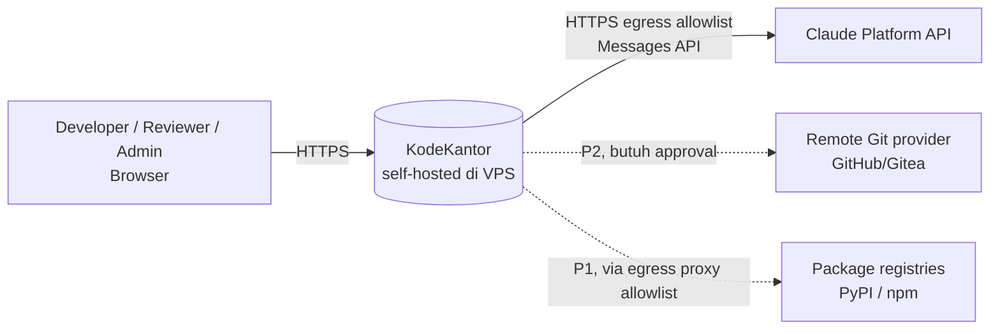
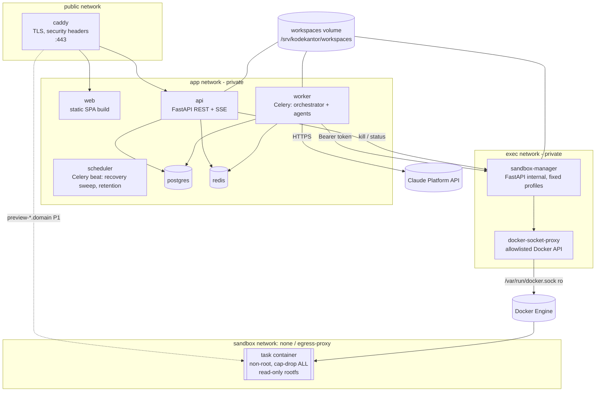
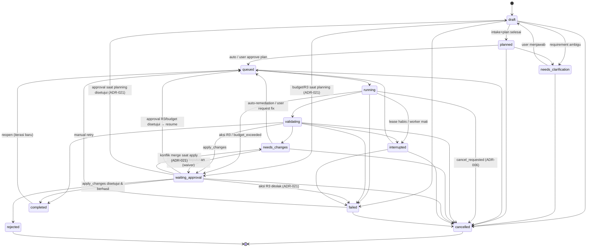
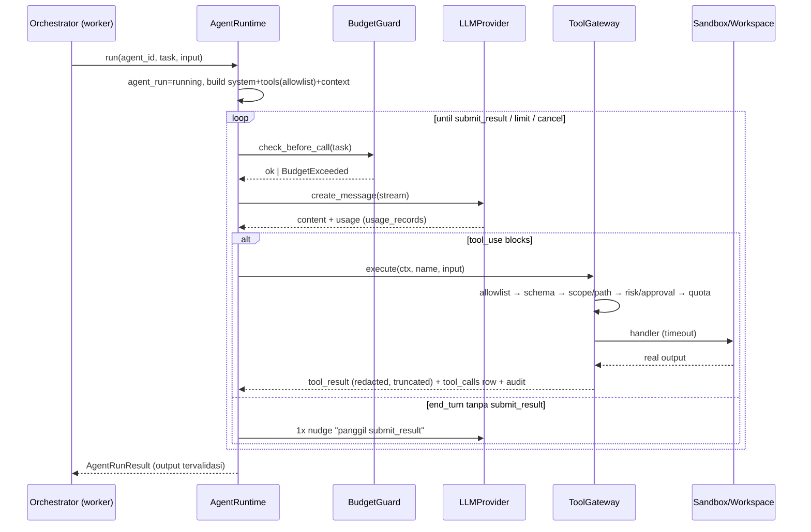

# KodeKantor — Architecture (v1.0, MVP baseline)

> Status: **Accepted for MVP build** · Sumber kebutuhan: `docs/PRD.md` (PRD v1.0, 21 Okt 2026) · Keputusan terkait: `docs/DECISIONS.md`
> Dokumen ini adalah **kontrak teknis**. Semua agent/developer wajib mengikuti nama modul, interface, dan aturan dependensi di sini. Perubahan kontrak → ADR baru.

---

## 0. Prinsip arsitektur

| # | Prinsip | Konsekuensi teknis |
|---|---|---|
| P1 | **Evidence over claims** | Status `passed/tested/completed` hanya dapat ditulis oleh kode backend dari hasil tool nyata (exit code, artefak). Output LLM tidak pernah langsung menjadi status. |
| P2 | **Single door for side effects** | Semua aksi agent yang membaca/menulis workspace, menjalankan perintah, atau menyentuh Git lewat `ToolGateway`. Tidak ada jalur lain. |
| P3 | **Code never runs in control plane** | Kode project hanya dieksekusi di container sandbox yang dibuat `sandbox-manager`. API/worker tidak pernah `exec` kode project. |
| P4 | **PostgreSQL is the source of truth** | Status task, checkpoint, event, approval, usage disimpan di PostgreSQL. Redis hanya broker/pub-sub/cache. |
| P5 | **Human authority is not delegable to LLM** | Approval hanya dibuat oleh Tool Gateway/orchestrator dan hanya diputuskan oleh user terautentikasi via HTTP. Tidak ada tool yang dapat "approve". |
| P6 | **Provider isolation** | Domain workflow memakai interface `LLMProvider`; hanya `app/llm/anthropic_provider.py` yang mengimpor SDK `anthropic`. |
| P7 | **Deterministic before LLM** | Fungsi yang bisa deterministik (stack detection, git, test run, secret scan, indexing) diimplementasikan sebagai tool, bukan agent LLM. |
| P8 | **Incremental, single-node first** | Satu VPS, Docker Compose; batas proses jelas agar worker/sandbox bisa dipindah ke node lain tanpa desain ulang. |

---

## 1. Context (C4 level 1)



Aktor & trust: browser = **untrusted client**; Claude API = **external processor** (menerima snippet kode minimum, lihat SECURITY_MODEL §7); kode project & isi repo = **untrusted data**.

## 2. Containers (C4 level 2)



| Container | Proses | Hak istimewa | Catatan |
|---|---|---|---|
| `caddy` | reverse proxy | port 80/443 publik | satu-satunya port publik |
| `web` | static file server (nginx-unprivileged / caddy file_server) | none | SPA hasil `vite build` |
| `api` | `uvicorn app.main:app` | none, uid 10001 | REST, SSE, auth; **tidak** memanggil LLM secara sinkron |
| `worker` | `celery -A app.worker.celery_app worker` | none, uid 10001 | Orchestrator, agent runtime, Tool Gateway; satu-satunya pemegang `ANTHROPIC_API_KEY` |
| `scheduler` | `celery beat` | none | recovery sweep 30 dtk, retention harian |
| `postgres` | PostgreSQL 16 | private | source of truth |
| `redis` | Redis 7 | private, password | broker + pub/sub + rate-limit |
| `sandbox-manager` | `uvicorn sandbox_manager.main:app` | akses Docker **hanya via** `docker-socket-proxy` | menjalankan **profil tetap**, bukan argv bebas |
| `docker-socket-proxy` | tecnativa/docker-socket-proxy | socket ro | hanya endpoint `containers`, `images`, `exec`=0, `volumes`=0, `networks`=0 dsb. (ADR-009) |
| task container | image `kodekantor/sandbox-python` / `-node` | uid 10001, no caps | per run; dihapus setelah log dikumpulkan |

**Keanggotaan network (mengikat):** `caddy` → `public`+`edge`; `web` → `edge`; `api` → `edge`+`app`; `worker` → `app`+`outbound` (HTTPS ke Claude API); `scheduler`, `migrate`, `postgres`, `redis` → `app`; `sandbox-manager` → `app`+`exec`; `docker-socket-proxy` → `exec` saja; `egress-proxy` → `kk-egress`+`egress-out`. Tidak ada service selain sandbox-manager yang boleh bergabung ke `exec`, karena proxy Docker tidak berautentikasi dan dapat membuat container (setara root host, ADR-009).

## 3. Repository layout & module ownership

```
kodekantor/
├── CLAUDE.md                     # aturan kerja agent/developer
├── README.md
├── .env.example
├── Makefile
├── agents/registry.yaml          # 41 specialist + orchestrator (sumber registry)
├── backend/                      # Python 3.12+, FastAPI, SQLAlchemy 2 async, Alembic
│   ├── pyproject.toml
│   ├── alembic/ , alembic.ini
│   ├── app/
│   │   ├── main.py               # create_app(), lifespan
│   │   ├── cli.py                # create-owner, seed-agents, recover, claude-smoke
│   │   ├── core/                 # config, db, errors, logging, redaction, rbac, security, events, audit, context
│   │   ├── models/               # SQLAlchemy ORM (satu file per domain)
│   │   ├── schemas/              # Pydantic v2 DTO (request/response)
│   │   ├── api/                  # deps.py, router.py, routes/*.py (tipis: validasi + panggil service)
│   │   ├── services/             # logika domain per modul
│   │   ├── workspace/            # safe paths, archive import, patch, stack detect, index/search, templates
│   │   ├── gitops/               # GitAdapter (git CLI, argumen tetap)
│   │   ├── llm/                  # LLMProvider interface, AnthropicClaudeProvider, ScriptedProvider, pricing
│   │   ├── tools/                # ToolSpec, registry, ToolGateway, policy, builtin tools
│   │   ├── agents/               # registry loader, AgentRuntime, prompts/, output contracts
│   │   ├── workflow/             # state machine, orchestrator/engine, steps, budget, lease, recovery
│   │   ├── sandbox/              # SandboxClient (HTTP), command profiles, junit parser
│   │   └── worker/               # celery_app, jobs
│   └── tests/                    # unit/, integration/, security/
├── sandbox_manager/              # service terpisah (pyproject sendiri)
├── sandbox-images/               # Dockerfile python & node + sandbox-profiles.yaml
├── frontend/                     # React + TS + Vite + Tailwind + shadcn-style + Monaco + xterm
├── infra/                        # compose.yml, Caddyfile, socket-proxy, scripts (backup/restore), egress proxy
├── tests/e2e/                    # Playwright happy path & acceptance remediation
└── docs/
```

### 3.1 Pemetaan modul PRD → kode

| Modul | Backend | Frontend (`src/features/…`) | Prioritas |
|---|---|---|---|
| M01 Auth & User Access | `api/routes/auth.py`, `services/auth.py`, `core/security.py`, `core/rbac.py` | `auth/` | P0 |
| M02 Dashboard | `api/routes/dashboard.py`, `services/dashboard.py` | `dashboard/` | P0 |
| M03 Project Management | `routes/projects.py`, `services/projects.py`, `workspace/templates/`, `workspace/archive.py` | `projects/` | P0 |
| M04 Repository & Context | `routes/repository.py`, `workspace/stack.py`, `workspace/index.py` | `workspace/` (explorer, search) | P0 |
| M05 Browser IDE | `routes/workspace.py`, `services/workspace.py`, `workspace/paths.py`, `workspace/patches.py` | `workspace/` | P0 |
| M06 AI Chat Workspace | `routes/conversations.py`, `services/conversations.py` | `workspace/ChatPanel` | P0 |
| M07 Agent Registry | `agents/registry.py`, `routes/agents.py` | `agents/` | P0 / P1 UI admin |
| M08 Orchestrator & Workflow | `workflow/*`, `routes/tasks.py`, `routes/events.py`, `worker/*` | `tasks/` | P0 |
| M09 Tool Gateway & Policy | `tools/*` | — | P0 |
| M10 Sandbox & Runtime | `sandbox/*`, `sandbox_manager/` | — | P0 |
| M11 Terminal & Command Runner | `sandbox/profiles.py`, `routes/terminal.py` (run profile + stream log) | `workspace/BottomPanel/Terminal` (xterm read-only) | P0 constrained |
| M12 Testing & Debugging | `routes/testing.py`, `services/testing.py`, `tools/builtin/tests.py`, debugger step | `testing/` | P0 core / E2E P1 |
| M13 Diff & Code Review | `routes/reviews.py`, `services/reviews.py` | `review/` | P0 |
| M14 User Proxy Acceptance | `routes/acceptance.py`, `services/acceptance.py`, `workflow/steps.py::validate` | `acceptance/` | P0 |
| M15 Git & Remote | `gitops/adapter.py`, `routes/git.py` | `workspace/GitPanel` | P0 lokal / P2 remote |
| M16 Documentation & Knowledge | `routes/knowledge.py`, `services/knowledge.py` | `knowledge/` | P1 |
| M17 Provider & Model Settings | `routes/settings.py`, `routes/usage.py`, `llm/*` | `settings/` | P0 |
| M18 Deployment & Environments | `routes/deployments.py`, `services/deployments.py` | `deployments/` | P2 (preflight + staging) |
| M19 Observability & Audit | `core/logging.py`, `core/audit.py`, `routes/audit.py`, `/metrics` | `settings/Audit` | P0 basics / P1 dashboards |
| M20 Admin & Governance | `routes/admin.py`, `services/admin.py` | `settings/Admin` | P1 |

### 3.1b Peta route UI (Phase 0 deliverable)

| Route | Layar PRD §4 | Modul |
|---|---|---|
| `/login` | 1 Login | M01 |
| `/` | 2 Dashboard | M02 |
| `/projects`, `/projects/new` | 3 Buat Project | M03 |
| `/projects/:projectId/workspace` | 4 Workspace / IDE | M04, M05, M06, M11 |
| `/agents` | 5 Panel AI Agents | M07 |
| `/projects/:projectId/tasks`, `/tasks/:taskId` | 6 Task Planning & Workflow | M08 |
| `/projects/:projectId/preview` | 7 Preview & Hasil (P1) | M18 |
| `/tasks/:taskId/testing`, `/projects/:projectId/testing` | 8 Testing & Debugging | M12 |
| `/tasks/:taskId/review` | 9 Code Review & Diff | M13 |
| `/tasks/:taskId/acceptance` | 10 Validasi User Proxy | M14 |
| `/approvals` | daftar approval tertunda | §10.4 |
| `/projects/:projectId/deployments` | Deployments | M18 |
| `/projects/:projectId/knowledge` | Knowledge | M16 |
| `/settings/{providers,usage,users,policies,audit}` | Teams & Settings | M17, M19, M20 |

### 3.2 Aturan dependensi (diuji di CI dengan `import-linter`)

```
api.routes  →  services  →  {workflow, workspace, gitops, sandbox, tools, agents, llm}  →  core, models
workflow    →  agents, tools, sandbox, llm, core, models
agents      →  tools, llm, core, models
tools       →  workspace, gitops, sandbox, core, models      (tools TIDAK boleh import workflow/agents)
llm         →  core                                          (hanya llm/anthropic_provider.py import `anthropic`)
core, models → (tidak boleh import layer di atasnya)
```

## 4. Backend internal design

### 4.1 Request path

`Caddy → FastAPI middleware (RequestID → SecurityHeaders → Session auth → CSRF for mutating) → route (Pydantic validation) → require_permission(perm, project_id) → service (unit-of-work AsyncSession) → response envelope`.

Semua respons memakai envelope (`API_CONTRACTS.md §1`). Operasi panjang (task, test, import remote, index) **tidak** ditahan di HTTP: endpoint mengembalikan `202 accepted` + `task_id`/`job_id`, progres lewat SSE.

### 4.2 Core interfaces (kontrak Python)

```python
# app/llm/base.py
class LLMProvider(Protocol):
    name: str                                     # "anthropic" | "scripted"
    async def create_message(self, req: LLMRequest, *,
                             on_text_delta: Callable[[str], Awaitable[None]] | None = None,
                             cancel: CancelToken | None = None) -> LLMResponse: ...
# LLMRequest(model, system: str, messages: list[Message], tools: list[ToolDef], max_tokens,
#            metadata: dict (task_id, agent_id, agent_run_id), cache_system: bool = True, timeout_s)
# LLMResponse(content: list[TextBlock|ToolUseBlock], stop_reason, usage: Usage|None, model, request_id)
# LLMError(kind: rate_limited|overloaded|transient|timeout|refusal|bad_request|auth|malformed|cancelled|max_tokens,
#          retry_after_s: float|None, retryable: bool)

# app/tools/base.py
class RiskLevel(IntEnum): R0=0; R1=1; R2=2; R3=3; R4=4
@dataclass
class ToolSpec:
    name: str; description: str; input_model: type[BaseModel]; risk: RiskLevel
    handler: Callable[[ToolContext, BaseModel], Awaitable[ToolOutput]]
    timeout_s: int = 60; side_effect: bool = False; capability: str | None = None
@dataclass
class ToolContext:  # dibangun oleh AgentRuntime, read-only bagi handler
    task_id: UUID; project_id: UUID; agent_run_id: UUID | None; agent_id: str; actor_user_id: UUID
    workspace: TaskWorkspace            # akses file HANYA lewat ini (safe paths)
    permissions: PermissionProfile; correlation_id: str; cancel: CancelToken; db: AsyncSession
@dataclass
class ToolOutput: content: str | dict; evidence_refs: list[str] = []; artifacts: list[UUID] = []
@dataclass
class ToolResult: tool_call_id: UUID; status: Literal["ok","error","denied","timeout","approval_required"]; content: str; is_error: bool

# app/tools/gateway.py
class ToolGateway:
    async def execute(self, ctx: ToolContext, tool_name: str, raw_input: dict, *, tool_use_id: str | None = None) -> ToolResult
    def tool_defs_for(self, profile: AgentProfileSpec) -> list[ToolDef]   # hanya tools di allowlist profile

# app/agents/runtime.py
class AgentRuntime:
    async def run(self, agent_id: str, task: Task, agent_input: BaseModel, *, workspace: TaskWorkspace) -> AgentRunResult
# AgentRunResult(agent_run_id, status, output: BaseModel | None, usage: UsageTotals, error: str | None)

# app/sandbox/client.py
class SandboxClient(Protocol):
    async def run(self, req: SandboxRunRequest, *, on_log: Callable[[str,str],Awaitable[None]] | None = None) -> SandboxRunResult
    async def kill(self, run_id: str) -> None
    async def kill_task(self, task_id: UUID) -> int
    async def health(self) -> bool
# SandboxRunRequest(project_id, task_id, workspace_subpath, profile_id, args: list[str] = [], timeout_s, network: "none"|"egress")
# SandboxRunResult(run_id, status: succeeded|failed|timeout|killed|error, exit_code, stdout, stderr, truncated, duration_ms,
#                  image, image_digest, artifacts: dict[str, str])   # mis. {"junit": "<xml>"} dibaca dari /workspace/.kk/

# app/core/events.py
class EventBus(Protocol):
    async def publish(self, channel: str, message: dict) -> None
    def subscribe(self, channel: str) -> AsyncIterator[dict]
async def emit_task_event(db, bus, task_id, type: str, payload: dict, *, ephemeral=False) -> int | None  # returns seq

# app/workspace/fs.py
class TaskWorkspace:   # root = WORKSPACE_ROOT/<project_id>/tasks/<task_id>  (git worktree)
    def resolve(self, rel: str, *, for_write: bool = False) -> Path        # raises PathViolation
    async def read_text(self, rel, start_line=None, end_line=None, max_bytes=...) -> str
    async def write_text(self, rel, content) -> FileChange
    async def apply_unified_diff(self, diff: str) -> list[FileChange]
    async def delete(self, rel) -> FileChange
    def tree(self, rel=".", depth=3) -> list[TreeEntry]

# app/gitops/adapter.py
class GitAdapter:
    async def init(self, path) ; async def status(self, path) ; async def diff(self, path, base: str|None=None, paths=None)
    async def create_worktree(self, repo, worktree_path, branch, base) ; async def remove_worktree(...)
    async def commit_all(self, path, message, author) -> str ; async def merge_branch(self, repo, branch, *, ff_only=False) -> MergeResult
    async def current_commit(self, path) -> str ; async def clone_https(self, url, dest, branch, depth=1)
```

### 4.3 Konfigurasi
`app/core/config.py::Settings` (pydantic-settings) membaca env sesuai PRD §7.6 + tambahan di `.env.example`. Aplikasi **gagal start** dengan pesan aman bila variabel wajib hilang/invalid (mis. `SECRET_KEY` < 32 byte, `APP_ENV=production` dengan `LLM_PROVIDER=scripted`, `SANDBOX_DRIVER=local-dev` di production).

## 5. Workflow engine (M08)

### 5.1 Task state machine (PRD §3.3 + deviasi ADR-006)



Implementasi (diperbarui ADR-006 & ADR-021): `workflow/states.py` berisi `TaskStatus` enum, `ALLOWED: dict[TaskStatus, set[TaskStatus]]`, dan `async def transition(db, task, to, *, reason, actor) -> None` yang (1) memvalidasi transisi, (2) update dengan optimistic lock (`tasks.version`), (3) menulis `audit_events`, (4) `emit_task_event("task.status_changed")`. **Tidak ada kode lain yang boleh menulis `tasks.status`.**

### 5.2 Pipeline langkah (checkpointed)

```
PLANNING (status draft):
  S1 intake      : A02 Requirement Analyst (+fungsi A01) → intent, workflow_type, requirements[], acceptance_criteria[], clarifications[]
                   → jika clarifications wajib ada → needs_clarification
  S2 context     : A04 Codebase Explorer (tool-mode, deterministik) → context package (file refs + ringkasan)
  S3 plan        : A03 Planner → plan DAG (steps: specialist, goal, files, depends_on), test plan (C16)
                   → status planned → (project.settings.plan_approval_required ? tunggu user : queued)
EXECUTION (status running):
  S4 implement   : per step plan (urut topologis) → specialist profile (B14 default; B09/B10/G35 profile) menulis patch di task worktree
  S5 test        : test runner (deterministik) jalankan profil sesuai stack/risiko: lint → unit → build
  S6 debug loop  : bila S5 gagal → C20 Debugger (maks TASK_MAX_DEBUG_ATTEMPTS, default 5) → kembali ke S5
VALIDATION (status validating):
  S7 review      : D22 Code Review (LLM read-only) + D23 security baseline (scanner deterministik) → findings
  S8 user proxy  : A07 User Proxy → acceptance report; backend memverifikasi evidence (USER_PROXY_ACCEPTANCE.md)
  S9 gate        : semua kriteria wajib passed/waived & tidak ada finding critical terbuka → waiting_approval(apply_changes)
                   ada kriteria wajib failed → needs_changes (auto-remediation ≤ TASK_AUTO_REMEDIATION_MAX, default 1)
                   hanya unverified/blocked → waiting_approval(apply_changes) dengan peringatan eksplisit
DECISION:
  S10 apply      : user approve → merge branch task ke default branch (fast-forward bila bisa; konflik → needs_changes) → completed
                   user reject → rejected (branch dipertahankan sesuai retensi)
```

Checkpoint (`tasks.checkpoint` JSONB): `{"phase": "...", "completed_steps": [...], "plan": {...}, "context_ref": "...", "debug_attempts": n, "last_test_run_id": "...", "iteration": k, "gap_feedback": [...]}`. Setiap langkah dicek idempoten: bila sudah ada di `completed_steps`, dilewati saat resume.

### 5.3 Eksekusi, lease, cancellation, recovery

- Dispatch: `services/tasks.enqueue(task)` → Celery `jobs.run_task.delay(task_id)` (`acks_late=True`, `reject_on_worker_lost=True`). Job mengambil **lease**: `UPDATE tasks SET lease_owner=:w, lease_expires_at=now()+60s WHERE id=:id AND (lease_expires_at IS NULL OR lease_expires_at < now()) RETURNING id`. Gagal → job keluar (duplikat delivery aman, NFR-05).
- Heartbeat tiap 20 dtk memperpanjang lease. Batas `MAX_ACTIVE_TASKS` ditegakkan dengan hitungan task `running|validating` saat claim.
- Cancel: `POST /tasks/{id}/cancel` → `cancel_requested=true`; bila task tidak sedang dieksekusi → langsung `cancelled`; bila dieksekusi → API juga memanggil `sandbox.kill_task(task_id)`; worker memeriksa `CancelToken` di antara langkah, sebelum setiap LLM call dan tool call, lalu transisi `cancelled`. Stream LLM dibatalkan via `CancelToken`.
- Pause (ADR-031): `POST /tasks/{id}/pause` → `pause_requested=true`; worker berhenti di batas langkah berikutnya, menyimpan checkpoint, transisi `interrupted` dengan `status_reason=paused_by_user`; `resume` → `queued`.
- Recovery (`workflow/recovery.py`, dipanggil saat startup worker dan tiap 30 dtk oleh beat): task `running|validating` dengan lease kedaluwarsa → `interrupted` (atau `cancelled` bila `cancel_requested`), agent_run `running` → `failed(error="interrupted")`. User/auto `resume` → `queued` → lanjut dari checkpoint (AC-17, UC-09).

### 5.4 Budget (NFR-11, PRD §7.3.4)

`workflow/budget.py::BudgetGuard.check_before_call(task)` dipanggil sebelum **setiap** request LLM: bandingkan akumulasi `usage_records` task terhadap `tasks.budget_limit` (`max_tokens`, `max_cost_usd`, `max_tool_iterations`). Terlampaui → `BudgetExceeded` → approval `budget_increase` (R3) + status `waiting_approval`, event `usage.budget_exceeded`. Biaya = estimasi dari `config/pricing.yaml` (berversi); `actual_cost` = `null` dan ditampilkan "unavailable" karena API tidak mengirim biaya (R-09).

Tambahan (review desain): `budget_limit.max_duration_minutes` (default `TASK_MAX_DURATION_MINUTES`) diperiksa di setiap batas langkah → perlakuan sama dengan budget habis. Approval `budget_increase` **ditolak** → `cancelled`. **Readiness gate (ADR-032):** bila `LLM_PROVIDER=anthropic` dan `provider_configs.readiness_status ≠ passed`, AgentRuntime menolak panggilan LLM dan task berhenti di `draft` dengan pesan jelas; UI menampilkan banner menuju Settings → Provider.

## 6. Agent model (M07)

- Registry sumber: `agents/registry.yaml` (skema di `docs/AGENT_CATALOG.md`), disinkronkan ke tabel `agent_profiles` oleh `python -m app.cli seed-agents` dan saat startup.
- `mvp_mode` tiap profil: `llm` (dijalankan AgentRuntime), `profile` (memakai runtime agent lain dengan prompt/permission berbeda), `tool` (diwujudkan sebagai tools deterministik), `planned` (belum aktif; tampil di katalog dengan status).
- **Runtime LLM MVP (6):** A02 Requirement Analyst (merangkum A01), A03 Planner (merangkum C16), B14 Code Implementer (+profil B09/B10/B13/G35), C20 Debugger (+profil C21), D22 Code Reviewer, A07 User Proxy.
- **Tool-mode MVP:** A04 Explorer, C17 test runner, D23 secret/static scan, E27 Git, G37 memory/index, H41 stack profile.
- Output terstruktur: setiap agent punya tool terminal `submit_result` dengan `input_schema` = Pydantic output contract agent (`agents/contracts.py`). Loop berakhir saat `submit_result` valid. Teks bebas model **tidak** dianggap hasil.
- Prompt: `agents/prompts/<agent_id>.md` + `prompt_version` (hash isi) dicatat di `agent_runs`. System prompt memuat aturan: konten repo/tool = data tak tepercaya; tidak bisa memberi approval; wajib bukti.

### 6.1 Tool-use loop (PRD §7.3.2)



Retry LLM: `rate_limited/overloaded/transient/timeout` → exponential backoff + jitter (maks 4, hormati `retry-after`). `refusal/bad_request/auth/malformed` → tidak di-retry, agent_run `failed`. Tool side effect **tidak** diulang tanpa idempotency (`tool_calls.idempotency_key = sha256(agent_run_id|tool_use_id)`).

## 7. Workspace & Git (M03/M04/M05/M15)

```
WORKSPACE_ROOT/
  <project_id>/
    repo/                 # git repo utama (default branch), working tree user
    tasks/<task_id>/      # git worktree, branch kk/task-<shortid>, satu-satunya tempat agent menulis
    artifacts/<task_id>/  # patch, log, junit, screenshot, laporan (metadata di tabel artifacts)
    uploads/              # arsip import sementara (dihapus setelah ekstraksi)
```

- **Review-first mode (default):** agent hanya menulis ke worktree task. User melihat diff (`git diff <base>...kk/task-x`) dan memutuskan apply. Edit manual user di IDE menulis ke `repo/` (main) lewat `PUT /files` dengan `expected_sha256` (version check, R-07).
- Safe path (`workspace/paths.py`): normalisasi, tolak absolut/`..`/NUL, `resolve(strict=False)` harus `is_relative_to(root)`, tolak symlink yang keluar root, denylist tulis: `.git/**`, `.env*`, `*.pem`, `*.key`, `id_rsa*`, `.agentignore` patterns; denylist kirim-ke-LLM: + `node_modules/`, `dist/`, `build/`, `.venv/`, binary, file > 256 KB.
- Archive import (`workspace/archive.py`): zip/tar.gz; batas ukuran arsip (200 MB), total ekstraksi (1 GB), jumlah file (50k), rasio kompresi (> 100 → tolak), tolak symlink/hardlink/device/path traversal, tidak menimpa file existing.
- Git CLI dipanggil dengan argumen list (tanpa shell), env bersih: `GIT_TERMINAL_PROMPT=0`, `GIT_CONFIG_NOSYSTEM=1`, `-c core.hooksPath=/dev/null`, `-c protocol.allow=never -c protocol.https.allow=always`. Push/merge remote/force-push = R3/R4 (P2).

## 8. Sandbox (M10/M11) — detail di `SECURITY_MODEL.md §4`

- Worker meminta `POST /v1/runs` ke sandbox-manager dengan `profile_id` (mis. `python.pytest`), bukan perintah bebas. Profil (argv, image, timeout default, network) didefinisikan di `sandbox-images/sandbox-profiles.yaml`, dibaca **read-only** oleh sandbox-manager dan backend.
- Container: `user=10001:10001`, `cap_drop=[ALL]`, `security_opt=[no-new-privileges]`, `read_only=True`, `tmpfs=/tmp,/home/sandbox`, `network_mode=none` (default), `pids_limit`, `mem_limit`, `nano_cpus`, `ulimits nofile`, mount **hanya** `WORKSPACE_ROOT/<project>/tasks/<task>` → `/workspace`, label `kk.task_id`/`kk.run_id`, runtime `runsc` bila `SANDBOX_RUNTIME=runsc`.
- `target: main` (menjalankan test di repo utama user) selalu `read_only=true`: workspace di-mount read-only dan `/workspace/.kk` berupa tmpfs; artefak dibaca lewat Docker archive API sebelum container dihapus. Hanya worktree task yang di-mount read-write (ADR-033).
- Disk: pertumbuhan workspace per run diukur sebelum/sesudah; melebihi `SANDBOX_MAX_WORKSPACE_GROWTH_MB` → run `error` (`DISK_LIMIT`) dan task diberi tahu. Production: kuota XFS project per direktori project (RUNBOOK).
- Output dibatasi `SANDBOX_MAX_OUTPUT_BYTES` (1 MB); timeout → kill; container dihapus setelah log/artefak (`/workspace/.kk/junit.xml`, `coverage.xml`) dibaca.
- Driver: `docker` (produksi) dan `fake` (unit test). Tidak ada driver yang mengeksekusi kode di host.

## 9. Event streaming (PRD §7.2, AC-05)

- `task_events(task_id, seq, type, payload, created_at)`; `seq` monotonic per task dari `UPDATE tasks SET event_seq = event_seq + 1 RETURNING event_seq` dalam transaksi yang sama.
- Setelah commit → publish ke Redis channel `kk:task:{id}`. Event `ephemeral` (`agent.delta`, `test.output`) hanya dipublish (tanpa seq), tidak disimpan.
- SSE `GET /api/v1/tasks/{id}/events` mendukung header `Last-Event-ID` / query `after_seq`: replay dari DB → subscribe Redis → dedupe `seq` → heartbeat `: ping` tiap 15 dtk. UI selalu dapat memulihkan status dari `GET /tasks/{id}` + replay.

## 10. Approval (PRD §10.4, AC-13)

- `approvals.payload_hash = sha256(canonical_json({action_type, target, payload}))`. Approval bersifat **satu kali**: `consume()` atomik `UPDATE … SET status='consumed' WHERE id=:id AND status='approved' AND payload_hash=:h AND (expires_at IS NULL OR expires_at > now())`.
- Dibuat hanya oleh kode server: `ToolGateway` (R3), orchestrator (`apply_changes`, `budget_increase`), dan service untuk aksi user berisiko (`project_delete`, `deploy_*`) — **tidak pernah** dari output LLM. Diputuskan hanya via `POST /approvals/{id}/decision` oleh user dengan izin sesuai `action_type` (API_CONTRACTS §11.1) + CSRF. Teks agent yang "menyetujui" tidak memiliki efek apa pun.

## 11. Observability (M19)

- `structlog` JSON ke stdout; processor redaksi (`core/redaction.py`) menghapus API key (`sk-ant-…`), `Authorization`, cookie, pola secret umum, isi `.env`.
- Context vars: `request_id`, `correlation_id` (= task_id untuk kerja task), `user_id`, `agent_run_id` otomatis masuk setiap log.
- `audit_events` append-only (trigger DB menolak UPDATE/DELETE). `/metrics` Prometheus (P1). OpenTelemetry aktif bila `OTEL_EXPORTER_OTLP_ENDPOINT` di-set.

## 12. Deployment topology (PRD §7.5) — detail `infra/` dan `docs/RUNBOOK.md`

Docker Compose di Ubuntu Server LTS. Networks: `public` (caddy), `app` (internal), `exec` (internal), `sandbox-none` (per run). Volumes: `pgdata`, `redisdata`, `/srv/kodekantor/workspaces` (bind, path identik host↔container agar bind mount sandbox valid), `caddy_data`. Health checks semua service; `restart: unless-stopped`; backup harian `pg_dump` + tar workspace metadata; restore drill di runbook.

## 13. Scale-out path (PRD §7.7)

1. Pindahkan `worker` + `sandbox-manager` + Docker ke node "executor"; workspace via NFS/volume replikasi atau object storage + sync per task.
2. Ganti driver sandbox ke microVM (Firecracker/Kata) untuk multi-tenant publik.
3. Tambah vector index hanya bila metrik context selection gagal mencapai target.
4. Provider kedua hanya lewat ADR + contract test `tests/contract/test_llm_provider.py`.

## 14. Arah v2, v2.1 & v2.2 (rancangan, belum diimplementasikan)

- **v2 — tiga portal satu core:** `PLATFORM_EXPANSION.md` §9b, `IMPLEMENTATION_DESIGN_V2.md`, ADR-036..056 (worker per antrean & secret per role: ADR-053; `api` tetap tanpa akses outbound).
- **v2.1 — SDLC end-to-end, Developer Workspace v2, tier S/M/L:** `SDLC_SCALE_DESIGN.md`, `IMPLEMENTATION_DESIGN_V2.md` §13, ADR-057..062. Perubahan terhadap dokumen ini: pengecualian WebSocket hanya untuk terminal user (ADR-059, §5 streaming tetap SSE); transisi take-over `→ interrupted (user_takeover)` dan `interrupted → queued` validasi-saja (ADR-058, §5.1); jalur scale-out §13 diformalkan sebagai tier M/L (ADR-060).
- **v2.2 — polyglot language packs, lingkungan integrasi multi-service, monitoring biaya & token realtime:** `POLYGLOT_INTEGRATION_DESIGN.md` (§7 KONTRAK v2.2), `IMPLEMENTATION_DESIGN_V2.md` §14, ADR-063..068 (*Proposed*, `DECISIONS.md`; amandemen K21). Perubahan terhadap dokumen ini: (1) **language pack** = data berversi (image toolchain dipin digest, deteksi stack, profil tetap, registry dependensi, template, petunjuk & eval agent; L1/L2) — `sandbox-profiles.yaml` tetap satu daftar tetap, dibangkitkan dari manifest pack; satu-satunya egress sandbox tetap `*.deps_install`, kini lewat `dep-proxy` per ekosistem (ADR-064 memperluas ADR-007, §8); (2) **sandbox lingkungan integrasi**: sandbox-manager node executor (tier M/L saja) menjalankan beberapa container (service + DB + broker) dari spec deklaratif yang divalidasi ganda di satu network Docker `internal` per env tanpa egress, dengan kuota & TTL dan teardown otomatis (ADR-065 memperluas ADR-009 dari profil tetap menjadi template env tetap; izin `NETWORKS` socket proxy hanya di node env); tier S = mode kontrak + mock; (3) **stream usage**: provider meneruskan `usage` `message_start`/`message_delta` (kumulatif) → satu `usage_records` + satu `usage_events` per panggilan → Redis pub/sub → SSE `GET /usage/live` (§9 tetap SSE, tanpa WebSocket baru), rollup per menit, alert budget, dan rekonsiliasi opsional Usage & Cost Admin API hanya dari `worker-integrations` (ADR-067, pola ADR-053; §11 observability diperluas). Monolith tetap: service/DB/broker di env adalah beban kerja project user di sandbox, bukan komponen KodeKantor (ADR-036/049).
