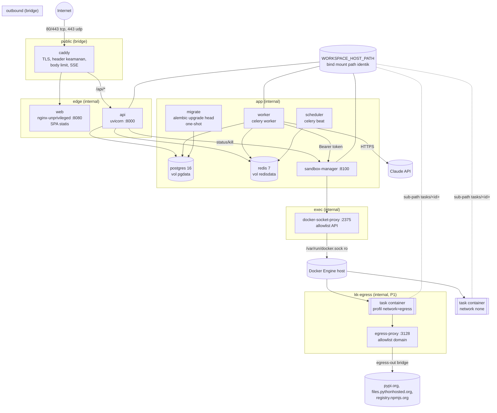

# KodeKantor — Deployment topology (single-node VPS)

> Sumber: `infra/compose.yml` (production), `infra/compose.dev.yml` (dev lokal), `infra/caddy/Caddyfile`, `infra/egress-proxy/`. Prosedur operasional: `docs/RUNBOOK.md`. Kontrak: ARCHITECTURE §2/§12/§13, PRD §7.5–§7.7, ADR-005/007/008/009/010/019.

## 1. Topologi

Prinsip:

- **Satu-satunya port publik** adalah Caddy (80/443). Semua network lain `internal: true` kecuali `public`, `outbound` (worker → Claude API) dan `egress-out` (egress-proxy → registry).
- **docker.sock** hanya di-mount (read-only) ke `docker-socket-proxy`, yang hanya terhubung ke network `exec`. Hanya `sandbox-manager` yang dapat menjangkaunya (ADR-009). api/worker tidak pernah melihat Docker API.
- **Container task** dibuat oleh sandbox-manager dengan `network_mode=none` (default) atau network `kk-egress` (profil `*.deps_install`, P1, `SANDBOX_EGRESS=allowlist`) yang hanya berisi `egress-proxy`.

## 2. Service

| Service | Image | User | Network | Hak / hardening | Limit (CPU / RAM / PID) | Healthcheck |
|---|---|---|---|---|---|---|
| `caddy` | `caddy:2.11.7-alpine` | root tanpa cap (hanya `NET_BIND_SERVICE`) | public, edge | read-only, tmpfs `/tmp` | 0.5 / 256M / 256 | admin API `:2019/config/` |
| `web` | `kodekantor/web` (build `frontend/`) | 101 | edge | cap_drop ALL, read-only | 0.25 / 128M / 128 | `GET :8080/healthz` |
| `api` | `kodekantor/backend` (build root, `backend/Dockerfile`) | 10001 | edge, app | cap_drop ALL, read-only, tmpfs `/tmp` 512M (upload spool), init | 1.0 / 1.5G / 512 | `GET :8000/api/v1/health/ready` |
| `migrate` | `kodekantor/backend` | 10001 | app | idem, `restart: "no"` | 0.5 / 512M / 256 | — (one-shot; api/worker/scheduler menunggu `service_completed_successfully`) |
| `worker` | `kodekantor/backend` | 10001 | app, outbound | idem | 2.0 / 2G / 1024 | `celery inspect ping` |
| `scheduler` | `kodekantor/backend` | 10001 | app | idem, schedule di tmpfs | 0.25 / 256M / 128 | mtime file schedule beat |
| `postgres` | `postgres:16.15-alpine` | 70 | app | cap_drop ALL, read-only + tmpfs socket, scram-sha-256 | 1.0 / 2G / 512 | `pg_isready` |
| `redis` | `redis:7.4.11-alpine` | 999 | app | cap_drop ALL, read-only, `requirepass` (file 0600 di tmpfs), AOF, `noeviction` | 0.5 / 512M / 128 | `redis-cli ping` (`REDISCLI_AUTH`) |
| `sandbox-manager` | `kodekantor/sandbox-manager` (build `sandbox_manager/`) | 10001 (image) | app, exec | cap_drop ALL, read-only, **tanpa docker.sock** | 0.5 / 512M / 256 | `GET :8100/healthz` |
| `docker-socket-proxy` | `tecnativa/docker-socket-proxy:v0.5.0` | root tanpa cap | exec | read-only, socket `:ro`, allowlist env | 0.25 / 128M / 128 | `GET :2375/_ping` |
| `egress-proxy` (profil `egress`) | `kodekantor/egress-proxy` (tinyproxy, alpine 3.24) | 100 | kk-egress, egress-out | cap_drop ALL, read-only, default-deny | 0.25 / 128M / 128 | `nc -z :3128` |

Semua service: `restart: unless-stopped` (kecuali `migrate`), `security_opt: no-new-privileges:true`, log `json-file` 10 MB × 5 terkompresi. Total limit control plane ±7,5 GB; container task: `SANDBOX_MAX_CONCURRENT_RUNS` (4) × `SANDBOX_MEMORY_LIMIT` (1 GB) — muat di VPS 16 GB (ADR-010).

Allowlist `docker-socket-proxy`: `CONTAINERS, IMAGES, POST, INFO, PING, VERSION = 1`; `EVENTS, EXEC, VOLUMES, NETWORKS, BUILD, SWARM, SERVICES, TASKS, SECRETS, CONFIGS, PLUGINS, SYSTEM, AUTH, COMMIT, DISTRIBUTION, NODES, SESSION, GRPC, ALLOW_START/STOP/RESTARTS = 0`. Diverifikasi: `/volumes`, `/networks`, `/events`, `/system/df`, `POST /build`, `POST /exec/{id}/start` → 403. Catatan: `POST /containers/{id}/exec` (membuat exec) lolos lewat aturan `/containers`, tetapi tidak dapat dijalankan karena `/exec/*/start` diblokir.

## 3. Networks

| Network | Jenis | Anggota | Tujuan |
|---|---|---|---|
| `public` | bridge | caddy | ingress internet + ACME |
| `edge` | internal | caddy, web, api | Caddy → upstream; Caddy tidak bisa menjangkau DB/Redis |
| `app` | internal | api, worker, scheduler, migrate, postgres, redis, sandbox-manager | control plane |
| `exec` | internal | sandbox-manager, docker-socket-proxy | satu-satunya jalan ke Docker API |
| `outbound` | bridge | worker | HTTPS ke Claude API (dan clone `git_https` P1) |
| `kk-egress` (nama tetap) | internal | egress-proxy + container task berprofil `egress` | install dependency via allowlist (ADR-007) |
| `egress-out` | bridge | egress-proxy | keluar ke registry yang di-allowlist |
| `devhost` (dev saja) | bridge | api, postgres, redis, web-dev | publish port ke `127.0.0.1` (port tidak bisa dipublish dari network internal) |

## 4. Volumes & bind mounts

| Nama | Mount | Isi | Backup |
|---|---|---|---|
| `pgdata` | postgres `/var/lib/postgresql/data` | database (source of truth) | `pg_dump` harian (`scripts/backup.sh`) |
| `redisdata` | redis `/data` | AOF broker/pub-sub | tidak (dapat dibuang, RUNBOOK §10.3) |
| `caddy_data` | caddy `/data` | sertifikat & kunci ACME | opsional (diterbitkan ulang otomatis) |
| `caddy_config` | caddy `/config` | autosave config | tidak |
| `${WORKSPACE_HOST_PATH}` (bind) | api, worker, sandbox-manager — **path identik** | repo, worktree task, artefak | `tar` harian + manifest |
| `infra/caddy/Caddyfile` (bind ro) | caddy `/etc/caddy/Caddyfile` | konfigurasi ingress | git |
| `sandbox-images/sandbox-profiles.yaml` (bind ro) | sandbox-manager `/etc/kodekantor/sandbox-profiles.yaml` | profil perintah tetap | git |

**Mengapa path workspace identik host↔container:** sandbox-manager meminta Docker daemon (lewat socket proxy) mem-bind `<WORKSPACE_ROOT>/<project>/tasks/<task>` ke `/workspace` di container task. Path sumber bind mount selalu ditafsirkan **di host** oleh daemon, bukan di namespace sandbox-manager. Karena itu compose me-mount `${WORKSPACE_HOST_PATH}` ke path yang sama dan menurunkan `WORKSPACE_ROOT` dari `WORKSPACE_HOST_PATH`, sehingga keduanya tidak mungkin berbeda. Direktori wajib sudah ada (`create_host_path: false`) dengan owner `10001:10001`, mode `0750` (`make setup`).

## 5. Port

| Port | Service | Eksposur |
|---|---|---|
| 80/tcp | caddy | publik — redirect ke HTTPS + ACME HTTP-01 |
| 443/tcp, 443/udp | caddy | publik — HTTPS / HTTP/3 |
| 8080 | web | internal (edge) |
| 8000 | api | internal (edge); dev: `127.0.0.1:8000` |
| 8100 | sandbox-manager | internal (app) |
| 2375 | docker-socket-proxy | internal (exec) |
| 5432 / 6379 | postgres / redis | internal (app); dev: `127.0.0.1` |
| 3128 | egress-proxy | internal (kk-egress) |
| 2019 | caddy admin | loopback container saja |

## 6. Routing ingress (Caddy)

| Path | Upstream | Body limit | Catatan |
|---|---|---|---|
| `POST /api/v1/projects/{id}/imports` | api:8000 | 210 MB | arsip ≤ 200 MB (ADR-005) |
| `/api/*` | api:8000 | 10 MB | `flush_interval -1` (SSE), `read_timeout 1h`, header `Server` dibuang |
| lainnya | web:8080 | 10 MB | SPA fallback oleh nginx; aset `/assets/*` cache 1 tahun `immutable`, `index.html` `no-cache` |
| error Caddy (502/413/…) | — | — | `handle_errors` tetap mengirim header keamanan, body minimal |

Header: HSTS (`CADDY_HSTS_MAX_AGE`, 0 di dev), CSP `default-src 'self'; script-src 'self'; style-src 'self' 'unsafe-inline'; img-src 'self' data: blob:; font-src 'self' data:; worker-src 'self' blob:; connect-src 'self'; frame-ancestors 'none'; base-uri 'self'; form-action 'self'; object-src 'none'`, `X-Content-Type-Options`, `X-Frame-Options DENY`, `Referrer-Policy same-origin`, `Permissions-Policy`, COOP/CORP. Preview `preview-*.{APP_DOMAIN}` (P1, ADR-008) tersedia sebagai stub ter-comment di Caddyfile (butuh DNS wildcard + DNS-01).

## 7. Konfigurasi & secret

- `.env` (dibuat `scripts/gen-secrets.sh`, mode 600, tidak di-commit) adalah satu-satunya sumber. Compose membacanya via `--env-file` dan memberikan ke tiap service **hanya** variabel yang dibutuhkan (anchor `x-backend-env`, daftar eksplisit untuk sandbox-manager/postgres/redis/caddy).
- `DATABASE_URL`, `REDIS_URL`, `WORKSPACE_ROOT`, `SANDBOX_MANAGER_URL`, `DOCKER_HOST`, `SANDBOX_PROFILES_PATH`, `AGENT_REGISTRY_PATH` diturunkan compose (tidak bisa salah ketik).
- `ANTHROPIC_API_KEY` nyata hanya untuk `worker` (+`api`, ADR-004). `migrate`/`scheduler` menerima placeholder non-rahasia karena validator Settings mewajibkan nilai tidak kosong di production.
- Build: image backend/web/sandbox-manager/egress-proxy dibangun lokal (`pull_policy: never`: dibangun bila belum ada, `make up` selalu `--build`; tidak pernah di-pull dari registry publik). CA proxy korporat opsional via BuildKit secret `build_ca` (`KK_BUILD_CA_FILE`), tidak tersimpan di layer.

## 8. Scale-out (PRD §7.7, ARCHITECTURE §13)

Pemicu (ADR-010): p95 antrean task > 5 menit, atau RAM control plane > 70% selama 1 minggu, atau beban CPU/IO sandbox mengganggu api. Jangan memperkenalkan Kubernetes/microservice tambahan tanpa bottleneck terukur.

**Langkah 1 — node executor terpisah** (worker + sandbox):

1. Siapkan node B (spesifikasi sama atau lebih besar, Docker + gVisor). Hubungkan node A↔B dengan jaringan privat (VPC provider atau WireGuard); jangan lewat internet publik.
2. Workspace bersama pada **path yang sama** di kedua node (`/srv/kodekantor/workspaces`): NFSv4 dari node A (atau volume replikasi). Path identik tetap wajib karena daemon node B yang mem-bind sub-path ke container task.
3. Node A: `caddy`, `web`, `api`, `scheduler`, `migrate`, `postgres`, `redis`. Ekspos postgres (5432) dan redis (6379) **hanya** di interface privat (bind ke IP privat + firewall sumber node B), aktifkan TLS PostgreSQL (`sslmode=require`) dan Redis TLS/ACL bila jalur tidak terenkripsi.
4. Node B: `worker`, `sandbox-manager`, `docker-socket-proxy` (+`egress-proxy`). `DATABASE_URL`/`REDIS_URL` menunjuk IP privat node A. api memanggil sandbox-manager node B (`SANDBOX_MANAGER_URL=http://<ip-privat-B>:8100`, port hanya terbuka untuk node A) — atau biarkan cancel/kill hanya lewat worker.
5. Pisahkan file compose per peran (mis. `infra/compose.control.yml`, `infra/compose.executor.yml`) yang mewarisi anchor yang sama; jalankan `make backup` sebelum migrasi peran.

**Langkah 2 — isolasi lebih kuat:** ganti driver sandbox ke microVM (Firecracker/Kata) sebelum membuka platform untuk multi-tenant publik (SECURITY_MODEL, ADR-009).

**Langkah 3 — lainnya bila terukur:** worker tambahan (lease + `MAX_ACTIVE_TASKS` mencegah duplikasi), PostgreSQL managed dengan PITR, observability (Prometheus/Grafana via `OTEL_EXPORTER_OTLP_ENDPOINT`), vector index hanya bila metrik context selection gagal.
