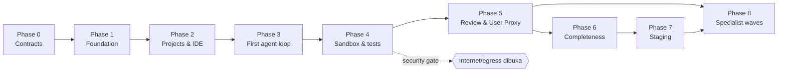

# KodeKantor — Implementation Roadmap

> Sumber: PRD v1.0 §13 (Phase 0–8), §13.1 (MVP definition of done), §14.1 (execution discipline), §15 (risiko), Lampiran B; `CLAUDE.md` (kepemilikan file, DoD per batch); `docs/ARCHITECTURE.md §3` (layout & modul); `docs/FR_CATALOG.md`; `docs/TEST_STRATEGY.md §7`; `docs/DECISIONS.md`.
> Status per work package dan per FR dilacak di `docs/IMPLEMENTATION_TRACKER.md`; dokumen ini menetapkan **urutan, kepemilikan, exit criteria, dan gate manusia**. Bagian bertanda *(turunan)* adalah perincian yang tidak tertulis eksplisit di PRD.

## 1. Prinsip delivery (PRD §14.1)

1. Baca `CLAUDE.md`, PRD, status repo, dan tracker sebelum mengubah kode.
2. **Vertical slice:** UI → API → database → workflow/tools → test → dokumentasi. Satu slice selesai = dapat didemokan end-to-end dengan test.
3. Setiap batch melaporkan: file yang berubah, perintah test + **output aktual**, known gaps, next step; tracker diperbarui.
4. Tidak ada klaim "lulus" tanpa menjalankan test dan mengutip hasil; phase tidak ditandai selesai bila exit criteria belum terbukti.
5. Jaga scope; jangan membuang perubahan pengguna; commit/branch mengikuti strategi Git project (di build multi-agent: hanya Lead yang commit).
6. Jangan membuat specialist sebagai LLM bila fungsi deterministik cukup (ADR-012).
7. Jalankan security checklist (SECURITY_MODEL §11) setiap kali sandbox, path, shell, credential, Git remote, atau deployment berubah.

## 2. Model delivery agentik

Produk dibangun oleh beberapa agent Claude Code paralel dengan kepemilikan path yang tegas, dikoordinasi Lead Architect, dengan gate persetujuan manusia (Product Owner) di setiap exit phase.

### 2.1 Peran & kepemilikan — roster aktual

> Tabel ini disinkronkan dengan sheet *Agent Roster* dan *WBS* di `2026-10-21-kodekantor-wbs-agentic.xlsx` (sumber kebenaran pembagian kerja). Versi awal tabel ini (sebelum Wave 2) memetakan sebagian service ke agent yang berbeda; pembagian di bawah adalah yang benar-benar dipakai.

| ID | Peran agent | Wave | Path milik (ringkas) | Modul |
|---|---|---|---|---|
| AG-00 | **Lead Architect** (orkestrator) | 0–6 | `docs/ARCHITECTURE, DATA_MODEL, API_CONTRACTS, DECISIONS, TOOL_CATALOG, CONFIGURATION, IMPLEMENTATION_TRACKER`, `CLAUDE.md`, file kontrak (`app/agents/contracts.py`, `app/llm/base.py`, `app/tools/base.py`, `app/sandbox/client.py`); satu-satunya yang commit | semua (kontrak, integrasi) |
| AG-01 | Backend Core | 1 | `backend/pyproject`, `alembic/`, `app/{main,cli}.py`, `app/core/`, `app/models/`, `app/api/{deps,router}.py`, routes `auth`,`health`, `services/{auth,users}`, `workflow/states.py`, `worker/celery_app.py`, `tests/conftest.py` | M01, M19 dasar, fondasi |
| AG-02 | Workspace & Git | 1 | `app/workspace/{paths,fs,patches,archive,stack,templates_registry,templates/}`, `app/gitops/` | M03 (import), M04, M05, M15 |
| AG-03 | Sandbox & Runtime | 1 (+hardening) | `sandbox_manager/`, `sandbox-images/`, `app/sandbox/{http_client,profiles,junit,factory}.py` | M10, M11 |
| AG-04 | Frontend Foundation | 1 | `frontend/` scaffold, design tokens, `components/`, `lib/`, `api/` dasar, i18n, auth, dashboard, projects, agents, approvals | M01–M03, M07 UI |
| AG-05 | Docs & Catalog | 1 | `docs/{PRD,FR_CATALOG,AGENT_CATALOG,SECURITY_MODEL,USER_PROXY_ACCEPTANCE,TEST_STRATEGY,IMPLEMENTATION_ROADMAP}.md`, `agents/registry.yaml`, `scripts/validate_registry.py` | traceability, registry |
| AG-06 | Infra & DevOps | 1 | `infra/`, `.env.example`, `Makefile`, `.github/`, Dockerfile backend/frontend, `scripts/*.sh`, `docs/{RUNBOOK,DEPLOYMENT}.md`, `README.md` | §7.5, AC-20 |
| AG-07 | Agentic Core | 2 | `app/llm/*` (provider Claude, scripted, pricing, smoke), `app/tools/*`, `app/agents/{registry,runtime,factory,prompting,prompts/}`, `workflow/budget.py`, services+routes `approvals`, `usage`, `agents`, `settings` | M07, M09, M17 |
| AG-08 | Workflow & Acceptance | 2 | `app/workflow/{engine,steps,lease,recovery,dispatch,context,checkpoint,gate,approval_handlers}.py`, `worker/jobs.py`, services+routes `tasks`, `conversations`, `events`, `testing`, `terminal`, `reviews`, `acceptance`, `artifacts`, `deployments` | M06, M08, M12, M13, M14, M18 |
| AG-09 | Platform Services | 2 | `app/workspace/{search,symbols}.py`, services+routes `projects`, `workspace`, `git`, `repository`, `indexing`, `knowledge`, `dashboard`, `admin`, `audit`, `worker/platform_jobs.py` | M02–M05, M15, M16, M19, M20 |
| AG-10 | Frontend Workspace | 2 | `features/{workspace,tasks,review,testing,acceptance,preview}` + hooks | M05, M06, M11–M14 UI |
| AG-11 | Frontend Admin | 2 | `features/{settings,admin,knowledge,deployments}` + hooks | M16–M20 UI |
| AG-12 | Integration & E2E QA *(rencana)* | 3 | `tests/e2e/`, CI `e2e`/`clean-install`, perbaikan integrasi lintas modul via brief Lead | AC-01..AC-20 bukti E2E |
| AG-13 | Security Reviewer *(rencana)* | 3, 5 | read-only + `backend/tests/security/`; sign-off 🔒 | T1–T10, rilis |
| AG-14 | Release & Staging *(rencana)* | 5 | runbook drill, staging VPS bersama Operator | Phase 7 |
| AG-15 | Specialist Rollout *(rencana)* | 6 | aktivasi 22 agent `planned` per wave + eval set | Phase 8 |

**Peran manusia:** *Product Owner* (memutuskan ADR Proposed, review FR turunan, menyetujui exit phase, memilih P1 yang disepakati, menyetujui aktivasi agent planned); *Operator* (VPS, secret, model ID/budget, backup/restore drill).

### 2.2 Aturan koordinasi

- Agent hanya mengubah path miliknya; perubahan `app/core/*`, `app/models/*`, `ARCHITECTURE.md`, `API_CONTRACTS.md` hanya oleh Lead (atau dengan catatan eksplisit di laporan) — CLAUDE.md.
- Kontrak (DTO, tool, agent I/O, sandbox API) dikunci di Phase 0; perubahan → ADR + pembaruan skenario Scripted, prompt, dokumen.
- Agent tidak menjalankan `git add/commit/reset/checkout/stash`; Lead mengintegrasikan per batch setelah memverifikasi output test.
- Serah terima lewat tracker: setiap WP mencatat FR/AC yang dipenuhi, test yang membuktikan, dan gap.
- Security Reviewer memberi sign-off tertulis (di tracker) untuk setiap WP bertanda 🔒.

## 3. Phase 0–8

> **Catatan penyelarasan (21 Okt 2026):** ID work package di bagian ini adalah ID **rencana awal** dan diberi awalan `R` (mis. `R1.3`). ID, owner, dependensi, dan status yang **berlaku** ada di sheet *WBS* `2026-10-21-kodekantor-wbs-agentic.xlsx` (ID `WP-x.y`). Bila owner di bawah berbeda dengan §2.1, yang berlaku adalah §2.1 dan WBS.

Format tiap phase: **Scope PRD** → work package (WP) dengan pemilik → **Exit criteria** (PRD + bukti konkret) → **Guardrail** (PRD + turunan) → **Gate manusia**.

### Phase 0 — Discovery & contracts
**Scope PRD:** repository baseline, decisions, threat model, data schema, UI routes, API contracts, agent/tool contract.

| WP | Isi | Pemilik |
|---|---|---|
| R0.1 | ARCHITECTURE, DATA_MODEL, API_CONTRACTS, CONFIGURATION, DECISIONS (ADR-001..020), TOOL_CATALOG | Lead Architect |
| R0.2 | Kontrak kode: `agents/contracts.py`, `llm/base.py`, `tools/base.py`, `sandbox/client.py` | Lead Architect |
| R0.3 | PRD.md, FR_CATALOG (159 FR), registry 42 agent + validator, AGENT_CATALOG, SECURITY_MODEL (threat model), USER_PROXY_ACCEPTANCE, TEST_STRATEGY, roadmap ini | Docs |
| R0.4 | Peta route UI (layar PRD §4.1 → route `src/features/*`) *(turunan)* | Frontend Foundation |
| R0.5 | IMPLEMENTATION_TRACKER (P0/P1/P2, dependency, AC, status) | Lead Architect |

- **Exit:** CLAUDE.md selaras; tracker ada; tidak ada blocker P0 yang tidak terdefinisi; `python3 scripts/validate_registry.py` lulus; Lampiran B checklist terisi.
- **Guardrail:** jangan membangun semua agent dulu (PRD); tidak ada kode aplikasi selain kontrak.
- **Gate manusia:** PO menyetujui ADR berstatus *Proposed* (002, 003, 004, 005, 007, 008, 010, 011, 020) dan meninjau FR turunan.

### Phase 1 — Foundation
**Scope PRD:** React shell, FastAPI, auth skeleton, PostgreSQL migrations, Redis, compose, health checks, lint/test/CI.

| WP | Isi | Pemilik | FR/AC |
|---|---|---|---|
| R1.1 | `core/` (config fail-start, db, errors/envelope, logging+redaction, audit append-only, events) | Lead + Backend Core | FR-144, FR-146 |
| R1.2 | ORM + migrasi awal (semua tabel DATA_MODEL, trigger audit) | Lead | — |
| R1.3 🔒 | Auth: login/logout, sesi, CSRF, RBAC, lockout, reset token, `create-owner` | Backend Core | FR-001–005, AC-01 |
| R1.4 | `/health/live`, `/health/ready` | Backend Core | FR-149 |
| R1.5 | Compose (api, worker, scheduler, web, postgres, redis, caddy, sandbox-manager stub, socket proxy), Caddyfile, `.env.example`, Makefile | Infra | AC-20 |
| R1.6 | React shell, router, design tokens, komponen dasar, i18n, halaman login | Frontend Foundation | FR-001 UI |
| R1.7 | CI: lint/type/unit/integration, security-scan, clean-install smoke | Infra + QA | PRD §7.4 |
| R1.8 | Registry loader + `seed-agents` | Agentic Core | FR-041 |

- **Exit:** clean install; semua service healthy; migrasi berjalan; smoke test lulus (TEST_STRATEGY §7).
- **Guardrail:** belum ada eksekusi kode yang digerakkan model (PRD); tidak ada port selain 80/443 dipublikasi.
- **Gate manusia:** Operator mencoba clean install di VM mirip VPS; PO menerima.

### Phase 2 — Projects & IDE
**Scope PRD:** project CRUD, safe import, file explorer, editor, local workspace, basic Git status/diff.

| WP | Isi | Pemilik | FR/AC |
|---|---|---|---|
| R2.1 | Projects API (blank/template, settings, archive, delete → approval) | Backend Core | FR-012–014, 017–018 |
| R2.2 🔒 | Safe paths, archive importer, file API (version check), search/index, stack detect, template Python/Node tanpa network | Workspace & Git | FR-015, 019–025, 028–029, 032; AC-02, AC-03 |
| R2.3 🔒 | GitAdapter lokal (init, status, diff, log, branch) | Workspace & Git | FR-113, 115, 117 |
| R2.4 | Dashboard API + UI | Backend Core + Frontend Foundation | FR-007–011 |
| R2.5 | Create Project UI (template search, import progress) | Frontend Admin | FR-013–015 UI |
| R2.6 | IDE: explorer, Monaco tabs, save state, binary metadata | Frontend Workspace | FR-026–032 |
| R2.7 🔒 | `test_paths.py`, `test_archive_import.py`, `test_cross_project.py` | Security Reviewer + QA | AC-01–03 |

- **Exit:** user dapat membuka project dan melihat/mengedit file dengan authorization tests (AC-01, AC-02, AC-03 hijau).
- **Guardrail:** jangan mengekspos shell ke browser (PRD); terminal belum ada.
- **Gate manusia:** PO demo import arsip + edit file; Security Reviewer sign-off 2.2/2.3.

### Phase 3 — First agent loop
**Scope PRD:** provider adapter, task records, basic orchestrator, Planner, Explorer, Code Implementer, streamed events.

| WP | Isi | Pemilik | FR/AC |
|---|---|---|---|
| R3.1 | `LLMProvider`, `AnthropicClaudeProvider`, `ScriptedProvider`, pricing berversi, usage records | Agentic Core | FR-129–134, AC-16 |
| R3.2 🔒 | `ToolGateway` + policy + builtin R0/R1 (repo.*, code.*, git.status/diff/commit_task, memory.*) | Agentic Core | FR-059–067, AC-06 |
| R3.3 | `AgentRuntime` (`submit_result`, limits, budget), prompts A02/A03/B14 (+profil B09/B10/B13/G35) | Agentic Core | FR-042–046 |
| R3.4 | Engine S1–S4, `states.transition`, checkpoint, lease, budget guard, SSE events | Workflow & Acceptance | FR-048–058, FR-035, AC-04, AC-05 |
| R3.5 | Conversations/tasks API + ChatPanel + task view (plan approve, cancel) | Workflow & Acceptance + Frontend Workspace | FR-033–040, FR-050 |
| R3.6 | Worktree per task + commit di branch task | Workspace & Git | FR-114, 116 |
| R3.7 | Readiness gate `claude-smoke` | Agentic Core | FR-135 |
| R3.8 | Kill switch `provider_calls_enabled` + pernyataan data flow | Platform services + Frontend Admin | FR-158 |

- **Exit:** prompt menghasilkan patch ber-scope dan jejak task lengkap (AC-04, AC-05, AC-06, AC-16, AC-19 hijau dengan ScriptedProvider).
- **Guardrail:** Tool Gateway dan budget wajib (PRD); `LLM_PROVIDER=scripted` dilarang di production (ADR-015).
- **Gate manusia:** Operator menjalankan readiness gate dengan key nyata; PO menetapkan model ID & budget pilot (ADR-004).

### Phase 4 — Sandbox & tests
**Scope PRD:** Sandbox Manager, command profiles, test/build, timeout, cancellation, Debugger loop.

| WP | Isi | Pemilik | FR/AC |
|---|---|---|---|
| R4.1 🔒 | sandbox-manager (profil tetap, HostConfig hardened, socket proxy, kill), image python/node | Sandbox | FR-068–075, AC-07 |
| R4.2 | `HttpSandboxClient`, `tests.run`, junit/coverage parser, `test_runs` | Sandbox | FR-084–088, 092, AC-08 |
| R4.3 | Terminal read-only + run API + stream | Sandbox + Frontend Workspace | FR-077–083 |
| R4.4 | Debugger loop C20 (+profil C21), batas 5 attempt | Workflow & Acceptance + Agentic Core | FR-090–091 |
| R4.5 | Cancellation end-to-end, recovery sweep, resume | Workflow & Acceptance | FR-055–057, AC-14, AC-17 |
| R4.6 | Testing UI (tabs suite, drill-down, feed to debugger) | Frontend Workspace | FR-089 |
| R4.7 🔒 | Suite isolasi Docker (`-m docker`), `test_no_host_exec.py` | Security Reviewer + QA | AC-07 |

- **Exit:** kode hanya dieksekusi di runtime terisolasi; test/log tersimpan (AC-07, AC-08, AC-14, AC-17 hijau).
- **Guardrail:** **security gate harus lulus sebelum internet dibuka** (PRD) — termasuk sebelum `SANDBOX_EGRESS=allowlist` atau akses publik VPS.
- **Gate manusia:** Security Reviewer sign-off (SECURITY_MODEL §11 lengkap); PO menyetujui pembukaan akses pilot.

### Phase 5 — Review & User Proxy
**Scope PRD:** diff review, Code Review, requirement traceability, User Proxy evidence/acceptance report.

| WP | Isi | Pemilik | FR/AC |
|---|---|---|---|
| R5.1 | Diff API + review UI (hunk, komentar, request fix, apply/reject) | Workflow & Acceptance + Frontend Workspace | FR-095–096, 099–102, AC-09 |
| R5.2 | D22 runtime + D23 secret scan → findings | Agentic Core + Workflow & Acceptance | FR-097–098, AC-10 |
| R5.3 | Requirement baseline, verifikasi evidence V1–V10, gate S9, waiver, feedback subjektif | Workflow & Acceptance | FR-103–112, AC-11, AC-12 |
| R5.4 | A07 runtime + prompt | Agentic Core | FR-105 |
| R5.5 🔒 | Approvals service (payload hash, consume, expiry, superseded) + apply/merge S10 | Workflow & Acceptance | FR-063, 101, AC-13 |
| R5.6 | Acceptance UI (checklist, gap, defer, export report.md) | Frontend Workspace | FR-108, 110 |
| R5.7 | E2E `acceptance-remediation.spec.ts`, `reject-patch.spec.ts` | QA/E2E | AC-18 |

- **Exit:** kasus E2E membuktikan requirement yang gagal diarahkan ke perbaikan lalu revalidation (AC-09–AC-13, AC-18 hijau).
- **Guardrail:** jangan memperlakukan approval model sebagai approval manusia (PRD); A07 tidak dapat set `waived_by_user`.
- **Gate manusia:** PO mengunci kontrak acceptance & evidence schema (Lampiran B #5) setelah demo.

### Phase 6 — Product completeness
**Scope PRD:** agent catalog UI, settings, usage, knowledge, documentation, audit, responsive polish.

| WP | Isi | Pemilik | FR/AC |
|---|---|---|---|
| R6.1 | Katalog agent UI + admin enable/disable | Frontend Admin + Agentic Core | FR-044–047 |
| R6.2 | Settings provider/budget/usage UI | Frontend Admin + Platform services | FR-128, 132–133, 150 |
| R6.3 | Knowledge (ADR, memory, stale index, docs generate via G35) | Platform services + Frontend Admin | FR-121–127 |
| R6.4 | Admin & governance (users, quotas, policy, retention, provider allowlist, flags, audit viewer) | Backend Core + Platform services + Frontend Admin | FR-152–159 |
| R6.5 | Observability (metrics, OTel opsional) | Platform services | FR-150–151 |
| R6.6 | UX polish: state empty/loading/error/timeout/disconnected/permission denied, keyboard, a11y scan, i18n | Frontend (semua) + QA | NFR-09, NFR-12 |
| R6.7 | RUNBOOK (install, update, backup, restore, provider config, troubleshooting) | Infra + Docs | §13.1 |

- **Exit:** semua kriteria P0 dan P1 yang disepakati lulus (PRD).
- **Guardrail:** tinjau biaya dan usability dengan pilot users (PRD).
- **Gate manusia:** PO + pilot users sign-off; PO menetapkan daftar P1 yang disepakati.

### Phase 7 — Staging delivery
**Scope PRD:** build/CI, Docker templates, staging deployment, smoke tests, rollback plan.

*(turunan)* PRD tidak menegaskan apakah Phase 7 berarti staging **KodeKantor sendiri** atau fitur deployment **project pengguna** (M18, P2). Roadmap ini memecahnya:

| WP | Isi | Pemilik | FR/AC |
|---|---|---|---|
| R7.1 | Staging KodeKantor di VPS: rilis image dipin + SBOM, backup harian, restore drill, rollback rilis dilatih | Infra | AC-20, NFR-10, §13.1 |
| R7.2 | (P2) Template Docker/CI untuk project pengguna + preflight + staging deploy berapproval + smoke + rollback | Platform services + Frontend Admin (+ aktivasi F30/F31/F32) | FR-136–143 |

- **Exit:** staging deployment repeatable; rollback dilatih (PRD).
- **Guardrail:** production deployment tetap ter-gate (PRD); `deploy_production` tidak tersedia.
- **Gate manusia:** Operator + PO menyetujui hasil restore drill dan rollback rehearsal.

### Phase 8 — Advanced specialist rollout
**Scope PRD:** E2E browser, security/dependency, performance, migration, data, SRE, remote Git/PR specialists.

- **Mekanisme:** wave per kapabilitas sesuai AGENT_CATALOG §10 (manfaat terukur, deterministik dulu, kontrak, tools di TOOL_CATALOG, contract tests, eval set, validator, persetujuan PO).
- **Urutan wave yang disarankan *(turunan)*:** W1 C19 + preview (FR-076, FR-094) & D24; W2 A06, A05; W3 F30/F31/F32 (bersama 7.2); W4 E28/E29 + remote Git (FR-119–120, ADR-003 P2); W5 sisanya (D25, D26, B08, B11, B12, B15, G36, H38–H40, F33, F34) sesuai permintaan pilot.
- **Exit:** acceptance per kapabilitas; setiap penambahan diukur (PRD).
- **Guardrail:** tambah specialist hanya bila manfaat melebihi kompleksitas (PRD, R-06).
- **Gate manusia:** PO per wave.

### 3.1 Dependensi antar-phase

Paralelisasi yang aman *(turunan)*: Frontend Foundation/Workspace dapat mulai Phase 2 UI dengan MSW mock segera setelah API_CONTRACTS dikunci; Sandbox dapat membangun sandbox-manager (4.1) paralel dengan Phase 3 karena kontraknya (`SandboxClient`, API §10) sudah dikunci; QA menyiapkan fixture (TEST_STRATEGY §4) sejak Phase 1.

## 4. MVP definition of done (PRD §13.1)

MVP = Phase 0–6 + WP 7.1. Setiap butir dibuktikan sebagai berikut:

| Butir PRD §13.1 | Bukti |
|---|---|
| Happy path end-to-end bekerja: login → project → prompt → patch → test → diff → acceptance report → keputusan user | `tests/e2e/happy-path.spec.ts` hijau di CI dan staging |
| Semua acceptance criteria P0 lulus di CI dan staging | AC-01..AC-20 sesuai TEST_STRATEGY §5 hijau; laporan CI terlampir di tracker |
| Tidak ada finding security critical yang diketahui; test isolasi & approval lulus | job `security-scan` bersih (critical/high = 0 atau exception tertulis); `sandbox-isolation`, `test_approvals.py` hijau; sign-off Security Reviewer |
| Setiap task punya status, events, artefak, test evidence, dan usage record atau status *unavailable* eksplisit | `test_audit_trace.py`, `test_usage_api.py`; pemeriksaan sampel task pilot |
| Dokumentasi operator: install, update, backup, restore, konfigurasi provider, troubleshooting | `docs/RUNBOOK.md` diuji pada clean install & restore drill (7.1) |
| Keterbatasan yang diketahui ditampilkan jujur di UI dan docs | halaman "Keterbatasan" di Settings/About + bagian *Known limitations* di README; badge "Scripted provider (demo)" (ADR-015); kriteria `browser` tampil `unverified` sampai C19 aktif |

## 5. Risiko per phase (PRD §15)

| Risiko | Phase paling terdampak | Mitigasi di roadmap |
|---|---|---|
| R-01 Arbitrary code execution | 4 | WP 4.1/4.7 🔒, security gate sebelum internet |
| R-02 Prompt injection | 3, 5 | WP 3.2 gateway, `test_prompt_injection.py`, evidence verification 5.3 |
| R-03 Agent saling mengubah file | 3 | worktree per task (3.6), plan langkah berurutan |
| R-04 LLM mengaku test berhasil | 4, 5 | `test_runs` dari runner (4.2), V1–V10 (5.3) |
| R-05 Biaya loop tak terbatas | 3, 4 | BudgetGuard (3.4), debug ≤ 5 (4.4), auto-remediation ≤ 1 (5.3) |
| R-06 Scope 41 agents terlalu awal | 0, 8 | ADR-012, wave Phase 8 |
| R-07 Kehilangan perubahan user | 2, 5 | version check (2.2), review-first + apply berapproval (5.1/5.5) |
| R-08 Dependency install butuh network | 4, 8 | egress off default; allowlist P1 setelah security gate |
| R-09 Provider tanpa data biaya | 3 | `cost_status=unavailable` (3.1) |
| R-10 Batas single VPS | 1, 7 | `MAX_ACTIVE_TASKS`, rencana pemisahan node (ARCHITECTURE §13), backup/restore (7.1) |
