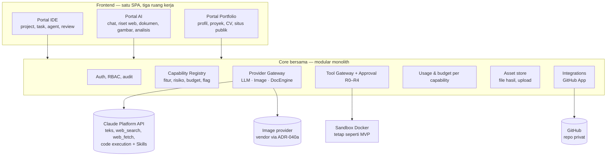
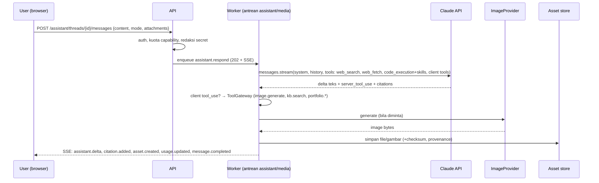
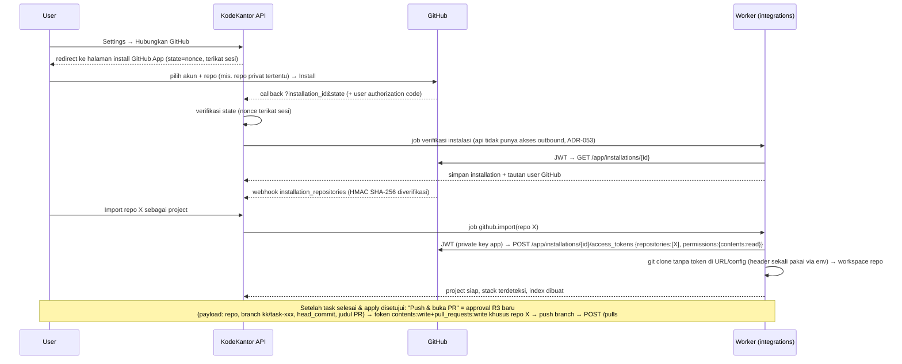

# KodeKantor Platform — Perluasan: Portal AI, Integrasi GitHub, Portfolio Profesional

> Status: **Rancangan (Proposed)**, 21 Okt 2026 · Pemilik: Lead Architect · Keputusan terkait: ADR-036..045 (`docs/DECISIONS.md`)
> Prasyarat: portal IDE mencapai gate G3 (MVP DoD). Dokumen ini **tidak** mengubah kontrak MVP IDE kecuali disebut eksplisit.
> Label keyakinan: **[Pasti]** dari dokumentasi resmi/kode; **[Kemungkinan Besar]** inferensi kuat; **[Menebak]** estimasi.

## 0. Ringkasan & kebenaran yang tidak nyaman

1. Portal tidak "memiliki kemampuan yang sama" dengan OpenAI/Claude; kemampuan ada pada model. Portal **mengorkestrasi** model lewat API dan menambah nilai lewat tools, data milik pengguna, kontrol biaya, audit, dan approval. [Pasti]
2. **Claude tidak menghasilkan gambar** (foto/ilustrasi); hanya diagram/visual berbasis SVG/HTML. Generate gambar butuh provider kedua lewat adapter `ImageProvider`. Ini mengubah ADR-004/012 ("MVP hanya Claude") menjadi multi-provider **per capability**. [Pasti]
3. **Akurasi tidak bisa dijamin**; yang dijamin desain adalah *setiap klaim faktual dari web disertai sitasi* yang dapat dicek, tanggal pencarian ditampilkan, dan jawaban tanpa sumber diberi label. [Pasti]
4. Scope bertambah ±3×. Urutan yang disarankan: IDE → G3 → **GitHub (P9)** → **Portal AI inti (P10)** → **Gambar (P11)** → **Portfolio (P12)**. Menjalankan paralel sebelum IDE stabil mengulang risiko R-06. [Kemungkinan Besar]

## 1. Visi: tiga portal, satu core



**Keputusan arsitektur (ADR-036):** tetap *modular monolith* (FastAPI + Celery + PostgreSQL + Redis) dengan modul domain baru `assistant/`, `integrations/github/`, `portfolio/`. Tidak menambah microservice. Antrean Celery dipisah: `ide`, `assistant`, `media`, `integrations` agar beban gambar/dokumen tidak menahan task IDE.

## 2. Capability Module Registry (ADR-044)

Setiap kemampuan adalah modul terdaftar (mirip registry agent), dengan provider, tools, risiko, budget default, izin, dan feature flag. UI hanya menampilkan modul yang aktif untuk user.

| Modul | Portal | Engine / provider | Tool utama | Risiko | Prioritas |
|---|---|---|---|---|---|
| `chat` | AI | Claude (Messages API, streaming) | – | R0 | P0 |
| `web_research` | AI, Portfolio | Claude server tool `web_search` + `web_fetch` | sitasi wajib | R0 (data keluar ke provider) | P0 |
| `doc_generate` (pptx/docx/xlsx/pdf) | AI, Portfolio | Claude Agent Skills via code execution **atau** DocEngine lokal di sandbox (ADR-039) | `docs.render_skills`, `docs.render_local` | R1 | P0 |
| `data_analysis` | AI | code execution Claude **atau** sandbox lokal | `analysis.run` | R2 | P1 |
| `kb_qa` (tanya jawab dokumen) | AI | Claude + PostgreSQL FTS/`pg_trgm`, potongan dikirim sebagai blok `search_result` (ADR-046; ADR-043 *superseded*) | `kb.search`, `kb.get_chunk` | R0 | P1 |
| `image_generate` / `image_edit` | AI, Portfolio | `ImageProvider` (ADR-040) | `image.generate` | R1 + moderasi | P1 |
| `github_sync` | IDE, Portfolio | GitHub App (ADR-041) | `github.import_repo`, `github.pull` | R1 | P0 (fase P9) |
| `github_push_pr` | IDE | GitHub App | `github.push_branch`, `github.open_pr` | **R3** (approval) | P0 (fase P9) |
| `portfolio_publish` | Portfolio | situs statis / GitHub Pages | `portfolio.publish` | **R3** | P1 |
| `voice` | AI | (belum) | – | – | P2 |

## 3. Provider Gateway multi-model (ADR-037)

- `LLMProvider` (sudah ada) tetap untuk teks/agent; Claude tetap provider utama.
- Interface baru, masing-masing dengan contract test sebelum vendor diaktifkan (PRD §7.7):

```python
class ImageProvider(Protocol):
    name: str
    async def generate(self, req: ImageRequest) -> ImageResult      # prompt, size, n, style, seed?, references[]
    async def edit(self, req: ImageEditRequest) -> ImageResult      # image + mask/instruksi
# ImageResult(images=[bytes], mime, provider, model, revised_prompt?, usage{images, tokens?}, request_id, safety{flagged, reasons})

class DocumentEngine(Protocol):
    name: Literal["claude_skills", "local_sandbox"]
    async def generate(self, req: DocRequest) -> DocResult          # kind pptx|docx|xlsx|pdf, outline/content, template_id, theme
```

- **Routing per capability** di `config/providers.yaml` (berversi): `text: anthropic`, `web_research: anthropic`, `doc_generate: {default: claude_skills, sensitive: local_sandbox}`, `image_generate: <vendor ADR-040>`.
- API key setiap vendor hanya di worker antrean terkait (`assistant`, `media`), tidak pernah di browser/log/sandbox (lanjutan ADR-004).
- Usage per capability: token, jumlah pencarian web, jumlah gambar, detik eksekusi; biaya estimasi dari `pricing.yaml` per vendor; tetap jujur `unavailable` bila tidak diketahui.

## 4. Portal AI

### 4.1 Fitur

| Fitur | Detail | Prio |
|---|---|---|
| Chat & thread | streaming SSE, edit/ulang pesan, pilih model tier, thread per "Ruang" (folder), cari riwayat | P0 |
| Riset web bersitasi | mode *Cepat* (1–3 pencarian) dan *Mendalam* (rencana riset → banyak pencarian → laporan dengan daftar sumber); allow/block domain per policy; tanggal pencarian ditampilkan | P0 |
| Buat dokumen | PPT/Word/Excel/PDF dari prompt atau outline; template brand (sans-serif default); pratinjau thumbnail; unduh lewat URL bertanda tangan | P0 |
| Upload file & tanya jawab dokumen | PDF/DOCX/XLSX/CSV; ekstraksi teks di sandbox; potongan + full-text search PostgreSQL; jawaban bersitasi lewat blok `search_result` Claude (ADR-046, tanpa embedding) | P1 |
| Analisis data | upload CSV/XLSX → kode dijalankan di sandbox → tabel/grafik + kode yang bisa diperiksa | P1 |
| Generate & edit gambar | prompt, ukuran, gaya, referensi; galeri; metadata asal-usul | P1 |
| Asisten kustom | system prompt + capability terpilih + knowledge collection, dibagikan per role | P1 |
| Memori personal | opt-in, dapat dilihat/dihapus user; tidak menyimpan kategori sensitif | P2 |

### 4.2 Alur request



### 4.3 Kebijakan akurasi & sitasi (ADR-038)
1. Mode riset memakai `web_search` dengan sitasi yang **selalu** dikembalikan API; UI wajib menampilkan sumber di samping klaim. [Pasti]
2. Jawaban bertanda "**Tanpa sumber web**" bila tidak ada pencarian; jawaban yang mengandung angka/tanggal terkini tanpa sitasi diberi peringatan.
3. Konten web = data tidak tepercaya (prompt injection); tidak dapat memanggil tool R3/R4.
4. Disimpan: `url`, `title`, `cited_text`, waktu pencarian, query; ditampilkan "dicari pada <tanggal>".
5. `max_uses` per mode (Cepat 3, Mendalam 20) dan anggaran pencarian per user/bulan. Biaya resmi: $10 per 1.000 pencarian + token. [Pasti, per dokumentasi Oktober 2026]

### 4.4 Engine dokumen (ADR-039)
| | Claude Agent Skills (`pptx`, `docx`, `xlsx`, `pdf`) | DocEngine lokal (sandbox KodeKantor) |
|---|---|---|
| Kualitas | tinggi, Claude menulis & menjalankan kode di container Anthropic | bergantung template kita (python-pptx/docx, openpyxl) |
| Data | konten dikirim ke container Anthropic; **tidak tercakup ZDR** [Pasti] | tetap di VPS |
| Network | container Skills tanpa akses internet [Pasti] | sandbox egress off |
| Pengambilan file | `file_id` → Files API | artefak lokal |
| Default | non-sensitif | wajib bila data diberi label `confidential` atau kill switch provider aktif |

### 4.5 Gambar (ADR-040)
- Adapter netral; vendor pertama dipilih saat deployment lewat ADR-040a dengan uji: kualitas teks dalam gambar, edit, biaya per gambar, kebijakan data vendor. Opsi saat ini: OpenAI `gpt-image-*`, Google Gemini image (keluarga "Nano Banana"); self-hosted (Flux/SDXL) butuh GPU, tidak cocok VPS 4 vCPU/16 GB. [Kemungkinan Besar — sumber pihak ketiga, perlu verifikasi di halaman resmi vendor saat deployment]
- Moderasi: kebijakan prompt (tolak tokoh nyata/merek/karakter berhak cipta, konten seksual/minor, kekerasan), ditambah moderasi vendor; hasil `flagged` tidak ditampilkan.
- Provenance disimpan: provider, model, hash prompt, waktu, user; metadata C2PA dipertahankan bila vendor mengirim.
- Kuota gambar per user/hari + estimasi biaya per gambar ditampilkan sebelum generate.

### 4.6 Data model tambahan (Portal AI)
`assistant_spaces` (folder), `assistant_threads` (space_id, title, model_tier, assistant_id), `assistant_messages` (role, content, mode, status, usage), `message_citations` (message_id, url, title, cited_text, searched_at, query), `assistant_files` (upload; mime, size, checksum, storage_ref, extraction_status), `kb_collections`, `kb_chunks` (tsvector FTS + trigram, source_file, offsets, contextual summary), `generated_assets` (type: image|pptx|docx|xlsx|pdf|chart; storage_ref, provider, model, prompt_hash, engine, provenance jsonb), `custom_assistants`, `capability_usage` (capability, unit, quantity, estimated_cost, cost_status). Semua ber-`owner_id` + scope; retensi mengikuti `policy_settings.retention`.

### 4.7 API (ringkas)
`GET/POST /assistant/spaces` · `GET/POST /assistant/threads` · `POST /assistant/threads/{id}/messages` (202, SSE `GET /assistant/threads/{id}/events`) · `POST /assistant/messages/{id}/regenerate` · `POST /assistant/files` (multipart) · `GET /assistant/files/{id}` · `POST /assistant/documents` `{kind, outline|prompt, template_id, engine?}` · `POST /assistant/images` `{prompt, size, n, style, references[]}` · `GET /assets/{id}/download` (URL bertanda tangan, `Content-Disposition: attachment`, `nosniff`) · `GET/POST /assistant/assistants` · `GET /capabilities` (modul aktif + kuota tersisa).

## 5. Integrasi GitHub untuk Portal IDE (ADR-041)

### 5.1 Mengapa GitHub App
GitHub App dapat dipasang hanya pada repo yang dipilih pengguna, permission granular, token instalasi **berumur 1 jam** yang dapat dibatasi ke repo & permission tertentu, dan webhook bawaan. PAT/OAuth App lebih kasar dan berumur panjang. [Pasti]

### 5.2 Permission yang diminta (minimum)

| Permission | Level | Untuk |
|---|---|---|
| Metadata | Read | daftar repo, info dasar |
| Contents | Read & write | clone/fetch; push branch `kk/*` (hanya setelah approval) |
| Pull requests | Read & write | membuat/memperbarui PR dari branch task |
| Checks / Commit statuses | Read | menampilkan status CI di review |
| **Workflows** | **tidak diminta** | mencegah agent mengubah `.github/workflows` (jalur eksfiltrasi secret CI). Tanpa izin ini push yang mengubah file workflow ditolak GitHub; ToolGateway juga memblokir path `.github/workflows/**` untuk agent. [Pasti untuk kebutuhan izin; kebijakan blokir = keputusan desain] |
| Administration, Secrets, Actions write | tidak diminta | – |

Webhook events: `installation`, `installation_repositories`, `push`, `pull_request`, `check_suite` (opsional).

### 5.3 Alur


### 5.4 Penanganan rahasia & keamanan
1. Private key GitHub App (`.pem`) di secret file read-only yang hanya di-mount ke container `worker-integrations` (antrean `integrations`, ADR-053); `api` tidak berada di network `outbound` sehingga **tidak** memegang pem — `api` hanya memegang `GITHUB_WEBHOOK_SECRET` untuk verifikasi HMAC. Pem tidak pernah di DB, log, sandbox, atau prompt.
2. Token instalasi dibuat **per operasi**, dibatasi ke 1 repo + permission minimum, tidak disimpan (cache in-memory ≤ 50 menit maksimal, opsional).
3. Git dipanggil tanpa token di URL/`.git/config`: kredensial lewat `GIT_CONFIG_COUNT`/`GIT_CONFIG_KEY_0=http.https://github.com/.extraheader` dari environment proses git saja; remote disimpan tanpa userinfo. [Kemungkinan Besar — perlu diuji pada versi git di image]
4. Sebelum push: secret scan (gitleaks) pada diff; temuan → push diblokir sampai user menyelesaikan.
5. Tidak ada force-push (R4); merge PR tetap dilakukan manusia di GitHub; branch protection dihormati.
6. Webhook: verifikasi `X-Hub-Signature-256` (HMAC-SHA256 atas body, perbandingan constant-time), dedupe `X-GitHub-Delivery`, rate limit. [Pasti]
7. Isi repo privat diperlakukan sebagai data rahasia: hanya snippet relevan dikirim ke Claude (ADR-011), dan project dapat menyalakan kill switch provider.

### 5.5 Operasi & tingkat risiko

| Operasi | Risiko | Catatan |
|---|---|---|
| Daftar instalasi/repo | R0 | token metadata:read |
| Import/clone, fetch/pull ke main lokal | R1 | pull yang konflik dengan perubahan lokal → tidak menimpa, buat branch `kk/sync-*` |
| Push branch `kk/task-*` | **R3** | approval terikat `head_commit` + repo + branch |
| Buka/update PR, komentar PR | **R3** | judul/deskripsi dari collaboration agent (E29) — pratinjau dulu |
| Force push, hapus branch remote, merge PR, ubah workflow | **R4** | tidak tersedia |

### 5.6 Data model & API
Tabel: `github_installations` (installation_id, account_login, account_type, repository_selection, suspended_at), `github_repositories` (installation_id, repo_id, full_name, private, default_branch, project_id null), `github_user_links` (user_id, github_login, github_user_id), `webhook_deliveries` (delivery_id unique, event, received_at, status). `repositories.provider` menambah nilai `github_app`.
API: `GET /integrations/github/install-url` · `GET /integrations/github/callback` · `POST /integrations/github/webhook` (publik, HMAC) · `GET /integrations/github/installations` · `GET /integrations/github/repos?q=` · `POST /projects` dengan `source:{type:"github_app", repo_id, branch?}` · `POST /projects/{id}/git/pull` · `POST /tasks/{id}/github/push-pr` → `{approval}` · `GET /tasks/{id}/github/pr`.

## 6. Portal Portfolio Profesional (ADR-042)

### 6.1 Fitur
| Fitur | Detail | Prio |
|---|---|---|
| Profil | nama, headline, ringkasan, lokasi, kontak (opsional publik), foto | P0 |
| Pengalaman & pendidikan | timeline, pencapaian per peran | P0 |
| Showcase proyek | manual; impor dari repo GitHub (README, bahasa, topik, bintang, tautan) dan dari project KodeKantor (stack, ringkasan, hasil test); repo privat hanya metadata yang dipilih | P0 |
| Skill & sertifikat | matriks skill (level, bukti/tautan), sertifikat dengan tanggal & ID | P0 |
| Generator CV | template ramah ATS (sans-serif), DOCX/PDF via DocEngine; versi per lamaran | P0 |
| Asisten lamaran | tempel URL lowongan → `web_fetch` → analisis kecocokan → saran penyesuaian CV & cover letter (draft, butuh review) | P1 |
| Situs publik | statis di `portfolio.<domain>` atau GitHub Pages; pratinjau; SEO meta | P1 |
| Analitik kunjungan | tanpa cookie pelacak pihak ketiga | P2 |

### 6.2 Aturan AI di portfolio
AI hanya membuat **draft**; tidak boleh mengarang pencapaian, angka, sertifikat, atau testimoni. Setiap kalimat hasil AI ditandai sampai user menyetujui. Testimoni hanya dari input user dengan sumber.

### 6.3 Publikasi = aksi keluar (R3)
`portfolio.publish` membuat approval dengan payload hash dari snapshot konten (HTML + daftar aset). Sebelum publish: cek privasi (email/telepon hanya bila ditandai publik), secret scan, dan konfirmasi bahwa tidak ada isi repo privat selain metadata yang dipilih.

### 6.4 Data model & API
Tabel: `portfolio_profiles`, `portfolio_items` (type: experience|education|project|skill|certification|publication|link; visibility draft|public; source manual|github|kodekantor|ai_draft), `portfolio_versions` (snapshot jsonb, created_by), `portfolio_publications` (target: static|github_pages, url, version_id, approval_id, status).
API: `GET/PUT /portfolio/profile` · `GET/POST/PATCH/DELETE /portfolio/items` · `POST /portfolio/import/github` `{repo_ids[]}` · `POST /portfolio/import/project` `{project_id}` · `POST /portfolio/cv` `{template, format, item_ids[], target_job_url?}` → asset · `POST /portfolio/publish` → `{approval}` · `GET /portfolio/publications`.

## 7. Keamanan, privasi, dan tata kelola tambahan (ADR-045)

| ID | Ancaman baru | Kontrol |
|---|---|---|
| T11 | Prompt injection dari halaman web hasil riset | konten web = data; tool R3/R4 tidak tersedia di mode riset; sitasi ditampilkan |
| T12 | Kebocoran token/kunci GitHub App | private key hanya di `worker-integrations` via secret file (ADR-053); `api` hanya memegang `GITHUB_WEBHOOK_SECRET`; token per operasi berumur ≤1 jam & tidak disimpan; redaksi pola `ghs_`/`ghu_`/`github_pat_` |
| T13 | Agent mengubah workflow CI untuk mencuri secret | permission Workflows tidak diminta + blokir path `.github/workflows/**` |
| T14 | Webhook palsu/replay | HMAC SHA-256 + constant-time + dedupe delivery id |
| T15 | Data sensitif terkirim ke vendor (Skills tidak ZDR, vendor gambar) | label sensitivitas per space/project; engine lokal untuk `confidential`; tabel data-flow per capability di Settings |
| T16 | Penyalahgunaan generate gambar (orang nyata, merek, konten terlarang) | kebijakan prompt + moderasi vendor + audit + kuota |
| T17 | Konten portfolio palsu/berlebihan | AI hanya draft; review wajib; tanda AI |
| T18 | Publikasi data pribadi tak sengaja | publish = R3 dengan pratinjau & cek privasi |

RBAC tambahan: `assistant:use`, `assistant:image`, `assistant:docs`, `integrations:github:manage`, `github:push`, `portfolio:edit`, `portfolio:publish`. Budget per capability per user (bulanan) dengan kill switch admin.

## 8. Roadmap perluasan (setelah G3)

| Fase | Isi | Exit / gate | Estimasi agent [Menebak] |
|---|---|---|---|
| P9 GitHub | GitHub App, import repo privat, pull, push-branch + PR via R3, webhook | demo repo privat: import → task → PR terbuka setelah approval; security sign-off | ±10–14 jam agent |
| P10 Portal AI inti | chat, riset web bersitasi, dokumen (Skills + engine lokal), capability registry, usage | evaluasi akurasi sitasi pada set pertanyaan uji; biaya per jawaban terukur | ±18–24 jam agent |
| P11 Gambar & analisis | ImageProvider + vendor pertama (ADR-040a), galeri, analisis data, KB Q&A (retrieval leksikal + sitasi Claude, ADR-046) | contract test provider; moderasi teruji | ±12–16 jam agent |
| P12 Portfolio | profil, item, impor GitHub/KodeKantor, CV DOCX/PDF, publish R3 | CV & situs publik dari data nyata pengguna, disetujui PO | ±10–14 jam agent |

## 8b. Kriteria penerimaan perluasan (AX)

| ID | Kriteria | Bukti/test |
|---|---|---|
| AX-01 | Repo privat dapat diimpor lewat GitHub App tanpa token tersimpan di DB/log/`.git/config` | test integrasi dengan GitHub App uji + grep token di DB/log/repo |
| AX-02 | Push branch & PR hanya setelah approval R3 terikat `head_commit`; file `.github/workflows/**` tidak dapat diubah agent | test approval + test path policy |
| AX-03 | Webhook dengan tanda tangan salah ditolak; delivery ganda diabaikan | test HMAC & dedupe |
| AX-04 | Setiap klaim dari web disertai sitasi + tanggal pencarian; jawaban tanpa sumber berlabel | evaluasi WP-10.6 |
| AX-05 | Dokumen PPT/DOCX/XLSX/PDF valid dapat diunduh lewat URL bertanda tangan | test buka file (python-pptx/docx/openpyxl/pdf) |
| AX-06 | Data `confidential` memakai engine lokal; tidak ada panggilan Skills | test routing + audit |
| AX-07 | Generate gambar mematuhi moderasi, kuota, dan menyimpan provenance | contract test provider + test kuota |
| AX-08 | Publikasi portfolio memerlukan approval R3 + cek privasi; repo privat hanya metadata terpilih | test approval + snapshot konten |
| AX-09 | AI di portfolio hanya membuat draft bertanda; tidak mengarang pencapaian/testimoni | review + test label |

## 9. Keputusan yang dibutuhkan dari Product Owner
1. Vendor gambar pertama (ADR-040a) dan anggaran gambar/bulan.
2. Default engine dokumen: Skills (kualitas) vs lokal (privasi) — usulan: Skills untuk non-sensitif, lokal untuk `confidential`.
3. Target situs portfolio: subdomain sendiri vs GitHub Pages.
4. Akun GitHub yang dipasangi App (personal/organisasi) dan repo awal yang diizinkan.
5. Apakah Portal AI dipakai multi-user (tim) atau personal saja pada fase pertama.

## 9b. KONTRAK v2 (mengikat untuk dokumen SRS v2, desain implementasi v2, katalog agent v2, PRD v2.0)

> Ditetapkan Lead Architect 21 Okt 2026. Perubahan → ADR baru. Semua item di bagian ini berstatus **rancangan; belum diimplementasikan**.

### K1. Modul & rentang FR baru
| Modul | Nama | FR | Prioritas | Fase |
|---|---|---|---|---|
| M21 | Portal AI (chat, riset web, dokumen, gambar, KB, analisis data, asisten kustom) | FR-160 – FR-184 (25) | P1 (inti P10 = P0 perluasan) | P10–P11 |
| M22 | Integrasi GitHub App | FR-185 – FR-196 (12) | P0 perluasan | P9 |
| M23 | Portal Portfolio Profesional | FR-197 – FR-212 (16) | P1 | P12 |
| M24 | Capability Registry & Provider Gateway | FR-213 – FR-220 (8) | P0 perluasan | P10 |

Use case baru: UC-11 Tanya jawab umum · UC-12 Riset web bersitasi · UC-13 Buat dokumen (PPT/Word/Excel/PDF) · UC-14 Buat/ubah gambar · UC-15 Tanya jawab dokumen sendiri · UC-16 Analisis data · UC-17 Hubungkan GitHub & impor repo privat · UC-18 Push branch & buka PR · UC-19 Kelola portfolio & CV · UC-20 Publikasikan situs portfolio.
Kriteria penerimaan: AX-01..AX-09 (§8b) + AX-10 "Jawaban KB menampilkan sitasi ke potongan dokumen sumber" + AX-11 "Router hanya memanggil capability yang aktif & dalam kuota".

### K2. Agent produk baru (registry v2; semua `mvp_mode: planned`, `enabled: false`, dengan `target_mode` & `phase`)
| ID | Slug | Nama | Grup | target_mode | Fase | Tools (nama kanonik) |
|---|---|---|---|---|---|---|
| I42 | assistant_concierge | Assistant Router & Concierge | ai_assistant | llm (tier fast/default) | P10 | `capabilities.list`, `kb.search`, `submit_result` (hanya untuk routing; jawaban akhir = teks) |
| I43 | web_research | Web Research & Citation Agent | ai_assistant | llm (default/complex) | P10 | `web.search`*, `web.fetch`* (server tool Claude) |
| I44 | document_builder | Document Builder Agent | ai_assistant | llm | P10 | `docs.render_skills`* (Agent Skills via code execution), `docs.render_local`, `assets.store`, `submit_result` |
| I45 | visual_prompt | Visual Prompt Agent | ai_assistant | llm (fast) | P11 | `moderation.check_image_prompt`, `image.generate`, `image.edit`, `submit_result` |
| I46 | data_analyst | Data Analysis Agent | ai_assistant | llm | P11 | `analysis.run` (sandbox) atau `code.execute_remote`*, `assets.store`, `submit_result` |
| I47 | knowledge_base | Knowledge Base Agent | ai_assistant | llm | P11 | `kb.search`, `kb.get_chunk` (hasil sebagai blok `search_result`) |
| J48 | github_integration | GitHub Integration Agent | integrations | tool (deterministik) | P9 | `github.list_repos`, `github.import_repo`, `github.pull`, `github.push_branch` (R3), `github.open_pr` (R3), `github.get_pr_status` |
| K49 | portfolio_curator | Portfolio Curator Agent | portfolio | llm | P12 | `portfolio.get_profile`, `github.get_repo_summary`, `repo.read_file`, `portfolio.draft_item`, `submit_result` |
| K50 | cv_job_fit | CV & Job-fit Agent | portfolio | llm | P12 | `web.fetch`*, `portfolio.get_profile`, `docs.render_local`, `portfolio.draft_item`, `submit_result` |
| K51 | portfolio_publisher | Portfolio Publisher | portfolio | tool (deterministik) | P12 | `portfolio.privacy_check`, `portfolio.build_site` (R2), `portfolio.publish` (R3) |
| S52 | content_safety | Content Safety & Moderation | quality_security | tool (deterministik + moderasi vendor) | P10 | `moderation.check_text`, `moderation.check_image_prompt` |

\* = **server tool** yang dieksekusi di infrastruktur Anthropic; tetap melalui allowlist ToolGateway (izin, kuota, audit), hasil dicatat sebagai `tool_calls` dengan `executor: provider`.
**Promosi:** E29 Pull Request & Collaboration Agent → `target_mode: llm`, fase P9 (menulis judul/deskripsi PR; eksekusi push/PR lewat J48 + approval R3). Total registry v2 = 41 + 11 + ORCH = **53 entri**.

### K3. Tools baru (TOOL_CATALOG v2)
| Tool | Risk | Executor | Syarat permission | Catatan |
|---|---|---|---|---|
| `capabilities.list` | R0 | backend | – | modul aktif + kuota |
| `web.search` | R0 | provider (Claude `web_search`) | `network: provider_web` | sitasi wajib; `max_uses` per mode |
| `web.fetch` | R0 | provider (Claude `web_fetch`) | `network: provider_web` | konten = data tak tepercaya |
| `code.execute_remote` | R2 | provider (Claude code execution) | `sandbox: allow` + data ≠ confidential | tanpa internet di container |
| `docs.render_skills` | R1 | provider (Agent Skills pptx/docx/xlsx/pdf) | data ≠ confidential | file via Files API → asset store |
| `docs.render_local` | R2 | sandbox `kodekantor/sandbox-docs` | `sandbox: allow` | python-pptx/python-docx/openpyxl/LibreOffice |
| `assets.store` | R1 | backend | – | simpan file hasil + provenance |
| `image.generate` / `image.edit` | R1 | provider (ImageProvider) | kuota + moderasi lulus | vendor via ADR-040a |
| `moderation.check_text` / `moderation.check_image_prompt` | R0 | backend (+vendor) | – | S52 |
| `kb.search` / `kb.get_chunk` | R0 | backend (PostgreSQL FTS) | scope koleksi user | output blok `search_result` |
| `analysis.run` | R2 | sandbox `kodekantor/sandbox-docs` | `sandbox: allow` | pandas/matplotlib, tanpa network |
| `github.list_repos`, `github.get_pr_status`, `github.get_repo_summary` | R0 | backend (GitHub App, token metadata/contents:read) | `git: read` | |
| `github.import_repo`, `github.pull` | R1 | worker integrations | `git: read` | token 1 repo, ≤1 jam |
| `github.push_branch`, `github.open_pr` | **R3** | worker integrations | `git: branch_commit` + approval | secret scan pre-push; blokir `.github/workflows/**` |
| `portfolio.get_profile` | R0 | backend | – | |
| `portfolio.draft_item` | R1 | backend | `portfolio: draft` | selalu berstatus draft + label AI |
| `portfolio.privacy_check` | R0 | backend | – | |
| `portfolio.build_site` | R2 | sandbox | `sandbox: allow` | Jinja2 → statis |
| `portfolio.publish` | **R3** | backend | approval | |
Permission profile v2 menambah field: `network: deny|allowlist|provider_web`, `portfolio: none|draft`, `data_sensitivity_max: public|internal|confidential`.

### K4. Tech stack v2 (keputusan; detail di ADR-049)
| Layer | Teknologi | Status |
|---|---|---|
| Frontend | React 19 + TypeScript + Vite; React Router; TanStack Query; Tailwind CSS 4 + komponen Radix (gaya shadcn/ui); Lucide; Monaco (lokal); xterm.js; React Hook Form + Zod; Zustand selektif | sudah dipakai di snapshot |
| Frontend (baru) | react-markdown + remark-gfm + rehype-sanitize (render jawaban); Shiki (highlight kode di chat); pdf.js (pratinjau PDF); grafik: SVG inline (sudah) + Recharts bila perlu | rencana |
| Backend | Python 3.12+, FastAPI, Pydantic v2, SQLAlchemy 2 async + asyncpg, Alembic, Celery + Redis (antrean `ide`, `assistant`, `media`, `integrations`), structlog, httpx, prometheus-client | sudah (antrean baru = rencana) |
| AI | Anthropic Python SDK: Messages API streaming, tool use, prompt caching, citations (dokumen & `search_result`), server tools `web_search`/`web_fetch`, code execution + Agent Skills (`pptx`/`docx`/`xlsx`/`pdf`), Files API | Messages/tool use sudah; lainnya rencana |
| Gambar | `ImageProvider` adapter; SDK vendor ditetapkan ADR-040a (kandidat OpenAI / Google) | rencana |
| Pengetahuan (KB) | PostgreSQL full-text search (`tsvector`, konfigurasi `simple`) + `pg_trgm`; ringkasan kontekstual per potongan dibuat Claude; **tanpa embedding/pgvector** (ADR-046) | rencana |
| Dokumen lokal | image sandbox baru `kodekantor/sandbox-docs`: python-pptx, python-docx, openpyxl, pdfplumber, pandas, matplotlib, LibreOffice headless (konversi PDF & thumbnail) | rencana |
| GitHub | GitHub App (REST API + webhooks), PyJWT[crypto] (JWT RS256), httpx | rencana |
| Portfolio | Jinja2 (situs statis), Caddy site `portfolio.<domain>` atau GitHub Pages | rencana |
| Data | PostgreSQL 16, Redis 7, asset store filesystem (`ASSETS_ROOT`), opsi S3-compatible kemudian | sudah / rencana |
| Eksekusi | Docker sandbox profil tetap, docker-socket-proxy, gVisor opsional, egress proxy | sudah |
| Infra | Docker Compose, Caddy (TLS), Ubuntu Server LTS | sudah |
| Kualitas | pytest, respx, Ruff, Pyright, import-linter, Vitest + RTL, Playwright, gitleaks, Semgrep, Trivy | sudah; + fixture webhook GitHub, contract test provider, eval harness sitasi |

## 10. Sumber riset (diakses 21 Okt 2026)
- Claude Platform — Web search tool: https://platform.claude.com/docs/en/agents-and-tools/tool-use/web-search-tool
- Claude Platform — Web fetch tool: https://platform.claude.com/docs/en/agents-and-tools/tool-use/web-fetch-tool
- Claude Platform — Using Agent Skills with the API: https://platform.claude.com/docs/en/build-with-claude/skills-guide
- Claude Help Center — Can Claude produce images?: https://support.claude.com/en/articles/9002504-can-claude-produce-images
- GitHub Docs — Authenticating as a GitHub App installation: https://docs.github.com/en/apps/creating-github-apps/authenticating-with-a-github-app/authenticating-as-a-github-app-installation
- GitHub Docs — Choosing permissions for a GitHub App: https://docs.github.com/en/apps/creating-github-apps/registering-a-github-app/choosing-permissions-for-a-github-app
- GitHub Docs — Validating webhook deliveries: https://docs.github.com/en/webhooks/using-webhooks/validating-webhook-deliveries
- Perbandingan API gambar (pihak ketiga, perlu verifikasi): https://www.aifreeapi.com/en/posts/gemini-vs-openai-image-generation
- Claude Platform — Embeddings ("Anthropic does not offer its own embedding model"): https://platform.claude.com/docs/en/build-with-claude/embeddings
- Claude Platform — Search results (blok `search_result` untuk RAG bersitasi): https://platform.claude.com/docs/en/build-with-claude/search-results
- Claude Platform — Citations: https://platform.claude.com/docs/en/build-with-claude/citations
- Claude Platform — Files API: https://platform.claude.com/docs/en/build-with-claude/files
