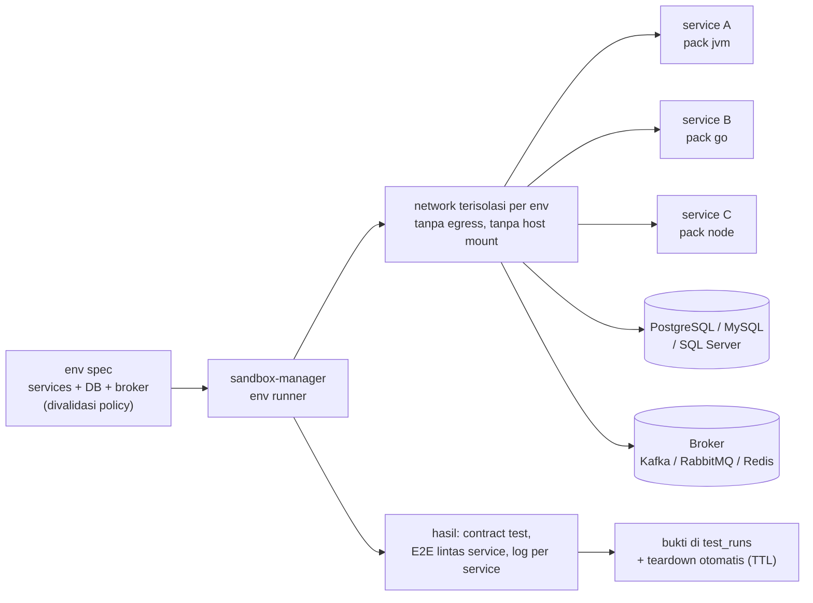
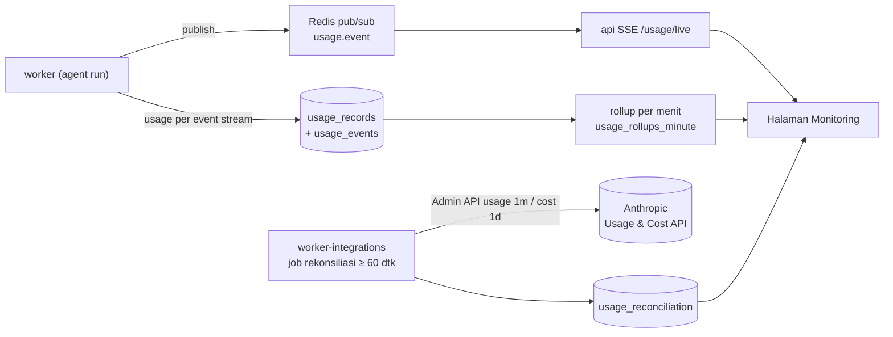

# KodeKantor — Polyglot Language Packs, Lingkungan Integrasi Multi-Service, dan Monitoring Biaya & Token Realtime

> **Status: RANCANGAN v2.2 (22 Oktober 2026) — belum diimplementasikan.** Kontrak mengikat untuk perluasan v2.2 (§7 "KONTRAK v2.2"). Melanjutkan `PLATFORM_EXPANSION.md` §9b (v2) dan `SDLC_SCALE_DESIGN.md` §6 (v2.1) tanpa menggeser ID yang ada.
>
> **Permintaan PO (22 Okt 2026):** (1) satu halaman monitoring biaya dan token secara realtime; (2) aplikasi coding harus dapat dipakai menciptakan **sistem level enterprise yang terintegrasi dari berbagai teknologi dan bahasa pemrograman secara end-to-end**.
> **Keputusan PO:** gelombang 1 bahasa/stack = Java/Kotlin (Spring), C#/.NET, Go, PHP/Laravel, Python, SQL, Node.js, JavaScript/TypeScript, React, React Native, Flutter (Dart), Ruby, C++; sistem terintegrasi diuji di **lingkungan multi-service ephemeral**; monitoring = **estimasi realtime + rekonsiliasi** Usage & Cost Admin API bila tersedia.
>
> **Label keyakinan:** [Pasti] / [Kemungkinan Besar] / [Menebak].

---

## 0. Kebenaran yang tidak nyaman

1. **Token realtime ≠ biaya realtime.** Setiap event stream Claude membawa `usage`; nilai di `message_delta` kumulatif [Pasti — dokumentasi Streaming]. Biaya yang tampil seketika adalah **estimasi** dari `pricing.yaml`. Angka resmi Usage & Cost Admin API umumnya muncul ≤ 5 menit setelah request, usage per bucket `1m`/`1h`/`1d`, biaya resmi **hanya harian** (`1d`), polling disarankan 1×/menit [Pasti — dokumentasi Usage and Cost API]. Biaya code execution hanya ada di endpoint cost; biaya Priority Tier tidak ada di endpoint cost [Pasti].
2. **Admin API tidak tersedia untuk akun individual** dan butuh kredensial admin organisasi (Admin API key `sk-ant-admin01-…`, token OAuth `org:admin`, atau kunci yang tidak di-scope ke workspace) [Pasti]. Kredensial ini berkuasa besar; bila PO memakai akun individual, rekonsiliasi resmi **tidak mungkin** dan halaman hanya menampilkan estimasi.
3. **Satu sandbox per bahasa tidak sama dengan sistem enterprise terintegrasi.** Unit test per bahasa tidak membuktikan service saling bekerja. Dibutuhkan lingkungan multi-container sementara (service + database + broker) di network terisolasi — kemampuan sandbox baru dengan permukaan serangan baru, dan **tidak muat di sandbox pilot** 1 CPU/1 GB; realistis mulai tier M (node executor, ADR-060). [Kemungkinan Besar]
4. **13 bahasa sekaligus adalah scope besar.** Setiap pack butuh image toolchain (beberapa GB untuk JVM/Android), proxy registry dependensi melewati gate G4, profil build/test/lint/run/package, dan set evaluasi agent. Gelombang 1 dibagi tingkat dukungan (L1 penuh / L2 build & test) supaya kualitas terukur. [Kemungkinan Besar]
5. **Target yang tidak dapat dibangun di sandbox Linux:** build iOS/macOS (Flutter iOS, React Native iOS) membutuhkan macOS + Xcode; .NET Framework lama & stack khusus Windows tidak berjalan di container Linux; emulator Android untuk E2E membutuhkan virtualisasi bersarang (KVM) yang sering tidak tersedia di VPS. Target ini hanya lewat CI eksternal (mis. runner macOS/Windows), bukan sandbox. [Kemungkinan Besar]
6. **Kualitas model berbeda per bahasa.** Agent tidak boleh dianggap setara di semua bahasa; setiap pack diaktifkan hanya setelah set evaluasi bahasa itu lulus ambang (G8 per pack). [Kemungkinan Besar]

---

## 1. Language Packs (M28)

### 1.1 Konsep

**Language pack** = paket berversi yang membuat satu ekosistem bahasa dapat dibuat, dibangun, diuji, dijalankan, dan dikemas di KodeKantor:

| Komponen | Isi | Catatan |
|---|---|---|
| Image toolchain | `kodekantor/sandbox-<pack>:<versi>` dipin digest | Rebuild bulanan, SBOM, scan Trivy (pola ADR-054) |
| Deteksi stack | Penanda file → bahasa, framework, package manager, entrypoint | Diperluas di H41 (`repo.detect_stack`) |
| Profil sandbox | `*.deps_install`, `*.build`, `*.test`, `*.test_select`, `*.lint`, `*.fmt`, `*.run`, `*.package` | Profil tetap, argumen ter-allowlist (FR-078/079) |
| Registry dependensi | Domain registry pack di egress proxy / proxy repositori | Hanya profil `*.deps_install`; G4 wajib (ADR-007) |
| Template project | Template awal per framework | Untuk FR-012 (project dari template) |
| Petunjuk agent | Konvensi, perintah, pola test per bahasa | Dimuat sebagai konteks ringkas untuk B14/C17/C20 |
| Set evaluasi | Tugas implementasi + bug seeded per bahasa | Syarat aktivasi pack (AX-22) |

### 1.2 Pack gelombang 1 dan tingkat dukungan

**L1 (penuh)** = template, deps, build, test, test terpilih, lint, format, run, package, set evaluasi agent. **L2 (build & test)** = deps, build, test, lint; tanpa run/preview dan eval agent penuh pada gelombang 1.

| Pack | Bahasa/stack | Toolchain utama [Kemungkinan Besar, versi dipin saat WP] | Registry | Tingkat |
|---|---|---|---|---|
| `python` | Python (FastAPI, Django) | CPython 3.12, pip/uv, pytest, ruff | PyPI | L1 (snapshot: sudah ada) |
| `node` | JavaScript/TypeScript, Node.js, React | Node LTS, npm/pnpm, Vitest/Jest, ESLint, Vite | npm | L1 (snapshot: sudah ada) |
| `jvm` | Java & Kotlin, Spring Boot | JDK LTS, Maven, Gradle, JUnit 5 | Maven Central, Gradle Plugin Portal | L1 |
| `dotnet` | C#/.NET (Linux) | .NET SDK LTS, NuGet, xUnit/NUnit, `dotnet format` | NuGet | L1 |
| `go` | Go | Go toolchain, modules, `go test`, `golangci-lint` | Go module proxy | L1 |
| `php` | PHP, Laravel | PHP 8.x, Composer, PHPUnit/Pest, PHP-CS-Fixer | Packagist | L1 |
| `ruby` | Ruby (Rails) | Ruby 3.x, Bundler, RSpec/Minitest, RuboCop | RubyGems | L2 |
| `cpp` | C++ | GCC/Clang, CMake, GoogleTest/Catch2, clang-tidy; Conan/vcpkg | Conan Center / vcpkg | L2 |
| `react-native` | React Native (JS/TS) | Node + Metro, Jest; build Android via Gradle + Android SDK | npm, Maven | L2 (Android saja) |
| `flutter` | Flutter / Dart | Flutter SDK, `flutter test`, `dart analyze`; build web & Android | pub.dev, Maven | L2 (web + Android) |
| `sql` | SQL & database | PostgreSQL, MySQL, SQL Server (Linux, edisi developer) sebagai service lingkungan; Flyway/Liquibase; sqlfluff | – (image DB) | L1 untuk migrasi & test terhadap DB ephemeral |

Tidak termasuk gelombang 1: build iOS/macOS, .NET Framework/Windows, emulator Android untuk E2E, ABAP/SAP, COBOL — lewat CI eksternal atau integrasi (FR-270).

### 1.3 Proxy dependensi

Semua instalasi dependensi melewati proxy (ADR-064): proxy repositori per ekosistem (mis. Maven/NuGet/npm/PyPI/Go/Packagist/RubyGems/pub/Conan) dengan cache, allowlist domain, dan pemeriksaan supply chain (D24: lockfile wajib, sumber registry tunggal per namespace untuk mencegah dependency confusion, daftar blokir paket). Profil selain `*.deps_install` tetap `network_mode=none`.

---

## 2. Lingkungan integrasi multi-service & kontrak antar-service (M29)

### 2.1 Katalog service dan kontrak

- **Service catalog** per program/project: service, bahasa/pack, repo, interface yang disediakan & dipakai, dependensi data (DB, broker), pemilik.
- **Kontrak antar-service** disimpan di repo sebagai sumber kebenaran: OpenAPI (REST), AsyncAPI (event/broker), Protobuf/gRPC, GraphQL schema. Perubahan kontrak = patch yang direview; breaking change terdeteksi otomatis (diff kontrak) dan memblokir merge queue sampai consumer diperbarui.
- **Contract test**: provider diuji terhadap kontraknya; consumer diuji terhadap mock yang dibangkitkan dari kontrak; test lintas service dijalankan di lingkungan integrasi.

### 2.2 Lingkungan integrasi ephemeral

Aturan (ADR-065):
1. **Spec deklaratif yang divalidasi**, bukan compose bebas: hanya image dari pack terdaftar dan **katalog service pendukung** (DB, broker, cache, object storage tiruan) yang dipin digest; tidak ada `privileged`, host mount, host network, device, atau capability tambahan; port tidak dipublikasikan ke host.
2. **Satu network internal per lingkungan**, tanpa egress; DNS internal antar-service; data seed sintetis (secret palsu dibangkitkan, tidak pernah secret nyata).
3. **Kuota per lingkungan**: jumlah service (`INTEGRATION_ENV_MAX_SERVICES`, default 8), CPU/RAM total, durasi (`INTEGRATION_ENV_TTL_MINUTES`, default 60); teardown otomatis 100%.
4. Hanya **tier M/L** (node executor); tier S hanya mode kontrak + mock (FR-276).
5. Hasil (contract test, E2E lintas service, log per service) disimpan sebagai bukti (`test_runs` dengan `suite = 'integration'`) dan dapat menjadi syarat merge queue untuk story lintas repo (AX-24).

### 2.3 Alur sistem enterprise end-to-end

Program → arsitektur service (A05, katalog + kontrak) → story per service/repo (A03 `ProgramPlan`) → implementasi per bahasa (B14 + pack) → unit test per pack (C17) → contract test (C18) → lingkungan integrasi + E2E lintas service (C18/C19) → review & User Proxy per story → merge queue per repo (kontrak tidak boleh rusak) → release terkoordinasi lintas repo (FR-254, FR-228) → operate.

---

## 3. Monitoring biaya & token realtime (M30)

### 3.1 Sumber data

| Sumber | Latensi | Isi | Status angka |
|---|---|---|---|
| Event stream Claude (`message_start`, `message_delta` kumulatif, respons akhir) | detik | input/output/cache tokens, `server_tool_use` (mis. jumlah web search) | **Token: aktual**; biaya: estimasi `pricing.yaml` |
| Vendor lain (gambar, dll.) | detik | unit (gambar, detik), estimasi dari `pricing.yaml` | Estimasi |
| Usage & Cost Admin API (opsional) | ≈ ≤ 5 menit (usage, bucket 1m); harian (cost) | token resmi per model/workspace/API key; biaya resmi USD harian | **Resmi** (rekonsiliasi) |

### 3.2 Halaman "Monitoring biaya & token" (`/usage/live`)

- **Aliran langsung** (SSE `usage.event`): setiap panggilan model/vendor tampil ≤ 2 detik [Menebak] dengan waktu, project, task, agent, model, capability, token in/out/cache, server tool, estimasi biaya, `cost_status`.
- **Kartu ringkasan realtime**: total token & estimasi biaya hari ini / bulan ini, **laju pemakaian** (token/menit, $/jam), proyeksi akhir bulan, sisa budget per project/program/capability.
- **Grafik**: time-series per menit (token dan estimasi biaya), breakdown per model, agent, project, capability, user; rasio cache hit.
- **Budget & alert**: ambang 50/80/100% per budget (task, project, program, organisasi, capability); tautan ke kill switch (FR-217, FR-255); alert tampil di UI + audit.
- **Rekonsiliasi** (bila kredensial Admin API dikonfigurasi): job tiap ≥ 60 detik menarik usage bucket `1m` dan cost harian, mencocokkan dengan catatan internal (per model per menit), menampilkan selisih token & biaya, menandai selisih di atas ambang; tanpa kredensial → label tetap "estimasi" dan panel rekonsiliasi menjelaskan alasannya.
- **Ekspor** CSV/JSON; semua angka membawa label `aktual` / `estimasi` / `resmi` / `tidak tersedia` (tidak ada angka palsu, FR-133).

### 3.3 Arsitektur

Kredensial Admin API hanya di `worker-integrations` (pola ADR-053), nonaktif default, tidak pernah dikirim ke browser atau log; dipakai **hanya** untuk endpoint usage/cost (T26).

---

## 4. Dampak pada agent

Tidak ada agent baru. Perubahan jadwal aktivasi (menggantikan sebagian K9 v2.1):

| Agent | Sebelumnya | v2.2 | Alasan |
|---|---|---|---|
| H41 Language & Framework Specialist (`tool`) | deteksi Python/Node | deteksi semua pack gelombang 1 (WP-15.0) | Deteksi stack polyglot |
| D24 Dependency & Supply Chain | P14 | **P15** | Proxy dependensi lintas ekosistem butuh pemeriksaan supply chain sejak pack aktif |
| B11 API & Integration Specialist | P14 | **P16** | Kontrak antar-service & integrasi |
| C18 Integration & API Testing | P13 | P13 + contract test lintas service di P16 | — |
| B14, C17, C20 (aktif) | Python/Node | + petunjuk & eval per pack (AX-22) | Kualitas per bahasa diukur |
| A05, B12, H38, F30, F31 | sesuai v2.1 | tetap; dipakai untuk arsitektur service, skema DB, data, CI, template env | — |

---

## 5. Risiko & pertanyaan terbuka

| ID | Risiko / pertanyaan | Mitigasi / pemutus |
|---|---|---|
| RP-01 | Image toolchain besar (JVM, Android) membebani disk & waktu build | Cache layer, node executor dengan disk besar, pack dipasang sesuai kebutuhan project |
| RP-02 | Dependency confusion / typosquatting lintas ekosistem | Proxy per ekosistem, namespace tunggal, lockfile wajib, D24 (T24) |
| RP-03 | Lingkungan integrasi menjadi jalur lateral movement | Network per env tanpa egress, tanpa host mount, katalog image pendukung terkunci (T25) |
| RP-04 | Kredensial Admin API bocor = akses admin organisasi | Opsional, hanya worker-integrations, hanya endpoint usage/cost, rotasi (T26) |
| RP-05 | Selisih estimasi vs resmi karena tarif berubah | `pricing.yaml` berversi + rekonsiliasi + alert selisih |
| OQ-04 | Proxy repositori: satu produk multi-ekosistem atau proxy per ekosistem | Lead + OPS di WP-15.0 |
| OQ-05 | Runner CI eksternal untuk iOS/macOS/Windows | PO bila target tersebut dibutuhkan |
| OQ-06 | Ambang eval per bahasa dan ambang selisih rekonsiliasi | PO sebelum G15 / G6 |

---

## 6. Sumber

- Claude Platform — Usage and Cost API: https://platform.claude.com/docs/en/manage-claude/usage-cost-api (diakses 22–23 Okt 2026): endpoint `/v1/organizations/usage_report/messages` dan `/v1/organizations/cost_report`; bucket `1m`/`1h`/`1d`; cost harian; usage dapat difilter `api_key_ids[]`, `workspace_ids[]`, `models[]`; cost dapat dikelompokkan `group_by[]=workspace_id` dan `description`; "Usage and cost data typically appears within 5 minutes of API request completion"; "The API supports polling once per minute for sustained use"; Admin API tidak tersedia untuk akun individual.
- Claude Platform — Streaming Messages: https://platform.claude.com/docs/build-with-claude/streaming (diakses 22 Okt 2026): "The token counts shown in the `usage` field of the `message_delta` event are *cumulative*."
- Kontrak repo: `SDLC_SCALE_DESIGN.md` (ADR-060 tier, ADR-057 merge queue), `DECISIONS.md` ADR-007 (egress), ADR-009 (sandbox), ADR-053 (secret per role), ADR-054 (`sandbox-docs`), `FR_CATALOG.md` FR-011, FR-131..135, FR-150, FR-217, FR-218.

---

## 7. KONTRAK v2.2 (mengikat)

### K14. Modul & FR baru

| Modul | Nama | FR | Prioritas | Fase |
|---|---|---|---|---|
| M28 | Polyglot Language Packs | FR-259 – FR-270 (12) | P1 (L1 = P0ᵉ fase P15) | P15 |
| M29 | Lingkungan Integrasi Multi-Service & Kontrak | FR-271 – FR-282 (12) | P1 | P16 |
| M30 | Monitoring Biaya & Token Realtime | FR-283 – FR-292 (10) | P0ᵉ (inti), P1 (rekonsiliasi) | P6 (inti), P10 (capability), P6 opsional rekonsiliasi |

Total FR setelah v2.2: **292**.

| FR | Modul | Kebutuhan ("Sistem harus …") | Prioritas | AX |
|---|---|---|---|---|
| FR-259 | M28 | menyediakan registry language pack berversi (image toolchain dipin digest, profil, deteksi stack, registry dependensi, template, petunjuk agent, set evaluasi) yang divalidasi sebelum aktif | P0ᵉ | AX-21 |
| FR-260 | M28 | mendeteksi bahasa, framework, package manager, dan entrypoint untuk semua pack gelombang 1 termasuk repo polyglot/monorepo | P0ᵉ | AX-21 |
| FR-261 | M28 | menyediakan template project per framework pack L1 (Spring Boot, ASP.NET Core, Go service, Laravel, FastAPI, Node/React) | P1 | AX-21 |
| FR-262 | M28 | menjalankan profil deps/build/test/test terpilih/lint/format/run/package per pack di sandbox dengan argumen ter-allowlist | P0ᵉ | AX-21 |
| FR-263 | M28 | menginstal dependensi hanya lewat proxy repositori ber-allowlist per ekosistem dengan lockfile wajib dan namespace tunggal per registry | P0ᵉ | AX-21 |
| FR-264 | M28 | mem-parse hasil test semua pack ke format seragam (JUnit XML atau setara) sehingga status test berasal dari exit code dan laporan nyata | P0ᵉ | AX-21 |
| FR-265 | M28 | memberi agent (B14, C17, C20) petunjuk ringkas per pack dan memilih profil yang sesuai stack file yang diubah | P1 | AX-22 |
| FR-266 | M28 | mengaktifkan pack untuk agent hanya setelah set evaluasi bahasa itu lulus ambang (G8 per pack) | P1 | AX-22 |
| FR-267 | M28 | membangun image toolchain secara reproducible (SBOM, scan, rebuild terjadwal, pin digest) dan menolak image yang tidak terdaftar | P1 | AX-21 |
| FR-268 | M28 | mendukung build mobile Android untuk Flutter dan React Native di sandbox serta build web Flutter | P2 | AX-21 |
| FR-269 | M28 | menyediakan pack SQL: migrasi (Flyway/Liquibase), lint SQL, dan test terhadap database ephemeral PostgreSQL/MySQL/SQL Server | P1 | AX-21, AX-23 |
| FR-270 | M28 | menandai target yang tidak dapat dibangun di sandbox Linux (iOS/macOS, Windows/.NET Framework, emulator Android) dan mengarahkannya ke CI eksternal dengan status yang dibaca sebagai bukti | P2 | — |
| FR-271 | M29 | menyediakan katalog service per program/project (service, pack, repo, interface disediakan/dipakai, dependensi data, pemilik) | P1 | AX-23 |
| FR-272 | M29 | menyimpan kontrak antar-service (OpenAPI, AsyncAPI, Protobuf/gRPC, GraphQL) di repo sebagai sumber kebenaran dan memvalidasinya | P1 | AX-24 |
| FR-273 | M29 | mendeteksi breaking change kontrak dan memblokir merge queue sampai semua consumer terdampak diperbarui atau pengecualian disetujui | P1 | AX-24 |
| FR-274 | M29 | membangkitkan mock/stub dari kontrak untuk test consumer dan menjalankan contract test provider | P1 | AX-24 |
| FR-275 | M29 | menjalankan lingkungan integrasi ephemeral dari spec deklaratif yang divalidasi policy (image terdaftar saja, tanpa privileged/host mount/host network, tanpa egress) | P1 | AX-23 |
| FR-276 | M29 | pada tier S menyediakan mode kontrak + mock tanpa menjalankan service bersama, dengan label keterbatasan | P1 | AX-24 |
| FR-277 | M29 | menyediakan katalog service pendukung terkunci (PostgreSQL, MySQL, SQL Server dev, Redis, Kafka/RabbitMQ, penyimpanan objek tiruan) dengan versi dipin | P1 | AX-23 |
| FR-278 | M29 | mengisi data seed sintetis dan secret palsu yang dibangkitkan; secret nyata tidak pernah masuk lingkungan integrasi | P1 | AX-23 |
| FR-279 | M29 | menjalankan E2E lintas service dan menyimpan hasil, log per service, dan trace sebagai bukti (`suite = 'integration'`) | P1 | AX-23 |
| FR-280 | M29 | menegakkan kuota per lingkungan (jumlah service, CPU/RAM, TTL) dan teardown otomatis | P1 | AX-23 |
| FR-281 | M29 | menampilkan peta service & status lingkungan (service, kesehatan, log, hasil test) di UI | P1 | — |
| FR-282 | M29 | menjadikan contract test dan E2E lintas service syarat merge queue untuk story yang menyentuh lebih dari satu service | P1 | AX-24 |
| FR-283 | M30 | menerbitkan event usage per panggilan model/vendor (token in/out/cache, server tool, model, agent, task, project, capability, estimasi biaya, `cost_status`) ke stream realtime | P0ᵉ | AX-19 |
| FR-284 | M30 | menyediakan halaman monitoring biaya & token realtime (`/usage/live`) dengan aliran langsung, kartu ringkasan, dan grafik per menit | P0ᵉ | AX-19 |
| FR-285 | M30 | menghitung laju pemakaian (token/menit, biaya/jam) dan proyeksi akhir periode | P1 | AX-19 |
| FR-286 | M30 | menampilkan breakdown per model, agent, project, task, capability, user, dan rasio cache | P0ᵉ | AX-19 |
| FR-287 | M30 | menerapkan alert budget 50/80/100% untuk task, project, program, organisasi, dan capability dengan tautan ke kill switch | P0ᵉ | AX-19 |
| FR-288 | M30 | merekonsiliasi catatan internal dengan Usage & Cost Admin API (usage bucket 1m, cost harian) bila kredensial dikonfigurasi, dengan polling ≥ 60 detik | P1 | AX-20 |
| FR-289 | M30 | menampilkan selisih internal vs resmi per model per menit/hari dan menandai selisih di atas ambang | P1 | AX-20 |
| FR-290 | M30 | memberi label setiap angka `aktual` / `estimasi` / `resmi` / `tidak tersedia` dan menjelaskan bila rekonsiliasi tidak tersedia (mis. akun individual) | P0ᵉ | AX-19, AX-20 |
| FR-291 | M30 | mengekspor data usage & biaya (CSV/JSON) per periode dan dimensi | P1 | — |
| FR-292 | M30 | menyimpan kredensial Admin API hanya di `worker-integrations`, nonaktif default, dipakai hanya untuk endpoint usage/cost, dan tidak pernah muncul di browser/log | P0ᵉ | AX-20 |

### K15. Kriteria penerimaan

| AX | Kriteria | Bukti | WP → gate |
|---|---|---|---|
| AX-19 | Setiap panggilan model/vendor tampil di halaman monitoring ≤ 2 detik [Menebak] setelah event stream, dengan token & estimasi biaya; total halaman = total `usage_records`; alert budget terpicu tepat di ambang | E2E dengan provider mock + test agregasi + test alert | WP-6.9 → G6 |
| AX-20 | Dengan kredensial Admin API: selisih token internal vs resmi per model per menit tampil; selisih > ambang ditandai; tanpa kredensial: label "estimasi" dan alasan tampil; kredensial tidak pernah keluar dari worker-integrations | Test rekonsiliasi (mock Admin API) + grep log/respons | WP-6.10 → G6 |
| AX-21 | Setiap pack gelombang 1: buat dari template (L1), deps lewat proxy saja, build, test, lint, (run, package untuk L1) di sandbox; hasil test dari laporan nyata | Matriks test per pack di CI | WP-15.0..15.9 → G15 |
| AX-22 | Agent menyelesaikan set evaluasi per pack L1 (implementasi + perbaikan bug seeded) di atas ambang PO [Menebak ≥ 70%] dengan bukti test | Laporan eval per bahasa | WP-15.10 → G15 |
| AX-23 | Lingkungan integrasi dengan ≥ 3 service berbeda bahasa + DB + broker naik terisolasi (tanpa egress), E2E lintas service lulus, teardown otomatis; spec ilegal (privileged/host mount) ditolak | Test env runner + test policy + test isolasi | WP-16.1, WP-16.3, WP-16.4 → G16 |
| AX-24 | Perubahan kontrak breaking terdeteksi dan memblokir merge queue sampai consumer diperbarui; story lintas service hanya merge setelah contract test + E2E lulus | Test diff kontrak + merge queue | WP-16.2, WP-16.3 → G16 |

### K16. NFR baru

| ID | Area | Target (rancangan) | Verifikasi |
|---|---|---|---|
| NFR-28 | Latensi monitoring | Event usage → UI p95 ≤ 2 dtk [Menebak] | Histogram SSE |
| NFR-29 | Akurasi usage | Token internal = token respons provider 100%; selisih estimasi biaya vs resmi ≤ 2% bila tarif mutakhir [Menebak] | Rekonsiliasi |
| NFR-30 | Toolchain | Image pack dipin digest, SBOM, scan tanpa temuan kritis, rebuild ≤ 30 hari | Pipeline image |
| NFR-31 | Lingkungan integrasi | Startup p95 ≤ 3 menit untuk ≤ 5 service [Menebak]; teardown otomatis 100%; 0 koneksi egress | Test env |

### K17. ADR baru (Proposed)

| ADR | Judul | Inti |
|---|---|---|
| ADR-063 | Arsitektur language pack | Pack = image + deteksi + profil + registry + template + petunjuk + eval; L1/L2; aktivasi per pack lewat G8 |
| ADR-064 | Proxy dependensi per ekosistem | Semua deps lewat proxy ber-allowlist + cache; lockfile wajib; namespace tunggal; memperluas ADR-007 |
| ADR-065 | Lingkungan integrasi multi-service ephemeral | Spec deklaratif tervalidasi, image terdaftar, network per env tanpa egress, kuota & TTL, tier M/L saja; memperluas ADR-009 dari "profil tetap" menjadi "template env tetap" |
| ADR-066 | Katalog service & integrasi contract-first | OpenAPI/AsyncAPI/Protobuf/GraphQL di repo; breaking change memblokir merge queue |
| ADR-067 | Stream usage realtime & rekonsiliasi Admin API | `usage.event` via Redis + SSE; rollup per menit; rekonsiliasi opsional ≥ 60 dtk; kredensial hanya worker-integrations |
| ADR-068 | Target non-Linux di luar sandbox | iOS/macOS, Windows/.NET Framework, emulator Android → CI eksternal; status dibaca sebagai bukti, tidak dieksekusi di VPS |

### K18. Fase, gate, dan work package

| Fase | Mulai setelah | Gate | Exit |
|---|---|---|---|
| P6 (tambahan) | sesuai P6 | G6 | AX-19 (monitoring inti), AX-20 (rekonsiliasi bila kredensial ada) |
| P10 (tambahan) | sesuai P10 | G10 | Biaya capability (web search, gambar, code execution) masuk monitoring |
| **P15 — Polyglot language packs gelombang 1** | Gate keamanan G4 (egress proxy WP-6.5) + WP-13.0 | **G15** | AX-21, AX-22 |
| **P16 — Lingkungan integrasi & kontrak** | G15 + WP-13.7 (tier M) | **G16** | AX-23, AX-24 |

| WP | Nama | Owner | Reviewer | Dependensi | FR | AX |
|---|---|---|---|---|---|---|
| WP-6.9 | Monitoring biaya & token realtime (stream, rollup, halaman, alert) | AG-07, AG-11 | AG-13 | WP-6.4 | FR-283–287, FR-290–291 | AX-19 |
| WP-6.10 | Rekonsiliasi Usage & Cost Admin API (opsional) 🔒 | AG-07, AG-18 | AG-13 🔒 | WP-6.9 | FR-288–289, FR-292 | AX-20 |
| WP-10.7 | Biaya capability (web search, gambar, code execution) ke monitoring | AG-07, AG-19 | AG-00 | WP-10.1, WP-6.9 | FR-283, FR-286 | AX-19 |
| WP-15.0 | Framework language pack: registry, pipeline image, proxy dependensi, deteksi polyglot (H41) 🔒 | AG-03, AG-06 | AG-13 🔒 | WP-6.5, WP-13.0 | FR-259–260, FR-263–264, FR-267 | AX-21 |
| WP-15.1 | Pack JVM (Java/Kotlin, Spring Boot) | AG-03 | AG-08 | WP-15.0 | FR-261–262 | AX-21 |
| WP-15.2 | Pack .NET (C#) | AG-03 | AG-08 | WP-15.0 | FR-261–262 | AX-21 |
| WP-15.3 | Pack Go | AG-03 | AG-08 | WP-15.0 | FR-261–262 | AX-21 |
| WP-15.4 | Pack PHP/Laravel | AG-03 | AG-08 | WP-15.0 | FR-261–262 | AX-21 |
| WP-15.5 | Pack Ruby (L2) | AG-03 | AG-08 | WP-15.0 | FR-262 | AX-21 |
| WP-15.6 | Pack C++ (L2) | AG-03 | AG-08 | WP-15.0 | FR-262 | AX-21 |
| WP-15.7 | Perluasan pack Node/JS/TS/React + Python | AG-03, AG-10 | AG-08 | WP-15.0 | FR-261–262 | AX-21 |
| WP-15.8 | Pack mobile: Flutter (web + Android) & React Native (Android), penanda target non-Linux | AG-03, AG-06 | AG-13 | WP-15.0 | FR-268, FR-270 | AX-21 |
| WP-15.9 | Pack SQL (migrasi, lint, test terhadap DB ephemeral) | AG-03, AG-09 | AG-08 | WP-15.0 | FR-269 | AX-21 |
| WP-15.10 | Set evaluasi agent per bahasa + petunjuk pack + aktivasi D24 | AG-12, AG-15 | PO | WP-15.1..15.9 | FR-265–266 | AX-22 |
| WP-G15 | Gate G15 | PO + AG-13 | – | WP-15.0..15.10 | – | AX-21, AX-22 |
| WP-16.0 | ADR & desain keamanan lingkungan integrasi 🔒 | AG-00, AG-13 | PO | WP-G15, WP-13.7 | FR-275 | – |
| WP-16.1 | Env runner: spec, validator policy, network per env, kuota, TTL 🔒 | AG-03 | AG-13 🔒 | WP-16.0 | FR-275, FR-277–278, FR-280 | AX-23 |
| WP-16.2 | Katalog service & kontrak (validasi, diff breaking, mock) | AG-09, AG-08 | AG-00 | WP-16.0 | FR-271–274, FR-276 | AX-24 |
| WP-16.3 | Contract test & E2E lintas service + syarat merge queue | AG-08, AG-12 | AG-13 | WP-16.1, WP-16.2 | FR-279, FR-282 | AX-23, AX-24 |
| WP-16.4 | Seed data, migrasi DB di env (B12, H38, H39) | AG-09 | AG-08 | WP-16.1, WP-15.9 | FR-269, FR-278 | AX-23 |
| WP-16.5 | UI peta service & lingkungan | AG-10 | AG-08 | WP-16.1 | FR-281 | – |
| WP-16.6 | Aktivasi B11 + contract test C18 lintas service per G8 | AG-15 | PO | WP-16.3 | FR-272–274 | – |
| WP-G16 | Gate G16 | PO + AG-13 | – | WP-16.0..16.6 | – | AX-23, AX-24 |

### K19. Delta data, API, konfigurasi

- **Data (migrasi 0009_polyglot_usage):** `language_packs` (id, versi, image digest, status, level), `project_stacks` (project, pack, framework, path), `usage_events` (per panggilan; FK `usage_records`), `usage_rollups_minute`, `budget_alerts`, `usage_reconciliation` (bucket, model, token internal/resmi, biaya estimasi/resmi, selisih, status); **0010_integration:** `service_catalog`, `service_interfaces` (tipe kontrak, path, versi), `service_dependencies`, `integration_envs` (spec hash, status, kuota, ttl, node), `integration_env_services`, `contract_checks`.
- **API:** `GET /usage/live` (SSE `usage.event`), `GET /usage/summary?group_by=&period=`, `GET /usage/timeseries?bucket=1m`, `GET /usage/reconciliation`, `GET/POST /budgets` + `/budgets/alerts`, `GET /usage/export`; `GET /language-packs`, `GET /projects/{id}/stack`; `GET/POST /programs/{id}/services`, `GET /services/{sid}/contracts`, `POST /contracts/check`; `POST /projects/{id}/integration-envs`, `GET /integration-envs/{eid}` (+ SSE status/log), `DELETE /integration-envs/{eid}`.
- **Konfigurasi:** `PRICING_PATH` (v1, satu sumber tarif; K21), `USAGE_LIVE_ENABLED` (`true`), `USAGE_RECONCILE_ENABLED` (`false`), `ANTHROPIC_ADMIN_API_KEY` (worker-integrations saja), `USAGE_RECONCILE_INTERVAL_SECONDS` (`60`, minimum 60), `USAGE_VARIANCE_ALERT_PCT` (`5`), `LANGUAGE_PACKS_ENABLED` (daftar), `DEP_PROXY_URLS` (per ekosistem), `INTEGRATION_ENV_ENABLED` (`false`; tier M/L), `INTEGRATION_ENV_MAX_SERVICES` (`8`), `INTEGRATION_ENV_TTL_MINUTES` (`60`), `INTEGRATION_ENV_CPU_LIMIT` / `_MEMORY_LIMIT`.

### K20. Ancaman baru

| ID | Ancaman | Kontrol |
|---|---|---|
| T24 | Dependency confusion / typosquatting lintas ekosistem | Proxy per ekosistem, namespace tunggal, lockfile wajib, daftar blokir, D24 |
| T25 | Lateral movement / escape dari lingkungan integrasi | Network per env tanpa egress, tanpa host mount/privileged, image terdaftar, kuota, TTL |
| T26 | Kredensial Admin API Anthropic bocor | Opsional, hanya worker-integrations, hanya endpoint usage/cost, redaksi `sk-ant-admin`, rotasi |
| T27 | Resource exhaustion oleh toolchain berat (JVM, Android, C++) | Kuota per pack/profil, node executor, cache build terbatas |
| T28 | Secret nyata masuk spec/seed lingkungan integrasi | Secret palsu dibangkitkan, secret scan spec, penolakan spec yang memuat pola secret |

### K21. Amandemen setelah sinkronisasi dokumen (22 Okt 2026, Lead)

Menutup isu `SYSTEM_SPEC.md` §13 (OI-37..OI-51). Keputusan bertanda *PO* tetap usulan default sampai PO memutuskan di gate yang disebut.

| Isu | Keputusan |
|---|---|
| OI-37 sinkronisasi | ADR-063..068 ditulis di `DECISIONS.md` (*Proposed*); WBS ditambah WP-6.9, WP-6.10, WP-10.7, WP-15.0..15.10, WP-G15, WP-16.0..16.6, WP-G16; D24/B11 dikeluarkan dari WP-14.8; WP-G6 bergantung juga pada WP-6.9 & WP-6.10; tracker §11 |
| OI-38 urutan migrasi | Nomor migrasi di dokumen adalah **ID desain**, bukan urutan. File Alembic final dinamai menurut urutan landing; rantai ditentukan `down_revision`. 0009 di-land *schema-first* di WP-6.9 (tabel usage aktif, tabel pack inert sampai WP-15.0). Kolom yang merujuk tabel yang belum ada (`organization_id`, `thread_id`, `project_repository_id`, `capability_usage_id`) dibuat di 0009 **tanpa FK**; FK ditambahkan oleh migrasi pemilik tabel tersebut (`DATA_MODEL.md` V2.11) |
| OI-39 tier S vs FR-282 | Default usulan *(diputuskan PO di G16)*: pada tier S syarat merge queue story multi-service = contract test provider + test consumer terhadap mock, dengan label "tanpa E2E lintas service" di entri merge queue dan di laporan acceptance. Release ke production dari story multi-service tier S tetap butuh approval R3 deploy biasa |
| OI-40 `worker-integrations` di P6 | Menerima ADR-067 di WP-6.9 berarti memajukan **sebagian** ADR-053: container `worker-integrations` dengan satu antrean `integrations` dan satu job (rekonsiliasi), satu-satunya pemegang `ANTHROPIC_ADMIN_API_KEY`. WP-9.0 memperluas container yang sama untuk GitHub. Bila PO menolak pemajuan ini, WP-6.10 menunggu WP-9.0 dan AX-20 pindah ke G10 |
| OI-41 `NETWORKS` socket proxy | `NETWORKS=1` hanya di socket proxy **node executor** tier M/L dan hanya bila `INTEGRATION_ENV_ENABLED=true`; socket proxy control plane tetap `NETWORKS=0` (diuji). Sandbox-manager hanya membuat network `internal: true` berlabel `kk.env_id`, tidak pernah menerima opsi network dari caller, dan sweeper TTL menghapus network tanpa env hidup. Sign-off AG-13 di WP-16.0 |
| OI-42 nama variabel tarif | **Satu nama: `PRICING_PATH`** (v1). `PRICING_TABLE_PATH` tidak diperkenalkan; semua rujukan v2.2 diganti. Versi tarif dicatat di `usage_events.pricing_version` |
| OI-43 `usage_events` ↔ ledger | `usage_record_id` (LLM) **atau** `capability_usage_id` (vendor/unit), CHECK `num_nonnulls(...) = 1` sejak 0009 — sebelum WP-10.7 semua baris memakai `usage_record_id`. Total halaman dihitung dari ledger tanpa hitung ganda |
| OI-44 `/budgets` | Fasad terpadu yang membaca/menulis ke sumber asli (`/projects/{id}/budget`, `/work-items/{wid}/budget`, `/orgs/{oid}/budgets`, kuota capability); tidak ada penyimpanan limit kedua |
| OI-45 pengecualian breaking change | Default usulan *(diputuskan PO di G16)*: keputusan user ber-izin `merge_queue:manage`, alasan wajib, audit `contract.exception_granted`, terikat `contract_check_id` + `head_commit`, sekali pakai, gugur bila head berubah. Bukan approval R3, karena efeknya terbatas pada branch internal; deploy tetap R3. Bila PO menghendaki R3 → ADR + `action_type` baru |
| OI-46 validator phase | Validator & loader menerima `P15` **dan** `P16` sekaligus di WP-15.0 (satu perubahan skema); registry tetap 53 entri |
| OI-47 tool D24 | `deps.audit` (R2, sandbox tanpa network, snapshot advisory read-only yang disinkronkan job OPS harian) masuk kontrak v2.2 sesuai `TOOL_CATALOG.md` v2.2. Kontrak tool di WP-15.0, implementasi sebelum aktivasi D24 di WP-15.10 |
| OI-48 ambang | Default *(PO sebelum G15/G6)*: eval per pack ≥ 70% (AX-22). `USAGE_VARIANCE_ALERT_PCT=5` adalah ambang **alert per menit** (bucket 1m bising); NFR-29 ≤ 2% adalah target **akurasi harian** yang diukur di G6 — keduanya tidak bertentangan |
| OI-49 proxy & CI eksternal | Tetap terbuka: produk proxy diputuskan Lead + OPS di WP-15.0; runner CI iOS/macOS/Windows diputuskan PO bila target itu dibutuhkan |
| OI-50 LSP/DAP pack baru | Di luar lingkup v2.2; WP-14.6 mencatat perluasan LSP/DAP per pack L1 sebagai backlog |
| OI-51 usage seluruh organisasi | Endpoint usage mendukung filter `api_key_ids[]` dan `workspace_ids[]`; endpoint cost mendukung `group_by[]=workspace_id` [Pasti — dokumentasi Usage and Cost API]. Rekomendasi: KodeKantor memakai **workspace Claude Console khusus** dan kunci API sendiri. Konfigurasi baru `USAGE_RECONCILE_API_KEY_IDS` dan `USAGE_RECONCILE_WORKSPACE_ID` (keduanya opsional). Tanpa filter, selisih ditandai "informatif" dan alert selisih dimatikan |
| Review 23 Okt — AX-19 & gate | AX-19 inti diverifikasi di **G6** (WP-6.9); biaya capability (WP-10.7) diverifikasi di **G10**. G6 tidak menunggu WP-10.7 |
| Review 23 Okt — agent P16 | H38, H39, F31 baru aktif di P14 (WP-14.8). Bila P16 berjalan sebelum P14, WP-16.4 dan template env dikerjakan B12 (aktif P13) + manusia; H38/H39/F31 dipakai hanya setelah aktif |

