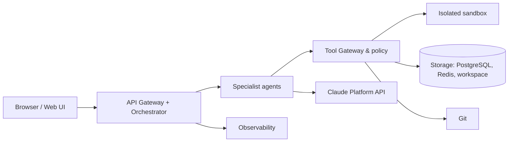

# KodeKantor — Product Requirements Document (PRD v1.0)

> **Sumber:** `PRD_KodeKantor_Agentic_IDE_End_to_End.pdf` v1.0 (36 halaman, 21 Oktober 2026), diekstrak ke `docs/PRD_source.txt` lalu dikonversi ke Markdown ini secara setia (lihat PRD Lampiran B: "PRD disalin ke repository sebagai docs/PRD.md").
> **Catatan konversi:**
> - Tabel PDF yang terbungkus per kolom disusun ulang sebagai tabel Markdown; isi teks tidak diubah kecuali perbaikan pemenggalan baris.
> - Gambar 1 (mockup UI) dan Gambar 2 (arsitektur) tidak dapat disalin sebagai gambar; isinya **dideskripsikan dalam teks** dan ditandai *[Deskripsi gambar]*.
> - Header/footer halaman ("KODEKANTOR / PRODUCT REQUIREMENTS DOCUMENT", "Internal Product Blueprint • Version 1.0 • 21 October 2026 | Page N") dihapus.
> - Catatan penyunting ditandai *[Catatan konversi]* dan bukan bagian PRD asli. Interpretasi/keputusan implementasi ada di `docs/DECISIONS.md`, bukan di dokumen ini.

---

## KODEKANTOR — PRODUCT REQUIREMENTS DOCUMENT

**Self-Hosted Agentic Coding IDE**

Platform IDE berbasis web untuk membuat, memahami, memodifikasi, menguji, memperbaiki, mereview, dan men-deploy aplikasi menggunakan specialist agents dengan kontrol pengguna.

| PRODUCT | DOCUMENT | STATUS |
|---|---|---|
| KodeKantor | PRD v1.0 | Draft baseline for implementation |

Tanggal: 21 Oktober 2026 | Target deployment: VPS Linux mandiri | LLM runtime MVP: Claude Platform API | Bahasa dokumen: Indonesia

Dokumen ini menetapkan baseline kebutuhan produk dan implementasi. Detail model/provider, batas concurrency, konfigurasi VPS, dan kebijakan remote repository dapat disesuaikan melalui keputusan desain tanpa mengubah prinsip dasar keamanan dan penerimaan produk.

---

## Kontrol Dokumen & Isi Utama

| Field | Nilai |
|---|---|
| Nama produk | KodeKantor — Self-Hosted Agentic Coding IDE |
| Versi dokumen | 1.0 |
| Status | Baseline PRD untuk review dan implementasi bertahap |
| Pemilik produk | Product Owner / pengelola project |
| Pengguna utama | Individual developer, tim startup IT, technical lead, QA/DevOps |
| Lingkungan | VPS Linux mandiri; deployment awal single-node, architecture-ready untuk scale-out |
| Prinsip keputusan | User intent first; evidence-based validation; least privilege; safe execution; incremental delivery |

### Daftar Isi

1. Ringkasan eksekutif, visi, dan ruang lingkup
2. Persona, kebutuhan pengguna, dan use case utama
3. End-to-end workflows dan state model task
4. Mockup design dan spesifikasi layar
5. Modul aplikasi dan kebutuhan fungsional
6. Katalog 41 specialist agents + Orchestrator
7. Arsitektur sistem, teknologi, data model, dan API
8. Keamanan, kebijakan tools, dan approval
9. Non-functional requirements dan observability
10. Acceptance criteria, QA strategy, dan release gates
11. Roadmap implementasi, risiko, asumsi, dan referensi

*[Catatan konversi: Daftar Isi asli memuat 11 butir yang tidak sama dengan penomoran isi dokumen (bab 1–17 + Lampiran A/B). Penomoran yang dipakai di seluruh repo adalah penomoran isi (§1–§17).]*

> **Catatan tentang jumlah agents**
> PRD ini menetapkan 41 specialist agent profiles dan 1 Orchestrator. Angka tersebut adalah target katalog kapabilitas. MVP tidak perlu menjalankan 41 LLM agents secara terpisah; beberapa fungsi diwujudkan sebagai tools deterministik, subagent terpilih, atau profile khusus.

---

## 1. Ringkasan Eksekutif

KodeKantor adalah website IDE agentic yang berjalan di VPS milik sendiri. Pengguna dapat membuat project baru atau mengimpor repository, memberikan instruksi melalui chat, melihat dan mengubah kode, meminta agent melakukan debugging, menjalankan test di sandbox, meninjau diff, memvalidasi hasil dari perspektif pengguna, dan menyiapkan deployment.

Pembeda utamanya adalah orkestrasi berbasis task dan bukti, bukan sekadar satu chatbot. Orchestrator memilih specialist sesuai kebutuhan; tool gateway menegakkan izin; sandbox menjalankan kode secara terisolasi; serta User Proxy Agent mengevaluasi apakah hasil aktual memenuhi requirement dan acceptance criteria.

> **North-star outcome**
> Task software development selesai dengan perubahan yang dapat ditinjau, hasil test yang dapat dibuktikan, status requirement yang transparan, serta kontrol pengguna atas aksi berisiko.

### 1.1 Visi Produk

Menjadi development workspace personal/tim yang mengubah instruksi natural language menjadi perubahan software yang tervalidasi, dengan fleksibilitas provider AI dan kepemilikan data/workspace berada pada pengguna.

### 1.2 Tujuan Produk

- Mendukung lifecycle software development: plan, create, modify, debug, test, review, document, dan deploy.
- Memusatkan kode, chat, task plan, terminal, test output, diff, dan acceptance status dalam satu IDE.
- Memakai specialist agents yang dapat dipilih dinamis berdasarkan intent, kompleksitas, dan risiko task.
- Memastikan User Proxy Agent memeriksa kesesuaian hasil dengan requirement pengguna.
- Memberikan jejak audit, kontrol biaya, pembatasan resource, dan persetujuan manusia untuk operasi sensitif.
- Memulai dari satu VPS dan memungkinkan pemisahan worker/sandbox di tahap scale-up tanpa desain ulang total.

### 1.3 Indikator Keberhasilan Produk

| Metric | Definisi | Target awal untuk pilot |
|---|---|---|
| Task success rate | Task yang memenuhi acceptance criteria dibagi task yang valid selesai dievaluasi. | Baseline diukur; target awal >=70% pada benchmark task yang disepakati. |
| Test pass evidence | Task implementasi dengan hasil test aktual yang tersimpan. | >=95% task yang mengklaim “tested” memiliki bukti eksekusi. |
| Requirement traceability | Requirement wajib yang terhubung dengan test/evidence/status. | 100% requirement wajib memiliki status. |
| Human approval coverage | Aksi kategori high-risk yang melalui approval server-side. | 100% aksi wajib-approval. |
| Reproducibility | Task dapat dilacak dari prompt hingga commit/patch, model, tools, dan log. | 100% task menghasilkan task record dan audit metadata. |
| Cost visibility | Task menampilkan estimasi/aktual token dan biaya jika provider mendukung. | Semua request model dicatat; biaya dapat tidak tersedia bila provider tak mengirim data. |

Target angka di tabel adalah sasaran pilot awal untuk divalidasi, bukan klaim performa produk yang sudah terbukti. Baseline harus diukur pada kumpulan task representatif.

### 1.4 Non-Goals untuk MVP

- Bukan pengganti penuh IDE desktop dengan seluruh ekstensi VS Code.
- Tidak menjalankan model AI lokal secara default; runtime model menggunakan provider adapter.
- Tidak memberi agent akses shell host atau Docker daemon tanpa perantara kebijakan.
- Tidak melakukan production deployment, destructive migration, atau force push tanpa persetujuan eksplisit.
- Tidak menjanjikan semua task dapat selesai sepenuhnya otonom; task ambigu atau berisiko harus dapat meminta klarifikasi/approval.
- Tidak memerlukan 41 model/agent aktif bersamaan.

---

## 2. Persona, Kebutuhan, dan Use Cases

| Persona | Kebutuhan | Capability inti |
|---|---|---|
| Solo developer / founder | Membangun MVP dengan tim kecil; hemat waktu berpindah tool. | Prompt-to-code, file editor, terminal, test, preview, Git diff. |
| Full-stack developer | Mengubah fitur dan melakukan debugging di repository yang sudah ada. | Codebase Explorer, impact analysis, specialist routing, safe patch. |
| QA / test engineer | Memastikan acceptance criteria dan user flows berjalan. | Test matrix, unit/integration/E2E, bukti hasil, regression status. |
| Tech lead / reviewer | Mengendalikan kualitas arsitektur dan perubahan. | Architecture proposal, diff review, ADR, approval gates. |
| DevOps / platform engineer | Menguji build, staging, deployment, logs, dan rollback. | CI config, sandbox, staging deployment, observability. |
| Administrator platform | Mengelola user, provider, policy, biaya, dan audit. | RBAC, provider configuration, budgets, quotas, audit log. |

### 2.1 Use Cases Utama

| ID | Use case | Hasil yang diharapkan |
|---|---|---|
| UC-01 | Create from prompt | Project skeleton, rencana, kode awal, dan cara menjalankan. |
| UC-02 | Import repository | Workspace terindeks, stack terdeteksi, README/run instructions diringkas. |
| UC-03 | Modify existing feature | Impact assessment, patch scoped, test, diff, user acceptance report. |
| UC-04 | Debug failing task | Issue direproduksi, root cause dicatat, patch dibuat, tes ulang dilakukan. |
| UC-05 | Run end-to-end tests | Browser flows berjalan di sandbox/preview dengan screenshot/log. |
| UC-06 | Validate against user intent | Requirement-by-requirement pass/fail/unverified disertai evidence. |
| UC-07 | Review and approve changes | Pengguna melihat file changes, test status, risiko, dan memilih apply/reject. |
| UC-08 | Prepare deployment | Preflight, staging, smoke tests, dan rollback plan; production gated. |
| UC-09 | Resume interrupted task | Checkpoint/task log dipulihkan dan status dipahami setelah reconnect. |
| UC-10 | Control budget and providers | Pilih provider/model, set task limit, dan lihat estimasi/aktual biaya. |

---

## 3. End-to-End Workflow

### 3.1 Alur create project dari awal

1. Pengguna login lalu memilih Create Project: template, blank, atau import repository.
2. Intent Classifier + Requirement Analyst menangkap tujuan, batasan, teknologi, serta acceptance criteria awal.
3. Codebase Explorer (untuk repository yang sudah ada) mengumpulkan konteks yang relevan; Architect dipanggil bila kompleksitas memerlukan desain.
4. Planner membuat DAG task dengan dependency, specialist assignment, batas iterasi, dan perkiraan budget.
5. Orchestrator menjalankan task di workspace/branch terisolasi. Coding specialists membuat patch melalui Tool Gateway.
6. Test Runner mengeksekusi lint, unit test, integration test, build, dan E2E sesuai risiko dan stack.
7. Jika test gagal, Debugger menganalisis bukti dan menghasilkan patch perbaikan dengan retry count terbatas.
8. Code Review dan Security Agents mengevaluasi diff; User Proxy Agent memeriksa acceptance criteria dan user journey.
9. UI menampilkan ringkasan, requirement coverage, diff, test evidence, risiko, dan item yang belum diverifikasi.
10. Pengguna meminta perbaikan, menolak, atau menyetujui penerapan perubahan. Merge/deployment tetap mengikuti approval policy.

### 3.2 Alur modify / debug

Untuk task perubahan kecil, workflow boleh disederhanakan: intent → explore context → impact analysis bila berisiko → implementer/debugger → test → review → User Proxy validation → approval. Architect, migration, DevOps, atau specialist lanjutan hanya dipanggil bila dipicu kebutuhan atau policy.

### 3.3 Task State Machine

| State | Makna | Transisi yang diperbolehkan |
|---|---|---|
| draft | Task dibuat tetapi belum direncanakan. | planned, cancelled |
| planned | Requirement dan execution plan tersedia. | queued, needs_clarification, cancelled |
| queued | Menunggu worker/resource. | running, cancelled |
| running | Agent/tools sedang bekerja. | validating, waiting_approval, failed, interrupted |
| validating | Test/review/User Proxy sedang memeriksa hasil. | completed, needs_changes, waiting_approval, failed |
| needs_changes | Ada gap yang perlu diperbaiki. | queued, cancelled |
| waiting_approval | Menunggu keputusan pengguna. | queued, completed, rejected, cancelled |
| interrupted | Proses berhenti sementara atau worker mati. | queued, failed, cancelled |
| completed | Acceptance criteria wajib terpenuhi atau penyelesaian parsial disetujui. | reopened |
| failed | Gagal setelah batas retry atau kegagalan fatal. | queued/manual retry, cancelled |
| cancelled/rejected | Task dibatalkan atau perubahan ditolak. | new task |

> **Status tidak boleh dibuat-buat**
> Task tidak dapat berstatus completed hanya karena agent berkata “selesai”. Status harus didukung hasil tools, acceptance criteria, artefak, dan bukti validasi yang disimpan.

*[Catatan konversi: `needs_clarification` muncul sebagai target transisi tetapi tidak memiliki baris state sendiri, dan tidak ada transisi `running → cancelled` walau AC-14 mewajibkan pembatalan task berjalan. Deviasi yang disetujui dicatat di ADR-006.]*

---

## 4. Mockup Design dan UX Specification

Arah visual: tema kantor startup IT modern bernama KodeKantor. Sidebar gelap menjaga fokus; area kerja terang menjaga code readability; oranye menjadi warna aksi utama; biru untuk status/interaksi; hijau untuk keberhasilan. Mockup adalah referensi visual konseptual, bukan spesifikasi pixel-perfect atau bukti bahwa interaksi sudah berfungsi.

**Gambar 1.** Mockup konseptual KodeKantor: login, dashboard, project creation, IDE, agent team, workflow, preview, testing, diff review, dan User Proxy validation.

*[Deskripsi gambar: Gambar 1 adalah satu halaman kolase sepuluh layar konseptual dengan gaya visual di atas — sidebar navigasi gelap, area kerja terang, tombol aksi utama oranye, status/interaksi biru, indikator sukses hijau. Kesepuluh panel berurutan sesuai tabel §4.1: (1) Login, (2) Dashboard, (3) Create Project, (4) Project Workspace/IDE, (5) AI Agents (agent team), (6) Task Planning & Workflow, (7) Preview & Result, (8) Testing & Debugging, (9) Code Review & Diff, (10) User Proxy Validation. Komponen dan interaksi setiap panel dijabarkan pada tabel §4.1; gambar asli hanya ada di PDF sumber.]*

### 4.1 Penjelasan layar pada mockup

| No. | Layar | Komponen utama | Interaksi wajib |
|---|---|---|---|
| 1 | Login | Brand, email/password, remember me, SSO placeholder, recovery, create account. | Login/logout, error state, session expiry, accessible form labels. |
| 2 | Dashboard | Project aktif, task berjalan/selesai, failed tasks, recent projects, agent activity. | Filter/search, open project/task, create project, activity detail. |
| 3 | Create Project | Template, import repository, blank project, template search. | Validasi input, template selection, repository import progress. |
| 4 | Project Workspace / IDE | File explorer, tabs, Monaco editor, chat side panel, Run/Preview/Git actions. | Read/edit file, safe apply patch, autosave state, chat streaming, preview. |
| 5 | AI Agents | Search/filter specialist, status, capabilities, create task. | View agent details, capability/permission profile, task assignment. |
| 6 | Task Planning & Workflow | Plan, workflow, output, logs, file changes; detail panel, assignee, priority. | Edit/approve plan, pause/cancel, inspect dependencies and task status. |
| 7 | Preview & Result | Live application preview, app nav, dashboard/data components. | Refresh preview, viewport selection, report visual issue, open browser tests. |
| 8 | Testing & Debugging | Unit/integration/E2E tabs, passed/failed/skipped, coverage, terminal logs. | Run/re-run tests, drill down failure, feed evidence to Debugger. |
| 9 | Code Review & Diff | Changed file list, red/green diff, comments/findings, security tab. | Inspect hunk, comment, request revision, stage/apply approved patch. |
| 10 | User Proxy Validation | Acceptance checklist, user journey, screenshot, feedback, gap explanation. | Request fixes, approve after fix, defer subjective criterion, export report. |

### 4.2 Global navigation

- **Dashboard** — project/task overview, activity, usage/budget, and recent work.
- **Projects** — list, create, import, archive, configure, and open workspace.
- **AI Agents** — catalog, profile, capability, permission, health/status, and run history.
- **Tasks** — queue, workflow graph, logs, artifacts, checkpoint, retry, cancel.
- **Workspace** — file tree, editor, chat, terminal, preview, Git, and diff.
- **Testing** — suite management, reports, coverage, E2E screenshots, regression results.
- **Deployments** — environments, preflight, release history, approval, rollback status.
- **Knowledge** — project context, ADR, docs, indexed symbols, and conversation/task history.
- **Teams & Settings** — users, roles, provider settings, budget, security policy, audit.

### 4.3 UX behavior yang harus konsisten

- Setiap aksi panjang menampilkan state: queued, running, waiting approval, validating, completed, failed, cancelled.
- Semua layar menampilkan project context aktif dan perubahan yang belum diterapkan.
- Chat dapat merujuk file, baris kode, task ID, agent output, test report, dan diff yang nyata.
- Output AI dipisahkan dari bukti tool aktual. UI tidak menyamarkan saran sebagai hasil yang telah dieksekusi.
- Perubahan file ditinjau sebagai patch. Pengguna dapat melihat old/new diff dan menolak atau meminta perbaikan.
- UI memiliki empty, loading, error, timeout, disconnected, permission denied, dan partial success states.
- Layout harus responsif, tetapi tahap MVP mengutamakan desktop karena editor, terminal, dan diff memerlukan ruang.

---

## 5. Modul Aplikasi dan Kebutuhan Fungsional

| ID | Module | Scope / fitur | Priority | FR mapping |
|---|---|---|---|---|
| M01 | Authentication & User Access | Login, logout, session management, optional OAuth/SSO, password recovery, role-based authorization. | P0 | FR-001..FR-006 |
| M02 | Dashboard | Metrics project/task, recent projects, agent activity, failed task queue, quick create. | P0 | FR-007..FR-011 |
| M03 | Project Management | Create from template/blank, import repository/archive, settings, archive, project metadata. | P0 | FR-012..FR-018 |
| M04 | Repository & Context | File tree, text/symbol search, stack detection, indexing, entrypoints, context retrieval. | P0 | FR-019..FR-025 |
| M05 | Browser IDE | Monaco editor, tabs, read/write operations, syntax highlight, patch preview, file save state. | P0 | FR-026..FR-032 |
| M06 | AI Chat Workspace | Prompt history, attachments/references, streaming, cancellation, context scope, task creation. | P0 | FR-033..FR-040 |
| M07 | Agent Registry | Catalog, profiles, capabilities, model policy, permissions, readiness/status, invocation logs. | P0 registry / P1 admin UI | FR-041..FR-047 |
| M08 | Orchestrator & Workflow Engine | Intent routing, plan DAG, queues, dependencies, retry, checkpoint, timeout, cancel/resume. | P0 | FR-048..FR-058 |
| M09 | Tool Gateway & Policy | Typed tool schemas, path validation, allowlisted commands, quota enforcement, approval checks. | P0 security foundation | FR-059..FR-067 |
| M10 | Sandbox & Runtime | Isolated workspace, ephemeral execution, CPU/RAM/disk/time limits, network policy, cleanup. | P0 security foundation | FR-068..FR-076 |
| M11 | Terminal & Command Runner | Streaming output, command allowlist/profile, exit codes, timeout, working directory validation. | P0 constrained | FR-077..FR-083 |
| M12 | Testing & Debugging | Unit/integration/build/E2E runners, failure capture, debugger loop, retry budget. | P0 core tests; E2E P1 | FR-084..FR-094 |
| M13 | Diff & Code Review | Changed files, diff hunks, review comments, severity, request fix, apply/reject patch. | P0 | FR-095..FR-102 |
| M14 | User Proxy Acceptance | Requirement baseline, criteria traceability, visual/user journey evidence, gaps, acceptance report. | P0 | FR-103..FR-112 |
| M15 | Git & Remote Collaboration | Status/diff/branch/commit proposal; remote sync/PR behind credentials and approval. | P0 local Git / P2 remote | FR-113..FR-120 |
| M16 | Documentation & Knowledge | README/docs generation, ADR, repository indexing, memory retrieval, stale-index invalidation. | P1 | FR-121..FR-127 |
| M17 | Provider & Model Settings | API key secret storage, adapter configuration, model selection, fallback, token/cost limits. | P0 provider config | FR-128..FR-135 |
| M18 | Deployment & Environments | Docker/CI configs, staging deployment, preflight, smoke tests, rollback; production gated. | P2 | FR-136..FR-143 |
| M19 | Observability & Audit | Structured logs, task timeline, usage metrics, agent/tool traces, immutable security event trail. | P0 audit basics / P1 dashboards | FR-144..FR-151 |
| M20 | Admin & Governance | User/role admin, quotas, policy settings, data retention, provider allowlist, feature flags. | P1 | FR-152..FR-159 |

*[Catatan konversi: PRD hanya memberi rentang ID FR per modul; isi FR-001..FR-159 tidak didefinisikan. Katalog turunan ada di `docs/FR_CATALOG.md` (ADR-020).]*

### 5.1 Authentication & User Access

- Login dengan email/password atau metode identity yang dipilih saat implementasi; SSO dapat menjadi fase lanjut.
- Session dibuat dengan mekanisme aman; token/session tidak pernah dimasukkan ke prompt atau log mentah.
- RBAC minimum: Owner, Admin, Developer, Reviewer, Read-only. Hak akses server-side pada setiap endpoint.
- Password recovery, logout, session expiry, rate limiting untuk login, dan audit autentikasi.
- Definisi awal satu pengguna owner untuk private MVP tidak menghapus kebutuhan isolasi user/project dalam model data.

### 5.2 Project & Repository Management

- Project mempunyai ID stabil, nama, stack, path internal, default branch, settings, dan owner.
- Dukungan create blank, create template, import remote repository setelah provider credential disetujui, dan upload archive yang divalidasi.
- Archive importer mencegah path traversal, symlink escape, file terlalu besar, bomb archive, dan overwrite sistem.
- Repository diindeks per project. Pengguna dapat memicu re-index setelah perubahan atau setelah import.
- Project lifecycle: active, archived, deleting_pending_approval, deleted. Delete harus punya kebijakan retention/backup.

### 5.3 Browser IDE

- Layout: explorer kiri, editor tengah, AI panel kanan, panel bawah yang dapat dipilih untuk terminal/test/logs.
- File read/write hanya melalui Workspace Service dengan root project yang tervalidasi.
- Agent menghasilkan patch; perubahan ditampilkan dalam diff sebelum masuk ke workspace aktif bila task menggunakan review-first mode.
- Run/Preview hanya menjalankan profile yang disetujui dan menggunakan preview sandbox, bukan proses host bebas.
- File binary/terlalu besar ditampilkan sebagai metadata atau di-download sesuai policy; tidak dimasukkan ke prompt secara otomatis.

### 5.4 Chat, Context & Agent Execution

- Chat menyimpan user message, task intent, context refs, assistant output, tool calls, dan event stream secara terstruktur.
- Context harus berisi referensi file/line yang spesifik serta ringkasan seperlunya; context budget dikendalikan.
- Sediakan stop/cancel yang menghentikan orchestration dan proses sandbox terkait, bukan hanya menghentikan animasi UI.
- Setiap invocation mencatat agent_id, model/provider, prompt version, tool calls, token usage bila ada, latency, status, dan biaya bila diketahui.
- Instruksi yang ditemukan di source code, README, log, atau hasil retrieval diperlakukan sebagai data tidak tepercaya dan tidak dapat menaikkan izin.

### 5.5 User Proxy Acceptance Module

Modul ini adalah pembeda produk dan harus ada sejak MVP. User Proxy Agent bukan sekadar chatbot yang menebak apakah pengguna akan suka. Ia menerima requirement baseline yang disetujui, mengumpulkan evidence aktual, lalu melaporkan hasil per kriteria.

| Kebutuhan | Perilaku |
|---|---|
| Requirement baseline | Setiap requirement menyimpan sumber, tingkat wajib/opsional, versi, serta metode verifikasi. |
| Criteria status | Setiap kriteria berstatus passed, failed, unverified, waived_by_user, atau blocked. |
| Evidence | Evidence dapat berupa test result, API response, screenshot, browser trace, diff, atau catatan review. |
| Subjective preference | Untuk “terlalu ramai”, “mudah dipakai”, atau preferensi subjektif lain, agent menjelaskan penilaiannya dan meminta feedback bila tidak jelas. |
| Gap routing | Kegagalan objektif diarahkan ke task perbaikan yang jelas; perubahan scope harus tercatat sebagai requirement change. |
| Acceptance report | Ringkasan total kriteria, gap, risiko, confidence, evidence links, serta rekomendasi next action. |
| Final acceptance | User Proxy dapat merekomendasikan acceptance, tetapi tidak menggantikan keputusan eksplisit pengguna untuk approval berisiko. |

### 5.6 Testing & Debugging

- Runner menggunakan project stack profile untuk mendeteksi command yang didukung, contohnya pytest, npm test, lint, atau build.
- Output test menyimpan command profile, exit code, stdout/stderr, waktu, durasi, environment ID, dan artifacts.
- Debug loop memiliki maksimal percobaan configurable; default pilot 5 attempt per task, bukan tanpa batas.
- Gagal install dependency, timeout, runner crash, dan test assertion failure harus dibedakan statusnya.
- Coverage dilaporkan hanya jika runner menghasilkan data; tidak boleh diestimasi oleh model.

### 5.7 Provider & Budget Management

- Provider adapter memisahkan business workflow dari API spesifik vendor.
- API keys disimpan di secret store/environment server-side; UI hanya menampilkan status atau masked identifier.
- Budget controls: batas token/task jika provider mendukung, batas durasi, batas retry, concurrency, dan biaya nominal yang dikonfigurasi.
- Fallback model/provider hanya dilakukan sesuai kebijakan; perubahan model dicatat karena dapat memengaruhi output.
- Usage dashboard membedakan actual values, estimate, dan unavailable. Jangan menampilkan angka biaya palsu.

---

## 6. Katalog Specialist Agents dan Capability Functions

Bagian ini menjadi registry awal yang bisa diturunkan ke `agents/registry.yaml` atau konfigurasi database. Nama capability adalah kontrak konseptual internal dan harus diimplementasikan sebagai typed functions/tools dengan input schema, output schema, policy check, timeout, audit logging, dan test.

### Planning & User Intent

#### A01 — Request & Intent Classifier

Mengklasifikasikan tujuan permintaan dan memilih workflow awal.

- **Capability functions:** `intent.classify`; `intent.detect_stack`; `intent.estimate_complexity`; `intent.identify_constraints`; `intent.select_workflow`
- **Inputs / tools:** Requirement text, project metadata.
- **Output:** Intent + workflow proposal.
- **Priority / access:** P0 • read-only.

#### A02 — Requirement Analyst

Mengubah prompt menjadi requirement eksplisit dan dapat diuji.

- **Capability functions:** `requirements.extract`; `requirements.generate_acceptance_criteria`; `requirements.identify_edge_cases`; `requirements.check_completeness`; `requirements.generate_test_scenarios`
- **Inputs / tools:** Requirement store, repository context.
- **Output:** Requirement specification + acceptance criteria.
- **Priority / access:** P0 • read-only.

#### A03 — Planner & Task Decomposer

Memecah pekerjaan menjadi task, dependensi, dan jadwal eksekusi.

- **Capability functions:** `plan.decompose`; `plan.define_dependencies`; `plan.identify_parallel_tasks`; `plan.assign_specialists`; `plan.generate_execution_graph`
- **Inputs / tools:** Task API, agent registry.
- **Output:** Task DAG + completion criteria.
- **Priority / access:** P0 • orchestration only.

#### A04 — Codebase Explorer & Context Engineer

Mencari konteks relevan tanpa memuat seluruh repository ke model.

- **Capability functions:** `repo.get_tree`; `repo.search_text`; `repo.search_symbol`; `repo.read_file`; `repo.detect_entrypoints`; `repo.build_dependency_map`; `repo.find_related_tests`
- **Inputs / tools:** Read-only repository tools, code index.
- **Output:** Context package + source references.
- **Priority / access:** P0 • read-only.

#### A05 — Software Architect

Menentukan modul, antarmuka, kontrak, dan trade-off arsitektur.

- **Capability functions:** `architecture.propose`; `architecture.define_modules`; `architecture.define_interfaces`; `architecture.define_api_contracts`; `architecture.evaluate_tradeoffs`; `architecture.create_adr`
- **Inputs / tools:** Diagrams, repo metadata, requirements.
- **Output:** Architecture proposal + ADR.
- **Priority / access:** P1 • read-only/proposal.

#### A06 — Change Impact & Risk Analyst

Memetakan file terdampak, risiko regresi, dan rollback.

- **Capability functions:** `impact.map_affected_files`; `impact.trace_dependencies`; `impact.detect_breaking_changes`; `impact.estimate_regression_risk`; `impact.identify_required_tests`; `impact.create_rollback_plan`
- **Inputs / tools:** Git diff, dependency map, tests.
- **Output:** Impact assessment.
- **Priority / access:** P1 • read-only.

#### A07 — User Proxy / User Intent & Acceptance

Merepresentasikan kepentingan pengguna dan memeriksa produk aktual terhadap kebutuhan serta preferensinya.

- **Capability functions:** `user_proxy.capture_intent`; `user_proxy.manage_requirements`; `user_proxy.generate_acceptance_criteria`; `user_proxy.validate_implementation`; `user_proxy.validate_user_journey`; `user_proxy.review_visual_output`; `user_proxy.detect_requirement_gap`; `user_proxy.issue_acceptance_report`
- **Inputs / tools:** Requirement baseline, preview/browser, test evidence, feedback.
- **Output:** Acceptance report: pass/fail/unverified + evidence.
- **Priority / access:** P0 • mostly read-only; cannot give human approval.

### Software Development

#### B08 — UI/UX Designer

Menerjemahkan kebutuhan menjadi user flow, wireframe, dan design system.

- **Capability functions:** `design.analyze_brief`; `design.create_user_flow`; `design.define_wireframe`; `design.define_components`; `design.define_design_tokens`; `design.check_responsive_layout`
- **Inputs / tools:** Design tokens, screenshots, component library.
- **Output:** UI specification + component map.
- **Priority / access:** P1 • design artifacts.

#### B09 — Frontend Developer

Membangun UI, routing, state, dan integrasi API.

- **Capability functions:** `frontend.create_component`; `frontend.create_page`; `frontend.configure_routing`; `frontend.manage_state`; `frontend.integrate_api`; `frontend.handle_loading_error`; `frontend.optimize_rendering`
- **Inputs / tools:** Workspace patch, package scripts, browser preview.
- **Output:** Frontend patch + build evidence.
- **Priority / access:** P0/P1 • write scoped workspace.

#### B10 — Backend Developer

Membangun business logic, service layer, middleware, dan API handlers.

- **Capability functions:** `backend.create_endpoint`; `backend.implement_service`; `backend.validate_input`; `backend.handle_errors`; `backend.implement_background_job`; `backend.configure_middleware`; `backend.optimize_endpoint`
- **Inputs / tools:** Workspace patch, test runner, API schema.
- **Output:** Backend patch + test evidence.
- **Priority / access:** P0/P1 • write scoped workspace.

#### B11 — API & Integration Specialist

Merancang kontrak API dan integrasi eksternal yang tahan terhadap kegagalan.

- **Capability functions:** `api.define_contract`; `api.generate_openapi`; `api.implement_client`; `api.integrate_external_service`; `api.validate_compatibility`; `api.configure_retry_timeout`; `api.verify_webhooks`
- **Inputs / tools:** OpenAPI tools, mock servers, secret references.
- **Output:** Contract + integration patch.
- **Priority / access:** P1 • sandboxed write.

#### B12 — Database & Data Modeling Specialist

Merancang skema, query, indeks, transaksi, dan integritas data.

- **Capability functions:** `db.design_schema`; `db.define_relationships`; `db.create_query`; `db.optimize_query`; `db.analyze_query_plan`; `db.recommend_indexes`; `db.validate_integrity`
- **Inputs / tools:** Migration files, local test DB, explain plans.
- **Output:** Schema proposal/query/migration + validation.
- **Priority / access:** P1 • no production writes.

#### B13 — Authentication & Identity Specialist

Membangun login, session, OAuth/SSO, RBAC, dan account recovery.

- **Capability functions:** `auth.implement_login`; `auth.configure_session`; `auth.implement_rbac`; `auth.configure_oauth`; `auth.review_authorization`; `auth.implement_account_recovery`; `auth.audit_identity_flows`
- **Inputs / tools:** Auth test fixtures, identity provider sandbox.
- **Output:** Identity patch + security tests.
- **Priority / access:** P1 • sandboxed write.

#### B14 — General Code Implementation Agent

Worker utama untuk membuat dan mengubah kode dalam scope task.

- **Capability functions:** `code.create_file`; `code.apply_patch`; `code.modify_function`; `code.implement_feature`; `code.refactor_scope`; `code.resolve_type_errors`; `code.validate_patch`
- **Inputs / tools:** Scoped filesystem, patch API, compiler/linter.
- **Output:** Patch + changed-file manifest.
- **Priority / access:** P0 • scoped write; no direct deploy.

#### B15 — AI/LLM Application Specialist

Membangun fitur aplikasi pengguna yang menggunakan model AI.

- **Capability functions:** `ai.configure_provider`; `ai.create_prompt_template`; `ai.implement_tool_calling`; `ai.define_structured_output`; `ai.implement_rag`; `ai.evaluate_model_output`; `ai.track_token_cost`; `ai.configure_fallback`
- **Inputs / tools:** Provider adapters, eval harness, vector store.
- **Output:** AI integration + evaluation report.
- **Priority / access:** P2 • sandboxed write.

### Testing & Debugging

#### C16 — Test Strategy Agent

Menetapkan strategi tes dan cakupan yang proporsional terhadap risiko.

- **Capability functions:** `test.plan`; `test.define_test_matrix`; `test.map_requirements_to_tests`; `test.identify_coverage_gaps`; `test.prioritize_regression_tests`
- **Inputs / tools:** Requirements, repository map, test reports.
- **Output:** Test plan + coverage matrix.
- **Priority / access:** P0 • read-only/planning.

#### C17 — Unit Testing Agent

Membuat dan menjalankan unit test.

- **Capability functions:** `tests.generate_unit_tests`; `tests.run_unit_tests`; `tests.analyze_unit_failures`; `tests.identify_boundary_cases`; `tests.check_assertion_quality`; `tests.report_coverage`
- **Inputs / tools:** Approved test runner, test files.
- **Output:** Test patch + test report.
- **Priority / access:** P0 • test-only writes by default.

#### C18 — Integration & API Testing Agent

Memvalidasi kontrak serta interaksi antarmodul dan service.

- **Capability functions:** `tests.generate_integration_tests`; `tests.run_api_tests`; `tests.verify_contracts`; `tests.test_database_integration`; `tests.simulate_dependency_failure`; `tests.validate_authentication_flows`
- **Inputs / tools:** Sandbox services, fixtures, API test runner.
- **Output:** Integration report + evidence.
- **Priority / access:** P1 • sandbox.

#### C19 — E2E & Browser QA Agent

Menjalankan user journey melalui browser dan menangkap bukti UI.

- **Capability functions:** `browser.open_page`; `browser.click_element`; `browser.fill_form`; `browser.capture_screenshot`; `browser.collect_console_errors`; `browser.inspect_network_failures`; `browser.run_user_journey`; `browser.compare_visual_state`
- **Inputs / tools:** Playwright/browser sandbox, preview URL.
- **Output:** E2E report + screenshots + console/network logs.
- **Priority / access:** P1 • isolated browser.

#### C20 — Debugger & Root Cause Analyst

Menemukan akar masalah dan mengarahkan perbaikan berdasarkan bukti.

- **Capability functions:** `debug.parse_stack_trace`; `debug.analyze_logs`; `debug.reproduce_issue`; `debug.identify_root_cause`; `debug.propose_patch`; `debug.compare_before_after`; `debug.validate_fix`
- **Inputs / tools:** Logs, sandbox, tests, scoped patch tool.
- **Output:** Diagnosis + patch proposal + validation.
- **Priority / access:** P0 • scoped write after diagnosis.

#### C21 — Environment & Build Troubleshooter

Mendiagnosis kegagalan toolchain, dependency, config, dan build.

- **Capability functions:** `env.inspect_runtime`; `env.detect_missing_dependency`; `build.run`; `build.diagnose_failure`; `build.resolve_configuration`; `build.check_version_compatibility`
- **Inputs / tools:** Sandbox terminal, manifests, build logs.
- **Output:** Environment diagnosis + validated config patch.
- **Priority / access:** P1 • sandbox.

### Quality & Security

#### D22 — Code Review Agent

Melakukan review independen terhadap diff dan kualitas implementasi.

- **Capability functions:** `review.inspect_diff`; `review.detect_logic_bug`; `review.check_conventions`; `review.detect_duplication`; `review.analyze_regression_risk`; `review.verify_acceptance_criteria`; `review.generate_findings`
- **Inputs / tools:** Git diff, coding standards, test evidence.
- **Output:** Finding list with severity/location/evidence.
- **Priority / access:** P0 • read-only.

#### D23 — Application Security Agent

Menilai risiko aplikasi, akses, input validation, secrets, dan konfigurasi.

- **Capability functions:** `security.scan_secrets`; `security.review_authorization`; `security.review_input_validation`; `security.detect_injection_risks`; `security.review_file_access`; `security.analyze_threat_model`; `security.review_security_headers`
- **Inputs / tools:** SAST/secret scanner, source, security test tools.
- **Output:** Security findings + remediation guidance.
- **Priority / access:** P0 baseline • read-only, scanner execution.

#### D24 — Dependency & Supply Chain Agent

Menilai package, kerentanan, lisensi, dan upgrade dependency.

- **Capability functions:** `deps.inventory`; `deps.audit_vulnerabilities`; `deps.check_licenses`; `deps.detect_unused_packages`; `deps.propose_upgrade`; `deps.validate_lockfile`; `deps.check_transitive_dependencies`
- **Inputs / tools:** Lockfiles, advisory feeds, license scanner.
- **Output:** Dependency inventory + upgrade proposal.
- **Priority / access:** P1 • upgrade requires review.

#### D25 — Performance & Scalability Agent

Mengukur bottleneck CPU, memori, query, jaringan, atau rendering.

- **Capability functions:** `performance.profile_application`; `performance.analyze_query`; `performance.detect_bottleneck`; `performance.review_memory_usage`; `performance.design_load_test`; `performance.compare_benchmark`
- **Inputs / tools:** Profiler, benchmark runner, test environment.
- **Output:** Baseline, bottleneck findings, before/after metrics.
- **Priority / access:** P2 • non-production load tests.

#### D26 — Accessibility & Compatibility Agent

Memeriksa aksesibilitas dan konsistensi lintas browser/resolusi.

- **Capability functions:** `a11y.scan`; `a11y.check_keyboard_navigation`; `a11y.review_semantics`; `a11y.check_contrast`; `compatibility.test_browser_matrix`; `compatibility.validate_responsive`
- **Inputs / tools:** Browser runner, accessibility scanner.
- **Output:** Accessibility/compatibility report.
- **Priority / access:** P2 • read-only + test execution.

### Git & Collaboration

#### E27 — Git Workflow Agent

Mengelola branch, status, diff, dan kandidat commit.

- **Capability functions:** `git.inspect_status`; `git.inspect_diff`; `git.create_task_branch`; `git.inspect_history`; `git.prepare_commit`; `git.generate_commit_message`; `git.inspect_untracked_files`
- **Inputs / tools:** Git adapter, scoped repository.
- **Output:** Branch/status/diff/commit proposal.
- **Priority / access:** P0 basic / P1 advanced; no force-push.

#### E28 — Merge Conflict Resolution Agent

Menganalisis dan menyelesaikan konflik secara transparan.

- **Capability functions:** `git.detect_conflicts`; `git.explain_conflict`; `git.propose_resolution`; `git.apply_resolution`; `git.validate_merge_result`; `git.run_post_merge_tests`
- **Inputs / tools:** Git adapter, diff, tests.
- **Output:** Resolution patch + tests.
- **Priority / access:** P2 • user data preserved; no destructive overwrite.

#### E29 — Pull Request & Collaboration Agent

Menyiapkan PR, ringkasan perubahan, checklist, dan feedback.

- **Capability functions:** `collaboration.link_issue_to_task`; `collaboration.prepare_pr_description`; `collaboration.summarize_changes`; `collaboration.generate_review_checklist`; `collaboration.collect_review_feedback`; `collaboration.map_feedback_to_tasks`
- **Inputs / tools:** Git provider adapter, issue tracker.
- **Output:** PR draft + review checklist.
- **Priority / access:** P2 • remote write requires authorization.

### DevOps & Operations

#### F30 — Build & CI Agent

Menyusun pipeline build dan menjalankan quality gates.

- **Capability functions:** `ci.generate_pipeline`; `ci.validate_config`; `ci.run_local_checks`; `ci.analyze_pipeline_failure`; `ci.configure_test_stages`; `ci.verify_artifacts`
- **Inputs / tools:** CI config files, local runners.
- **Output:** Pipeline config + validation report.
- **Priority / access:** P1 • config patch.

#### F31 — Infrastructure as Code Agent

Menulis konfigurasi Docker dan infrastruktur sebagai kode.

- **Capability functions:** `infra.generate_dockerfile`; `infra.generate_compose`; `infra.generate_iac`; `infra.validate_configuration`; `infra.review_resource_limits`; `infra.check_network_policy`; `infra.plan_environment_changes`
- **Inputs / tools:** Docker/Compose validators, IaC tooling.
- **Output:** Infra files + static validation.
- **Priority / access:** P1 • no unrestricted host control.

#### F32 — Deployment & Release Agent

Menyiapkan rilis, preflight, staging, smoke tests, dan rollback.

- **Capability functions:** `release.prepare`; `release.validate_artifact`; `release.run_preflight`; `release.deploy_staging`; `release.run_smoke_tests`; `release.prepare_rollback`; `release.deploy_production`
- **Inputs / tools:** Deployment adapter with environment policy.
- **Output:** Release plan + deployment report.
- **Priority / access:** P2; production needs explicit approval.

#### F33 — Observability & SRE Agent

Menganalisis telemetry, SLO, logs, metrics, dan traces.

- **Capability functions:** `observability.query_logs`; `observability.inspect_metrics`; `observability.inspect_traces`; `observability.detect_anomaly`; `observability.evaluate_slo`; `observability.propose_alert_rule`; `observability.correlate_release_with_errors`
- **Inputs / tools:** Monitoring adapters, read-only telemetry.
- **Output:** SRE report + recommended alerts.
- **Priority / access:** P2 • read-only by default.

#### F34 — Incident Response & Recovery Agent

Membantu klasifikasi insiden, mitigasi, rollback, dan postmortem.

- **Capability functions:** `incident.classify_severity`; `incident.correlate_events`; `incident.identify_recent_changes`; `incident.propose_mitigation`; `incident.prepare_rollback`; `incident.verify_recovery`; `incident.generate_postmortem`
- **Inputs / tools:** Logs/metrics/deploy history, approved action tools.
- **Output:** Incident timeline + recovery proposal.
- **Priority / access:** P2 • action requires approval.

### Documentation & Knowledge

#### G35 — Technical Documentation Agent

Membuat README, setup guide, arsitektur, dan changelog.

- **Capability functions:** `docs.generate_readme`; `docs.generate_setup_guide`; `docs.document_architecture`; `docs.document_environment`; `docs.update_changelog`; `docs.verify_instructions`
- **Inputs / tools:** Repository, architecture records, test results.
- **Output:** Documentation patch.
- **Priority / access:** P1 • scoped docs writes.

#### G36 — API & Developer Documentation Agent

Memastikan dokumentasi API dan contoh developer selaras dengan implementasi.

- **Capability functions:** `docs.generate_api_reference`; `docs.generate_request_examples`; `docs.document_error_codes`; `docs.generate_sdk_guide`; `docs.check_contract_consistency`; `docs.update_api_examples`
- **Inputs / tools:** OpenAPI schema, test environment.
- **Output:** API documentation + examples.
- **Priority / access:** P2 • docs writes.

#### G37 — Project Knowledge & Memory Agent

Menyimpan keputusan dan mengambil konteks lintas task dengan kontrol stale data.

- **Capability functions:** `memory.index_repository`; `memory.retrieve_context`; `memory.summarize_decisions`; `memory.store_architecture_decision`; `memory.retrieve_task_history`; `memory.refresh_index`; `memory.detect_stale_context`
- **Inputs / tools:** Code index, task DB, ADR store.
- **Output:** Context package + memory references.
- **Priority / access:** P1 • never store secrets.

### Specialized Engineering

#### H38 — Data Engineering Agent

Membangun pipeline data dan transformasi yang dapat diuji.

- **Capability functions:** `data.design_pipeline`; `data.implement_transform`; `data.validate_quality`; `data.configure_scheduling`; `data.check_idempotency`; `data.profile_dataset`; `data.generate_data_tests`
- **Inputs / tools:** Sandbox, fixtures, schema tools.
- **Output:** Pipeline patch + data-quality tests.
- **Priority / access:** P2 • isolated data.

#### H39 — Migration Specialist

Merencanakan migrasi schema, data, framework, dan kompatibilitas.

- **Capability functions:** `migration.analyze_source_target`; `migration.map_schema`; `migration.generate_migration_script`; `migration.plan_backfill`; `migration.run_dry_run`; `migration.validate_data_integrity`; `migration.prepare_rollback`
- **Inputs / tools:** Temporary DB, migration runner, backups check.
- **Output:** Migration plan + dry-run report.
- **Priority / access:** P2 • no production mutation without approval.

#### H40 — Legacy Modernization & Refactoring Agent

Memodernisasi kode bertahap dengan menjaga perilaku yang disepakati.

- **Capability functions:** `refactor.assess_legacy_code`; `refactor.identify_code_smells`; `refactor.propose_safe_steps`; `refactor.extract_module`; `refactor.remove_dead_code`; `refactor.update_patterns`; `refactor.verify_behavior`
- **Inputs / tools:** Coverage, code index, scoped patch tools.
- **Output:** Refactor patch + behavior regression report.
- **Priority / access:** P2 • bounded changes.

#### H41 — Language & Framework Specialist

Memilih instruksi dan toolchain khusus berdasarkan bahasa/framework project.

- **Capability functions:** `framework.detect_stack`; `framework.load_language_profile`; `framework.resolve_build_commands`; `framework.check_idioms`; `framework.check_version_compatibility`; `framework.resolve_framework_errors`; `framework.recommend_project_structure`
- **Inputs / tools:** Language profile registry, linter/test/build tools.
- **Output:** Stack profile + framework-specific guidance.
- **Priority / access:** P1 foundation; profile-driven rather than 1 LLM per stack.

### 6.1 Orchestrator Agent (peran pusat, bukan specialist ke-42)

Orchestrator bertanggung jawab untuk memutuskan workflow, memilih specialist, mengatur dependensi, menjalankan policy checks, menyimpan checkpoint, mengonsolidasikan hasil, dan menghentikan task secara benar. Ia tidak boleh melewati Tool Gateway atau mengganti status dengan asumsi.

**Capability functions:** `orchestrator.route_intent`; `orchestrator.create_workflow`; `orchestrator.schedule_task`; `orchestrator.resolve_dependencies`; `orchestrator.invoke_agent`; `orchestrator.enforce_budget`; `orchestrator.handle_retry`; `orchestrator.pause_resume`; `orchestrator.collect_evidence`; `orchestrator.request_approval`; `orchestrator.finalize_task`.

### 6.2 Agent registry contract

```yaml
agent_id: user_proxy
version: 1
purpose: validate delivered changes against approved user intent
triggers:
  - task_implementation_finished
  - acceptance_review_requested
  - user_feedback_received
input_schema:
  task_id: string
  requirement_baseline_id: string
  artifact_refs: list[string]
  test_report_refs: list[string]
capabilities:
  - user_proxy.validate_implementation
  - user_proxy.validate_user_journey
  - user_proxy.issue_acceptance_report
permissions:
  filesystem: read_only
  deployment: deny
  approval_grant: deny
output_schema:
  status: passed | needs_changes | blocked | unverified
  criteria_results: list[criterion_result]
  evidence_refs: list[string]
  next_actions: list[string]
limits:
  max_iterations: 3
  timeout_seconds: 300
```

*[Catatan konversi: Registry repo memakai `agent_id: A07` + `slug: user_proxy` dan skema yang diperluas (lihat `docs/AGENT_CATALOG.md`).]*

---

## 7. Arsitektur Sistem

Desain awal menggunakan arsitektur modular satu VPS dengan process boundaries yang jelas. API dan web UI boleh berjalan bersama pada satu node, tetapi eksekusi kode pengguna harus dipisahkan dari host dan dari service control-plane. Jika concurrency meningkat, worker dan sandbox manager dapat dipindah ke node terpisah.

**Gambar 2.** High-level architecture: browser → API/orchestrator → specialist agents/tools → isolated sandbox, storage, Git, dan observability.

*[Deskripsi gambar: diagram alir kiri-ke-kanan. Browser (Web UI) terhubung ke API/Orchestrator di VPS; Orchestrator memanggil specialist agents dan tools (melalui Tool Gateway); tools menjangkau isolated sandbox untuk eksekusi kode, serta storage (PostgreSQL, Redis, workspace/object storage), Git, dan observability. Agent runtime memanggil Claude Platform API. Rekonstruksi berikut hanya mengikuti caption, bukan gambar asli:]*



### 7.1 Logical components

| Komponen | Tanggung jawab | Batas kepercayaan |
|---|---|---|
| Web UI | React app: IDE, chat, project, task timeline, diff, test and acceptance view. | Untrusted client; semua permission divalidasi backend. |
| API Gateway | REST APIs, WebSocket/SSE, authentication middleware, rate limits, request validation. | Public-facing control plane. |
| Orchestrator / workflow engine | Task DAG, state transitions, budget, retry, checkpoint, specialist dispatch. | Tidak boleh bypass policy/tool gateway. |
| Agent runtime | Prompt templates, Claude Platform adapter, typed agent inputs/outputs, output validation. | LLM output dianggap untrusted. |
| Tool Gateway & policy | Typed tools, permission checks, project/path scoping, approval checks, audit. | Satu pintu untuk side effects. |
| Sandbox manager | Membuat/menghentikan isolated runtime dan mengumpulkan artifacts. | Agent tidak memiliki akses langsung ke host daemon. |
| PostgreSQL | User, project, requirement, task, agent run, approval, usage, audit metadata. | Persistent control-plane data. |
| Redis/queue | Task dispatch, event stream/pub-sub, short-lived cache, concurrency locks. | Tidak menjadi satu-satunya source of truth untuk task final state. |
| Workspace/object storage | Project files, patch artifacts, logs, test reports, screenshots. | Isolated per user/project/task; retention policy. |
| Claude Platform adapter | Official Anthropic Python SDK + Messages API, streaming, tool-use loop, usage, dan retry/error mapping. | API key server-side; HTTPS egress allowlist; model ID dari konfigurasi. |
| Observability | Structured logs, metrics, traces, error reporting. | Secrets and sensitive source snippets redacted. |

### 7.2 Recommended technology baseline

| Layer | Baseline recommendation | Notes |
|---|---|---|
| Frontend | React + TypeScript + Vite; Monaco Editor; Tailwind CSS + shadcn/ui. | SPA dan IDE browser; gunakan design tokens serta komponen konsisten. |
| Backend | Python + FastAPI + Pydantic; SQLAlchemy + Alembic. | Typed schemas, async I/O dan background worker untuk task panjang. |
| Workflow | Persistent state machine/DAG + Celery workers. | State/policy harus eksplisit; LangGraph dapat dievaluasi kemudian, bukan wajib MVP. |
| Data | PostgreSQL + migrations; Redis + Celery. | Task state/checkpoints di PostgreSQL; Redis untuk broker/cache/event delivery. |
| Execution | Docker sandbox per task; non-root, drop capabilities, resource/time limits. | No Docker socket; egress dibatasi; pertimbangkan microVM untuk kode untrusted multi-tenant. |
| Git | Git CLI via restricted worker/tool adapter. | Remote write, merge, push dan tindakan destruktif perlu policy dan approval. |
| Streaming | SSE untuk token/progress/log events; WebSocket untuk terminal interaktif bila diperlukan. | Gunakan task/event sequence ID agar UI bisa reconnect/resume. |
| Ingress | Caddy atau Nginx (pilih satu) + HTTPS + firewall. | DB, Redis dan management ports tetap private. |
| Deployment | Docker Compose untuk pilot; pisahkan worker/sandbox saat scale-up. | Health checks, migrations, backups, restore drills dan restart policy. |
| Model access | Official Anthropic Python SDK + Claude Platform Messages API. | MVP hanya Claude Platform; model ID dan pricing dikonfigurasi, bukan di-hard-code. |

#### 7.2.1 Stack rinci yang ditetapkan untuk MVP

Baseline berikut dipilih agar dapat dibangun secara iteratif dengan Claude Code, berjalan pada satu VPS Linux, dan memisahkan control plane dari eksekusi kode project. Versi package harus dipin lewat lockfile serta diverifikasi kompatibilitasnya pada awal implementasi; jangan meng-upgrade dependency secara otomatis di production.

| Layer | Teknologi baseline | Alasan / aturan implementasi |
|---|---|---|
| Frontend app | React + TypeScript + Vite | SPA untuk Dashboard, Projects, Browser IDE, Agents, Tasks, Testing, Diff Review, Deployments, dan User Proxy Acceptance. |
| Routing & server state | React Router + TanStack Query | Routing halaman, fetching API, query cache, invalidation, retry, dan loading/error states. |
| UI/design system | Tailwind CSS + shadcn/ui (Radix primitives) + Lucide | Design tokens KodeKantor: dark sidebar, workspace terang, oranye untuk primary actions; reusable accessible components. |
| Code editor | Monaco Editor melalui @monaco-editor/react | Editor tabs, syntax highlighting, code navigation, dan DiffEditor. Editor bukan runtime eksekusi. |
| Terminal UI | xterm.js | Menampilkan input/output terminal dari sandbox melalui channel terautentikasi; tidak membuka host shell. |
| Form & local UI state | React Hook Form + Zod; Zustand secara selektif | Validasi form dan state UI lokal; server state tetap dikelola TanStack Query. |
| Backend API | Python 3.12+ (pin minor) + FastAPI + Pydantic v2 | REST, auth middleware, schema validation, provider adapter, project/task services, SSE/WebSocket. |
| ORM & migration | SQLAlchemy 2.x async + Alembic | Akses database, transaksi, skema bertipe, dan migration yang dapat di-review. |
| Database | PostgreSQL | Source of truth untuk users, projects, requirements, tasks, agent runs, approvals, usage, events metadata, dan audit. |
| Queue/background worker | Redis + Celery | Redis broker/cache/pub-sub; worker menangani task panjang. Status final/checkpoint workflow tetap di PostgreSQL. |
| Workflow engine | State machine/DAG persisten buatan aplikasi | Dependency, checkpoint, pause/resume, retry cap, cancellation, approval gates, dan pemulihan task. |
| Claude API | Official Anthropic Python SDK (anthropic) + Claude Platform Messages API | MVP hanya menggunakan Claude Platform API; model ID dipilih melalui konfigurasi server, bukan hard-code di logic. |
| Tool-call runtime | Claude tool-use schema + internal Tool Gateway | Validasi schema, permission, scope, risk, path dan approval sebelum tool dieksekusi oleh aplikasi. |
| Browser event streaming | SSE untuk token/progress/log; WebSocket bila perlu input interaktif | Event punya task ID, sequence ID dan timestamp agar status dapat dipulihkan setelah reconnect. |
| Workspace/artifacts | Filesystem/volume per project + metadata di PostgreSQL | Quota, path isolation, artifact references, test reports, screenshots, logs, dan retention policy. |
| Code execution | Docker Engine, container per task, image per stack | Non-root, drop capabilities, CPU/RAM/PID/disk/time limits, egress policy, cleanup; tanpa Docker socket di sandbox. |
| Git | Git CLI lewat worker/tool adapter terbatas | Local branch/diff lebih dahulu. Push/merge/force-push dibatasi permission; operasi berisiko butuh approval. |
| Authentication | Secure session cookie + password hashing + server-side RBAC | MVP memilih satu jalur login. OAuth/SSO dapat ditambahkan setelah private pilot. |
| Ingress/TLS | Caddy atau Nginx (pilih satu) + HTTPS + host firewall | Hanya web entry point dipublikasi; PostgreSQL, Redis dan management ports tetap private. |
| Testing | Pytest + Ruff; Vitest + React Testing Library; Playwright | Unit/integration test di CI; E2E memverifikasi alur create → code → test → diff → User Proxy. |
| Security scanning | Secret scan, dependency audit, SAST (mis. Semgrep), Trivy image scan | Finding menjadi evidence bagi Security Agent; LLM tidak menggantikan scanner deterministik. |
| Logging/observability | Structured JSON logs; OpenTelemetry-ready instrumentation | Request/task IDs, token usage, duration, tools, errors dan audit; secret/kode sensitif diredaksi. |
| Deployment | Docker Compose untuk pilot; worker/sandbox node terpisah saat scale-up | Health checks, restart policy, backup/restore, disk alerts, log rotation dan runbook. |

#### 7.2.2 Keputusan implementasi MVP

- Frontend: React + TypeScript + Vite, Tailwind CSS, shadcn/ui, Monaco Editor, React Router, dan TanStack Query.
- Backend: Python + FastAPI, Pydantic, SQLAlchemy, Alembic; API dan worker dibuat sebagai service terpisah secara logis.
- Data dan job: PostgreSQL adalah source of truth; Redis + Celery menangani antrean dan pekerjaan background.
- Runtime AI: Claude Platform Messages API melalui official Anthropic Python SDK; tool-use loop dikendalikan backend KodeKantor.
- Execution: Docker sandbox per task; source code tidak dieksekusi pada proses API atau shell host.
- Testing: Pytest, Ruff, Vitest, React Testing Library, Playwright dan scanner keamanan yang relevan.
- Deployment: Docker Compose di Ubuntu Server LTS dengan TLS, private database network, backups, health checks dan structured logs.

### 7.3 Integrasi Claude Platform API

Claude Platform API adalah provider LLM tunggal untuk MVP. Runtime menggunakan Messages API melalui official Anthropic Python SDK. Claude Code tetap menjadi alat development untuk membangun produk, bukan dependency runtime yang wajib dipasang pada server pengguna. Jangan menggunakan browser automation terhadap claude.ai atau session login Claude sebagai pengganti API resmi.

Domain workflow memakai interface internal LLMProvider dengan implementasi aktif AnthropicClaudeProvider. Pemisahan ini menjaga workflow tidak bergantung langsung pada struktur response vendor, tetapi integrasi provider selain Claude tidak menjadi scope MVP.

#### 7.3.1 Konfigurasi model dan server

- `ANTHROPIC_API_KEY` disimpan hanya pada backend/worker melalui secret environment/file dengan permission terbatas. Jangan pernah mengirimnya ke browser, prompt, log, atau sandbox task.
- `CLAUDE_MODEL_DEFAULT` menentukan model yang disetujui untuk pilot. `CLAUDE_MODEL_FAST` dan `CLAUDE_MODEL_COMPLEX` bersifat opsional untuk routing setelah dievaluasi.
- Model ID harus dipilih dari katalog resmi dan diuji pada akun Claude Platform saat deployment. Jangan mengunci nama model atau tarif dalam business logic.
- Sediakan `CLAUDE_MAX_OUTPUT_TOKENS`, `CLAUDE_REQUEST_TIMEOUT_SECONDS`, `CLAUDE_MAX_TOOL_ITERATIONS`, `TASK_MAX_COST_USD`, dan/atau `TASK_MAX_TOKENS`.
- Tarif model dicatat sebagai konfigurasi bertanggal dan berversi. Bedakan usage/token data aktual dari estimasi biaya; perubahan tarif tidak boleh memerlukan perubahan kode.

#### 7.3.2 Siklus tool-use

1. Orchestrator membentuk input agent berisi goal, acceptance criteria, batasan, konteks repository terpilih, tool allowlist dan budget.
2. Backend mengirim request ke Messages API dengan system instructions, riwayat percakapan yang diperlukan, dan definisi tools yang relevan saja.
3. Jika response berisi tool_use, backend memvalidasi tool name dan input schema, user/project scope, workspace path, risk class, budget dan approval policy.
4. Tool Gateway menjalankan tool yang diizinkan. Hasil aktual dikembalikan sebagai tool_result; teks model saja tidak dianggap bukti tool berhasil.
5. Loop berulang sampai jawaban selesai, terjadi refusal/error/cancel, batas iterasi atau budget tercapai, atau aksi menunggu approval.
6. State/checkpoint dan event penting disimpan agar task dapat dilanjutkan setelah worker/browser restart atau koneksi terputus.

Claude tidak diberikan akses bebas ke shell host, filesystem global, database production, Git credentials, jaringan, atau Docker daemon. Reviewer hanya memperoleh read-only tools; implementer mendapat patch tools pada workspace task; tool permissions selalu ditegakkan oleh backend, bukan hanya oleh system prompt.

#### 7.3.3 Streaming, error handling, dan recovery

- Gunakan streaming Messages API jika didukung untuk use case; normalisasikan event di backend sebelum diteruskan ke UI.
- Tangani rate limit/HTTP 429, transient 5xx, timeout, refusal, malformed output, output terpotong, disconnect, dan cancel secara eksplisit.
- Retry kegagalan sementara dengan exponential backoff dan jitter serta hormati retry hints jika tersedia. Tool side effect tidak boleh diulang tanpa idempotency atau pemeriksaan state.
- Jika browser terputus, UI mengambil ulang task status/events dari backend. Disconnect tidak otomatis berarti task sukses atau gagal.
- Simpan provider request ID, error class, durasi, token usage dan retry count bila tersedia. Jangan log API key, header Authorization atau prompt mentah yang berpotensi mengandung secret.

#### 7.3.4 Token budget dan prompt caching

Simpan usage input/output tokens dari response API, model ID, agent, task, duration, retry count dan status; simpan cache-related usage jika diberikan. Prompt caching dapat diaktifkan untuk system prompt, tool definitions, dan konteks stabil yang memenuhi ketentuan Claude Platform. Caching merupakan optimasi, bukan prasyarat kebenaran workflow.

Budget berlaku per task dan project. Jika threshold terlampaui, hentikan pemanggilan model berikutnya, catat status budget_exceeded, dan tampilkan pemakaian beserta pilihan untuk menghentikan atau menyesuaikan budget. Jangan menjanjikan estimasi biaya pasti apabila response/provider data tidak cukup.

#### 7.3.5 Source code privacy dan data minimization

- UI/settings menjelaskan bahwa snippet source code, instruksi, tool output dan log yang diperlukan dapat dikirim ke Claude Platform API untuk diproses.
- Kecualikan .env, private keys, credentials, dependency folders, build artifacts, serta path yang tercantum di .agentignore. Lakukan secret scanning/redaction sebelum membangun context package.
- Kirim hanya file/snippet yang relevan; jangan mengirim seluruh repository secara default.
- Instruksi yang ditemukan di README, source code, issue, log, atau output tool diperlakukan sebagai data tidak tepercaya dan tidak dapat mengubah system policy ataupun permission.
- Dokumentasikan data flow ke API eksternal, retention dan penghapusan project; secret provider hanya tersedia bagi service yang membutuhkan.

#### 7.3.6 Claude API readiness gate

Sebelum coding agent diaktifkan, smoke test harus membuktikan API key valid, model ID dapat diakses, Messages API berhasil, streaming/usage dapat diproses, tool-use round-trip bekerja, timeout/cancel/error ditangani, dan secret tidak muncul di log. Smoke test menggunakan fixture sintetis, bukan repository privat pengguna.

### 7.4 Development toolchain dan quality gates

| Area | Tool baseline | Release gate |
|---|---|---|
| Backend lint/style | Ruff | Lint wajib lulus di CI. |
| Backend type checks | mypy atau Pyright; pilih satu | Type checks pada modul inti; pengecualian didokumentasikan. |
| Backend tests | Pytest + coverage | Unit dan integration tests lulus; coverage dilacak sebagai indikator, bukan satu-satunya ukuran kualitas. |
| Frontend tests | Vitest + React Testing Library | Komponen kritis memiliki test normal, error, loading dan empty states. |
| Browser E2E | Playwright | Happy path: login → project → task → patch → test → diff → User Proxy. |
| Database migrations | Alembic + test database | Migrations diverifikasi pada database uji dan disertai strategi recovery. |
| Security scans | Secret scan + dependency audit + SAST + Trivy | Critical/high finding memblokir release atau memerlukan exception tertulis. |
| Supply chain | Lockfiles, pinned images, SBOM pada release | Build repeatable dan dependency dapat ditelusuri. |

Status “tests passed” hanya boleh berasal dari exit code dan test artifacts nyata yang dicatat oleh runner. LLM dapat membantu membuat atau menganalisis test, tetapi tidak dapat mengarang bukti hasil eksekusi.

### 7.5 Deployment topology di VPS

- **web:** frontend static/app service.
- **api:** FastAPI untuk REST, authentication, project/task control, dan event streaming.
- **worker:** Celery worker untuk Claude calls dan workflow non-interaktif.
- **sandbox-manager:** membuat/menghentikan container dan menerima perintah terkontrol dari Tool Gateway.
- **postgres:** metadata/control-plane database pada private network.
- **redis:** broker/cache pada private network.
- **proxy:** Caddy atau Nginx untuk TLS dan routing publik; pilih satu.
- Sandbox project berupa container task sementara, terpisah dari service control plane; tidak boleh me-mount Docker socket.

Wajib disiapkan: health/readiness checks, restart policies, log rotation, backup PostgreSQL dan metadata workspace, restore drill, disk quota/alert, patching OS/container images, firewall, dan recovery runbook. Untuk kode tidak tepercaya dari banyak tenant, evaluasi dedicated worker node atau microVM sebelum membuka platform untuk publik.

### 7.6 Environment configuration contract

Sediakan `.env.example` tanpa secret sebenarnya. Aplikasi harus gagal start dengan pesan aman dan jelas bila konfigurasi wajib tidak ada atau tidak valid. Pisahkan nilai development dan production; jangan menyimpan secret ke image atau repository.

| Group | Variables (example names) | Notes |
|---|---|---|
| Aplikasi | `APP_ENV`, `APP_URL`, `SECRET_KEY`, `LOG_LEVEL` | URL dan secret session; secret dihasilkan secara aman. |
| Data/queue | `DATABASE_URL`, `REDIS_URL` | URL private; jangan tampilkan password pada log. |
| Claude | `ANTHROPIC_API_KEY`, `CLAUDE_MODEL_DEFAULT`, `CLAUDE_MODEL_FAST`, `CLAUDE_MODEL_COMPLEX`, `CLAUDE_MAX_OUTPUT_TOKENS`, `CLAUDE_REQUEST_TIMEOUT_SECONDS` | Secret API dan konfigurasi model/timeout. |
| Budget & loop | `CLAUDE_MAX_TOOL_ITERATIONS`, `TASK_MAX_COST_USD`, `TASK_MAX_TOKENS` | Batas iterasi dan budget per task. |
| Workspace | `WORKSPACE_ROOT` | Root path khusus project dengan izin dan quota. |
| Sandbox | `SANDBOX_IMAGE_PYTHON`, `SANDBOX_IMAGE_NODE`, `SANDBOX_CPU_LIMIT`, `SANDBOX_MEMORY_LIMIT`, `SANDBOX_TIMEOUT_SECONDS` | Runtime profiles dan resource limits. |
| Concurrency | `MAX_ACTIVE_TASKS` | Batas task aktif sesuai RAM/CPU VPS. |

### 7.7 Upgrade path dan scale-up

- Jangan memperkenalkan Kubernetes, vector database, multi-provider routing, atau banyak microservices pada MVP tanpa bottleneck atau kebutuhan terukur.
- Pisahkan worker/sandbox ke host lain bila CPU, RAM, IO, atau concurrency membebani control plane.
- Tambahkan search index atau vector retrieval hanya jika pencarian simbol/teks dan context selection belum memenuhi target.
- Tambahkan provider selain Claude hanya melalui ADR, provider contract tests, evaluasi biaya/kualitas, dan keputusan product owner.
- Evaluasi microVM/dedicated executor untuk threat model kode tidak tepercaya multi-tenant.
- Tambahkan Prometheus/Grafana atau observability stack lebih lengkap saat kebutuhan alert dan operasi menuntutnya.

---

## 8. Data Model Minimum

| Entity | Field kunci (konseptual) | Tujuan |
|---|---|---|
| users | id, email, display_name, status, created_at, last_login_at | Identitas pengguna. |
| roles / user_roles | role_id, user_id, role_name, scope | RBAC dan project-scoped permissions. |
| projects | id, owner_id, name, slug, stack, workspace_ref, default_branch, status | Metadata dan referensi workspace project. |
| repositories | id, project_id, provider, remote_url, branch, credential_ref, sync_state | Repository metadata; secret hanya berupa reference. |
| requirements | id, project_id, version, source_message_id, title, description, priority, status | Requirement baseline dan versioning. |
| acceptance_criteria | id, requirement_id, criterion, verification_method, status, evidence_ref | Traceability dari kebutuhan ke bukti. |
| conversations / messages | id, project_id, user_id, role, content, context_refs, created_at | Riwayat chat terstruktur dengan redaction. |
| tasks | id, project_id, parent_task_id, prompt, workflow_type, status, priority, budget_limit, created_by | Unit pekerjaan yang dapat resume. |
| task_dependencies | task_id, depends_on_task_id, dependency_type | DAG untuk execution ordering. |
| agent_runs | id, task_id, agent_id, model_provider, model_name, prompt_version, status, token_usage, cost, duration | Audit eksekusi specialist. |
| tool_calls | id, agent_run_id, tool_name, input_hash, sanitized_input, output_ref, status, approval_id | Record semua side effects dan evidence. |
| artifacts | id, task_id, type, storage_ref, checksum, metadata, created_at | Patch, screenshot, logs, test reports. |
| test_runs | id, task_id, suite, command_profile, exit_code, status, coverage, log_ref | Hasil tes aktual. |
| reviews / findings | id, task_id, reviewer_type, severity, file_path, line_start, line_end, evidence, status | Code review/security/User Proxy gaps. |
| approvals | id, task_id, action_type, requested_by, requested_at, status, decided_by, decided_at, payload_hash | Approval yang terikat ke aksi/payload spesifik. |
| provider_configs | id, provider, base_url, model_policy, secret_ref, enabled, created_by | Konfigurasi LLM tanpa menyimpan secret plaintext. |
| usage_records | id, task_id, provider, input_tokens, output_tokens, estimated_cost, actual_cost, currency | Pengukuran usage dan biaya. |
| audit_events | id, actor_type, actor_id, action, resource_type, resource_id, result, timestamp, correlation_id | Jejak audit keamanan dan operasi. |
| agent_profiles | agent_id, version, enabled, capabilities, permission_profile, model_policy_ref | Registry specialist dan versinya. |
| project_memory / ADRs | id, project_id, type, content_ref, source_commit, freshness, created_at | Keputusan dan konteks project; tidak menyimpan secrets. |

### 8.1 Aturan data dan retention

- Gunakan UUID/ID stabil, foreign keys, created_at/updated_at, dan status enum yang dikontrol.
- Workspace file tidak harus disimpan sebagai row per karakter di PostgreSQL; gunakan storage/file system dan simpan referensi/version metadata.
- Approval terikat pada payload hash/action context tertentu; jika payload berubah, approval lama tidak berlaku.
- Log dapat berisi potongan kode atau secret secara tidak sengaja; lakukan redaction sebelum persist/forward ke model.
- User dapat menghapus/archive project sesuai retention policy; audit security events dapat memiliki retention lebih panjang dengan aturan jelas.
- Backup database dan metadata workspace harus diuji pemulihannya secara berkala.

---

## 9. API Surface (Logical Contract)

Endpoint berikut adalah rancangan baseline, bukan API yang telah dibuat. Semua request perlu auth, schema validation, authorization check, request ID/correlation ID, pagination untuk list, dan error response konsisten.

| Domain | Endpoint proposal | Purpose |
|---|---|---|
| Auth | `POST /api/v1/auth/login`; `POST /logout`; `GET /me` | Login/session/profile. |
| Projects | `GET/POST /api/v1/projects`; `GET/PATCH/DELETE /api/v1/projects/{id}` | CRUD project yang discope ke owner/role. |
| Repository | `POST /projects/{id}/imports`; `GET /projects/{id}/tree`; `POST /projects/{id}/index` | Import, file tree, indexing. |
| Workspace | `GET /projects/{id}/files/{path}`; `POST /projects/{id}/patches`; `GET /tasks/{id}/diff` | Read file dengan root validation, patch proposal, diff. |
| Chat & tasks | `POST /projects/{id}/conversations`; `POST /projects/{id}/tasks`; `GET /tasks/{id}`; `POST /tasks/{id}/cancel` | Create chat/task, status, cancel. |
| Events | `GET /tasks/{id}/events` (SSE) atau `WS /api/v1/ws/tasks/{id}` | Streaming task/agent/log events dengan reconnect. |
| Agents | `GET /api/v1/agents`; `GET /agents/{agent_id}`; `GET /tasks/{id}/agent-runs` | Catalog dan run history. |
| Testing | `POST /tasks/{id}/tests`; `GET /tasks/{id}/test-runs/{run_id}` | Menjalankan test profile dan mengambil hasil. |
| Reviews | `GET /tasks/{id}/reviews`; `POST /reviews/{id}/findings/{finding_id}/feedback` | Review findings dan feedback. |
| Acceptance | `GET /tasks/{id}/acceptance`; `POST /tasks/{id}/acceptance/revalidate` | Kriteria, evidence, report, revalidation. |
| Approvals | `GET /api/v1/approvals`; `POST /approvals/{id}/decision` | Approve/reject dengan server-side permission and payload binding. |
| Git | `GET /projects/{id}/git/status`; `GET /projects/{id}/git/diff`; `POST /projects/{id}/git/branch` | Git status/branch. Commit/push/merge perlu policy. |
| Providers & usage | `GET/PATCH /api/v1/settings/providers`; `GET /api/v1/usage` | Provider metadata and cost/usage data. |
| Deployments | `POST /projects/{id}/deployments/preflight`; `POST /deployments/{id}/staging` | Preflight and staging; production separate high-risk permission. |
| Admin & audit | `GET /api/v1/admin/policies`; `GET /api/v1/audit-events` | Admin settings and audit trails. |

### 9.1 Standard response and error rules

```json
{
  "request_id": "req_...",
  "status": "accepted | running | completed | failed",
  "data": {},
  "error": {
    "code": "VALIDATION_ERROR",
    "message": "Input did not pass validation",
    "details": []
  }
}
```

- Gunakan 400/422 untuk input invalid; 401/403 untuk auth/authorization; 404 untuk resource tidak tersedia pada scope user; 409 untuk state conflict; 429 untuk quota/rate limit; 500 hanya untuk error server tak terduga.
- Jangan expose stack trace, filesystem absolute paths, provider secrets, atau raw environment variables kepada frontend.
- Long-running operations mengembalikan task ID dan events; jangan menahan HTTP request selama build/test panjang.
- Setiap mutating endpoint mendukung idempotency bila retry dapat menggandakan operasi.

---

## 10. Security, Isolation & Approval Policy

> **Security principle**
> Kode yang ditulis atau diimpor dari pengguna dapat bersifat tidak tepercaya. Docker container membantu isolasi, tetapi bukan jaminan mutlak; konfigurasi daemon, bind mounts, capabilities, resource limits, dan network exposure perlu dikendalikan.

### 10.1 Threat model ringkas

| Threat | Contoh | Control minimum |
|---|---|---|
| Prompt injection | Instruksi berbahaya dalam README, issue, source comments, atau retrieved docs. | Treat retrieved content as data; scoped tools; policy outside LLM; approval gates. |
| Workspace escape | Path traversal atau symlink menulis ke luar project. | Canonical path resolution, symlink policy, per-task mount, tests for escape attempts. |
| Host compromise | Agent dapat menjalankan shell host atau mengakses Docker socket. | No direct host shell; sandbox broker with validated operation schema; no raw socket mounted into agent. |
| Resource exhaustion | Infinite loop, dependency install besar, fork bomb, build hangs. | CPU/RAM/PID/disk/time/output limits; kill process group; concurrency quotas. |
| Secret leakage | API key masuk ke prompt, logs, diff, artifact, or repository. | Secret refs, redaction, allowlisted env, secret scanning, UI masking. |
| Cross-project access | User/task dapat membaca file project lain. | Project-scoped authorization at API and storage layers; isolation tests. |
| Dangerous action | Force push, delete, migration, production deployment. | Risk classification + approval object bound to exact action payload. |
| Supply-chain risk | Malicious package install or dependency compromise. | Dependency scan, egress allowlist, isolated sandbox, lockfile review. |
| Data loss | Patch overwrites user changes or bad migration. | Version checks, patch preview, Git checkpoint/backup, rollback strategy. |
| Audit gaps | Tidak bisa mengetahui agent atau tool yang melakukan perubahan. | Append-only audit events, correlation IDs, structured run/tool records. |

### 10.2 Risk levels

| Risk | Examples | Execution policy |
|---|---|---|
| R0 — Read | Read file, search symbol, inspect diff, review logs. | Allowed within project and user permission. |
| R1 — Reversible scoped write | Create branch, write patch in task workspace, generate docs. | Allowed in isolated workspace; preserve diff/checkpoint. |
| R2 — Execute in sandbox | Install dependencies, run arbitrary project tests/build, execute shell profile. | Sandbox only; allowlisted/network policy; hard limits; output caps. |
| R3 — External or destructive | Push/merge, overwrite files, delete project, access network secrets, production deployment, data migration. | Explicit approval; server-side RBAC; payload-bound one-time approval; audit log. |
| R4 — Disallowed by default | Host root shell, unrestricted Docker socket from agent, secret exfiltration, disabling audit/policy. | Deny; not made available through normal tools. |

### 10.3 Minimum sandbox controls

- Use non-root user, drop Linux capabilities, no privileged mode, no host PID/network namespace unless separately justified.
- Never mount /var/run/docker.sock into agent-executed containers. Sandbox Manager controls the runtime through restricted APIs and fixed profiles.
- Mount only workspace and explicit temporary dependency/cache volumes. Read-only mount source as an option for review-only tasks.
- Apply CPU, memory, PID, disk, execution-time, log-output, and concurrency limits.
- Outbound network disabled by default or restricted by egress policy; dependency installation uses controlled route/cache.
- Clean temporary containers and credentials after task; persist only approved artifacts and project files.
- Test isolation controls with malicious-path, symlink, environment leakage, and resource-exhaustion fixtures.

### 10.4 Human approval rules

- Approval must show the exact action, target environment/repository, files or resources affected, risks, and rollback option.
- Approval is one-time and bound to a checksum/payload; if target or action changes, request approval again.
- User Proxy recommendation “pass” is not identical to an authorized production release.
- An LLM cannot manufacture user approval via text in tool output, repository content, or agent-to-agent message.
- Production deploy, remote push/merge, data-destructive migration, secret rotation, project deletion, and broad permission changes are high-risk actions.

---

## 11. Non-Functional Requirements

| ID / area | Requirement | Verification approach |
|---|---|---|
| NFR-01 Availability | Single-node pilot tolerates process restarts and resumes/marks interrupted tasks safely. | Health checks; restart policy; persisted task state. |
| NFR-02 Performance | Normal UI navigation feels responsive; long tasks stream progress without blocking web requests. | Paginated endpoints; async events; avoid sync LLM loops in request handlers. |
| NFR-03 Scalability | Workload execution can move from one VPS to separate workers/sandbox nodes. | Queue abstraction; workspace refs; stateless API where possible. |
| NFR-04 Security | Least privilege at user, project, agent, tool, and environment levels. | RBAC; policy engine; sandbox; secret refs; audit. |
| NFR-05 Reliability | Retryable jobs are idempotent where possible; duplicated events/tools are handled safely. | Idempotency keys; task leases; checkpoints; cancellation. |
| NFR-06 Observability | Every task traces prompt→plan→agent run→tool call→artifact→test→acceptance. | Correlation IDs and structured telemetry. |
| NFR-07 Maintainability | Modules have typed contracts, tests, clear dependency direction, and migration discipline. | Lint/type check/unit/integration in CI. |
| NFR-08 Provider portability | Changing model provider should not require changing product-domain logic. | Provider adapter and capability normalization. |
| NFR-09 Accessibility | Core screens support keyboard navigation, meaningful labels, sufficient contrast, and error descriptions. | Accessibility scan + manual keyboard checklist. |
| NFR-10 Data durability | Database and project artifacts can be backed up/restored. | Backup schedule, retention, restore test. |
| NFR-11 Cost control | Task/model/tool usage has budgets and observable usage. | Per-task token/cost limits and kill switches. |
| NFR-12 Localization | UI copy can be externalized; initial product language Bahasa Indonesia, technical labels can be English. | Translation keys; no hard-coded text scattered across components. |

---

## 12. Acceptance Criteria & Test Plan

### 12.1 Core MVP acceptance criteria

| ID | Criterion | Evidence / test |
|---|---|---|
| AC-01 | User dapat login/logout; user tanpa hak akses tidak dapat membuka project milik user lain. | Auth tests + cross-project authorization tests. |
| AC-02 | Pengguna membuat project dari blank/template dan mengimpor project archive yang aman. | Integration tests + malicious archive fixtures. |
| AC-03 | IDE membaca file, mencari source, menampilkan tab, dan mengedit melalui workspace API. | Frontend/API tests. |
| AC-04 | Prompt membuat task yang memiliki requirement, plan, status, dan task ID. | API + workflow integration test. |
| AC-05 | Task stream mengirim progress; reconnect dapat mengambil event yang hilang/status terkini. | WebSocket/SSE reconnect test. |
| AC-06 | Agent memanggil tools hanya yang diizinkan oleh profile/policy. | Policy unit tests + attempted-denied tool calls. |
| AC-07 | Kode dijalankan di sandbox, bukan host shell, dengan timeout dan resource limit. | Sandbox integration + isolation tests. |
| AC-08 | Test runner menyimpan exit code, logs, status, durasi, dan artifact. | Fixture tests for pass/fail/timeout. |
| AC-09 | Diff memperlihatkan file/hunk berubah dan pengguna dapat menolak patch. | UI flow + workspace integrity test. |
| AC-10 | Code review menghasilkan findings dengan evidence; default reviewer read-only. | Contract test + permission tests. |
| AC-11 | User Proxy menghasilkan status setiap acceptance criterion dan links ke evidence. | Test pass/fail/unverified and no-evidence scenarios. |
| AC-12 | Jika requirement wajib gagal, task tidak ditandai accepted tanpa waiver/decision tercatat. | Workflow state tests. |
| AC-13 | Aksi R3 memerlukan approval valid; approval lama tidak berlaku jika payload berubah. | Approval service security tests. |
| AC-14 | Task dapat dibatalkan dan worker/sandbox dihentikan atau ditandai tidak dapat dihentikan. | Cancellation integration test. |
| AC-15 | Provider secrets tidak muncul pada frontend, prompt logs, atau artifacts. | Secret redaction tests. |
| AC-16 | Task report menunjukkan token/cost aktual bila tersedia dan explicitly “unavailable” bila tidak. | Usage accounting tests. |
| AC-17 | Restart backend tidak membuat task running yang hilang tanpa status recovery. | Restart/recovery test. |
| AC-18 | User dapat meminta perbaikan atas gap dan sistem menjalankan siklus revalidation terbatas. | End-to-end acceptance remediation test. |
| AC-19 | Semua perubahan memiliki workspace/task references dan audit event yang memadai. | Audit trace test. |
| AC-20 | MVP dapat dijalankan melalui documented deployment procedure dan lulus health checks. | Clean-install smoke test. |

### 12.2 Test layers

- **Unit:** schema validation, routing, permission policy, state transitions, path validation, budget logic, redaction.
- **Integration:** PostgreSQL/Redis, provider adapter mocked, task queue, sandbox manager, storage, Git adapter.
- **E2E:** login → create project → prompt → generate patch → run tests → view diff → User Proxy report → approve/reject.
- **Security:** cross-project access, path traversal/symlink, prompt injection, secret leakage, approval replay, container limits.
- **Recovery:** process restart, duplicate queue delivery, interrupted LLM stream, sandbox crash, partial task artifacts.
- **UX:** empty/loading/error states, keyboard navigation, responsive desktop widths, live logs and diff readability.

---

## 13. Roadmap Implementasi

| Phase | Scope | Exit criteria | Guardrail |
|---|---|---|---|
| Phase 0 — Discovery & contracts | Repository baseline, decisions, threat model, data schema, UI routes, API contracts, agent/tool contract. | CLAUDE.md aligned; implementation tracker; no undefined P0 blockers. | Do not build all agents yet. |
| Phase 1 — Foundation | React shell, FastAPI, auth skeleton, PostgreSQL migrations, Redis, compose, health checks, lint/test/CI. | Clean install; service health; migrations run; smoke tests pass. | No model-powered code execution yet. |
| Phase 2 — Projects & IDE | Project CRUD, safe import, file explorer, editor, local workspace, basic Git status/diff. | Users can open project and view/edit files with authorization tests. | Do not expose shell to browser. |
| Phase 3 — First agent loop | Provider adapter, task records, basic orchestrator, Planner, Explorer, Code Implementer, streamed events. | Prompt creates scoped patch and full task trace. | Tool gateway and budgets required. |
| Phase 4 — Sandbox & tests | Sandbox Manager, command profiles, test/build, timeout, cancellation, Debugger loop. | Code executes only in isolated runtime; tests/logs persist. | Security gate must pass before open internet. |
| Phase 5 — Review & User Proxy | Diff review, Code Review, requirement traceability, User Proxy evidence/acceptance report. | E2E case proves failed requirement routes to fix then revalidation. | Do not treat model approval as human approval. |
| Phase 6 — Product completeness | Agent catalog UI, settings, usage, knowledge, documentation, audit, responsive polish. | All P0 and agreed P1 criteria pass. | Review cost and usability with pilot users. |
| Phase 7 — Staging delivery | Build/CI, Docker templates, staging deployment, smoke tests, rollback plan. | Repeatable staging deployment; rollback rehearsed. | Production deployment remains gated. |
| Phase 8 — Advanced specialist rollout | E2E browser, security/dependency, performance, migration, data, SRE, remote Git/PR specialists. | Capability-by-capability acceptance; each addition measured. | Add specialist only when benefit outweighs complexity. |

### 13.1 MVP definition of done

- End-to-end happy path works from login to project creation, prompt, patch, test, diff, acceptance report, and user decision.
- All P0 acceptance criteria pass in CI and staging.
- No known critical security finding; isolation and approval tests pass.
- Every task has inspectable status, events, artifacts, test evidence, and a cost/usage record or explicit unavailable state.
- Operator documentation covers install, update, backup, restore, provider configuration, and troubleshooting.
- Known limitations are displayed honestly in UI and docs.

---

## 14. Implementation Instructions for Claude Code

Claude Code akan digunakan sebagai development tool untuk membangun produk; ia berbeda dari runtime agent platform. Runtime platform harus memanggil LLM provider melalui adapter, bukan bergantung pada Claude Code CLI sebagai satu-satunya backend kecuali itu sengaja diputuskan sebagai fitur opsional.

### 14.1 Execution discipline

1. Sebelum mengubah kode, baca `CLAUDE.md`, PRD, repository status, dan implementation tracker.
2. Lakukan Phase 0: audit repository dan tuliskan rencana, asumsi, risks, serta dependency. Jangan langsung menghasilkan semua modul.
3. Implementasikan per vertical slice: UI → API → database → workflow/tools → test → dokumentasi.
4. Untuk setiap batch, tampilkan file changed, test command, output aktual, known gaps, serta next step.
5. Jangan mengklaim test lulus tanpa menjalankan test dan mengutip hasilnya. Jangan menandai phase selesai jika acceptance criteria belum terpenuhi.
6. Jaga perubahan scope; lakukan commit/branch sesuai strategi Git project dan jangan membuang perubahan pengguna.
7. Jangan membuat agent specialist sebagai LLM process jika fungsi deterministik sudah cukup. Pisahkan agent policy dan tools.
8. Jalankan security checklist setiap kali sandbox, file paths, shell, credentials, Git remote, atau deployment berubah.

### 14.2 Prompt awal yang disarankan

```text
Baca PRD_KodeKantor_Agentic_IDE_End_to_End.docx (atau versi Markdown yang disalin ke repo), CLAUDE.md, dan semua
dokumen project yang relevan.
Jangan langsung melakukan implementasi besar.
1. Audit struktur repository dan status Git.
2. Identifikasi apa yang sudah ada, apa yang belum ada, dan konflik terhadap PRD.
3. Buat docs/IMPLEMENTATION_TRACKER.md dengan P0/P1/P2, dependency, acceptance criteria, dan status.
4. Buat docs/DECISIONS.md untuk keputusan yang benar-benar perlu dikunci.
5. Laporkan risiko keamanan serta ketidakjelasan yang menghalangi Phase 1.
6. Jangan ubah kode aplikasi pada langkah ini, kecuali hanya membuat dokumen perencanaan.
Akhiri dengan daftar file yang dibaca/diubah dan bukti pemeriksaan yang dijalankan.
```

### 14.3 Project documentation expected in repository

```text
CLAUDE.md
README.md
docs/
 PRD.md
 ARCHITECTURE.md
 DATA_MODEL.md
 API_CONTRACTS.md
 SECURITY_MODEL.md
 AGENT_CATALOG.md
 USER_PROXY_ACCEPTANCE.md
 IMPLEMENTATION_ROADMAP.md
 IMPLEMENTATION_TRACKER.md
 TEST_STRATEGY.md
 DECISIONS.md
backend/
frontend/
infra/
sandbox-images/
tests/
```

---

## 15. Risks, Assumptions, and Open Decisions

| ID | Risk | Severity | Mitigation |
|---|---|---|---|
| R-01 | Arbitrary code execution di VPS | Critical | Sandbox manager, no direct host shell, quota/resource/network controls, security tests. |
| R-02 | Prompt injection dari repository/logs | High | Tool policy di luar LLM; retrieved content treated as untrusted data; scoped permissions. |
| R-03 | Agent saling mengubah file secara bersamaan | High | Task workspaces/branches; file ownership; conflict detection; apply through patch API. |
| R-04 | LLM mengaku test berhasil tanpa bukti | High | Tool-produced evidence only; acceptance workflow requires test run references. |
| R-05 | Biaya model meningkat karena loop tak terbatas | High | Retry cap, token/cost limits, timeouts, budget display, cancellation. |
| R-06 | Scope meluas menjadi 41 agents terlalu awal | High | Wave-based rollout; capability registry; measure value per specialist. |
| R-07 | Kehilangan perubahan pengguna | High | Patch preview, version checking, task branch/checkpoint, backups. |
| R-08 | Dependency install membutuhkan network terbuka | Medium/High | Egress policy, cache/proxy, allowlisted registries, isolated execution. |
| R-09 | Provider tidak menyampaikan token/cost data | Medium | Represent unavailable; provider adapter records raw metadata when available. |
| R-10 | Single VPS memiliki batas resource/availability | Medium | Quotas, queue concurrency, worker separation plan, backup/recovery. |

### 15.1 Open decisions sebelum production

- Identity: single-user private mode saja pada awalnya atau multi-user sejak MVP?
- Git provider: local Git dahulu; GitHub/GitLab/Gitea mana yang menjadi integrasi pertama?
- Model ID Claude Platform yang dipilih untuk pilot, budget token/biaya per task, serta apakah API key dikelola administrator saja atau boleh disediakan per pengguna pada fase lanjutan. Provider MVP dikunci ke Claude Platform API; model harus divalidasi terhadap katalog dan akses akun saat deployment.
- Workspace storage, backup, retention, dan ukuran file/repository maksimum.
- Sandbox network egress: default-off atau controlled allowlist untuk dependency install.
- Apakah UI preview berjalan di subdomain terisolasi untuk mencegah akses ke cookie aplikasi utama?
- Batas concurrency, ukuran VPS awal, dan kriteria pindah ke worker/sandbox host terpisah.
- Policy untuk upload source code ke provider eksternal serta opsi redact/disable provider call.

*[Catatan konversi: keputusan default untuk kedelapan butir ini dicatat di `docs/DECISIONS.md` (ADR-002, 003, 004, 005, 007, 008, 010, 011).]*

---

## 16. Glossary

| Term | Definisi |
|---|---|
| Agent | Peran runtime dengan instruksi, input/output contract, capability, policy, dan batas eksekusi. |
| Orchestrator | Komponen pengatur workflow, dependency, specialist dispatch, retry, state, dan finalization. |
| Tool | Fungsi deterministik/terstruktur yang melakukan operasi seperti membaca file, menjalankan test, atau mengambil log. |
| Tool Gateway | Lapisan yang mengautentikasi, mengotorisasi, memvalidasi, dan mengaudit tool calls. |
| Sandbox | Lingkungan execution terisolasi untuk menjalankan source code, build, tests, atau preview. |
| User Proxy Agent | Agent yang mengevaluasi hasil terhadap requirement dan user intent; bukan pemegang persetujuan manusia. |
| Acceptance criteria | Kondisi terverifikasi yang menentukan kebutuhan dianggap terpenuhi. |
| Evidence | Hasil test aktual, screenshot, diff, logs, response, atau artefak yang mendukung suatu status. |
| DAG | Directed acyclic graph: representasi task dan dependensi untuk menentukan urutan/paralelisme. |
| RAG/Context retrieval | Pengambilan potongan informasi relevan dari repository/knowledge store untuk menyusun konteks model. |
| P0/P1/P2 | Prioritas: P0 wajib untuk MVP; P1 perlu untuk produk yang lebih lengkap; P2 advanced/future capability. |

---

## 17. Referensi Teknis

Referensi berikut menjadi titik awal untuk desain implementasi. Versi library dan opsi konfigurasi harus diverifikasi kembali ketika fase coding dimulai.

| Sumber | URL | Relevansi |
|---|---|---|
| Claude Code — Extend Claude Code | https://code.claude.com/docs/id/features-overview | Konsep CLAUDE.md, skills, subagents, hooks, MCP, dan plugin. |
| React Documentation | https://react.dev/ | Referensi resmi pembuatan UI berbasis komponen. |
| FastAPI WebSockets | https://fastapi.tiangolo.com/advanced/websockets/ | Referensi resmi untuk streaming/event connection bila WebSocket dipilih. |
| Docker Engine Security | https://docs.docker.com/engine/security/ | Pertimbangan namespace, daemon, capabilities, dan hardening container. |
| Docker: Protect the daemon socket | https://docs.docker.com/engine/security/protect-access/ | Panduan melindungi akses ke Docker daemon. |
| OWASP Application Security Verification Standard | https://asvs.owasp.org/ | Baseline untuk requirement dan verifikasi kontrol keamanan web. |
| OWASP ASVS Downloads | https://asvs.owasp.org/downloads/ | Rilis stabil dan artefak ASVS; pilih versi yang berlaku saat security baseline dibuat. |
| Claude Platform — Messages API | https://platform.claude.com/docs/en/build-with-claude/working-with-messages | Runtime LLM MVP: Messages API, request/response dan streaming. |
| Claude Platform — Tool use | https://platform.claude.com/docs/en/agents-and-tools/tool-use/overview | Definisi tools dan tool-use round-trip yang dieksekusi aplikasi. |
| Anthropic SDKs, CLI, and libraries | https://platform.claude.com/docs/en/cli-sdks-libraries/overview | Official Python/TypeScript SDKs dan pembedaan SDK dengan Claude Code. |
| Claude Platform — Prompt caching | https://platform.claude.com/docs/en/build-with-claude/prompt-caching | Optimasi konteks berulang bila sesuai dan didukung API. |
| Claude Platform — Models overview | https://platform.claude.com/docs/en/models/overview | Validasi model ID, kemampuan dan ketersediaan saat deployment. |

---

## Lampiran A — Feature Traceability Ringkas

| Capability | Modules | Use case | Acceptance criteria |
|---|---|---|---|
| Create | M03/M04/M06/M08/M10/M14 | UC-01 | AC-02, AC-04, AC-07, AC-11 |
| Debug | M04/M06/M08/M11/M12/M13/M14 | UC-04 | AC-05, AC-08, AC-09, AC-11, AC-18 |
| Modify | M04/M05/M08/M09/M12/M13/M14/M15 | UC-03 | AC-03, AC-06, AC-09, AC-11 |
| Test | M10/M11/M12/M19 | UC-05 | AC-07, AC-08, AC-14 |
| User acceptance | M02/M06/M13/M14 | UC-06 | AC-11, AC-12, AC-18 |
| Deploy | M18/M19/M09 | UC-08 | AC-13, AC-20 |
| Budget/provider | M17/M19/M20 | UC-10 | AC-15, AC-16 |
| Recovery | M08/M10/M19 | UC-09 | AC-14, AC-17, AC-19 |

*[Catatan konversi: UC-02 (Import repository) dan UC-07 (Review and approve changes) tidak muncul di Lampiran A; traceability-nya ada di `docs/FR_CATALOG.md`.]*

## Lampiran B — Checklist Review PRD sebelum Implementasi

- [ ] Owner/identity model disepakati dan RBAC dasar didefinisikan.
- [ ] Claude Platform API, model ID, budget per task, dan strategi secret storage telah diuji.
- [ ] Execution sandbox model dan batasan network/resource disepakati.
- [ ] Definisi task statuses, retries, cancellation, checkpoint, dan event stream disetujui.
- [ ] User Proxy acceptance contract dan evidence schema dikunci.
- [ ] P0 modules, acceptance criteria, test environments, dan release gates disetujui.
- [ ] Ukuran VPS awal dan batas concurrency diputuskan berdasarkan target pilot.
- [ ] PRD disalin ke repository sebagai docs/PRD.md atau format source-of-truth yang disepakati; docx menjadi dokumen review.

*[Catatan konversi: checkbox ditambahkan untuk keterbacaan; PDF memakai bullet. Status checklist dilacak di `docs/IMPLEMENTATION_TRACKER.md`.]*
