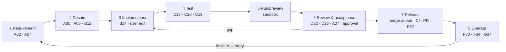
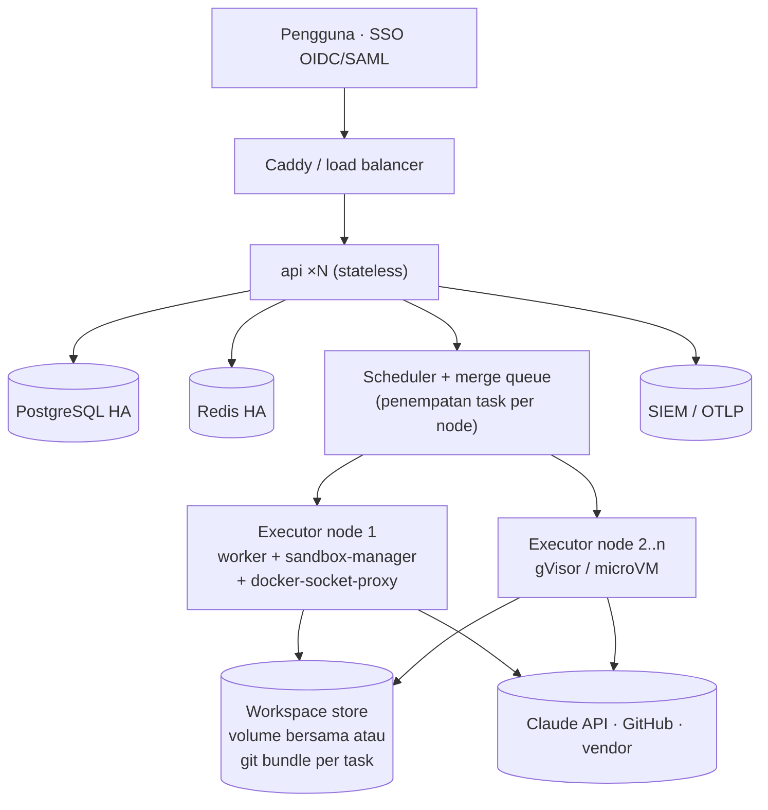

# KodeKantor — SDLC End-to-End, Skala Project S/M/L, dan Developer Workspace v2

> **Status: RANCANGAN v2.1 (22 Oktober 2026) — belum diimplementasikan.** Dokumen ini adalah kontrak mengikat untuk perluasan Portal IDE (§9 "KONTRAK v2.1"). Ia melanjutkan `PLATFORM_EXPANSION.md` §9b (KONTRAK v2) dan tidak mengubah FR-001..FR-220.
>
> **Keputusan PO (22 Okt 2026):** skala enterprise dimasukkan sebagai **tier S/M/L bertahap** (pilot tetap 1 VPS; tier M dan L = fase P13–P14); live demo menjalankan test hasil editan pengguna **secara nyata via Pyodide** dengan label "bukan sandbox KodeKantor"; PRD diperbarui sebagai **PRD v2.1** (file baru).
>
> **Label keyakinan:** [Pasti] / [Kemungkinan Besar] / [Menebak]. Semua angka kapasitas tier adalah target rancangan [Menebak] yang wajib diukur di gate G13/G14.

---

## 0. Kebenaran yang tidak nyaman

1. **Arsitektur pilot tidak melayani mega project.** Pilot = 1 VPS 4 vCPU/16 GB, `MAX_ACTIVE_TASKS=2`, sandbox 1 CPU/1 GB/300 dtk, single-owner (ADR-002, ADR-010). Skala enterprise membutuhkan node executor terpisah, identitas SSO, tenancy, HA/DR, dan strategi repo besar. Kode domain tetap satu; yang berbeda adalah **profil deployment (tier)**. [Pasti — ADR-010, ARCHITECTURE §13]
2. **Agent tidak menyelesaikan mega project sendirian.** Platform memecah pekerjaan menjadi Program → Epic → Story → Task; setiap task tetap tervalidasi bukti dan diputuskan manusia. Pada skala besar, *throughput* dibatasi kapasitas review manusia dan merge queue, bukan jumlah agent. [Kemungkinan Besar]
3. **Edit kode manual sudah P0 sejak PRD v1** (M05, FR-026..FR-032, AC-03; Monaco ada di snapshot). Yang belum ada: operasi file lengkap (buat/rename/hapus), aturan *take-over* worktree agent, run/test oleh user, dan terminal interaktif. [Pasti]
4. **Terminal interaktif mengubah keputusan lama.** ADR-014 tidak memakai WebSocket karena terminal read-only. Terminal interaktif untuk user membutuhkan kanal dua arah dan permukaan serangan baru (T19) — diputuskan lewat ADR-059, default **nonaktif**. [Pasti]
5. **Tier L memerlukan keputusan orkestrasi yang belum diambil.** ADR-036 menolak Kubernetes untuk pilot; tier L membutuhkan pool executor yang dapat diskalakan (VM pool atau Kubernetes). Pilihannya ditunda ke ADR tier L (WP-14.0) dengan data beban nyata dari tier M. [Kemungkinan Besar]

---

## 1. Definisi skala (tier S/M/L)

| Dimensi | Tier S — project kecil/pribadi (pilot) | Tier M — tim/produk | Tier L — enterprise / mega project |
|---|---|---|---|
| Pengguna | 1–3 (single-owner pilot) | 5–50 [Menebak] | 50–1.000+ [Menebak] |
| Node | 1 VPS (4 vCPU/16 GB) | 1 node kontrol + 1–4 node executor | Node kontrol HA + pool executor terskala (VM pool / Kubernetes — ADR tier L) |
| Task agent aktif | 2 | 2 per node executor (4–8) [Menebak] | ≥ 50 bersamaan [Menebak] |
| Repo per project | 1 | Multi-repo (≤ 10) [Menebak] | Multi-repo + monorepo besar (≥ 1 juta LOC) [Menebak] |
| Hierarki kerja | Task (+ story opsional) | Story → Task, Epic | Program → Epic → Story → Task |
| Identitas | Login lokal + RBAC | + SSO OIDC, `four_eyes` | + SAML, SCIM, organisasi/tenant |
| Sandbox | Docker profil tetap (+gVisor opsional) | Docker + gVisor wajib | microVM (Firecracker/Kata) untuk multi-tenant |
| Data | PostgreSQL & Redis tunggal, backup harian | + backup terverifikasi, workspace di volume bersama | PostgreSQL HA (replika/failover), Redis HA, RPO ≤ 15 mnt, RTO ≤ 4 jam [Menebak] |
| Integrasi | GitHub App (P9) | + status CI, merge queue, environment dev/staging | + release train, CODEOWNERS, SIEM, multi-org budget |
| Fase | P0–P8 (+P9–P12) | **P13** | **P14** |
| Gate | G3 | **G13** | **G14** |

Prinsip: **satu basis kode, tier = konfigurasi + topologi**. Fitur tier yang lebih tinggi tidak boleh melemahkan kontrol tier S (sandbox, approval, evidence).

---

## 2. SDLC end-to-end (8 fase)

Setiap story (atau task di tier S) bergerak melalui fase berikut. Fase hanya "selesai" bila bukti yang tercantum ada — bukan karena agent mengklaimnya.

| # | Fase | Bukti yang wajib ada | Modul | Agent (mode MVP → target) | Ketersediaan |
|---|---|---|---|---|---|
| 1 | Requirement & intent | Requirement baseline, acceptance criteria, klarifikasi | M06, M14 | A01 (profile→A02), A02 (llm), A07 (llm) | MVP |
| 2 | Desain | ADR/diagram/skema API & DB sebagai patch dokumen yang direview; analisis dampak | M16, M25 | A05 (planned), A06 (planned), B08 (planned), B12 (planned), G35 (profile→B14) | Sebagian MVP (G35); penuh di P13 |
| 3 | Implementasi | Patch di worktree `kk/task-*`, commit per task, edit manual user | M05, M26 | A03 (llm), A04 (tool), B09/B10/B13 (profile→B14), B14 (llm), B11/B15/H38–H41 (planned/tool) | MVP (+P13 untuk edit v2) |
| 4 | Testing | `test_runs` nyata: unit, integrasi, E2E, performa, aksesibilitas, keamanan | M12 | C16 (profile→A03), C17 (tool), C18/C19 (planned), C20 (llm), C21 (profile→C20), D25/D26 (planned) | Unit/integrasi MVP; E2E P1; integrasi API & E2E agent P13; perf/a11y P14 (D25/D26) |
| 5 | Run / preview | Run profile + preview terisolasi, log tersimpan | M10, M11, M26 | C21, user | Preview P1 (FR-076); run/terminal user P13 |
| 6 | Review & acceptance | Findings review & keamanan, laporan User Proxy per kriteria, approval apply | M13, M14 | D22 (llm), D23 (tool), D24 (planned), A07 (llm) | MVP |
| 7 | Release | Merge queue lulus, status CI, PR/push (P9), release notes, staging/production (R3) | M15, M18, M22, M25 | E27 (tool), E28 (planned), E29 (planned→llm P9), F30/F31/F32 (planned) | Push/PR P9; merge queue & release P13 |
| 8 | Operate & maintain | Log/metrik, insiden → story perbaikan, dokumentasi & memori project | M16, M19, M25 | F33/F34 (planned), G36 (planned), G37 (tool) | P13–P14 |

Status mode agent berasal dari `agents/registry.v2.yaml`. **Tidak ada agent baru di v2.1**: kebutuhan SDLC dipenuhi dengan mengaktifkan agent `planned` yang sudah ada per gate G8 (§9 K9). Dekomposisi tingkat program memakai A03 dengan kontrak output baru `ProgramPlan`; merge queue dan release train deterministik (tanpa LLM).

---

## 3. Hierarki kerja dan delivery (M25)

### 3.1 Model

| Level | Isi | Pemilik keputusan | Selesai bila |
|---|---|---|---|
| Program | Tujuan bisnis, anggaran, repo yang terlibat, release target | PO / program owner | Semua epic wajib `accepted` atau ditutup dengan alasan |
| Epic | Kapabilitas besar, requirement tingkat tinggi | Product/tech lead | Semua story wajib `accepted` |
| Story | Requirement baseline + acceptance criteria (A02), fase SDLC | Tech lead / reviewer | Semua task `completed` + AC wajib lulus + merge queue lulus |
| Task | Unit eksekusi agent di satu worktree satu repo (tidak berubah dari v1) | Agent + approval user | State machine v1 (`completed`) |

- `work_items` menyimpan Program/Epic/Story (type + `parent_id`); `tasks.work_item_id` menautkan task ke story. Task tanpa story tetap valid (tier S).
- **Dekomposisi** (FR-223): A03 mengusulkan `ProgramPlan` (epic → story → task + DAG dependensi + repo per task). Usulan ditampilkan sebagai diff rencana; **task baru hanya dibuat setelah user menyetujui** (aksi user biasa, bukan approval R3).
- **Roll-up**: status story = turunan deterministik dari task & AC; status epic/program = turunan dari story. Tidak ada status yang diketik LLM (prinsip CLAUDE.md #1, #4).

### 3.2 Eksekusi paralel dan merge queue

1. Scheduler menjalankan task yang dependensinya selesai, dibatasi kapasitas tier (`MAX_ACTIVE_TASKS` per node) dan budget program.
2. Setiap task tetap di worktree sendiri (ADR-016); paralelisme tidak pernah berbagi worktree.
3. **Merge queue (ADR-057):** apply ke branch target diserialisasi per repo. Untuk setiap entri: rebase/merge ke head terbaru → jalankan profil test wajib (`MERGE_QUEUE_REQUIRED_PROFILES`) + status CI eksternal bila diwajibkan → merge bila lulus; gagal → entri keluar dengan bukti, task kembali `needs_changes`, branch target tidak berubah.
4. Approval `apply_changes` tetap terikat payload hash; merge queue hanya mengeksekusi entri yang sudah disetujui. Perubahan head selama antrean tidak membatalkan approval selama diff task identik (hash diff dicatat); bila diff berubah karena konflik → approval baru.

### 3.3 Release, environment, traceability

- **Release train** (P2): release = kumpulan story `accepted`; changelog dibangkitkan dari task/commit; release notes adalah patch yang direview.
- **Environment registry**: dev → staging → production per project; promosi production tetap R3 + izin `deploy:production` (FR-141).
- **Traceability** (FR-231): requirement → story → task → commit → test run → acceptance report → release, dapat diekspor CSV/JSON/PDF untuk audit.

---

## 4. Developer Workspace v2 — edit, run, test, debug manual (M26)

### 4.1 Tiga mode kerja di IDE

| Mode | Target yang diedit | Siapa menulis | Aturan |
|---|---|---|---|
| **Edit repo** | Checkout repo project (`<project>/repo`) | User | Simpan via workspace API dengan version check (`expected_sha256`, FR-029); buat/rename/hapus file dicatat audit; perubahan menjadi commit user di branch kerja `kk/user-<user8>` dan masuk ke default branch **lewat merge queue** (wajib bila merge queue repo aktif — default tier M/L). Commit langsung ke default branch hanya diizinkan bila merge queue repo **nonaktif** (opsi tier S, keputusan PO OQ-02) |
| **Pantau task** | Worktree task (`tasks/<id>`) | Agent | User hanya membaca; editor read-only selama task `running` |
| **Take-over task** | Worktree task yang dijeda | User | `POST /tasks/{id}/takeover` → task berhenti di checkpoint dan berstatus `interrupted` dengan `status_reason=user_takeover` (pola ADR-031, tanpa state baru); user mengedit; perubahan dicommit atas nama user di branch task; bukti test & User Proxy sebelumnya ditandai **stale**; task tidak dapat di-apply sebelum test + User Proxy dijalankan ulang (ADR-058) |

### 4.2 Matriks konflik

| Situasi | Perilaku sistem |
|---|---|
| User menyimpan file yang berubah di server sejak dibuka | 409 + diff 3-way (milik user / server / basis); tidak ada overwrite diam-diam |
| Agent ingin menulis file yang sedang di-take-over user | Ditolak; agent tidak berjalan selama take-over |
| Apply task saat default branch sudah diubah user | Merge queue: rebase + test ulang; konflik → `needs_changes`, E28 dapat mengusulkan resolusi sebagai patch (planned) |
| User menghapus file yang dirujuk task berjalan | Diizinkan di repo; konflik terdeteksi saat apply (bukan saat hapus) |
| Format/lint on save mengubah isi | Hasil formatter ditampilkan sebagai patch yang dapat ditolak (FR-238) |

### 4.3 Run, test, terminal, debug

- **Run** (FR-239): profil `run.*` per stack (mis. `python.run_module`, `node.dev_server`) di sandbox; dev server dilayani lewat preview terisolasi ADR-008. Output streaming + tersimpan.
- **Test oleh user** (FR-240): semua test / satu file / satu test; `test_runs.initiated_by = user`; hasil dapat dipakai sebagai bukti story.
- **Terminal interaktif** (FR-241, ADR-059): sesi PTY di container sandbox project (bukan host), network off default, CPU/RAM/PID sama dengan sandbox, durasi maks `TERMINAL_SESSION_MAX_MINUTES` (default 30), idle timeout, input/output diaudit dengan redaksi secret. Hanya untuk **manusia**; agent tetap hanya profil allowlist (FR-078). Default nonaktif; admin mengaktifkan per project. Kanal: WebSocket khusus endpoint terminal (pengecualian terbatas ADR-014).
- **Language intelligence & debugger** (FR-242, FR-243, P2, tier M+): language server dan Debug Adapter Protocol berjalan di sandbox; tidak ada language server di proses api/worker.
- **Git manual** (FR-244): stage/commit/branch/diff/discard lokal; push ke remote hanya lewat jalur R3 GitHub App (FR-191).

---

## 5. Arsitektur tier M dan L (M27)

| Area | Tier M | Tier L |
|---|---|---|
| Penempatan task | Scheduler memilih node dengan kapasitas dan afinitas workspace; lease node per task | + autoscale pool, kuota per organisasi |
| Identitas node | Token node per node, rotasi, mTLS ke API internal [Kemungkinan Besar] | + attestation image node |
| Rahasia di node | Hanya token task-scoped dan kunci yang dibutuhkan antrean node (ADR-053) | sama |
| Workspace | Volume bersama (NFS) atau sinkronisasi git bundle per task dengan checksum | Object storage + cache lokal |
| Kegagalan node | Task → `interrupted`, dilanjutkan di node lain dari checkpoint (FR-053..056) | sama + drain node terjadwal |
| Repo besar | Sparse checkout per task, index simbol inkremental (ctags/tree-sitter) di sandbox | + index terdistribusi; embedding tetap dikecualikan kecuali ADR baru (ADR-046 berlaku) |
| Identitas user | OIDC, pemetaan grup → role | + SAML, SCIM, organisasi/tenant |
| Data | Backup terverifikasi | PostgreSQL HA, DR drill berkala |
| Audit | `audit_events` + ekspor | + SIEM berantai hash |

---

## 6. KONTRAK v2.1 (mengikat)

Semua butir di bawah berstatus **rancangan / Proposed**. Penomoran melanjutkan KONTRAK v2 tanpa menggeser ID yang ada.

### K5. Modul & FR baru

| Modul | Nama | FR | Prioritas | Fase |
|---|---|---|---|---|
| M25 | SDLC Program & Delivery Management | FR-221 – FR-234 (14) | P1 (merge queue & traceability = P0ᵉ fase P13) | P13 |
| M26 | Developer Workspace v2 — edit, run, test, debug manual | FR-235 – FR-244 (10) | P0ᵉ untuk FR-235..237; P1/P2 sisanya | P13 (LSP/debugger P14) |
| M27 | Scale & Enterprise Platform (tier S/M/L) | FR-245 – FR-258 (14) | P1 tier M; P2 tier L | P13 (tier M), P14 (tier L) |

Total FR setelah v2.1: **258** (FR-001..FR-258).

| FR | Modul | Kebutuhan ("Sistem harus …") | Prioritas | Sumber | AX |
|---|---|---|---|---|---|
| FR-221 | M25 | menyediakan hierarki work item Program → Epic → Story → Task dengan parent, pemilik, status, dan prioritas; task tetap menjadi unit eksekusi agent dan dapat berdiri tanpa story di tier S | P1 | §3.1, ADR-057 | AX-14 |
| FR-222 | M25 | menyimpan requirement baseline & acceptance criteria per story (A02) dan menghitung status story/epic/program secara deterministik dari task dan AC; story `accepted` hanya bila semua task selesai dan AC wajib lulus | P1 | §3.1 | AX-14, AX-15 |
| FR-223 | M25 | menampilkan usulan dekomposisi A03 (`ProgramPlan`: epic, story, task, DAG dependensi, repo per task) sebagai diff rencana dan hanya membuat task setelah user menyetujui | P1 | §3.1 | AX-14 |
| FR-224 | M25 | menjadwalkan task paralel sesuai DAG, kapasitas tier, dan budget program, masing-masing di worktree terpisah | P1 | §3.2, ADR-016 | AX-14 |
| FR-225 | M25 | menyediakan merge queue per repo: entri yang sudah disetujui di-rebase ke head terbaru, menjalankan profil test wajib (dan status CI bila diwajibkan) sebelum merge; gagal → keluar antrean dengan bukti dan branch target tidak berubah | P0ᵉ | §3.2, ADR-057 | AX-14 |
| FR-226 | M25 | menampilkan papan SDLC per story dengan 8 fase dan bukti per fase; fase tanpa bukti tidak dapat ditandai selesai | P1 | §2 | AX-15 |
| FR-227 | M25 | menghasilkan artefak desain (ADR, diagram, skema API/DB) sebagai patch dokumen yang direview (A05, B12, G35) dan menautkannya ke story | P1 | §2 fase 2 | — |
| FR-228 | M25 | mengelompokkan story `accepted` ke release, membangkitkan changelog dari task/commit, dan memperlakukan release notes sebagai patch yang direview | P2 | §3.3 | AX-15 |
| FR-229 | M25 | menyediakan registry environment (dev, staging, production) per project dengan promosi bertahap; production tetap R3 + izin `deploy:production` | P2 | §3.3, FR-141 | — |
| FR-230 | M25 | membaca status CI eksternal (GitHub checks) sebagai bukti tambahan dan memblokir merge queue bila policy mewajibkan CI lulus | P1 | §3.2, M22 | AX-14 |
| FR-231 | M25 | menyediakan traceability requirement → story → task → commit → test run → acceptance → release yang dapat diekspor (CSV/JSON/PDF) | P0ᵉ | §3.3 | AX-15 |
| FR-232 | M25 | menampilkan dashboard program: progres per epic, task gagal/blocked, lead time, antrean, dan biaya per program/epic | P1 | §3 | — |
| FR-233 | M25 | menerapkan code ownership per path (CODEOWNERS): apply/merge memerlukan reviewer pemilik path pada tier M+ | P2 | §1 tier M/L | — |
| FR-234 | M25 | mengubah insiden dari log/alert (F33/F34) menjadi story perbaikan dengan tautan bukti | P2 | §2 fase 8 | — |
| FR-235 | M26 | memungkinkan user membuat, mengedit, me-rename, dan menghapus file/folder project di IDE melalui workspace API dengan version check, audit, dan undo per sesi | P0ᵉ | §4.1, FR-026..032 | AX-12 |
| FR-236 | M26 | menyediakan take-over task: task berhenti di checkpoint (`interrupted`, `status_reason=user_takeover`), user mengedit worktree task, perubahan dicommit atas nama user, bukti sebelumnya ditandai stale, dan apply diblokir sampai test + User Proxy dijalankan ulang | P0ᵉ | §4.1, ADR-058 | AX-12 |
| FR-237 | M26 | mencegah agent menimpa perubahan user yang belum disimpan atau lebih baru, dan menampilkan konflik sebagai diff 3-way untuk diselesaikan user | P0ᵉ | §4.2 | AX-12 |
| FR-238 | M26 | menjalankan format & lint saat simpan (opsional per project) memakai profil sandbox dan menampilkan hasilnya sebagai patch yang dapat ditolak | P1 | §4.2 | — |
| FR-239 | M26 | memungkinkan user menjalankan project dari IDE dengan profil `run.*` di sandbox, output streaming tersimpan, dan preview terisolasi (ADR-008) | P1 | §4.3, FR-076 | AX-13 |
| FR-240 | M26 | memungkinkan user menjalankan semua test, satu file, atau satu test; hasil tersimpan sebagai `test_runs` dengan `initiated_by = user` dan dapat dipakai sebagai bukti | P1 | §4.3 | AX-13 |
| FR-241 | M26 | menyediakan terminal interaktif untuk user (bukan agent) sebagai sesi PTY di container sandbox project dengan network off default, batas resource & durasi, audit input/output teredaksi; default nonaktif dan diaktifkan admin per project | P1 | §4.3, ADR-059 | AX-13 |
| FR-242 | M26 | menyediakan language intelligence (autocomplete, go-to-definition, diagnostics) lewat language server di sandbox untuk stack yang didukung | P2 | §4.3 | — |
| FR-243 | M26 | menyediakan debugger (breakpoint, step, inspect) lewat Debug Adapter Protocol di sandbox untuk Python dan Node | P2 | §4.3 | — |
| FR-244 | M26 | menyediakan Git manual untuk user (stage, commit, branch, diff, discard) pada repo lokal; push ke remote hanya lewat jalur R3 GitHub App | P1 | §4.3, FR-113..120, FR-191 | AX-12 |
| FR-245 | M27 | memvalidasi profil tier deployment (S/M/L) yang menentukan batas pengguna, task aktif, node, dan fitur aktif tanpa mengubah kode domain | P1 | §1, ADR-060 | AX-16 |
| FR-246 | M27 | mendukung pool node executor (worker + sandbox-manager) dengan registrasi node berbasis token yang dirotasi, health, kapasitas, dan penempatan task berdasarkan kapasitas & afinitas workspace | P1 | §5, ADR-060 | AX-16 |
| FR-247 | M27 | menandai task di node yang gagal sebagai `interrupted` dan melanjutkannya di node lain dari checkpoint tanpa mengulang side effect | P1 | §5, FR-053..056 | AX-16 |
| FR-248 | M27 | menyediakan penyimpanan workspace multi-node (volume bersama atau sinkronisasi git bundle per task) dengan verifikasi checksum | P1 | §5 | AX-16 |
| FR-249 | M27 | mendukung driver sandbox microVM (Firecracker/Kata) untuk tier L dengan profil yang sama | P2 | §5, ARCHITECTURE §13 | AX-17 |
| FR-250 | M27 | mendukung SSO OIDC (tier M) dan SAML (tier L) dengan pemetaan grup → role dan opsi mematikan login lokal | P1 | §5, ADR-061 | AX-17 |
| FR-251 | M27 | mendukung provisioning/deprovisioning SCIM; user yang dinonaktifkan kehilangan sesi dan token ≤ 5 menit [Menebak] | P2 | §5, ADR-061 | AX-17 |
| FR-252 | M27 | mengisolasi data, budget, kebijakan, dan audit per organisasi (tenant); akses lintas organisasi menghasilkan 404 | P2 | §5, ADR-061 | AX-17 |
| FR-253 | M27 | mendukung repo besar & monorepo dengan sparse/partial checkout per task, index simbol inkremental, dan batas konteks sehingga agent hanya menerima file relevan | P1 | §5, ADR-062 | AX-18 |
| FR-254 | M27 | mendukung project multi-repo: story dapat mencakup beberapa repo, task per repo, merge queue per repo, dan release yang mengikat versi lintas repo | P1 | §3, ADR-062 | AX-14 |
| FR-255 | M27 | menerapkan anggaran per organisasi/program/epic dengan alert dan kill switch | P1 | §5 | AX-16 |
| FR-256 | M27 | menyediakan HA & DR tier L (PostgreSQL replika/failover, backup terenkripsi, RPO ≤ 15 menit, RTO ≤ 4 jam [Menebak]) yang diuji berkala | P2 | §1, §5 | AX-17 |
| FR-257 | M27 | mengekspor audit ke SIEM (syslog/OTLP/JSON) dengan rantai hash integritas dan retensi sesuai kebijakan | P2 | §5 | AX-17 |
| FR-258 | M27 | menampilkan kapasitas & antrean secara transparan: estimasi waktu tunggu task, utilisasi node, dan task yang ditolak karena kuota | P1 | §5 | AX-16 |

### K6. Kriteria penerimaan baru

| AX | Kriteria | Bukti | WP → gate |
|---|---|---|---|
| AX-12 | User dapat membuat/mengedit/rename/hapus file di IDE dan menyimpan dengan version check; konflik dengan agent tidak pernah menimpa diam-diam; take-over menandai bukti lama stale dan memblokir apply sampai validasi ulang | Test integrasi workspace + E2E edit/konflik/take-over | WP-13.1 → G13 |
| AX-13 | User dapat menjalankan project, test, dan terminal dari IDE; semua eksekusi terjadi di sandbox dan tersimpan sebagai bukti | E2E run/test + test isolasi terminal (T19) | WP-13.2, WP-13.3 → G13 |
| AX-14 | Story dengan ≥ 5 task [Menebak] berjalan paralel di worktree terpisah; merge queue menguji ulang tiap entri; branch target tidak pernah berisi commit yang gagal test wajib | E2E program kecil + test merge queue | WP-13.4, WP-13.5, WP-13.9, WP-13.12 → G13 |
| AX-15 | Setiap release dapat ditelusuri requirement → story → task → commit → test run → acceptance dan diekspor | Test ekspor traceability | WP-13.4, WP-13.6, WP-13.10 → G13 |
| AX-16 | Tier M: node executor dapat ditambah tanpa mengubah kode domain; kegagalan node → task dilanjutkan di node lain dari checkpoint | Test chaos (matikan node) + test penempatan | WP-13.7 → G13 |
| AX-17 | Identitas & tenancy: **tier M** — login OIDC dengan pemetaan grup → role dan opsi mematikan login lokal (diverifikasi di G13); **tier L** — SAML, deprovision SCIM mencabut akses ≤ 5 menit [Menebak], isolasi organisasi (404 lintas org), DR drill memenuhi RPO/RTO, ekspor SIEM berantai hash | Test OIDC; test SAML/SCIM, test cross-tenant, laporan DR drill, verifikasi rantai hash SIEM | WP-13.8 → G13 (OIDC); WP-14.1..14.5 → G14 |
| AX-18 | Repo ≥ 1 juta LOC [Menebak]: index inkremental dan pemilihan konteks selesai dalam batas waktu yang disetujui PO; agent hanya menerima file relevan | Benchmark repo besar | WP-13.9, WP-14.7 → G14 |

### K6b. NFR baru

| ID | Area | Target (rancangan) | Verifikasi |
|---|---|---|---|
| NFR-23 | Editor & workspace | Buka file ≤ 1 MB p95 ≤ 1 dtk; ack simpan p95 ≤ 300 ms; 100% konflik versi terdeteksi (tidak ada overwrite diam-diam) [Menebak] | Test beban kecil + test konflik |
| NFR-24 | Kapasitas per tier | Tier S: 2 task aktif; tier M: ≥ 2 task per node executor dengan waktu antre p95 ≤ 5 menit; tier L: ≥ 50 task bersamaan [Menebak] | Benchmark G13/G14 |
| NFR-25 | Ketahanan node | Task di node yang mati dilanjutkan ≤ 5 menit setelah node dinyatakan mati; 0 side effect ganda [Menebak] | Test chaos |
| NFR-26 | Isolasi tenant & identitas | 0 akses lintas organisasi pada test; deprovision SCIM efektif ≤ 5 menit [Menebak] | Test cross-tenant + SCIM |
| NFR-27 | Integritas branch target | Untuk repo dengan merge queue aktif: 100% commit di branch target (dari agent maupun user) melewati test wajib merge queue; waktu antre merge dipantau | Audit merge queue |

### K7. ADR baru (Proposed)

| ADR | Judul | Inti |
|---|---|---|
| ADR-057 | Hierarki kerja Program/Epic/Story/Task + merge queue + release train | `work_items`; task tetap unit eksekusi; merge queue per repo menguji ulang sebelum merge; status turunan deterministik |
| ADR-058 | Edit manual & take-over worktree | Tiga mode kerja (§4.1); take-over = `interrupted/user_takeover`; bukti lama stale; agent tidak pernah menimpa perubahan user |
| ADR-059 | Terminal interaktif sandbox untuk user | PTY di sandbox, network off, batas waktu/resource, audit teredaksi, default nonaktif; WebSocket hanya untuk endpoint terminal (pengecualian ADR-014); agent tetap profil allowlist |
| ADR-060 | Tier deployment S/M/L & pool executor | Satu basis kode; tier = konfigurasi + topologi; node executor dengan token terotasi; penempatan & failover dari checkpoint; pilihan orkestrator tier L ditunda ke WP-14.0 |
| ADR-061 | Identitas enterprise & tenancy | OIDC (M), SAML + SCIM + organisasi (L); scope organisasi pada semua query; pemetaan grup → role |
| ADR-062 | Strategi repo besar & multi-repo | Sparse checkout per task, index simbol inkremental di sandbox, batas konteks; multi-repo per story; embedding tetap dikecualikan (ADR-046) |

### K8. Fase, gate, dan work package

| Fase | Mulai setelah | Gate | Exit |
|---|---|---|---|
| P13 — SDLC end-to-end & tier M | G3 (semua WP P13); G9 hanya untuk WP-13.12 (status CI GitHub) | **G13** | AX-12..AX-16 + AX-17 (OIDC) lulus; program kecil (≥ 1 epic, ≥ 3 story) berjalan end-to-end di tier M dengan merge queue dan traceability |
| P14 — Enterprise tier L | G13 | **G14** | AX-17, AX-18 lulus; sign-off keamanan AG-13; DR drill |

| WP | Nama | Owner | Reviewer | Dependensi | FR | AX |
|---|---|---|---|---|---|---|
| WP-13.0 | Kunci kontrak v2.1 (ADR-057..062, migrasi 0007) | AG-00 | AG-13; PO | WP-G3 | FR-221, FR-245 | — |
| WP-13.1 | Developer workspace v2: operasi file, take-over, konflik 3-way, Git manual | AG-09, AG-10, AG-02 | AG-13 | WP-13.0 | FR-235–237, FR-244 | AX-12 |
| WP-13.2 | Run & test dari IDE + preview, format/lint on save | AG-03, AG-10 | AG-08 | WP-13.0 | FR-238–240 | AX-13 |
| WP-13.3 | Terminal interaktif sandbox 🔒 | AG-03, AG-10 | AG-13 🔒 | WP-13.2 | FR-241 | AX-13 |
| WP-13.4 | Work item, dekomposisi A03, papan SDLC | AG-08, AG-10 | AG-00 | WP-13.0 | FR-221–224, FR-226–227 | AX-14 |
| WP-13.5 | Merge queue lokal (rebase + profil test wajib) | AG-08 | AG-13 | WP-13.4 | FR-225 | AX-14 |
| WP-13.6 | Traceability export + dashboard program | AG-09, AG-11 | AG-08 | WP-13.4 | FR-231–232 | AX-15 |
| WP-13.7 | Pool executor tier M + failover + workspace multi-node | AG-06, AG-03, AG-01 | AG-13 🔒 | WP-13.0 | FR-245–248, FR-255, FR-258 | AX-16 |
| WP-13.8 | SSO OIDC | AG-01, AG-11 | AG-13 🔒 | WP-13.0 | FR-250 | AX-17 |
| WP-13.9 | Repo besar & multi-repo | AG-02, AG-07 | AG-00 | WP-13.0 | FR-253–254 | AX-18 |
| WP-13.10 | Release train + environment registry | AG-08, AG-14 | AG-00 | WP-13.5 | FR-228–229, FR-233–234 | AX-15 |
| WP-13.11 | Aktivasi agent SDLC tier M (A05, A06, B12, C18, C19, E28, F30, F32) per G8 | AG-15 | PO | WP-13.4 | FR-227 | — |
| WP-13.12 | Status CI GitHub sebagai syarat merge queue | AG-18, AG-08 | AG-13 | WP-13.5, WP-G9 | FR-230 | AX-14 |
| WP-G13 | Gate G13 | PO + AG-13 | – | WP-13.1..13.12 | — | AX-12–AX-16, AX-17 (OIDC) |
| WP-14.0 | ADR orkestrator tier L (VM pool vs Kubernetes) berbasis data beban tier M | AG-00 + PO | AG-13 | WP-G13 | FR-246 | — |
| WP-14.1 | Organisasi/tenant | AG-01, AG-09 | AG-13 🔒 | WP-14.0 | FR-252 | AX-17 |
| WP-14.2 | SAML + SCIM | AG-01 | AG-13 🔒 | WP-14.1 | FR-250–251 | AX-17 |
| WP-14.3 | Driver sandbox microVM | AG-03 | AG-13 🔒 | WP-14.0 | FR-249 | AX-17 |
| WP-14.4 | HA & DR | AG-06 + OPS | AG-13 | WP-14.0 | FR-256 | AX-17 |
| WP-14.5 | SIEM export + governance biaya organisasi | AG-01, AG-11 | AG-13 | WP-14.1 | FR-255, FR-257 | AX-17 |
| WP-14.6 | Language server + debugger di sandbox | AG-03, AG-10 | AG-13 | WP-G13 | FR-242–243 | — |
| WP-14.7 | Benchmark repo besar & beban | AG-12 | PO | WP-13.9, WP-14.0 | FR-253 | AX-18 |
| WP-14.8 | Aktivasi agent tier L (B08, B11, B15, D24, D25, D26, F31, F33, F34, G36, H38–H40) per G8 | AG-15 | PO | WP-G13 | FR-234 | — |
| WP-G14 | Gate G14 | PO + AG-13 | – | WP-14.1..14.8 | — | AX-17, AX-18 |

### K9. Agent — aktivasi untuk SDLC (tanpa agent baru)

| Fase SDLC | Agent `planned` yang diaktifkan | Fase roadmap | Syarat |
|---|---|---|---|
| Desain | A05 Software Architect, A06 Change Impact & Risk Analyst, B12 Database & Data Modeling | P13 | Gate G8 per agent: contract test + eval set |
| Test | C18 Integration & API Testing, C19 E2E & Browser QA | P13 | Preview/E2E profil tersedia |
| Release | E28 Merge Conflict Resolution (usulan patch saja), F30 Build & CI, F32 Deployment & Release (staging) | P13 | Merge queue (WP-13.5) |
| Kualitas lanjutan | D24 Dependency & Supply Chain, D25 Performance & Scalability, D26 Accessibility | P14 | Egress allowlist (G4) untuk D24 |
| Operasi | F31 IaC, F33 Observability & SRE, F34 Incident Response | P14 | Tier L observability |
| Dokumentasi & data | G36 API & Developer Docs, H38 Data Engineering, H39 Migration, H40 Legacy Modernization | P14 | Kebutuhan program nyata |
| Desain & implementasi lanjutan | B08 UI/UX Designer, B11 API & Integration Specialist, B15 AI/LLM Application Specialist | P14 | Amandemen K13 (OI-21); G8 per agent |

A03 menambah kontrak output `ProgramPlan` (epic/story/task + DAG) di registry versi berikutnya (WP-13.4). Registry v2 (`agents/registry.v2.yaml`) tetap 53 entri.

### K10. Tool baru (rancangan)

| Tool | Risk | Executor | Catatan |
|---|---|---|---|
| `workspace.create_file`, `workspace.rename`, `workspace.delete` | R1 | backend | Aksi **user** lewat API; agent tetap memakai `code.apply_patch` |
| `sdlc.propose_plan` | R0 | backend | A03 menyerahkan `ProgramPlan`; tidak membuat task sendiri |
| `merge_queue.enqueue` | R1 | backend | Hanya untuk task yang approval apply-nya valid |
| `tests.run_selected` | R2 | sandbox | Subset test (file/test) — dipakai user & C17 |
| `index.symbols_incremental` | R2 | sandbox | ctags/tree-sitter, tanpa network |
| `ci.get_checks` | R0 | worker integrations | Lewat GitHub App (`checks: read`) |

### K11. Delta data, API, konfigurasi

- **Data (migrasi 0007_sdlc, 0008_scale):** `work_items`, `work_item_links`, `tasks.work_item_id`, `merge_queue_entries`, `releases`, `release_items`, `environments`, `ci_check_results`, `terminal_sessions`, `test_runs.initiated_by`; `organizations`, `org_memberships`, `sso_connections`, `scim_tokens`, `executor_nodes`, `node_leases`, `project_repositories`, `cost_budgets`.
- **API:** `/work-items` (CRUD, `POST /work-items/{id}/plan`, `POST /work-items/{id}/plan/accept`), `/merge-queue/{repo_id}`, `/releases`, `/environments`, `POST/PATCH/DELETE /projects/{id}/files`, `POST /tasks/{id}/takeover`, `POST /projects/{id}/runs`, `POST /projects/{id}/terminal-sessions` (→ URL WebSocket sekali pakai), `/admin/nodes`, `/admin/sso`, `/scim/v2/*`, `/orgs`.
- **Konfigurasi:** `DEPLOYMENT_TIER` (`S`/`M`/`L`, default `S`), `EXECUTOR_NODE_TOKEN_TTL_HOURS`, `MERGE_QUEUE_REQUIRED_PROFILES`, `TERMINAL_ENABLED` (default `false`), `TERMINAL_SESSION_MAX_MINUTES` (`30`), `TERMINAL_IDLE_MINUTES` (`10`), `OIDC_ISSUER`/`OIDC_CLIENT_ID`/`OIDC_CLIENT_SECRET`, `SAML_IDP_METADATA_URL`, `SCIM_TOKEN`, `SPARSE_CHECKOUT_ENABLED`.

### K12. Ancaman baru

| ID | Ancaman | Kontrol |
|---|---|---|
| T19 | Terminal interaktif disalahgunakan (eksfiltrasi, mining, escape) | Sandbox sama dengan run (network off, limit), default nonaktif, durasi & idle timeout, audit teredaksi, rate limit sesi |
| T20 | Kebocoran lintas tenant | Scope organisasi di setiap query & path workspace; test 404 lintas org; kunci cache per org |
| T21 | Node executor dikompromikan | Identitas node + token terotasi, mTLS, rahasia task-scoped saja, drain & revoke node |
| T22 | Salah konfigurasi SSO/SCIM (pengambilalihan akun) | Validasi tanda tangan & audience, JIT provisioning nonaktif default, pemetaan grup eksplisit |
| T23 | Bypass merge queue | Branch target dilindungi; merge hanya oleh worker merge queue; audit |

---

### K13. Amandemen setelah sinkronisasi dokumen (22 Okt 2026, Lead)

| Isu (SYSTEM_SPEC §12) | Keputusan |
|---|---|
| OI-20 commit user langsung vs NFR-27/T23 | Commit user → `kk/user-*` → merge queue bila aktif (default tier M/L); commit langsung hanya bila merge queue repo nonaktif (opsi tier S, OQ-02). NFR-27 berlaku untuk repo dengan merge queue aktif |
| OI-21 B12 di FR-227 | B12 diaktifkan di P13 (K9, WP-13.11); B08, B11, B15 di P14 (WP-14.8) |
| OI-22 transisi take-over | ADR-058: take-over diizinkan dari `running` (di checkpoint), `waiting_approval`, `needs_changes`, `failed` → `interrupted` (`status_reason=user_takeover`); "Selesai take-over" → `queued` dengan rencana validasi saja (test → review → User Proxy), tanpa langkah implementasi agent. Transisi baru dicatat di `workflow/states.py` pada WP-13.1 |
| OI-23 CI untuk entri merge queue | CI GitHub hanya sah untuk `head_commit` yang sudah di-push (UC-18) dan bila rebase tidak mengubah commit (fast-forward); selain itu merge queue memakai profil test lokal wajib, dan CI pasca-merge di default branch yang gagal membuat story perbaikan otomatis |
| OI-24 tabel run user | `test_runs` dengan `suite = 'run'` (CHECK diperluas) — disetujui |
| OI-27/OI-28 urutan migrasi | 0007 & 0008 di-land *schema-first* di WP-13.0; tabel tier L inert sampai WP-14.1; penegakan budget program aktif setelah WP-13.7 (sebelumnya budget per task v1) |
| OI-29 OIDC di G13 | AX-17 dipecah: OIDC diverifikasi di G13 (WP-13.8); SAML/SCIM/tenant/DR/SIEM di G14 |
| OI-30 kolom AX ↔ WP | Diselaraskan: AX-14 = WP-13.4, 13.5, 13.9, 13.12; AX-15 = WP-13.4, 13.6, 13.10; AX-17 = WP-13.8 (OIDC) + WP-14.1..14.5; sama dengan WBS |
| OI-31 registry `phase` P13/P14 | Validator & loader menerima `P13`/`P14` di WP-13.0; registry tetap 53 entri |
| OI-33 OIDC dari `api` tanpa outbound | Pertukaran code OIDC & metadata SAML di `worker-integrations` (pola ADR-053) |
| OI-35 merge queue menunggu G9 | Dipisah: WP-13.5 merge queue lokal (tanpa G9), WP-13.12 status CI GitHub (butuh G9) |
| v2.2 (POLYGLOT_INTEGRATION_DESIGN §4) | D24 dipindah ke P15 (WP-15.10), B11 ke P16 (WP-16.6); WP-14.8 tidak lagi memuat keduanya |
| OI-25, OI-26, OI-32, OI-34 | Tetap terbuka; diputuskan di WP-14.6, WP-13.0, WP-14.0, WP-13.1 secara berurutan |

## 7. Dampak pada demo live (WP-DEMO-03)

Demo replay ditambah: (1) **editor kode interaktif** atas file project hasil rekaman nyata (highlight, penanda belum tersimpan, diff vs asli, simpan dengan version check simulasi, reset); (2) **Jalankan test** atas kode hasil editan secara nyata di browser via **Pyodide** — diberi label *"dijalankan di browser (Pyodide), bukan sandbox KodeKantor"*; bila Pyodide gagal dimuat, demo jatuh ke rekaman run nyata dan menyatakannya; (3) **papan SDLC 8 fase** dengan bukti nyata dari rekaman untuk project kecil; (4) halaman **tier S/M/L** berlabel rancangan. Tidak ada klaim bahwa tier M/L atau terminal interaktif sudah ada.

## 8. Risiko & pertanyaan terbuka

| ID | Risiko / pertanyaan | Mitigasi / pemutus |
|---|---|---|
| RS-01 | Scope melebar lagi (P13–P14 ≈ dua kali P9–P12) [Menebak] | Gate per fase; tier L hanya bila ada kebutuhan nyata |
| RS-02 | Merge queue menjadi bottleneck pada program besar | Batching entri yang tidak bersinggungan path; ukur di G13 |
| RS-03 | Terminal interaktif membuka jalur eksfiltrasi | ADR-059, default off, T19 |
| RS-04 | Biaya model naik linear dengan jumlah task paralel | Budget per program/epic (FR-255), kill switch |
| RS-05 | Repo besar melampaui konteks model | Sparse checkout + index simbol + A04; tanpa janji "seluruh repo dalam konteks" |
| OQ-01 | Orkestrator tier L (VM pool vs Kubernetes) | PO + AG-00 di WP-14.0 |
| OQ-02 | Default branch kerja user (`kk/user-*` vs langsung default branch) | PO per project |
| OQ-03 | Ambang G13/G14 (jumlah task paralel, LOC benchmark, RPO/RTO) | PO |

## 9. Sumber

Kontrak repo: `PRD.md` (v1 §5.3, §7.7, §13), `PLATFORM_EXPANSION.md` §9b, `DECISIONS.md` (ADR-002, 008, 010, 014, 016, 031, 036, 046, 053), `ARCHITECTURE.md` §13, `FR_CATALOG.md` (FR-026..032, FR-053..056, FR-076..083, FR-136..143), `agents/registry.v2.yaml`. Tidak ada klaim eksternal baru di dokumen ini selain yang sudah bersumber di dokumen tersebut.
