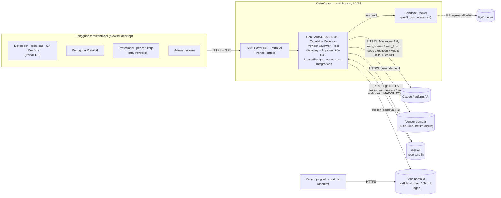

# KodeKantor Platform — System Specification (SRS v2)

> **Status: rancangan (Proposed) — dokumen spesifikasi, bukan bukti implementasi.** Tanggal: 21 Oktober 2026 · Pemilik: Lead Architect (AG-00) · Penyusun: agen dokumentasi SRS v2 · Persetujuan: Product Owner (gate G0 untuk v1; sebelum P9 untuk v2).
> **Addendum v2.1 (22 Oktober 2026, rancangan / Proposed):** SDLC end-to-end, Developer Workspace v2, dan tier S/M/L — §12. Sumber mengikat: `docs/SDLC_SCALE_DESIGN.md` §6 **KONTRAK v2.1** (K5–K12). §1–§11 di bawah tetap menggambarkan baseline v1/v2; angka v2.1 ditambahkan sebagai catatan, bukan penulisan ulang.
> **Addendum v2.2 (22 Oktober 2026, rancangan / Proposed):** polyglot language packs, lingkungan integrasi multi-service & kontrak, dan monitoring biaya & token realtime — §13. Sumber mengikat: `docs/POLYGLOT_INTEGRATION_DESIGN.md` §7 **KONTRAK v2.2** (K14–K20). §1–§12 tidak ditulis ulang; total ID diperbarui sebagai catatan.
> Struktur terinspirasi ISO/IEC/IEEE 29148 (SRS). Bahasa Indonesia dengan istilah teknis bahasa Inggris.
> **Konvensi label:** *(turunan)* = inferensi penyusun yang tidak tertulis eksplisit di sumber; **[Pasti] / [Kemungkinan Besar] / [Menebak]** mengikuti label keyakinan `PLATFORM_EXPANSION.md`. `PE §x` = `docs/PLATFORM_EXPANSION.md`; `K1–K4` = KONTRAK v2 (PE §9b, **mengikat**). Status item perluasan (M21–M24, UC-11..UC-20, AX, agent I42–S52) = **rancangan; belum diimplementasikan**.

| Field | Nilai |
|---|---|
| Produk | KodeKantor Platform — Portal IDE agentik + Portal AI + Portal Portfolio Profesional + integrasi GitHub App |
| Versi dokumen | SRS v2.0 (draft) — menggantikan tidak ada; melengkapi PRD v1.0 dan `PLATFORM_EXPANSION.md`. **+ Addendum v2.1-draft (§12, 22 Okt 2026)** · **+ Addendum v2.2-draft (§13, 22 Okt 2026)** |
| Baseline kebutuhan | PRD v1.0 (`docs/PRD.md`, 36 halaman) untuk M01–M20; KONTRAK v2 (PE §9b) + ADR-036..056 untuk M21–M24; **v2.1:** KONTRAK v2.1 (`SDLC_SCALE_DESIGN.md` §6) + ADR-057..062 (*Proposed*) untuk M25–M27; **v2.2:** KONTRAK v2.2 (`POLYGLOT_INTEGRATION_DESIGN.md` §7) + ADR-063..068 (*Proposed*, belum tertulis di `DECISIONS.md`) untuk M28–M30 |
| Katalog FR | `docs/FR_CATALOG.md` — FR-001..FR-159 (v1, §1–§6) + FR-160..FR-220 (v2, §7) + **FR-221..FR-258 (v2.1, §8)** + **FR-259..FR-292 (v2.2, §9)** → total 292 |
| Status implementasi | Portal IDE: kode *snapshot* teruji per komponen, **belum terintegrasi end-to-end**; perluasan: **belum ada kode** (lihat §11); v2.1 (P13–P14): **belum ada kode** (§12.1); v2.2 (P6 tambahan, P10 tambahan, P15–P16): **belum ada kode** (§13.1) |

---

## 1. Pendahuluan

### 1.1 Tujuan

Dokumen ini menetapkan kebutuhan perangkat lunak KodeKantor Platform secara lengkap, dapat diuji, dan dapat ditelusuri: kebutuhan fungsional per modul (M01–M24), antarmuka eksternal, kebutuhan non-fungsional (NFR-01..NFR-22), kebutuhan data, use case (UC-01..UC-20), kriteria penerimaan (AC-01..AC-20, AX-01..AX-11), dan matriks traceability ke agent dan work package. **Addendum v2.1 (§12)** menambah modul M25–M27 (FR-221..FR-258, total 258 FR), UC-21..UC-24 (total 24 UC), NFR-23..NFR-27 (total 27 NFR), AX-12..AX-18 (total 18 AX), dan ancaman T19–T23 tanpa mengubah ID yang sudah ada. **Addendum v2.2 (§13)** menambah modul M28–M30 (FR-259..FR-292, total 292 FR), UC-25..UC-27 (total 27 UC), NFR-28..NFR-31 (total 31 NFR), AX-19..AX-24 (total 24 AX), dan ancaman T24–T28, juga tanpa mengubah ID yang ada. Pembaca utama: Product Owner (PO), Lead Architect, agen implementasi (AG-xx), Security Reviewer (AG-13), QA/E2E (AG-12), dan operator VPS.

SRS ini **tidak** menambah keputusan arsitektur baru. Keputusan tetap di `docs/DECISIONS.md`; kontrak teknis tetap di `ARCHITECTURE.md`, `DATA_MODEL.md`, `API_CONTRACTS.md`. Bila SRS bertentangan dengan dokumen kontrak atau KONTRAK v2, dokumen kontrak yang berlaku dan konflik dicatat di §11.3.

### 1.2 Lingkup

KodeKantor adalah platform self-hosted di satu VPS yang terdiri atas **tiga portal di atas satu core** (ADR-036) dan satu integrasi eksternal:

| Bagian | Isi | Modul | Fase | Status |
|---|---|---|---|---|
| **Portal IDE** | IDE agentik berbasis task & bukti: project, workspace/editor, chat → task, orchestrator + specialist agent, sandbox, test/debug, diff review, User Proxy acceptance, approval, Git lokal | M01–M20 | Phase 0–8 (PRD §13), gate G3 = MVP DoD | snapshot, belum E2E |
| **Portal AI** | Chat & thread, riset web bersitasi, pembuatan dokumen PPT/Word/Excel/PDF, tanya jawab dokumen sendiri, analisis data, generate/edit gambar, asisten kustom, memori personal (P2) | M21 (+M24) | P10–P11 | rancangan |
| **Portal Portfolio Profesional** | Profil, pengalaman, showcase proyek (manual/GitHub/KodeKantor), skill & sertifikat, CV ATS, asisten lamaran, situs publik dengan publikasi R3 | M23 | P12 | rancangan |
| **Integrasi GitHub App** | Hubungkan akun, impor repo privat terpilih, pull, push branch & PR lewat approval R3, webhook | M22 | P9 | rancangan |
| **Core bersama** | Auth/RBAC/audit, Capability Registry & Provider Gateway, Tool Gateway + approval, usage/budget, asset store | M01, M09, M17, M19, M20, **M24** | P10 (M24) | v1 snapshot; M24 rancangan |

**Di luar lingkup** (PRD §1.4, PE §0, ADR-049): pengganti penuh IDE desktop; model AI lokal/self-hosted (termasuk model gambar — butuh GPU); production deployment, force push, merge PR, atau migrasi destruktif tanpa approval; Kubernetes, vector database, message bus; jaminan akurasi jawaban AI (yang dijamin desain adalah sitasi yang dapat dicek, PE §0 #3); voice (P2, belum dirancang).

### 1.3 Definisi, akronim, singkatan

| Istilah | Definisi |
|---|---|
| SRS / PRD | Software Requirements Specification (dokumen ini) / Product Requirements Document v1.0 |
| FR / NFR | Functional / non-functional requirement. FR v1 = FR-001..159, FR v2 = FR-160..220, FR v2.1 = FR-221..258 (K5), FR v2.2 = FR-259..292 (K14); NFR v2.1 = NFR-23..27 (K6b), NFR v2.2 = NFR-28..31 (K16) |
| AC / AX | Kriteria penerimaan v1 (PRD §12.1) / kriteria penerimaan perluasan (PE §8b + K1); v2.1: AX-12..AX-18 (K6); v2.2: AX-19..AX-24 (K15) |
| UC | Use case: UC-01..UC-10 (PRD §2.1), UC-11..UC-20 (K1), UC-21..UC-24 (v2.1, §12.4), UC-25..UC-27 (v2.2, §13.4) |
| Language pack | Paket berversi satu ekosistem bahasa (image toolchain dipin digest, deteksi stack, profil sandbox, registry dependensi, template, petunjuk agent, set evaluasi); tingkat L1 penuh / L2 build & test (PID §1, ADR-063) |
| Lingkungan integrasi | Lingkungan multi-container ephemeral (service + DB + broker) di network terisolasi per env, dari spec deklaratif tervalidasi, tier M/L saja (PID §2.2, ADR-065) |
| Usage & Cost Admin API | API organisasi Claude Platform (`/v1/organizations/usage_report/messages`, `/v1/organizations/cost_report`) untuk rekonsiliasi; butuh kredensial admin, tidak tersedia untuk akun individual (PID §0 #2, §6) |
| Tier S/M/L | Profil deployment v2.1 (SSD §1): S = pilot 1 VPS, M = tim/produk dengan node executor, L = enterprise (ADR-060) |
| Work item | Program / Epic / Story di atas task (`work_items`, ADR-057); task tetap unit eksekusi agent |
| Merge queue | Antrean apply per repo yang me-rebase, menguji ulang, lalu merge (ADR-057, FR-225) |
| Take-over | User mengambil alih worktree task yang dijeda (`interrupted/user_takeover`, ADR-058) |
| P0 / P1 / P2 / **P0ᵉ** | Prioritas PRD §16; `P0ᵉ` = *P0 perluasan* (K1): wajib untuk gate fase perluasan, bukan bagian MVP/G3 |
| Portal | Ruang kerja di satu SPA: IDE, AI, Portfolio (ADR-036) |
| Core | Layanan bersama: auth, RBAC, audit, usage, provider gateway, tool gateway, approval, asset store |
| Capability | Kemampuan terdaftar di Capability Module Registry (ADR-044), mis. `chat`, `web_research`, `doc_generate`, `kb_qa`, `data_analysis`, `image_generate`, `github_sync`, `github_push_pr`, `portfolio_publish` |
| Ruang (space) | Folder thread Portal AI (`assistant_spaces`) dengan label sensitivitas |
| Label sensitivitas | `public` / `internal` / `confidential` per Ruang/project (ADR-045); `confidential` memaksa engine lokal dan melarang Skills/Files API |
| Server tool | Tool yang dieksekusi di infrastruktur Anthropic (`web_search`, `web_fetch`, code execution + Agent Skills); tetap melalui allowlist ToolGateway dan dicatat `executor: provider` (K2) |
| Agent Skills | Skill `pptx`/`docx`/`xlsx`/`pdf` Claude yang dijalankan via code execution di container Anthropic tanpa internet (PE §4.4) |
| Files API | API file Claude Platform untuk mengambil file hasil (`file_id`); **tidak eligible ZDR** (ADR-046) |
| ZDR | Zero Data Retention; konten Agent Skills dan Files API tidak tercakup (PE §4.4, ADR-046) |
| Sitasi | Lokasi sumber yang dilekatkan API pada blok teks: `web_search_result_location`, `search_result_location`, `char_location`/`page_location` (ADR-047) |
| Blok `search_result` | Blok konten berisi hasil retrieval yang dapat dikutip Claude (`citations.enabled = true`) (ADR-046) |
| `ImageProvider` / `DocumentEngine` | Interface adapter provider gambar / engine dokumen (ADR-037) |
| Provenance | Metadata asal-usul aset: provider, model, hash prompt, waktu, user, engine; metadata C2PA dipertahankan bila dikirim vendor |
| GitHub App / installation token | Integrasi GitHub dengan permission granular; token instalasi berumur 1 jam yang dapat dibatasi ke repo & permission (PE §5.1) |
| HMAC / JWT RS256 | Tanda tangan webhook `X-Hub-Signature-256` (HMAC-SHA256) / JWT bertanda tangan RSA-SHA256 dari private key App |
| R0–R4 | Tingkat risiko tool/aksi PRD §10.2 (R3 = approval sekali pakai terikat payload hash; R4 = tidak tersedia) |
| SSE | Server-Sent Events |
| TTFT | *Time to first token* — di SRS ini: waktu dari submit sampai delta jawaban pertama tampil di UI |
| FTS / `pg_trgm` | Full-text search PostgreSQL (`tsvector`) / ekstensi trigram |
| ATS | Applicant Tracking System |
| WP / Gate | Work package / gate di WBS (`docs/wbs/wbs_data.py`): G3 = MVP DoD, G9 GitHub, G10 Portal AI inti, G11 gambar & analisis, G12 portfolio |
| AG-xx | Agen delivery (pembangun) di roster WBS; **berbeda** dari agent produk (A01–H41, I42–S52) yang berjalan di runtime |

### 1.4 Referensi

**Dokumen internal (repo):**

| Dokumen | Peran terhadap SRS |
|---|---|
| `docs/PRD.md` | Sumber kebutuhan v1 (persona, UC-01..10, layar 1–10, modul, NFR-01..12, AC-01..20, keamanan) |
| `docs/PLATFORM_EXPANSION.md` | Sumber kebutuhan v2; **§9b KONTRAK v2 mengikat** (K1 modul/FR/UC/AX, K2 agent, K3 tools, K4 stack) |
| `docs/DECISIONS.md` | ADR-001..056 (v2: ADR-036..056; ADR-043 *superseded* oleh ADR-046) |
| `docs/FR_CATALOG.md` | Katalog FR-001..FR-292 + coverage (v2 §7: FR-160..FR-220; v2.1 §8: FR-221..FR-258; v2.2 §9: FR-259..FR-292) |
| `docs/ARCHITECTURE.md`, `docs/DATA_MODEL.md`, `docs/API_CONTRACTS.md` | Kontrak teknis v1 (belum memuat v2 — §11.3). Pembaruan 22 Okt 2026: `DATA_MODEL.md` memuat Ekstensi v2 dan v2.1 (V2.9 `0007_sdlc`, V2.10 `0008_scale`), `API_CONTRACTS.md` memuat §12 (v2) dan §13 (v2.1) — semuanya rancangan; `ARCHITECTURE.md` belum memuat v2/v2.1 (OI-36) |
| `docs/SECURITY_MODEL.md` | Ancaman T1–T10 + lampiran T11–T18 + lampiran v2.1 T19–T23, kontrol, redaksi, approval |
| `docs/USER_PROXY_ACCEPTANCE.md` | Kontrak M14 |
| `docs/CONFIGURATION.md` | Kontrak variabel lingkungan (termasuk variabel perluasan) |
| `docs/TEST_STRATEGY.md` | Rencana test AC-01..AC-20, CI gates |
| `docs/AGENT_CATALOG.md`, `docs/TOOL_CATALOG.md` | Registry agent v1 (42 profil) dan tool v1; v2: 53 entri (`AGENT_CATALOG.md` §12) dan tool K3; v2.1: aktivasi agent SDLC tanpa agent baru (`AGENT_CATALOG.md` §13) dan tool K10 (`TOOL_CATALOG.md` v2.1) |
| `docs/IMPLEMENTATION_TRACKER.md`, `docs/wbs/wbs_data.py` | Status snapshot, WP, gate |
| `docs/IMPLEMENTATION_DESIGN_V2.md` | Desain implementasi v2 yang disusun paralel (draft, *Proposed*); memuat usulan ADR U-01..U-05 yang menjawab sebagian isu §11.3 — bukan sumber kebutuhan SRS ini. §13 = desain implementasi v2.1 |
| `docs/SDLC_SCALE_DESIGN.md` | Sumber kebutuhan v2.1; **§6 KONTRAK v2.1 mengikat** (K5 modul/FR, K6 AX, K6b NFR, K7 ADR-057..062, K8 fase/gate/WP, K9 agent, K10 tools, K11 data/API/config, K12 ancaman) |
| `docs/POLYGLOT_INTEGRATION_DESIGN.md` (PID) | Sumber kebutuhan v2.2; **§7 KONTRAK v2.2 mengikat** (K14 modul/FR, K15 AX, K16 NFR, K17 ADR-063..068, K18 fase/gate/WP, K19 data/API/config, K20 ancaman); §1–§4 = tabel pack L1/L2, aturan lingkungan integrasi, sumber data monitoring, perubahan aktivasi agent |

**Sumber eksternal** (diakses 21 Okt 2026, dicatat di PE §10 — satu-satunya sumber fakta vendor di SRS ini):
Claude Platform — Web search tool, Web fetch tool, Using Agent Skills with the API, Embeddings, Search results, Citations, Files API (`platform.claude.com/docs/...`); Claude Help Center — *Can Claude produce images?*; GitHub Docs — *Authenticating as a GitHub App installation*, *Choosing permissions for a GitHub App*, *Validating webhook deliveries*; perbandingan API gambar pihak ketiga (perlu verifikasi). Referensi teknis v1 di PRD §17 (OWASP ASVS, Docker security, Messages API, tool use, prompt caching, models overview).

### 1.5 Ikhtisar dokumen

§2 deskripsi umum; §3 kebutuhan fungsional per modul; §4 antarmuka eksternal (UI, API, perangkat lunak, komunikasi); §5 NFR; §6 data; §7 use case; §8 kriteria penerimaan; §9 matriks traceability; §10 keamanan ringkas; §11 status, batasan, isu terbuka, dan keputusan PO; **§12 addendum v2.1** (SDLC end-to-end, Developer Workspace v2, tier S/M/L); **§13 addendum v2.2** (polyglot language packs, lingkungan integrasi multi-service, monitoring biaya & token realtime). Tabel bertanda *(dihitung)* dibangkitkan skrip dari `docs/FR_CATALOG.md`, bukan diketik tangan.

---

## 2. Deskripsi umum

### 2.1 Perspektif produk

KodeKantor berjalan sebagai *modular monolith* (FastAPI + Celery + PostgreSQL + Redis) di satu VPS dengan Docker Compose dan Caddy (ADR-010, ADR-036). Frontend adalah satu SPA dengan tiga ruang kerja. Semua side effect agent melewati ToolGateway; kode project, dokumen lokal, analisis data, ekstraksi teks, dan build situs dieksekusi hanya di sandbox Docker berprofil tetap. Provider eksternal diakses lewat Provider Gateway per capability: Claude Platform API untuk teks, riset, dokumen (Skills), KB, dan code execution; vendor gambar lewat `ImageProvider` (ADR-037, ADR-040).



Alur request rinci: Portal AI → PE §4.2 (sequence diagram); GitHub App → PE §5.3; tool-use loop agent → ARCHITECTURE §6.1; sandbox → ARCHITECTURE §8 dan SECURITY_MODEL §4.

### 2.2 Fungsi utama per portal

| Portal / bagian | Fungsi utama | Prinsip pengikat |
|---|---|---|
| Portal IDE | Buat/impor project (blank, template, arsip, `git_https`, **GitHub App**); IDE (explorer, Monaco, chat, terminal read-only); prompt → task berrequirement & plan; eksekusi specialist di worktree `kk/task-*`; test/debug di sandbox; diff review; User Proxy per kriteria; approval apply; **push branch & PR via R3** | Evidence over claims; satu pintu side effect; review-first; approval hanya oleh manusia |
| Portal AI | Chat & thread per Ruang; riset web Cepat/Mendalam bersitasi; dokumen PPT/Word/Excel/PDF (engine ganda); upload & tanya jawab dokumen bersitasi; analisis data dengan kode yang dapat diperiksa; generate/edit gambar dengan moderasi, kuota, provenance; asisten kustom | Sitasi wajib & label tanpa sumber (ADR-038); `confidential` tetap lokal (ADR-039); konten web = data tak tepercaya |
| Portal Portfolio | Profil, item, impor proyek, skill/sertifikat, CV ATS, asisten lamaran, situs publik, publikasi | AI hanya draft; tidak mengarang (ADR-042); publish = R3 + cek privasi |
| Integrasi GitHub | Instalasi App, daftar repo, impor/pull, push/PR R3, webhook, status PR/CI | Permission minimum; token per operasi tidak disimpan; blok `.github/workflows/**` (ADR-041) |
| Core / M24 | Registry capability, routing provider, budget/kill switch per capability, usage & biaya, data-flow/ZDR, isolasi kunci vendor & antrean | Hanya capability aktif & dalam kuota yang dipanggil (AX-11) |

### 2.3 Kelas & karakteristik pengguna (persona)

| Persona | Portal | Kebutuhan | Capability inti | Izin RBAC terkait | Karakteristik |
|---|---|---|---|---|---|
| Solo developer / founder | IDE | Membangun MVP cepat tanpa berpindah tool | Prompt-to-code, editor, terminal, test, preview, diff | developer/owner | Teknis tinggi; sering |
| Full-stack developer | IDE (+GitHub) | Mengubah fitur & debug di repo yang ada, termasuk **repo GitHub privat** | Explorer, impact analysis, safe patch, **impor repo privat, PR** | developer + `integrations:github:manage`, `github:push` | Teknis tinggi |
| QA / test engineer | IDE | Memastikan AC & user flow berjalan | Test matrix, E2E, evidence | developer/reviewer | Teknis menengah–tinggi |
| Tech lead / reviewer | IDE | Mengendalikan kualitas & perubahan | Diff review, ADR, approval gate, **approval push/PR** | reviewer (+`approval:decide`) | Memutuskan R3 |
| DevOps / platform engineer | IDE | Build, staging, log, rollback | CI config, sandbox, staging | developer + izin deploy | P2 |
| Administrator platform | Semua | Mengelola user, provider, policy, biaya, audit, **capability & vendor** | RBAC, provider config, budget, **kill switch per capability, data-flow** | admin/owner | Jarang, kritis |
| **Pengguna Portal AI** *(baru, turunan dari PE §4)* | AI | Jawaban bersumber yang dapat dicek, dokumen siap pakai, analisis data, tanya jawab atas dokumen sendiri, gambar | `chat`, `web_research`, `doc_generate`, `kb_qa`, `data_analysis`, `image_generate` | `assistant:use`, `assistant:docs`, `assistant:image` | Bisa non-developer; butuh transparansi sumber, biaya, dan aliran data |
| **Profesional / pencari kerja** *(baru)* | Portfolio | Portfolio & CV dari data nyata, versi per lamaran, situs publik yang aman | `portfolio_publish`, `doc_generate`, `web.fetch` (lowongan), `github_sync` | `portfolio:edit`, `portfolio:publish` | Peduli privasi data pribadi; tidak boleh ada klaim karangan |
| Pengunjung situs portfolio *(aktor eksternal)* | — | Melihat situs publik | — | tanpa akun | Anonim; hanya konten terpublikasi |
| GitHub / vendor *(aktor sistem)* | — | Mengirim webhook; melayani API | — | HMAC / API key | Tidak tepercaya sampai diverifikasi |

Pilot berjalan *single-owner* (ADR-002): PO adalah satu-satunya user manusia. Apakah Portal AI dipakai multi-user pada fase pertama masih keputusan PO (PE §9 #5).

### 2.4 Lingkungan operasi

| Aspek | Ketentuan | Sumber |
|---|---|---|
| Server | VPS Linux mandiri, Ubuntu Server LTS; pilot **4 vCPU / 16 GB RAM / 200 GB SSD**; `MAX_ACTIVE_TASKS=2`, Celery concurrency 2, sandbox 1 CPU / 1 GB / 256 PID / 300 dtk | ADR-010 |
| Runtime | Docker Compose; container `caddy`, `web`, `api`, `worker`, `scheduler`, `postgres` 16, `redis` 7, `sandbox-manager`, `docker-socket-proxy`, sandbox per run; gVisor opsional | ARCHITECTURE §2, ADR-009 |
| Tambahan v2 | Antrean Celery `ide`, `assistant`, `media`, `integrations`; image sandbox `kodekantor/sandbox-docs` (python-pptx, python-docx, openpyxl, pdfplumber, pandas, matplotlib, LibreOffice headless); asset store filesystem (`ASSETS_ROOT`); situs `portfolio.<domain>` di Caddy atau GitHub Pages | ADR-036, K4 |
| Tidak cocok | Model gambar self-hosted (Flux/SDXL) butuh GPU | PE §4.5 |
| Klien | Browser desktop modern; MVP mengutamakan desktop (editor/diff butuh ruang) | PRD §4.3 |
| Klien *(turunan)* | Matriks uji: Chromium (Playwright E2E); Firefox & Safari versi terkini diuji manual; situs portfolio publik harus responsif termasuk layar ponsel | — |
| Jaringan | Hanya 80/443 publik via Caddy; egress HTTPS dari worker ke Claude Platform API, GitHub, vendor gambar; sandbox `network_mode=none` | ARCHITECTURE §2, ADR-007 |

### 2.5 Batasan desain & implementasi

| ID | Batasan | Sumber |
|---|---|---|
| C-01 | Teks/chat, riset web, dokumen (engine Skills), KB, dan code execution remote hanya memakai **Claude Platform API**; tidak ada provider LLM/embedding ketiga | ADR-037, ADR-046 (permintaan PO), ADR-047 |
| C-02 | Gambar (foto/ilustrasi) hanya lewat adapter `ImageProvider` karena Claude tidak menghasilkan gambar; vendor ditetapkan ADR-040a | PE §0 #2, ADR-040 |
| C-03 | **Tanpa vector DB/embedding**: KB memakai PostgreSQL FTS (`simple`) + `pg_trgm` + ringkasan kontekstual | ADR-046, ADR-049 |
| C-04 | **Tanpa Kubernetes**, message bus, atau microservice tambahan; modular monolith | ADR-036, ADR-049, PRD §7.7 |
| C-05 | **Satu VPS** untuk pilot; pemisahan worker/sandbox hanya bila metrik ADR-010 terlampaui | ADR-010 |
| C-06 | Semua side effect agent — termasuk server tool provider — melalui ToolGateway (allowlist, izin, kuota, audit) | CLAUDE.md #2, K2 |
| C-07 | Hanya `app/llm/anthropic_provider.py` yang meng-import SDK `anthropic`; SDK vendor lain hanya di modul adapter-nya *(turunan analog)* | CLAUDE.md #8 |
| C-08 | Tidak ada eksekusi kode project, render dokumen lokal, analisis data, ekstraksi teks, atau build situs di proses api/worker | CLAUDE.md #3, K3 |
| C-09 | Approval hanya diputuskan user via `POST /approvals/{id}/decision`; R4 tidak didaftarkan | CLAUDE.md #5, PRD §10.4 |
| C-10 | Agent bersitasi mengakhiri run dengan **teks bersitasi**, bukan `submit_result` (citations tidak kompatibel dengan structured outputs) | ADR-047 |
| C-11 | Data `confidential` tidak boleh ke Agent Skills, code execution remote, atau Files API | ADR-039, ADR-046, K3 |
| C-12 | Tech stack K4 mengikat (React 19 + TS + Vite, FastAPI, SQLAlchemy 2 async, Celery + Redis, PostgreSQL 16, Anthropic Python SDK, PyJWT, Jinja2, react-markdown + rehype-sanitize, Shiki, pdf.js) | ADR-049 |
| C-13 | Model ID, versi tool (`WEB_SEARCH_TOOL_VERSION`), dan tarif dari konfigurasi berversi; tidak di-hard-code | ADR-004, CONFIGURATION |
| C-14 | Perluasan dimulai setelah gate G3, urutan P9 → P10 → P11 → P12 | PE §0 #4, §8 |

### 2.6 Asumsi & dependensi

| ID | Dependensi / asumsi | Dipakai untuk | Bila tidak terpenuhi | Verifikasi / mitigasi |
|---|---|---|---|---|
| D-01 | Akun Claude Platform operator dapat memakai Messages API streaming, tool use, prompt caching, citations, server tool `web_search`/`web_fetch`, code execution + Agent Skills, Files API | M21, M23, M24 | Capability terkait dinonaktifkan di registry | Readiness gate per capability *(turunan, §11.3 OI-11)*; smoke test v1 (ADR-032) |
| D-02 | Tarif web search $10 per 1.000 pencarian + token [Pasti per dokumentasi Okt 2026]; tarif lain dari `pricing.yaml` | NFR-15, FR-218 | Estimasi biaya salah | `pricing.yaml` berversi, verifikasi saat deployment (ADR-004) |
| D-03 | GitHub App dapat dipasang pada akun PO (personal/organisasi) dan repo terpilih; token instalasi 1 jam; webhook | M22 | P9 tidak dapat dimulai | Keputusan PO PE §9 #4; WP-9.1 |
| D-04 | Vendor gambar tersedia dengan API generate/edit, moderasi, kebijakan data yang diterima PO; kandidat OpenAI `gpt-image-*` / Google Gemini image [Kemungkinan Besar — sumber pihak ketiga] | FR-181–FR-183 | Capability gambar tetap nonaktif | ADR-040a (WP-11.1) |
| D-05 | Domain/DNS untuk `portfolio.<domain>` atau GitHub Pages | FR-208–FR-210 | Publikasi tidak tersedia | Keputusan PO PE §9 #3 |
| D-06 | Versi git di image mendukung kredensial via `GIT_CONFIG_COUNT`/`http.extraheader` [Kemungkinan Besar — perlu diuji] | FR-189 | Risiko token di config | Uji AX-01 (grep `.git/config`) |
| D-07 | `gitleaks` tersedia untuk secret scan pre-push dan pra-publish | FR-192, FR-209 | Push/publish tidak boleh berjalan | Uji CI image |
| D-08 | Image `kodekantor/sandbox-docs` (termasuk LibreOffice headless) berjalan dalam limit sandbox pilot *(turunan)* | FR-171–FR-176, FR-179, FR-208 | Timeout/OOM render | Ukur di WP-10.4; profil dengan limit sendiri bila perlu |
| D-09 | Portal IDE lulus G3 sebelum P9 | Semua v2 | Risiko R-06 berulang | Gate WBS |
| D-10 | Retrieval leksikal + ringkasan kontekstual cukup akurat | M21 KB | Recall rendah pada sinonim | Ukur WP-11.3; ADR baru untuk `EmbeddingProvider` (ADR-046) |
| D-11 | Single-owner pilot (ADR-002) | Approval, RBAC | Aturan `four_eyes` dibutuhkan | §11.3 OI-05 |

---

## 3. Kebutuhan fungsional

Kebutuhan fungsional rinci (pernyataan *"Sistem harus …"*, prioritas, sumber, AC/AX, UC) ada di `docs/FR_CATALOG.md`: v1 §3 (FR-001..FR-159, *derived — perlu review PO*, ADR-020) dan v2 §7 (FR-160..FR-220); v2.1 §8 (FR-221..FR-258, M25–M27) diringkas di §12.3; v2.2 §9 (FR-259..FR-292, M28–M30) diringkas di §13.3. Bagian ini meringkas per modul.

### 3.1 Modul v1 — Portal IDE dan core (M01–M20)

Jumlah dan rentang di tabel *(dihitung)* dari baris FR_CATALOG. Kolom *Kode snapshot* dikutip dari `IMPLEMENTATION_TRACKER.md` §2 (🟢 kode + test unit/integrasi lulus, belum E2E; 🟡 sebagian); **tidak ada modul yang terintegrasi E2E**.

| Modul | Nama | Ringkasan scope (PRD §5) | Rentang FR | Jumlah | Prioritas | Agent produk pemilik | Agen delivery (WBS) | Kode snapshot |
|---|---|---|---|---|---|---|---|---|
| M01 | Authentication & User Access | Login/logout, sesi, OAuth/SSO opsional, recovery, RBAC | FR-001..FR-006 | 6 | P0 | — (deterministik) | AG-01, AG-04 | 🟢 |
| M02 | Dashboard | Metrik project/task, recent, aktivitas agent, antrean gagal, quick create | FR-007..FR-011 | 5 | P0 | — | AG-09, AG-04 | 🟢 |
| M03 | Project Management | Create template/blank, import repo/arsip, settings, archive, metadata | FR-012..FR-018 | 7 | P0 | H41, A04 (tool) | AG-09, AG-02, AG-04 | 🟢 |
| M04 | Repository & Context | File tree, cari teks/simbol, deteksi stack, indexing, context retrieval | FR-019..FR-025 | 7 | P0 | A04, H41, G37 (tool) | AG-09, AG-02 | 🟢 |
| M05 | Browser IDE | Monaco, tab, baca/tulis, highlight, patch preview, status simpan | FR-026..FR-032 | 7 | P0 | B14 (patch) | AG-09, AG-10 | 🟢 |
| M06 | AI Chat Workspace | Riwayat prompt, lampiran/referensi, streaming, cancel, context scope, task | FR-033..FR-040 | 8 | P0 | A02 (+A01) | AG-08, AG-10 | 🟢 |
| M07 | Agent Registry | Katalog, profil, capability, model policy, permission, readiness, log | FR-041..FR-047 | 7 | P0 registry / P1 admin UI | semua profil (registry) | AG-05, AG-07, AG-04 | 🟢 |
| M08 | Orchestrator & Workflow Engine | Intent routing, plan DAG, antrean, dependensi, retry, checkpoint, cancel/resume | FR-048..FR-058 | 11 | P0 | ORCH, A02, A03 | AG-08, AG-01 | 🟡 |
| M09 | Tool Gateway & Policy | Schema tool bertipe, validasi path, perintah allowlist, kuota, cek approval | FR-059..FR-067 | 9 | P0 security foundation | — (pintu untuk semua agent) | AG-07 | 🟢 |
| M10 | Sandbox & Runtime | Workspace terisolasi, eksekusi ephemeral, limit, network policy, cleanup | FR-068..FR-076 | 9 | P0 security foundation | C17 (tool) | AG-03 | 🟢 |
| M11 | Terminal & Command Runner | Streaming output, profil perintah, exit code, timeout, validasi working dir | FR-077..FR-083 | 7 | P0 constrained | C17 (tool) | AG-03, AG-08, AG-10 | 🟢 |
| M12 | Testing & Debugging | Runner unit/integration/build/E2E, capture kegagalan, debug loop, retry budget | FR-084..FR-094 | 11 | P0 core / E2E P1 | C16, C17, C20, C21 (+C19 P1) | AG-08, AG-10 | 🟡 |
| M13 | Diff & Code Review | File berubah, hunk, komentar, severity, request fix, apply/reject | FR-095..FR-102 | 8 | P0 | D22, D23 | AG-08, AG-10 | 🟢 |
| M14 | User Proxy Acceptance | Baseline requirement, traceability kriteria, evidence, gap, laporan | FR-103..FR-112 | 10 | P0 | A07 | AG-08, AG-07, AG-10 | 🟢 |
| M15 | Git & Remote Collaboration | Status/diff/branch/commit lokal; remote/PR di balik credential & approval | FR-113..FR-120 | 8 | P0 lokal / P2 remote | E27 (+E28 P2, E29 → P9) | AG-02, AG-09 | 🟡 |
| M16 | Documentation & Knowledge | Generate README/docs, ADR, indexing, memory retrieval, invalidasi stale | FR-121..FR-127 | 7 | P1 | G35, G37 (+G36 P2) | AG-09, AG-11 | 🟡 |
| M17 | Provider & Model Settings | Secret API key, adapter, pilihan model, fallback, limit token/biaya | FR-128..FR-135 | 8 | P0 provider config | — (adapter provider) | AG-07, AG-11 | 🟡 |
| M18 | Deployment & Environments | Config Docker/CI, staging, preflight, smoke, rollback; production gated | FR-136..FR-143 | 8 | P2 | F30–F32 (planned) | AG-08, AG-06, AG-11 | 🟡 |
| M19 | Observability & Audit | Log terstruktur, timeline task, metrik usage, trace, audit append-only | FR-144..FR-151 | 8 | P0 audit / P1 dashboard | — (+F33 planned) | AG-01, AG-09, AG-11 | 🟡 |
| M20 | Admin & Governance | Admin user/role, kuota, policy, retensi, provider allowlist, feature flag | FR-152..FR-159 | 8 | P1 | — | AG-09, AG-11 | 🟢 |
| **Σ** | | | FR-001..FR-159 | **159** | | | | |

Perubahan v2 terhadap modul v1 (tidak mengubah FR-001..159): M03 menambah sumber project `github_app` (FR-189); M15 mendapat jalur remote lewat GitHub App pada fase P9 menggantikan rencana remote P2 ADR-003 (ADR-041; FR-119 tetap sebagai FR v1 berprioritas P2 dan direalisasikan oleh FR-191–FR-193 *(turunan)*); M07 menambah 11 agent (I42–S52) dan promosi E29 → total registry v2 = 53 entri (K2, ADR-048); M09 menambah tool K3 dan field permission v2 (FR-216); M17/M20 diperluas oleh M24 (routing per capability, budget & kill switch per capability).

### 3.2 Modul v2 — perluasan (M21–M24)

#### 3.2.1 M21 — Portal AI · FR-160..FR-184 (25) · prioritas P1 (inti P10 = P0ᵉ) · fase P10–P11

Ringkasan: chat & thread per Ruang dengan label sensitivitas; riset web bersitasi memakai server tool Claude; dokumen PPT/Word/Excel/PDF dengan engine ganda; upload & tanya jawab dokumen dengan retrieval leksikal dan blok `search_result`; analisis data dengan kode yang dapat diperiksa; gambar lewat `ImageProvider` dengan moderasi, kuota, provenance; asisten kustom; memori personal (P2).
Agent produk pemilik: I42 (router), I43 (riset), I44 (dokumen), I45 (gambar), I46 (analisis), I47 (KB), S52 (moderasi). Agen delivery: AG-19 (backend), AG-20 (frontend), review AG-13.

- **FR-160** (P0ᵉ) — Ruang & thread, model tier, label sensitivitas, cari riwayat.
- **FR-161** (P0ᵉ) — Pesan asinkron 202 + streaming SSE dengan reconnect.
- **FR-162** (P0ᵉ) — Edit, regenerate, cancel stream yang menghentikan provider.
- **FR-163** (P0ᵉ) — Pra-cek RBAC, kuota capability, redaksi secret sebelum provider.
- **FR-164** (P0ᵉ) — Label "Tanpa sumber web" + peringatan angka/tanggal tanpa sitasi.
- **FR-165** (P0ᵉ) — Routing I42 hanya ke capability aktif & dalam kuota; jawaban = teks.
- **FR-166** (P0ᵉ) — Mode Cepat/Mendalam, `web_search` dipin, `max_uses` 3/20.
- **FR-167** (P0ᵉ) — Riset Mendalam: rencana → pencarian/`web_fetch` → laporan bersumber.
- **FR-168** (P0ᵉ) — Ekstraksi sitasi ke `message_citations` + tampil di samping klaim.
- **FR-169** (P0ᵉ) — Allow/block domain + anggaran pencarian per user/bulan.
- **FR-170** (P0ᵉ) — Konten web = data tak tepercaya; tanpa tool R3/R4 di mode riset.
- **FR-171** (P0ᵉ) — Dokumen PPTX/DOCX/XLSX/PDF + template sans-serif + thumbnail.
- **FR-172** (P0ᵉ) — Engine ganda: Skills (non-confidential) vs lokal (wajib confidential).
- **FR-173** (P0ᵉ) — Unduhan via URL bertanda tangan TTL 300 dtk, attachment + nosniff.
- **FR-174** (P0ᵉ) — Validasi file hasil dengan parser format sebelum siap.
- **FR-175** (P1) — Upload PDF/DOCX/XLSX/CSV + ekstraksi teks di sandbox.
- **FR-176** (P1) — Chunk + ringkasan kontekstual + FTS/`pg_trgm`, tanpa embedding.
- **FR-177** (P1) — Jawaban KB via blok `search_result` bersitasi; confidential inline.
- **FR-178** (P2) — Memori personal opt-in, dapat dilihat/dihapus.
- **FR-179** (P1) — Analisis CSV/XLSX di sandbox/code execution + kode dapat diperiksa.
- **FR-180** (P1) — Angka/grafik hanya dari output run tercatat; narasi dipisah.
- **FR-181** (P1) — Generate/edit gambar hanya via `ImageProvider`; hasil flagged disembunyikan.
- **FR-182** (P1) — Moderasi prompt S52 + moderasi vendor + audit penolakan.
- **FR-183** (P1) — Kuota gambar/hari, estimasi biaya, provenance (+C2PA) di galeri.
- **FR-184** (P1) — Asisten kustom (prompt + capability + koleksi) berbagi per role.

#### 3.2.2 M22 — Integrasi GitHub App · FR-185..FR-196 (12) · prioritas P0ᵉ · fase P9

Ringkasan: GitHub App terpasang hanya pada repo pilihan pengguna, permission minimum, token per operasi ≤ 1 jam yang tidak disimpan, clone tanpa token di URL/config, webhook HMAC + dedupe, push/PR sebagai R3, blok `.github/workflows/**`, merge tetap oleh manusia.
Agent produk pemilik: J48 (deterministik), E29 (judul/deskripsi PR, dipromosikan ke `llm`). Agen delivery: AG-18 (+AG-10/AG-11 UI), sign-off keamanan AG-13 🔒.

- **FR-185** (P0ᵉ) — Install GitHub App dengan `state` nonce terikat sesi + callback.
- **FR-186** (P0ᵉ) — Permission minimum; tanpa Workflows/Administration/Secrets.
- **FR-187** (P0ᵉ) — Daftar instalasi & repo terpilih (R0, metadata read).
- **FR-188** (P0ᵉ) — Token instalasi per operasi, 1 repo, ≤ 1 jam, tidak disimpan.
- **FR-189** (P0ᵉ) — Import repo privat; clone tanpa token di URL/config.
- **FR-190** (P0ᵉ) — Pull tanpa menimpa; konflik → branch `kk/sync-*`.
- **FR-191** (P0ᵉ) — Push & PR = R3 terikat repo+branch+`head_commit`.
- **FR-192** (P0ᵉ) — Secret scan pre-push memblokir push.
- **FR-193** (P0ᵉ) — Blok `.github/workflows/**`; force push/merge/hapus branch = R4.
- **FR-194** (P0ᵉ) — Webhook HMAC-SHA256 constant-time + dedupe delivery + rate limit.
- **FR-195** (P0ᵉ) — Private key = secret file read-only; redaksi token GitHub.
- **FR-196** (P0ᵉ) — Status PR & CI di review; merge tetap oleh manusia.

#### 3.2.3 M23 — Portal Portfolio Profesional · FR-197..FR-212 (16) · prioritas P1 · fase P12

Ringkasan: model konten profil/item/versi/publikasi; impor dari GitHub & project KodeKantor; CV ATS via DocEngine; asisten lamaran bersitasi; situs statis; AI hanya draft bertanda dan tidak mengarang; publikasi R3 dengan pratinjau dan cek privasi.
Agent produk pemilik: K49 (kurator), K50 (CV & job-fit), K51 (publisher, deterministik). Agen delivery: AG-21 (+AG-18 untuk impor GitHub, AG-06 untuk hosting situs).

- **FR-197** (P1) — Profil; kontak default non-publik.
- **FR-198** (P1) — Pengalaman & pendidikan dengan visibility dan source.
- **FR-199** (P1) — Showcase proyek manual (CRUD).
- **FR-200** (P1) — Impor dari GitHub; repo privat hanya metadata terpilih.
- **FR-201** (P1) — Impor dari project KodeKantor; hasil test dari `test_runs` nyata.
- **FR-202** (P1) — Matriks skill & sertifikat.
- **FR-203** (P1) — AI hanya draft bertanda; tak bisa public sebelum disetujui.
- **FR-204** (P1) — Larangan mengarang; klaim tanpa rujukan ditandai.
- **FR-205** (P1) — Snapshot versi yang dirujuk publikasi.
- **FR-206** (P1) — CV DOCX/PDF ramah ATS, versi per lamaran.
- **FR-207** (P1) — Asisten lamaran: `web.fetch` lowongan → saran draft bersitasi.
- **FR-208** (P1) — Build situs statis di sandbox + pratinjau + SEO.
- **FR-209** (P1) — Cek privasi + secret scan pra-publish memblokir.
- **FR-210** (P1) — Publish = R3 terikat hash snapshot.
- **FR-211** (P2) — Analitik kunjungan tanpa cookie pihak ketiga.
- **FR-212** (P1) — Ekspor & hapus data portfolio.

#### 3.2.4 M24 — Capability Registry & Provider Gateway · FR-213..FR-220 (8) · prioritas P0ᵉ · fase P10

Ringkasan: registry modul capability (provider, tools, risiko, budget, izin, flag); hanya capability aktif yang terekspos; routing provider per capability dengan contract test; server tool melalui ToolGateway; budget & kill switch per capability; usage & biaya jujur; tabel data-flow/ZDR; isolasi kunci vendor dan antrean.
Agent produk: — (core; dikonsumsi I42 dan semua agent v2). Agen delivery: AG-07 (Agentic Core) per WBS WP-10.1.

- **FR-213** (P0ᵉ) — Registry capability tervalidasi (`capabilities.yaml` + `capability_settings`).
- **FR-214** (P0ᵉ) — `GET /capabilities`; capability nonaktif tak pernah dipanggil.
- **FR-215** (P0ᵉ) — Routing provider per capability + contract test sebelum vendor aktif.
- **FR-216** (P0ᵉ) — Server tool lewat ToolGateway (`executor: provider`) + permission v2.
- **FR-217** (P0ᵉ) — Budget per capability/user/bulan + kill switch admin.
- **FR-218** (P0ᵉ) — Usage & biaya per capability, `cost_status` jujur.
- **FR-219** (P0ᵉ) — Tabel data-flow per capability + pengungkapan ZDR.
- **FR-220** (P0ᵉ) — Kunci vendor per antrean; antrean Celery terpisah.

### 3.3 Verifikasi jumlah FR

Dijalankan skrip pembangkit SRS (mem-parse `docs/FR_CATALOG.md`) pada 21 Okt 2026; output aktual:

```text
v1 rows: 159 (FR-001..FR-159)
v2 rows: 61 (FR-160..FR-220)
v2 per modul: {'M21': 25, 'M22': 12, 'M23': 16, 'M24': 8}
v2 per prio : {'P0ᵉ': 35, 'P1': 24, 'P2': 2}
total: 220 unik: 220 kontigu FR-001..FR-220: True
AX tanpa FR: tidak ada | UC-11..20 tanpa FR: tidak ada
```

Coverage AX/UC v2 *(dihitung)* juga tercantum di `FR_CATALOG.md` §7.8 beserta snippet verifikasi ulang.

**Pembaruan v2.1 (22 Okt 2026).** Skrip yang sama dijalankan ulang setelah `FR_CATALOG.md` §8 ditambahkan; output aktual:

```text
v1 rows: 159 (FR-001..FR-159)
v2 rows: 61 (FR-160..FR-220)
v2.1 rows: 38 (FR-221..FR-258)
v2.1 per modul: {'M25': 14, 'M26': 10, 'M27': 14}
v2.1 per prio : {'P1': 22, 'P0ᵉ': 5, 'P2': 11}
total: 258 unik: 258 kontigu FR-001..FR-258: True
AX-12..18 tanpa FR: tidak ada | UC-21..24 tanpa FR: tidak ada
```

Coverage v2.1 *(dihitung)* tercantum di `FR_CATALOG.md` §8.7; ringkasan modul di §12.3.

**Pembaruan v2.2 (22 Okt 2026).** Skrip penghitung dijalankan ulang setelah `FR_CATALOG.md` §9 ditambahkan; output aktual:

```text
v1 rows: 159 (FR-001..FR-159)
v2 rows: 61 (FR-160..FR-220)
v2.1 rows: 38 (FR-221..FR-258)
v2.2 rows: 34 (FR-259..FR-292)
v2.2 per modul: {'M28': 12, 'M29': 12, 'M30': 10}
v2.2 per prio : {'P0ᵉ': 11, 'P1': 21, 'P2': 2}
total: 292 unik: 292 kontigu FR-001..FR-292: True
AX-19..24 tanpa FR: tidak ada | UC-25..27 tanpa FR: tidak ada
```

Coverage v2.2 *(dihitung)* tercantum di `FR_CATALOG.md` §9.7; ringkasan modul di §13.3.

---

## 4. Kebutuhan antarmuka eksternal

### 4.1 Antarmuka pengguna

#### 4.1.1 Perilaku UX lintas layar

Berlaku untuk semua layar (PRD §4.3, CLAUDE.md konvensi frontend) dan diperluas untuk v2:

1. Setiap aksi panjang menampilkan state (queued, running, waiting approval, validating, completed, failed, cancelled); setiap layar punya state empty, loading, error, timeout, disconnected, permission denied, partial success — **ditambah v2:** *kuota habis*, *capability nonaktif*, *provider degraded* (FR-214, FR-217, NFR-20).
2. Output AI dipisahkan secara visual dari bukti tool/eksekusi (PRD §4.3, FR-039, FR-180). Jawaban Markdown dirender lewat react-markdown + `rehype-sanitize` (K4); tidak ada HTML/JS dari konten agent atau web yang dieksekusi.
3. **Sitasi** tampil di samping klaim; jawaban tanpa sumber web berlabel "Tanpa sumber web" (FR-164, FR-168).
4. **Konten bertanda AI** di portfolio diberi penanda per kalimat sampai disetujui (FR-203).
5. **Biaya & kuota** ditampilkan sebelum aksi berbiaya per unit (gambar, riset) dan setelah selesai (FR-183, FR-218).
6. **Aliran data**: badge engine/vendor pada hasil (mis. "dibuat lokal — data confidential") dan tautan ke tabel data-flow (FR-172, FR-219).
7. Aksi keluar (push, PR, publish) hanya lewat dialog approval yang menampilkan payload persis (PRD §10.4, FR-191, FR-210).
8. Teks UI lewat i18n key (default `id`); dokumen hasil memakai template sans-serif secara default (FR-171, FR-206).

#### 4.1.2 Navigasi global v2

Sidebar v1 (Dashboard, Projects, AI Agents, Tasks, Workspace, Testing, Deployments, Knowledge, Teams & Settings — PRD §4.2) ditambah *(turunan)*: pengalih ruang kerja **IDE · AI · Portfolio** di bagian atas sidebar; grup **Asisten AI** (Chat, Dokumen, Gambar, Knowledge, Analisis, Asisten kustom) dan **Portfolio** (Profil, Proyek, CV, Situs) hanya tampil bila capability terkait aktif; **Settings** menambah *Integrasi GitHub* dan *Capability & data-flow*.

#### 4.1.3 Daftar layar

Route v1 dari ARCHITECTURE §3.1b; route v2 adalah **usulan** *(turunan)* sampai `ARCHITECTURE.md` diperbarui Lead Architect.

| No. | Layar | Route | Komponen utama | Interaksi wajib | FR |
|---|---|---|---|---|---|
| 1 | Login | `/login` | Brand, email/password, remember me, SSO placeholder, recovery | Login/logout, error state, session expiry, label form aksesibel | FR-001–FR-006 |
| 2 | Dashboard | `/` | Project aktif, task berjalan/selesai, failed tasks, recent projects, agent activity, usage/budget | Filter/search, buka project/task, create project, detail aktivitas | FR-007–FR-011 |
| 3 | Create Project | `/projects/new` | Template, import repository/arsip, blank, template search; **v2: tab "GitHub (repo privat)"** | Validasi input, pilih template, progres import | FR-012–FR-016, FR-189 |
| 4 | Project Workspace / IDE | `/projects/:projectId/workspace` | File explorer, tab, Monaco, chat panel, Run/Preview/Git actions | Baca/edit file, safe apply patch, status simpan, chat streaming, preview | FR-019–FR-040 |
| 5 | AI Agents | `/agents` | Search/filter specialist, status, capability; **v2: grup `ai_assistant`, `integrations`, `portfolio` berstatus `planned`** | Detail agent, profil capability/permission, penugasan task | FR-041–FR-047 |
| 6 | Task Planning & Workflow | `/tasks/:taskId` | Plan, workflow, output, log, file changes, detail panel | Edit/approve plan, pause/cancel, dependensi & status | FR-048–FR-058 |
| 7 | Preview & Result (P1) | `/projects/:projectId/preview` | Preview aplikasi live, navigasi app | Refresh, viewport, laporkan isu visual, buka browser test | FR-076 |
| 8 | Testing & Debugging | `/tasks/:taskId/testing` | Tab unit/integration/E2E, passed/failed/skipped, coverage, log terminal | Run/re-run, drill down, kirim bukti ke Debugger | FR-084–FR-094 |
| 9 | Code Review & Diff | `/tasks/:taskId/review` | File berubah, diff red/green, komentar/findings, tab security; **v2: panel Push & PR** | Inspect hunk, komentar, request revision, apply patch disetujui | FR-095–FR-102 |
| 10 | User Proxy Validation | `/tasks/:taskId/acceptance` | Checklist acceptance, user journey, screenshot, feedback, penjelasan gap | Request fixes, approve setelah fix, defer kriteria subjektif, export laporan | FR-103–FR-112 |
| 11 | Peta Platform | `/platform` | Kartu tiga portal, capability aktif + kuota tersisa, status provider/vendor | Pindah portal, buka capability; capability nonaktif tidak tampil | FR-214, FR-217 |
| 12 | Asisten AI — Chat | `/ai/spaces/:spaceId/threads/:threadId` | Daftar Ruang (label sensitivitas) & thread, composer (mode Chat/Riset Cepat/Riset Mendalam, lampiran, model tier), stream jawaban, badge "Tanpa sumber web", indikator usage | Kirim, Stop (cancel nyata), edit & regenerate, cari riwayat, ubah label Ruang, state kuota habis/provider degraded | FR-160–FR-165, FR-178 |
| 13 | Asisten AI — Riset web (panel sitasi) | (thread yang sama, mode riset) | Rencana riset (Mendalam), progres pencarian, kartu sitasi (judul, url, cited_text, "dicari pada <tanggal>"), daftar sumber | Buka sumber, lihat semua sumber, peringatan angka/tanggal tanpa sitasi | FR-164, FR-166–FR-170 |
| 14 | Pembuat dokumen | `/ai/documents` | Jenis (PPT/Word/Excel/PDF), prompt/outline, template (default sans-serif), engine + alasannya, thumbnail, riwayat aset | Generate, pratinjau, unduh (URL bertanda tangan), regenerate | FR-171–FR-174 |
| 15 | Gambar | `/ai/images` | Prompt, ukuran, jumlah, gaya, referensi; estimasi biaya & kuota; galeri + provenance | Generate/edit, lihat provenance, unduh; pesan penolakan moderasi tanpa menampilkan hasil flagged | FR-181–FR-183 |
| 16 | Knowledge base | `/ai/knowledge` | Koleksi, upload + status ekstraksi, daftar file, tanya jawab dengan sitasi ke potongan (file + lokasi) | Upload, hapus, tanya, buka potongan sumber | FR-175–FR-177 |
| 17 | Analisis data | `/ai/analysis` | Upload CSV/XLSX, pratinjau data, tabel/grafik hasil, panel kode yang dijalankan, log run, label engine | Jalankan, lihat kode, unduh hasil; narasi dipisah dari output eksekusi | FR-179, FR-180 |
| 18 | Asisten kustom | `/ai/assistants` | Daftar asisten, editor (system prompt, capability, koleksi), pembagian per role | Buat/ubah/bagikan; capability di luar izin tidak dapat dipilih | FR-184 |
| 19 | Integrasi GitHub — Hubungkan | `/settings/integrations/github` | Status koneksi, akun terpasang, repo terpilih, daftar permission yang diminta, status webhook terakhir | Hubungkan (redirect install), segarkan daftar repo, kelola di GitHub | FR-185–FR-187, FR-194, FR-195 |
| 20 | GitHub — Pilih repo & import | `/projects/new` (tab GitHub) | Pencarian repo, branch, progres import (clone → deteksi stack → index), status sync | Import, batal, lihat error; pull dengan pemberitahuan branch `kk/sync-*` | FR-187, FR-189, FR-190 |
| 21 | GitHub — Push & PR | panel di `/tasks/:taskId/review` + `/approvals` | Pratinjau payload (repo, branch, `head_commit`, judul/deskripsi PR dari E29), hasil secret scan, status PR & CI | Minta push & PR, approve/reject di dialog approval, buka PR di GitHub; **tidak ada tombol merge/force push** | FR-191–FR-193, FR-196 |
| 22 | Portfolio — Profil & item | `/portfolio` | Editor profil (flag publik per kontak), timeline pengalaman/pendidikan, skill & sertifikat, penanda draft/AI | Tambah/ubah/hapus, setujui draft AI per kalimat, ekspor/hapus data | FR-197–FR-199, FR-202–FR-204, FR-212 |
| 23 | Portfolio — Proyek | `/portfolio/projects` | Daftar proyek, impor dari GitHub (pilih field metadata untuk repo privat), impor dari project KodeKantor | Impor, pilih field, edit, sembunyikan | FR-199–FR-201 |
| 24 | Portfolio — CV & asisten lamaran | `/portfolio/cv` | Template ATS, pilih item, format DOCX/PDF, URL lowongan, analisis kecocokan bersitasi, saran draft | Generate CV, unduh, terima/tolak saran | FR-206, FR-207 |
| 25 | Portfolio — Situs publik | `/portfolio/site` | Pratinjau situs per versi, SEO meta, target (subdomain/GitHub Pages), hasil cek privasi & secret scan, riwayat publikasi | Build pratinjau, jalankan cek, minta publish (approval R3), lihat URL | FR-205, FR-208–FR-211 |
| 26 | Settings — Capability & data-flow | `/settings/capabilities` | Daftar capability (provider, risiko, flag, budget), usage & kuota per capability, tabel data-flow & ZDR, routing provider | (admin) aktif/nonaktif, ubah budget, kill switch; (user) lihat kuota & data-flow | FR-213–FR-219 |

### 4.2 Antarmuka API

Prinsip umum v1 berlaku untuk seluruh endpoint v2: base `/api/v1`, envelope `{request_id, status, data, error, meta}`, kode error API_CONTRACTS §1 (404 untuk di luar scope, 409 konflik/`APPROVAL_PAYLOAD_MISMATCH`, 429 `QUOTA_EXCEEDED`, 503 `DEPENDENCY_UNAVAILABLE`), CSRF untuk mutating, `Idempotency-Key`, pagination, operasi panjang → 202 + SSE.

**v1 (rujukan):** Auth & RBAC §2 · Projects/repository/dashboard §3 · Workspace & Git §4 · Chat, tasks, SSE `TaskEvent` §5 · Agents §6 · Testing & terminal §7 · Reviews, acceptance, approvals §8 · Settings, usage, knowledge, deployments, admin, health §9 · Sandbox manager internal §10 · Penyelarasan v1.1 & matriks approval §11 (`docs/API_CONTRACTS.md`).

**v2 (dari PE §4.7, §5.6, §6.4 — belum masuk `API_CONTRACTS.md`, lihat §11.3 OI-04):**

| Domain | Endpoint | Izin *(turunan bila tidak disebut PE)* | FR |
|---|---|---|---|
| Capability | `GET /capabilities` (modul aktif + kuota tersisa) | auth | FR-214 |
| Ruang & thread | `GET/POST /assistant/spaces` · `GET/POST /assistant/threads` | `assistant:use` | FR-160 |
| Pesan | `POST /assistant/threads/{id}/messages` (202) · SSE `GET /assistant/threads/{id}/events` · `POST /assistant/messages/{id}/regenerate` | `assistant:use` | FR-161, FR-162 |
| File & KB | `POST /assistant/files` (multipart) · `GET /assistant/files/{id}` | `assistant:use` | FR-175 |
| Dokumen | `POST /assistant/documents` `{kind, outline/prompt, template_id, engine?}` | `assistant:docs` | FR-171, FR-172 |
| Gambar | `POST /assistant/images` `{prompt, size, n, style, references[]}` | `assistant:image` | FR-181–FR-183 |
| Aset | `GET /assets/{id}/download` (URL bertanda tangan, `attachment`, `nosniff`) | pemilik aset | FR-173 |
| Asisten kustom | `GET/POST /assistant/assistants` | `assistant:use` | FR-184 |
| GitHub | `GET /integrations/github/install-url` · `GET /integrations/github/callback` · `POST /integrations/github/webhook` (publik, HMAC) · `GET /integrations/github/installations` · `GET /integrations/github/repos?q=` | `integrations:github:manage` (webhook: HMAC) | FR-185, FR-187, FR-194 |
| GitHub ↔ project | `POST /projects` `source:{type:"github_app", repo_id, branch?}` · `POST /projects/{id}/git/pull` · `POST /tasks/{id}/github/push-pr` → `{approval}` · `GET /tasks/{id}/github/pr` | `project:write` / `github:push` | FR-189–FR-191, FR-196 |
| Portfolio | `GET/PUT /portfolio/profile` · `GET/POST/PATCH/DELETE /portfolio/items` · `POST /portfolio/import/github` `{repo_ids[]}` · `POST /portfolio/import/project` `{project_id}` · `POST /portfolio/cv` → aset · `POST /portfolio/publish` → `{approval}` · `GET /portfolio/publications` | `portfolio:edit` / `portfolio:publish` | FR-197–FR-210 |

**Event SSE Portal AI** (PE §4.2): `assistant.delta` (ephemeral *(turunan)*), `citation.added`, `asset.created`, `usage.updated`, `message.completed`. Semantik seq/`Last-Event-ID` mengikuti ADR-014 *(turunan, FR-161)*.

**Belum didefinisikan di sumber** (wajib ditambahkan ke kontrak sebelum P10–P12): endpoint koleksi KB dan pertanyaan KB, analisis data, cancel pesan asisten, admin capability (budget, kill switch, routing), ekspor/hapus data portfolio, `action_type` approval v2 (§10.4).

### 4.3 Antarmuka perangkat lunak

| Sistem | Fitur / endpoint yang dipakai | Dipakai oleh | Catatan | Sumber |
|---|---|---|---|---|
| Claude Platform API | Messages API streaming + tool use (v1) | Semua agent LLM | API key hanya di worker (ADR-004); hanya `anthropic_provider.py` | PRD §7.3, ADR-004 |
| | Prompt caching | Semua agent LLM | Optimasi, bukan prasyarat kebenaran | PRD §7.3.4 |
| | Citations (blok `document` & `search_result`) | I43, I47, K50 | Tidak kompatibel structured outputs → jawaban = teks (ADR-047) | ADR-046, ADR-047 |
| | Server tool `web_search` (versi dipin `WEB_SEARCH_TOOL_VERSION`), `web_fetch` | I43, K50 | `max_uses` per mode; konten = data tak tepercaya | ADR-038 |
| | Code execution + Agent Skills `pptx/docx/xlsx/pdf` | I44, I46 | Container tanpa internet [Pasti]; **tidak tercakup ZDR**; dilarang untuk `confidential` | PE §4.4, ADR-039 |
| | Files API (`file_id` hasil Skills) | I44 | **Tidak eligible ZDR**; dilarang untuk `confidential` | ADR-046 |
| | Embeddings | — | Anthropic tidak menyediakan model embedding sendiri → tidak dipakai | ADR-046 |
| GitHub | Alur instalasi App (install URL, callback + `state`) | M22 | `state` nonce terikat sesi | PE §5.3 |
| | JWT RS256 → `POST /app/installations/{id}/access_tokens {repositories, permissions}` | J48 | Token per operasi, 1 repo, ≤ 1 jam, tidak disimpan | PE §5.3, §5.4 |
| | REST: daftar repo/instalasi, buat PR (`POST /pulls`), baca checks/commit statuses | J48 | Permission minimum PE §5.2 | PE §5.2, §5.6 |
| | git HTTPS (clone/fetch/push) | worker `integrations` | Kredensial via `http.extraheader` di env proses git saja | PE §5.4 #3 |
| | Webhooks `installation`, `installation_repositories`, `push`, `pull_request`, `check_suite` (opsional) | API | `X-Hub-Signature-256`, `X-GitHub-Delivery` | PE §5.2, §5.4 #6 |
| Vendor gambar | `ImageProvider.generate/edit` → `ImageResult(images, mime, provider, model, revised_prompt?, usage, request_id, safety{flagged, reasons})` | I45 | Vendor via ADR-040a; contract test wajib | PE §3, ADR-040 |
| DocumentEngine | `claude_skills` / `local_sandbox` → `DocResult` | I44, K50 | Routing per sensitivitas | PE §3, ADR-039 |
| Sandbox manager | `POST /v1/runs` dengan `profile_id` tetap; profil baru untuk image `kodekantor/sandbox-docs` (render dokumen, ekstraksi teks, analisis, build situs) *(nama profil = turunan)* | worker | Network none; limit ADR-010/033; hanya `profile_id` dari daftar tetap | API_CONTRACTS §10, K3, K4 |
| PostgreSQL 16 / Redis 7 | Source of truth + `pg_trgm`, FTS `simple`; broker/pub-sub | api, worker | Tanpa `pgvector` (ADR-046) | DATA_MODEL, ADR-046 |

### 4.4 Antarmuka komunikasi

| Kanal | Protokol & aturan | Sumber |
|---|---|---|
| Browser ↔ KodeKantor | HTTPS via Caddy (TLS otomatis, HSTS, CSP ketat, `nosniff`, `frame-ancestors 'none'`); cookie sesi host-only; CSRF double-submit | ADR-019, SECURITY_MODEL §8 |
| Streaming | SSE untuk event task dan event thread Portal AI; Caddy `flush_interval -1`; heartbeat; replay dari DB untuk event persisten | ADR-014, ADR-019 |
| Webhook masuk | `POST /integrations/github/webhook` HTTPS publik; verifikasi HMAC-SHA256 atas body mentah, constant-time, dedupe delivery id, rate limit; batas ukuran body *(turunan)* | PE §5.4 #6 |
| Egress worker | HTTPS ke Claude Platform API (antrean `ide`, `assistant`), GitHub REST & git (`integrations`), vendor gambar (`media`); kunci vendor hanya di worker antrean terkait | PE §3, ADR-036 |
| Unduhan aset | URL bertanda tangan TTL `ASSET_SIGNED_URL_TTL_SECONDS` (300 dtk), `Content-Disposition: attachment`, `nosniff` | PE §4.7, CONFIGURATION |
| Internal | Bearer token constant-time ke sandbox-manager di network privat `app`/`exec`; Redis pub/sub privat | API_CONTRACTS §10, ADR-009 |
| Sandbox | `network_mode=none` untuk render dokumen, analisis, ekstraksi, build situs; egress allowlist hanya profil install dependency (P1) | ADR-007, K3 |
| Publikasi | Ke situs statis Caddy `portfolio.<domain>` atau GitHub Pages setelah approval R3 | PE §6.1, §6.3 |

---

## 5. Kebutuhan non-fungsional

### 5.1 NFR v1 (PRD §11) dan penerapannya pada v2

| ID | Kebutuhan (PRD) | Verifikasi (PRD/TEST_STRATEGY) | Penerapan pada v2 |
|---|---|---|---|
| NFR-01 Availability | Restart proses aman; task terputus ditandai/dilanjutkan | Health check, restart policy, state persisten | Job `assistant`/`media`/`integrations` idempoten dan dapat ditandai gagal tanpa hilang (NFR-20) |
| NFR-02 Performance | Navigasi responsif; task panjang streaming tanpa memblokir request | Endpoint berpaginasi, event async | Target TTFT Portal AI di NFR-14 |
| NFR-03 Scalability | Eksekusi dapat dipindah ke worker/sandbox terpisah | Abstraksi antrean, workspace refs | Antrean terpisah per beban (ADR-036) |
| NFR-04 Security | Least privilege di semua level | RBAC, policy, sandbox, secret refs, audit | Izin RBAC v2 (§10.3), permission profile v2 (FR-216) |
| NFR-05 Reliability | Job retry idempoten; duplikat aman | Idempotency key, lease, checkpoint | Dedupe webhook (FR-194); approval sekali pakai |
| NFR-06 Observability | Trace prompt → … → acceptance | Correlation ID, telemetri terstruktur | Audit aksi keluar (NFR-22) |
| NFR-07 Maintainability | Kontrak bertipe, test, arah dependensi | Lint/type/unit/integration di CI | Contract test provider (NFR-17) |
| NFR-08 Provider portability | Ganti provider tanpa ubah domain | Adapter & normalisasi capability | Diperluas per capability (NFR-17) |
| NFR-09 Accessibility | Keyboard, label, kontras, deskripsi error | Scan a11y + checklist keyboard | Layar 11–26 (NFR-21) |
| NFR-10 Data durability | Backup/restore DB & artefak | Jadwal backup, restore test | Asset store & data portfolio masuk backup *(turunan)* |
| NFR-11 Cost control | Budget & usage teramati | Limit per task, kill switch | Budget & kill switch per capability (FR-217), NFR-15 |
| NFR-12 Localization | Teks UI terekstrak; Bahasa Indonesia default | Translation keys | Layar v2 (NFR-21) |

### 5.2 NFR baru (v2)

Target bertanda **(target pilot)** adalah **usulan penyusun** *(turunan, [Menebak])* yang harus diukur pada VPS pilot dan disetujui PO (WP-10.6 / gate G10–G12); bukan klaim performa.

| ID | Area | Kebutuhan | Target | Verifikasi | FR terkait |
|---|---|---|---|---|---|
| NFR-13 | Citation fidelity | Setiap klaim yang berasal dari web atau dokumen KB disertai sitasi yang dapat dibuka; jawaban tanpa pencarian web selalu berlabel | (a) 100% jawaban mode riset yang memuat klaim web punya ≥ 1 sitasi tersimpan & tampil; (b) 100% jawaban tanpa `web_search` berlabel; (c) ≥ 90% sitasi benar-benar mendukung klaimnya pada set uji (target pilot; ambang final PO di WP-10.6) | Eval harness sitasi WP-10.6 (set pertanyaan berjawaban terverifikasi; review manual sampel); unit test ekstraksi `citations` dari blok teks; evaluasi KB WP-11.3 | FR-164, FR-166–FR-168, FR-177, FR-207 |
| NFR-14 | Latency / TTFT Portal AI | Jawaban terasa responsif; progres selalu terlihat | Ack `POST …/messages` (202) p95 ≤ 300 ms; TTFT mode Chat p95 ≤ 3 dtk; riset Cepat: event progres pertama ≤ 2 dtk, selesai p95 ≤ 60 dtk; riset Mendalam: event progres minimal tiap 15 dtk; dokumen/gambar: status progres ≤ 2 dtk (semua target pilot) | Histogram Prometheus (`/metrics`) per capability + skrip beban kecil di VPS pilot; laporan di G10/G11; latensi provider dicatat terpisah | FR-161, FR-167 |
| NFR-15 | Transparansi biaya per capability | Setiap panggilan provider/vendor tercatat dan biayanya ditampilkan jujur | 100% panggilan tercatat di `capability_usage`; estimasi biaya tampil sebelum generate gambar; `cost_status` selalu terisi; biaya per jawaban terukur (WP-10.6) | Test akuntansi usage per capability (mock respx); laporan biaya WP-10.6 | FR-169, FR-183, FR-217, FR-218 |
| NFR-16 | Transparansi data-flow & pengungkapan ZDR | Pengguna dapat melihat data apa dikirim ke vendor mana dan apakah tercakup ZDR | Setiap capability aktif punya entri data-flow; Skills & Files API berlabel "tidak tercakup ZDR"; 0 panggilan Skills/Files API untuk data `confidential` | Validasi registry (capability tanpa entri data-flow ditolak) *(turunan)*; test routing AX-06 + audit; review dokumen di G10 | FR-172, FR-177, FR-219 |
| NFR-17 | Portabilitas provider per capability | Ganti vendor satu capability tanpa mengubah logika domain | Perubahan vendor = konfigurasi + adapter + contract test; 0 perubahan di `services/` domain | Contract test per interface (`LLMProvider`, `ImageProvider`, `DocumentEngine`); aturan import-linter: SDK vendor hanya di modul adapter | FR-215, FR-216 |
| NFR-18 | Keamanan konten | Konten terlarang tidak dihasilkan/ditampilkan; konten web tidak dapat memicu aksi berisiko; portfolio tidak memuat klaim karangan | 100% prompt gambar dimoderasi sebelum vendor; 0 hasil `flagged` tampil; 0 tool R3/R4 tersedia di mode riset; 0 konten AI belum disetujui terpublikasi | Fixture moderasi per kategori (tokoh nyata, merek, berhak cipta, seksual/minor, kekerasan); fixture prompt injection halaman web (T11); test label AI (AX-09) | FR-170, FR-181, FR-182, FR-203, FR-204 |
| NFR-19 | Penanganan rahasia GitHub | Private key App dan token instalasi tidak pernah bocor atau tersimpan | 0 kemunculan token/private key di DB, log, event, artefak, `.git/config`, env sandbox setelah skenario E2E; umur token ≤ 1 jam | Test AX-01 (grep DB/log/repo); test redaksi pola `ghs_`/`ghu_`/`github_pat_` (pola GitHub sudah ada di `core/redaction.py` snapshot — dibaca, belum diuji untuk alur App); secret scan CI | FR-188, FR-189, FR-195 |
| NFR-20 | Ketersediaan & degradasi terkendali Portal AI | Gangguan satu provider tidak menjatuhkan capability lain maupun Portal IDE | Capability terdampak berstatus *degraded/unavailable* di `/capabilities` ≤ 1 menit setelah kegagalan beruntun (target pilot); retry 429/5xx dengan backoff + jitter (PRD §7.3.3); jawaban tidak lengkap tidak pernah berstatus selesai; antrean `ide` tetap memproses task saat `media` penuh | Test fault injection (respx: 429/5xx/timeout/disconnect); test isolasi antrean; uji kill switch | FR-162, FR-214, FR-217, FR-220 |
| NFR-21 | Aksesibilitas & i18n layar baru | Layar 11–26 memenuhi NFR-09/NFR-12 | 0 pelanggaran *serious/critical* scan a11y; sitasi, badge AI, dan status dapat dijangkau keyboard dan punya label teks (tidak hanya warna); seluruh teks lewat i18n key (default `id`) | axe via Playwright + checklist keyboard manual (WP-6.7 diperluas); lint teks hard-coded | FR-164, FR-168, FR-203 |
| NFR-22 | Auditabilitas aksi keluar | Setiap aksi yang mengirim data atau berdampak keluar dapat ditelusuri | 100% aksi keluar menulis `audit_events` (actor, capability, target, hasil, `approval_id` untuk R3, `correlation_id`), tanpa secret: query `web_search`/`web_fetch`, unggahan ke Skills/Files API, generate gambar, penerbitan token & clone/pull/push/PR GitHub, webhook diterima/ditolak, publikasi portfolio | Test jejak audit per jenis aksi; review di G9/G10/G12 | FR-163, FR-182, FR-191, FR-194, FR-210, FR-216 |

---

## 6. Kebutuhan data

Konvensi `DATA_MODEL.md` berlaku untuk tabel v2: PK UUID, `created_at`/`updated_at`, enum `VARCHAR + CHECK` (ADR-018), isi file tidak di DB (hanya `storage_ref`), dan **semua tabel v2 ber-`owner_id` + scope** dengan retensi mengikuti `policy_settings.retention` (PE §4.6).

### 6.1 Entitas v1 (ringkas — detail `DATA_MODEL.md`)

| Kelompok | Tabel |
|---|---|
| Identitas & akses (M01, M20) | `users`, `user_roles`, `sessions`, `password_reset_tokens`, `policy_settings` |
| Project & repository (M03, M04) | `projects`, `repositories`, `repo_index_entries` |
| Requirement & acceptance (M14) | `requirements`, `acceptance_criteria`, `acceptance_reports` |
| Percakapan (M06) | `conversations`, `messages` |
| Task & workflow (M08) | `tasks`, `task_dependencies`, `task_events` |
| Agent & tool (M07, M09) | `agent_profiles`, `agent_runs`, `tool_calls` |
| Evidence (M12, M13) | `artifacts`, `test_runs`, `findings` |
| Approval | `approvals` |
| Provider & usage (M17) | `provider_configs`, `usage_records` |
| Audit (M19) | `audit_events` (append-only, trigger) |
| Knowledge (M16) | `project_memory` |
| Deployment (M18) | `deployments` |

### 6.2 Entitas v2

| Tabel | Field kunci | Modul | Sumber |
|---|---|---|---|
| `assistant_spaces` | owner_id, nama, **label sensitivitas** *(turunan dari ADR-045)* | M21 | PE §4.6, ADR-045 |
| `assistant_threads` | space_id, title, model_tier, assistant_id | M21 | PE §4.6 |
| `assistant_messages` | role, content (diredaksi), mode, status, usage | M21 | PE §4.6 |
| `message_citations` | message_id, url, title, cited_text, searched_at, query; jenis lokasi + rujukan potongan untuk sitasi KB *(turunan dari ADR-047)* | M21 | PE §4.6, ADR-047 |
| `assistant_files` | mime, size, checksum, storage_ref, extraction_status | M21 | PE §4.6 |
| `kb_collections` | owner_id, nama, scope berbagi *(turunan)* | M21 | PE §4.6 |
| `kb_chunks` | source_file, offsets, ringkasan kontekstual, kata kunci, `tsvector` (konfigurasi `simple`) + indeks trigram; **tanpa kolom embedding** | M21 | PE §4.6, ADR-046 |
| `generated_assets` | type (`image`/`pptx`/`docx`/`xlsx`/`pdf`/`chart`), storage_ref, provider, model, prompt_hash, engine, provenance jsonb | M21, M23 | PE §4.6 |
| `custom_assistants` | owner_id, system prompt, capability terpilih, koleksi, pembagian per role | M21 | PE §4.1, §4.6 |
| `capability_settings` | per capability: provider, flag aktif, budget default/override, kill switch *(rincian kolom = turunan)* | M24 | ADR-044 |
| `capability_usage` | capability, unit, quantity, estimated_cost, cost_status | M24 | PE §4.6 |
| `github_installations` | installation_id, account_login, account_type, repository_selection, suspended_at | M22 | PE §5.6 |
| `github_repositories` | installation_id, repo_id, full_name, private, default_branch, project_id (null) | M22 | PE §5.6 |
| `github_user_links` | user_id, github_login, github_user_id | M22 | PE §5.6 |
| `webhook_deliveries` | delivery_id (**unique**), event, received_at, status | M22 | PE §5.6 |
| `portfolio_profiles` | owner_id, nama, headline, ringkasan, lokasi, kontak + flag publik, foto | M23 | PE §6.1, §6.4 |
| `portfolio_items` | type (`experience`/`education`/`project`/`skill`/`certification`/`publication`/`link`), visibility (`draft`/`public`), source (`manual`/`github`/`kodekantor`/`ai_draft`) | M23 | PE §6.4 |
| `portfolio_versions` | snapshot jsonb, created_by | M23 | PE §6.4 |
| `portfolio_publications` | target (`static`/`github_pages`), url, version_id, approval_id, status | M23 | PE §6.4 |

**Tidak ada token GitHub, private key, atau API key vendor di tabel mana pun** (FR-188, FR-195, FR-220).

### 6.3 Perubahan pada tabel v1

| Tabel | Perubahan | Status |
|---|---|---|
| `repositories.provider` | CHECK menambah `github_app` | PE §5.6 |
| `approvals.action_type` | Nilai baru untuk push/PR GitHub dan publikasi portfolio (usulan `github_push_pr`, `portfolio_publish`) | *(turunan)* — butuh ADR + API_CONTRACTS §11.1 (OI-05) |
| `tool_calls` | Field `executor` (`backend`/`sandbox`/`worker`/`provider`) agar server tool tercatat `executor: provider` | *(turunan dari K2/K3)* |
| `agent_profiles` | Field `target_mode`, `phase`; grup baru `ai_assistant`, `integrations`, `portfolio`; 53 entri | K2, ADR-048 |
| `agent_profiles.permission_profile` | Field `network: deny/allowlist/provider_web`, `portfolio: none/draft`, `data_sensitivity_max: public/internal/confidential` | K3 |
| `projects.settings` | Label sensitivitas project | *(turunan dari ADR-045)* |
| `policy_settings` | Kunci baru: allow/block domain riset, anggaran pencarian, retensi per jenis aset | *(turunan dari ADR-038, ADR-045)* |

### 6.4 Dampak ADR-046 (pengganti ADR-043)

Ekstensi `pgvector` **tidak** dipasang; `kb_chunks` tidak punya kolom vektor; retrieval memakai `tsvector` (`simple`) + `pg_trgm`; saat ingest Claude membuat ringkasan kontekstual + kata kunci per potongan; saat menjawab potongan teratas dikirim sebagai blok `search_result` bersitasi; dokumen kecil (≤ ±100 halaman) boleh sebagai blok `document`; untuk data `confidential` teks dikirim inline, bukan Files API. Kualitas pencarian lintas sinonim diukur di WP-11.3; `EmbeddingProvider` hanya lewat ADR baru dengan persetujuan PO.

### 6.5 Retensi, kepemilikan, dan hak pengguna

- Retensi v1 (ADR-005): task events 90 hari, artefak log/screenshot 30 hari, audit 365 hari, project `deleted` dihapus fisik 7 hari.
- v2: retensi per jenis aset (ADR-045) — **nilai default belum ditetapkan** (OI-06). Aset Portal AI disimpan di filesystem `ASSETS_ROOT` (K4), opsi S3-compatible kemudian.
- Ekspor & hapus data pengguna (ADR-045; FR-212 untuk portfolio). Memori personal (FR-178, P2) belum dimodelkan (OI-10).
- Provenance aset dan `message_citations` dipertahankan selama aset/pesan ada, agar klaim dan asal-usul tetap dapat diaudit *(turunan)*.

---

## 7. Use case

### 7.1 UC-01..UC-10 (ringkas dari PRD §2.1, §3)

| UC | Aktor | Prasyarat | Alur utama (ringkas) | Alternatif utama | Hasil | FR *(dihitung)* |
|---|---|---|---|---|---|---|
| UC-01 Create from prompt | Developer | Login; readiness gate `passed` (ADR-032) | Create project → prompt → A02 requirement & AC → A03 plan (approve bila wajib) → B14 implement di worktree → test sandbox → D22/D23 review → A07 User Proxy → approval apply | Klarifikasi → `needs_clarification`; budget habis → `budget_increase` | Skeleton, plan, kode awal, cara menjalankan | FR-011–FR-014, FR-038, FR-048–FR-051, FR-085 |
| UC-02 Import repository | Developer | Arsip ≤ 200 MB / host allowlist (`git_https`, P1) / GitHub App (UC-17) | Upload/clone → validasi → deteksi stack → index → ringkasan README | Arsip ditolak (traversal/bomb/symlink) | Workspace terindeks, stack terdeteksi | FR-012, FR-015, FR-016, FR-019, FR-022, FR-023, FR-121, FR-123 |
| UC-03 Modify existing feature | Developer | Project ada | Prompt → konteks A04 → implement → test → review → User Proxy → approval | Konflik apply → `needs_changes` | Patch scoped, test, diff, laporan acceptance | FR-019–FR-021, FR-024, FR-026, FR-027, FR-029, FR-034, FR-037, FR-038, FR-048, FR-050, FR-051, FR-059, FR-084, FR-085, FR-105, FR-113, FR-114 |
| UC-04 Debug failing task | Developer, QA | Test gagal tercatat | Reproduksi → C20 analisis bukti → patch → test ulang (≤ 5 percobaan) | Batas tercapai → `failed` dengan status jelas | Root cause, patch, test ulang | FR-024, FR-038, FR-048, FR-068, FR-077, FR-085, FR-087, FR-089–FR-091 |
| UC-05 Run end-to-end tests (P1) | QA | Preview sandbox (ADR-008) | Playwright di sandbox/preview → screenshot, console, network log | Preview tak tersedia → kriteria `browser` `unverified` | Browser flow dengan evidence | FR-068, FR-076, FR-094, FR-107 |
| UC-06 Validate against user intent | Developer, reviewer | Baseline requirement disetujui | A07 menilai per kriteria; backend memverifikasi evidence | Kriteria subjektif → feedback; gagal → remediasi | Status per kriteria + evidence | FR-009, FR-039, FR-049, FR-058, FR-093, FR-103–FR-112 |
| UC-07 Review and approve changes | Reviewer, tech lead | Validasi selesai | Inspect diff, findings, test, acceptance → approve apply (payload hash) / reject / request fix | Payload berubah → 409 mismatch | Perubahan diterapkan atau ditolak | FR-010, FR-031, FR-067, FR-095–FR-102, FR-112, FR-115, FR-119 |
| UC-08 Prepare deployment (P2) | DevOps | Preflight lulus | Preflight → approval staging → smoke → rollback plan; production gated | Smoke gagal → rollback | Staging terverifikasi | FR-063, FR-136–FR-143 |
| UC-09 Resume interrupted task | Developer | Task `interrupted` | Reconnect → replay event → resume dari checkpoint | Lease habis → `interrupted` | Status dipulihkan tanpa mengulang side effect | FR-007, FR-008, FR-010, FR-033, FR-053–FR-057, FR-083, FR-127, FR-145, FR-148 |
| UC-10 Control budget and providers | Admin | Izin `settings:providers` | Atur model policy, budget, lihat usage (estimated/partial/unavailable), kill switch | Readiness gagal → agent LLM diblokir | Biaya terkendali & transparan | FR-011, FR-017, FR-064, FR-128–FR-135, FR-150, FR-156, FR-158 |

### 7.2 UC-11..UC-20 (lengkap)

#### UC-11 — Tanya jawab umum

| Atribut | Isi |
|---|---|
| Aktor | Utama: Pengguna Portal AI (`assistant:use`). Sekunder: I42 Assistant Router, Claude Platform API |
| Prasyarat | Login; capability `chat` aktif dan dalam kuota (M24); readiness gate Claude `passed`; Ruang tersedia atau dibuat |
| Pemicu | User mengirim pesan di thread |
| Alur utama | 1. User memilih/membuat Ruang (dengan label sensitivitas) dan thread, memilih model tier, menulis pesan (opsional lampiran).<br/>2. API memeriksa RBAC, status & kuota capability, meredaksi secret; mengembalikan 202 dan event mulai mengalir lewat SSE.<br/>3. Worker antrean `assistant` menjalankan I42: routing hanya ke capability aktif & dalam kuota; untuk pertanyaan umum jawaban di-stream sebagai teks.<br/>4. Setelah selesai, jawaban tersimpan dengan usage per capability dan label "Tanpa sumber web" karena tidak ada pencarian.<br/>5. User dapat mengedit pesan atau regenerate; versi sebelumnya tetap tersimpan. |
| Alur alternatif | A1 Kuota/budget habis → `429 QUOTA_EXCEEDED` sebelum panggilan provider; UI menampilkan sisa kuota.<br/>A2 User menekan Stop → panggilan provider dihentikan; jawaban parsial ditandai dibatalkan.<br/>A3 Provider 429/5xx/timeout → retry backoff; bila tetap gagal, pesan berstatus gagal dan capability ditandai degraded (NFR-20).<br/>A4 Router menilai perlu riset/dokumen/gambar → lanjut ke UC-12/13/14 hanya bila capability terkait aktif & dalam kuota; bila tidak, user diberi tahu.<br/>A5 Kill switch capability/provider aktif → chat tidak tersedia, tanpa panggilan provider *(turunan)*. |
| Hasil | Pesan & jawaban tersimpan dengan usage, label sumber, dan audit; thread dapat dicari |
| FR *(dihitung)* | FR-160–FR-165, FR-178, FR-184, FR-213, FR-214, FR-217, FR-218 |
| Kriteria | AX-04 (label tanpa sumber), AX-11 |

#### UC-12 — Riset web bersitasi

| Atribut | Isi |
|---|---|
| Aktor | Utama: Pengguna Portal AI. Sekunder: I43 Web Research & Citation Agent, Claude (`web_search`, `web_fetch`) |
| Prasyarat | Capability `web_research` aktif; anggaran pencarian tersisa; policy allow/block domain terdefinisi |
| Pemicu | User memilih mode Riset Cepat atau Riset Mendalam lalu mengirim pertanyaan |
| Alur utama | 1. Sistem memeriksa izin, kuota capability, dan anggaran pencarian.<br/>2. *Cepat:* I43 memanggil `web_search` (≤ 3 penggunaan) dan menyusun jawaban bersitasi. *Mendalam:* I43 menampilkan rencana riset, lalu `web_search`/`web_fetch` (≤ 20 penggunaan) dengan progres tampil, dan menyusun laporan dengan daftar sumber.<br/>3. Backend mengekstrak sitasi dari blok teks ke `message_citations`; UI menampilkan sitasi di samping klaim dengan "dicari pada <tanggal>".<br/>4. Usage (token + jumlah pencarian) dan estimasi biaya dicatat. |
| Alur alternatif | A1 Anggaran pencarian habis → riset ditolak 429; chat tanpa web tetap dapat dipakai.<br/>A2 Domain diblok policy → sumber tersebut tidak dipakai.<br/>A3 Halaman web memuat instruksi (prompt injection) → diperlakukan sebagai data; tidak ada tool R3/R4 yang tersedia (T11).<br/>A4 Jawaban memuat angka/tanggal terkini tanpa sitasi → peringatan.<br/>A5 Provider gagal → NFR-20. |
| Hasil | Jawaban/laporan dengan daftar sumber yang dapat dibuka dan tanggal pencarian; jejak query di audit |
| FR *(dihitung)* | FR-161, FR-165–FR-170, FR-213, FR-214, FR-216–FR-218 |
| Kriteria | AX-04, AX-11 |

#### UC-13 — Buat dokumen (PPT/Word/Excel/PDF)

| Atribut | Isi |
|---|---|
| Aktor | Utama: Pengguna Portal AI (`assistant:docs`). Sekunder: I44 Document Builder, Claude (code execution + Agent Skills, Files API) atau sandbox `kodekantor/sandbox-docs` |
| Prasyarat | Capability `doc_generate` aktif; label sensitivitas Ruang/project diketahui |
| Pemicu | User meminta dokumen dari prompt atau outline |
| Alur utama | 1. User memilih jenis dokumen, template (default sans-serif), memberi prompt/outline.<br/>2. Sistem menentukan engine: non-`confidential` → `claude_skills`; `confidential` atau kill switch → `local_sandbox`.<br/>3. I44 menghasilkan file; untuk Skills file diambil via Files API (`file_id`) lalu disimpan ke asset store; untuk engine lokal file adalah artefak sandbox.<br/>4. Sistem memvalidasi file dengan parser format, membuat thumbnail, mencatat engine & provenance.<br/>5. User mengunduh lewat URL bertanda tangan. |
| Alur alternatif | A1 File gagal divalidasi → status gagal, tidak ditawarkan untuk diunduh.<br/>A2 Data `confidential` → tidak ada panggilan Skills/Files API; UI menampilkan alasan engine lokal (AX-06).<br/>A3 Kuota habis → 429.<br/>A4 URL unduhan kedaluwarsa → ditolak; user meminta URL baru. |
| Hasil | Aset dokumen valid dengan provenance; audit pengiriman data ke vendor bila memakai Skills |
| FR *(dihitung)* | FR-161, FR-163, FR-165, FR-171–FR-174, FR-213–FR-219 |
| Kriteria | AX-05, AX-06 |

#### UC-14 — Buat/ubah gambar

| Atribut | Isi |
|---|---|
| Aktor | Utama: Pengguna Portal AI (`assistant:image`). Sekunder: I45 Visual Prompt Agent, S52 Content Safety, vendor `ImageProvider` |
| Prasyarat | Vendor ditetapkan ADR-040a dan `IMAGE_PROVIDER` terkonfigurasi; capability `image_generate` aktif; kuota harian tersisa |
| Pemicu | User meminta generate atau edit gambar |
| Alur utama | 1. User mengisi prompt, ukuran, jumlah, gaya, referensi (edit: gambar + instruksi/mask).<br/>2. UI menampilkan estimasi biaya per gambar dan sisa kuota.<br/>3. S52 memoderasi prompt (tokoh nyata, merek, karakter berhak cipta, konten seksual/minor, kekerasan).<br/>4. I45 memanggil `image.generate`/`image.edit` lewat adapter; moderasi vendor diterapkan.<br/>5. Hasil lulus disimpan dengan provenance (C2PA dipertahankan bila ada) dan tampil di galeri; unduhan lewat URL bertanda tangan. |
| Alur alternatif | A1 Moderasi menolak → pesan kategori penolakan, audit, tanpa panggilan vendor.<br/>A2 Vendor menandai `flagged` → hasil tidak ditampilkan/disediakan.<br/>A3 Kuota habis → 429.<br/>A4 Vendor belum dipilih → capability tidak tampil. |
| Hasil | Gambar dengan provenance di galeri; usage & biaya tercatat |
| FR *(dihitung)* | FR-163, FR-165, FR-173, FR-181–FR-183, FR-213–FR-215, FR-217, FR-218, FR-220 |
| Kriteria | AX-07 |

#### UC-15 — Tanya jawab dokumen sendiri

| Atribut | Isi |
|---|---|
| Aktor | Utama: Pengguna Portal AI. Sekunder: I47 Knowledge Base Agent, Claude (blok `search_result`/`document` bersitasi) |
| Prasyarat | Capability `kb_qa` aktif; koleksi milik user atau dibagikan kepadanya |
| Pemicu | User mengunggah dokumen lalu bertanya |
| Alur utama | 1. User mengunggah PDF/DOCX/XLSX/CSV ke koleksi; sistem memvalidasi tipe/ukuran dan menyimpan checksum.<br/>2. Teks diekstrak di sandbox; dipotong; Claude membuat ringkasan kontekstual + kata kunci per potongan; indeks FTS + trigram dibuat.<br/>3. User bertanya; `kb.search` mencari pada koleksi yang boleh diakses.<br/>4. Potongan teratas dikirim sebagai blok `search_result` dengan sitasi aktif (dokumen kecil sebagai blok `document`).<br/>5. Jawaban teks bersitasi; UI menampilkan sitasi ke potongan sumber (file + lokasi). |
| Alur alternatif | A1 Ekstraksi gagal → `extraction_status` gagal, file tidak diindeks.<br/>A2 Data `confidential` → teks potongan dikirim inline, bukan via Files API.<br/>A3 Tidak ada potongan relevan → jawaban menyatakan informasi tidak ditemukan di dokumen *(turunan)*.<br/>A4 Pertanyaan memakai sinonim yang tidak muncul di dokumen → recall dapat rendah (keterbatasan ADR-046, diukur WP-11.3). |
| Hasil | Jawaban dengan sitasi yang menunjuk potongan dokumen sumber |
| FR *(dihitung)* | FR-165, FR-168, FR-175–FR-177, FR-213, FR-214, FR-217–FR-219 |
| Kriteria | AX-10, AX-06 |

#### UC-16 — Analisis data

| Atribut | Isi |
|---|---|
| Aktor | Utama: Pengguna Portal AI. Sekunder: I46 Data Analysis Agent, sandbox lokal atau code execution Claude |
| Prasyarat | Capability `data_analysis` aktif; file CSV/XLSX terunggah |
| Pemicu | User mengajukan pertanyaan analisis atas data |
| Alur utama | 1. User mengunggah data dan melihat pratinjau.<br/>2. I46 menulis kode analisis; engine: sandbox lokal (`analysis.run`, R2, tanpa network) atau `code.execute_remote` hanya bila data ≠ `confidential`.<br/>3. Run tercatat; tabel/grafik ditampilkan dari output run bersama kode yang dijalankan.<br/>4. Hasil disimpan sebagai aset dan dapat diunduh. |
| Alur alternatif | A1 Run gagal/timeout → error + log; tidak ada angka yang ditampilkan sebagai hasil.<br/>A2 Data `confidential` → hanya sandbox lokal.<br/>A3 Kuota habis / kill switch → 429 / tidak tersedia. |
| Hasil | Tabel/grafik yang berasal dari eksekusi nyata + kode yang dapat diperiksa |
| FR *(dihitung)* | FR-165, FR-173, FR-175, FR-179, FR-180, FR-213, FR-214, FR-216–FR-218 |
| Kriteria | AX-06 (routing), AX-11 |

#### UC-17 — Hubungkan GitHub & impor repo privat

| Atribut | Isi |
|---|---|
| Aktor | Utama: Developer/Owner (`integrations:github:manage`, izin buat project). Sekunder: GitHub, J48 GitHub Integration Agent |
| Prasyarat | Gate G3 lulus; GitHub App terdaftar dengan permission minimum (WP-9.1); private key & webhook secret terpasang sebagai secret; user memiliki repo privat |
| Pemicu | User memilih Settings → Hubungkan GitHub, lalu Import repo |
| Alur utama | 1. Sistem membuat URL instalasi dengan `state` nonce terikat sesi; user diarahkan ke GitHub.<br/>2. User memilih akun & repo → Install.<br/>3. Callback: `state` diverifikasi; instalasi dan tautan user disimpan.<br/>4. Webhook `installation_repositories` diterima setelah verifikasi HMAC.<br/>5. User memilih repo X → Import (`source.type = github_app`).<br/>6. Worker `integrations` meminta token (repo X, `contents:read`, ≤ 1 jam), meng-clone tanpa token di URL/config, mendeteksi stack, membangun index.<br/>7. Project siap; sinkronisasi berikutnya lewat pull. |
| Alur alternatif | A1 `state` tidak cocok/kedaluwarsa → callback ditolak, audit.<br/>A2 Webhook bertanda tangan salah → ditolak; delivery ganda → diabaikan.<br/>A3 Repo tidak termasuk seleksi instalasi → tidak tampil.<br/>A4 Pull konflik dengan perubahan lokal → perubahan remote di branch `kk/sync-*`, tanpa menimpa.<br/>A5 Token kedaluwarsa di tengah operasi → token baru dibuat per operasi; operasi diulang secara idempoten *(turunan)*. |
| Hasil | Project dari repo privat; tidak ada token di DB/log/`.git/config` |
| FR *(dihitung)* | FR-185–FR-190, FR-194, FR-195 |
| Kriteria | AX-01, AX-03 |

#### UC-18 — Push branch & buka PR

| Atribut | Isi |
|---|---|
| Aktor | Utama: Developer (`github:push`). Sekunder: E29 PR & Collaboration Agent, J48, GitHub |
| Prasyarat | Project bersumber `github_app`; task selesai dan apply disetujui (PE §5.3); branch `kk/task-*` tersedia |
| Pemicu | User memilih "Push & buka PR" di review task |
| Alur utama | 1. E29 menyusun judul/deskripsi PR; user melihat pratinjau.<br/>2. Sistem menjalankan secret scan atas diff dan memeriksa path `.github/workflows/**`.<br/>3. Approval R3 dibuat dengan payload repo, branch, `head_commit`, judul/deskripsi PR.<br/>4. User berizin menyetujui dengan `payload_hash` yang dilihatnya.<br/>5. J48 meminta token (`contents:write` + `pull_requests:write`, hanya repo X), push branch, membuka PR; approval dikonsumsi.<br/>6. Status PR & CI tampil di review; merge dilakukan manusia di GitHub. |
| Alur alternatif | A1 Secret ditemukan → push diblokir sampai diselesaikan.<br/>A2 Diff menyentuh `.github/workflows/**` → ditolak (R4).<br/>A3 `head_commit` berubah setelah approval → approval lama tidak berlaku (409), approval baru dibuat.<br/>A4 User menolak → tidak ada push.<br/>A5 Permintaan force push/merge/hapus branch → tidak tersedia. |
| Hasil | Branch & PR terbuka di GitHub setelah approval; audit lengkap |
| FR *(dihitung)* | FR-186, FR-188, FR-191–FR-194, FR-196 |
| Kriteria | AX-02, AC-13 |

#### UC-19 — Kelola portfolio & CV

| Atribut | Isi |
|---|---|
| Aktor | Utama: Profesional/pencari kerja (`portfolio:edit`). Sekunder: K49 Portfolio Curator, K50 CV & Job-fit, GitHub (opsional) |
| Prasyarat | Login; impor GitHub butuh UC-17; asisten lamaran butuh capability web aktif |
| Pemicu | User mengisi atau memperbarui portfolio, atau menyiapkan lamaran |
| Alur utama | 1. User mengisi profil (kontak default non-publik).<br/>2. User menambah pengalaman, pendidikan, skill, sertifikat.<br/>3. User mengimpor proyek dari GitHub (memilih field metadata untuk repo privat) atau dari project KodeKantor (hasil test dari `test_runs` nyata).<br/>4. K49 menyusun deskripsi sebagai draft bertanda AI; user menyetujui per kalimat.<br/>5. User menghasilkan CV DOCX/PDF ramah ATS dari item terpilih.<br/>6. Opsional: user menempel URL lowongan → K50 mengambil dengan `web.fetch`, menganalisis kecocokan bersitasi, dan memberi saran CV/cover letter berstatus draft.<br/>7. User menyimpan versi portfolio. |
| Alur alternatif | A1 Draft AI memuat klaim tanpa rujukan data user → ditandai "perlu verifikasi" dan tidak dapat dipublikasikan.<br/>A2 Lowongan tidak dapat diambil → pesan gagal, tanpa analisis.<br/>A3 User menolak draft → tidak menjadi konten.<br/>A4 User mengekspor atau menghapus data portfolio. |
| Hasil | Portfolio terkurasi dari data nyata, CV per lamaran, tanpa klaim karangan |
| FR *(dihitung)* | FR-173, FR-197–FR-207, FR-212 |
| Kriteria | AX-09, AX-05, AX-08 |

#### UC-20 — Publikasikan situs portfolio

| Atribut | Isi |
|---|---|
| Aktor | Utama: Profesional (`portfolio:publish`). Sekunder: K51 Portfolio Publisher, host target, pengunjung |
| Prasyarat | Target (subdomain/GitHub Pages) diputuskan PO; versi portfolio ada; tidak ada draft AI belum disetujui yang ikut |
| Pemicu | User meminta publikasi |
| Alur utama | 1. Sistem membangun situs statis dari versi terpilih di sandbox; user meninjau pratinjau + SEO meta.<br/>2. Cek privasi (kontak hanya bila publik), secret scan, dan konfirmasi tidak ada isi repo privat selain metadata terpilih.<br/>3. `POST /portfolio/publish` membuat approval R3 dengan hash snapshot (HTML + daftar aset).<br/>4. User menyetujui → K51 mempublikasikan; `portfolio_publications` mencatat target, URL, versi, approval, status.<br/>5. Pengunjung mengakses situs; analitik tanpa cookie pelacak pihak ketiga (P2). |
| Alur alternatif | A1 Temuan privasi/secret → publish diblokir.<br/>A2 Snapshot berubah setelah approval → approval baru wajib.<br/>A3 User menolak → tidak dipublikasikan.<br/>A4 Publikasi gagal → status gagal tercatat, approval tidak dapat dipakai ulang *(turunan)*. |
| Hasil | Situs publik dari versi tertentu yang disetujui, dapat ditelusuri ke snapshot |
| FR *(dihitung)* | FR-205, FR-208–FR-212 |
| Kriteria | AX-08, AC-13 |

---

## 8. Kriteria penerimaan

### 8.1 AC-01..AC-20 (PRD §12.1)

Bukti/test dari `TEST_STRATEGY.md` §5; status dari `IMPLEMENTATION_TRACKER.md` §3 (🟢 test ada di snapshot dan lulus; 🟡 sebagian). **Tidak ada AC yang sudah terbukti E2E di CI/staging** (syarat PRD §13.1). Kolom FR *(dihitung)* menggabungkan FR v1 dan v2.

| AC | Kriteria | Bukti / test | Status snapshot | FR *(dihitung)* |
|---|---|---|---|---|
| AC-01 | Login/logout; user tanpa hak tidak dapat membuka project user lain | `test_auth_flow.py`, `test_cross_project.py`, `LoginPage.test.tsx` | 🟢 | FR-001–FR-007, FR-017, FR-152 |
| AC-02 | Project dari blank/template; import arsip aman | `test_projects.py`, `test_archive_import.py` | 🟢 | FR-012–FR-016 |
| AC-03 | IDE membaca, mencari, tab, edit via workspace API | `test_workspace_api.py`, `EditorTabs.test.tsx` | 🟢 | FR-019–FR-021, FR-026–FR-030, FR-032 |
| AC-04 | Prompt → task dengan requirement, plan, status, ID | `test_task_flow.py` | 🟢 | FR-024, FR-033, FR-034, FR-037, FR-038, FR-048–FR-051, FR-124 |
| AC-05 | Stream progres; reconnect mengambil event hilang | `test_events_sse.py`, `reconnect.spec.ts` | 🟢 | FR-035, FR-077, FR-083, FR-145, FR-161 |
| AC-06 | Agent hanya memanggil tool yang diizinkan | `test_policy.py`, `test_gateway_denials.py`, `test_prompt_injection.py` | 🟢 | FR-040–FR-044, FR-059–FR-062, FR-064, FR-067, FR-078, FR-079, FR-117, FR-170, FR-193, FR-216 |
| AC-07 | Kode di sandbox dengan timeout & limit | `test_hostconfig.py`, `test_isolation_docker.py` (Docker nyata) | 🟢 komponen; sign-off 🔒 belum | FR-065, FR-068–FR-075, FR-077, FR-078, FR-080, FR-085 |
| AC-08 | Runner menyimpan exit code, log, status, durasi, artefak | `test_test_runner.py`, `test_junit_parser.py` | 🟢 | FR-070, FR-081–FR-092, FR-094 |
| AC-09 | Diff file/hunk; user dapat menolak patch | `test_review_apply.py`, `reject-patch.spec.ts` | 🟢 | FR-029, FR-031, FR-051, FR-095, FR-096, FR-101, FR-102, FR-113–FR-115, FR-120, FR-121 |
| AC-10 | Review findings dengan evidence; reviewer read-only | `test_contracts.py`, `test_review_step.py` | 🟢 | FR-042, FR-043, FR-097–FR-099 |
| AC-11 | User Proxy: status per kriteria + link evidence | `test_evidence_verification.py`, `test_user_proxy_step.py` | 🟢 | FR-039, FR-049, FR-058, FR-092, FR-093, FR-103, FR-105–FR-108, FR-110 |
| AC-12 | Requirement wajib gagal → tidak accepted tanpa waiver | `test_acceptance_gate.py`, `test_states_transition.py` | 🟢 | FR-052, FR-058, FR-104, FR-111, FR-112 |
| AC-13 | R3 butuh approval valid; payload berubah → approval lama batal | `test_approvals.py` | 🟢 | FR-018, FR-043, FR-062, FR-063, FR-067, FR-101, FR-112, FR-118, FR-119, FR-138, FR-141, FR-147, FR-191, FR-210 |
| AC-14 | Task dapat dibatalkan; worker/sandbox dihentikan | `test_cancellation.py`, `cancel.spec.ts` | 🟢 | FR-036, FR-052, FR-057, FR-082, FR-162 |
| AC-15 | Secret tidak muncul di frontend/log/artefak | `test_secret_redaction.py`, `test_settings_api.py` | 🟡 gap ADR-030 | FR-002, FR-025, FR-098, FR-126, FR-128, FR-135, FR-144, FR-158, FR-163, FR-192, FR-195, FR-220 |
| AC-16 | Token/biaya aktual atau "unavailable" | `test_pricing_usage.py`, `test_usage_api.py` | 🟢 | FR-011, FR-046, FR-064, FR-131–FR-134, FR-150, FR-218 |
| AC-17 | Restart backend tidak menghilangkan task running | `test_recovery.py` | 🟢 | FR-010, FR-053–FR-056 |
| AC-18 | Request fix atas gap → revalidation terbatas | `test_remediation_cycle.py`, `acceptance-remediation.spec.ts` | 🟢 | FR-100, FR-104, FR-109 |
| AC-19 | Perubahan punya referensi task/workspace & audit | `test_audit_trace.py`, `test_core_audit.py` | 🟡 | FR-005, FR-009, FR-046, FR-047, FR-066, FR-114, FR-116, FR-143–FR-148, FR-152, FR-154, FR-159 |
| AC-20 | Deployment terdokumentasi + health checks lulus | CI `clean-install` + `happy-path.spec.ts` | 🟡 | FR-135, FR-137, FR-149 |

### 8.2 AX-01..AX-11 (perluasan)

Semua berstatus **belum** (tidak ada implementasi). Bukti AX-01..AX-09 dari PE §8b; bukti AX-10/AX-11 *(turunan)*. WP dari WBS (`wbs_data.py` AC).

| AX | Kriteria | Bukti / test | WP implementasi → verifikasi | FR *(dihitung)* |
|---|---|---|---|---|
| AX-01 | Repo privat dapat diimpor lewat GitHub App tanpa token tersimpan di DB/log/`.git/config` | Test integrasi dengan GitHub App uji + grep token di DB/log/repo | WP-9.1, WP-9.3 → WP-G9 | FR-185, FR-188, FR-189, FR-195 |
| AX-02 | Push branch & PR hanya setelah approval R3 terikat `head_commit`; `.github/workflows/**` tidak dapat diubah agent | Test approval + test path policy | WP-9.4 → WP-G9 | FR-186, FR-191–FR-193, FR-196 |
| AX-03 | Webhook dengan tanda tangan salah ditolak; delivery ganda diabaikan | Test HMAC & dedupe (fixture webhook GitHub) | WP-9.2 → WP-G9 | FR-194 |
| AX-04 | Setiap klaim dari web disertai sitasi + tanggal pencarian; jawaban tanpa sumber berlabel | Evaluasi WP-10.6 (eval harness sitasi) | WP-10.3, WP-10.5 → WP-10.6 | FR-164, FR-166–FR-168, FR-207 |
| AX-05 | Dokumen PPT/DOCX/XLSX/PDF valid dapat diunduh lewat URL bertanda tangan | Test buka file (python-pptx/docx/openpyxl/pdf) | WP-10.4 → WP-10.6 | FR-171, FR-173, FR-174, FR-206 |
| AX-06 | Data `confidential` memakai engine lokal; tidak ada panggilan Skills | Test routing + audit | WP-10.4 → WP-G10 | FR-160, FR-172, FR-177, FR-179, FR-215, FR-216, FR-219 |
| AX-07 | Generate gambar mematuhi moderasi, kuota, dan menyimpan provenance | Contract test provider + test kuota | WP-11.2 → WP-G11 | FR-181–FR-183, FR-215 |
| AX-08 | Publikasi portfolio memerlukan approval R3 + cek privasi; repo privat hanya metadata terpilih | Test approval + snapshot konten | WP-12.2, WP-12.4 → WP-G12 | FR-197, FR-200, FR-205, FR-208–FR-210 |
| AX-09 | AI di portfolio hanya membuat draft bertanda; tidak mengarang pencapaian/testimoni | Review + test label | WP-12.1, WP-12.3 → WP-G12 | FR-203, FR-204, FR-207 |
| AX-10 | Jawaban KB menampilkan sitasi ke potongan dokumen sumber | *(turunan)* Test integrasi: jawaban berisi `search_result_location` yang menunjuk `kb_chunks` sumber yang benar; set evaluasi KB | belum ada di WBS → usulan WP-11.3 → WP-G11 | FR-168, FR-175–FR-177 |
| AX-11 | Router hanya memanggil capability yang aktif & dalam kuota | *(turunan)* Unit test router + test kuota/kill switch dengan provider mock: capability nonaktif/kuota habis → 0 panggilan provider | belum ada di WBS → usulan WP-10.1 → WP-G10 | FR-163, FR-165, FR-169, FR-184, FR-213–FR-217 |

---

## 9. Matriks traceability

Semua tabel di bagian ini *(dihitung)* dari `docs/FR_CATALOG.md` (UC/AC/AX per FR) dan data agent/WP penyusun (`agents`, `wps` per FR v2; pemetaan agent produk v1 dari `AGENT_CATALOG.md` §5; WP dari `wbs_data.py`).

### 9.1 v1 — per modul (M01–M20)

| Modul | FR | UC (dihitung) | AC (dihitung) | Agent produk | Fase PRD §13 | WP (WBS) |
|---|---|---|---|---|---|---|
| M01 Authentication & User Access | FR-001–FR-006 | — | AC-01, AC-15, AC-19 | — (deterministik) | Fase 1–2 | WP-1.1, WP-1.4, WP-2.1 |
| M02 Dashboard | FR-007–FR-011 | UC-01, UC-06, UC-07, UC-09, UC-10 | AC-01, AC-16, AC-17, AC-19 | — | Fase 1–2 | WP-1.4, WP-2.1 |
| M03 Project Management | FR-012–FR-018 | UC-01, UC-02, UC-10 | AC-01, AC-02, AC-13 | H41, A04 (tool) | Fase 1–2 | WP-1.2, WP-1.4, WP-2.1 |
| M04 Repository & Context | FR-019–FR-025 | UC-02, UC-03, UC-04 | AC-03, AC-04, AC-15 | A04, H41, G37 (tool) | Fase 1–2 | WP-1.2, WP-2.1 |
| M05 Browser IDE | FR-026–FR-032 | UC-03, UC-07 | AC-03, AC-09 | B14 (patch) | Fase 1–2, 5 | WP-1.2, WP-2.1, WP-2.2, WP-5.2 |
| M06 AI Chat Workspace | FR-033–FR-040 | UC-01, UC-03, UC-04, UC-06, UC-09 | AC-04, AC-05, AC-06, AC-11, AC-14 | A02 (+A01) | Fase 2–3, 5 | WP-2.2, WP-3.2, WP-5.2 |
| M07 Agent Registry | FR-041–FR-047 | — | AC-06, AC-10, AC-13, AC-16, AC-19 | semua profil (registry) | Fase 0, 3 (+6) | WP-0.6, WP-1.4, WP-3.1 |
| M08 Orchestrator & Workflow Engine | FR-048–FR-058 | UC-01, UC-03, UC-04, UC-06, UC-09 | AC-04, AC-09, AC-11, AC-12, AC-14, AC-17 | ORCH, A02, A03 | Fase 1, 3 | WP-1.1, WP-3.2, WP-INT-02, WP-INT-03 |
| M09 Tool Gateway & Policy | FR-059–FR-067 | UC-03, UC-07, UC-08, UC-10 | AC-06, AC-07, AC-13, AC-16, AC-19 | — (pintu untuk semua agent) | Fase 3 | WP-3.1, WP-INT-03, WP-SEC-01 |
| M10 Sandbox & Runtime | FR-068–FR-076 | UC-04, UC-05 | AC-07, AC-08 | C17 (tool) | Fase 1, 4, 6 | WP-1.3, WP-4.2, WP-4.3, WP-6.5 |
| M11 Terminal & Command Runner | FR-077–FR-083 | UC-04, UC-09 | AC-05, AC-06, AC-07, AC-08, AC-14 | C17 (tool) | Fase 1–2, 5 | WP-1.3, WP-2.2, WP-5.2 |
| M12 Testing & Debugging | FR-084–FR-094 | UC-01, UC-03, UC-04, UC-05, UC-06 | AC-07, AC-08, AC-11 | C16, C17, C20, C21 (+C19 P1) | Fase 4–6 | WP-4.1, WP-5.2, WP-6.2 |
| M13 Diff & Code Review | FR-095–FR-102 | UC-07 | AC-09, AC-10, AC-13, AC-15, AC-18 | D22, D23 | Fase 5 | WP-5.1, WP-5.2 |
| M14 User Proxy Acceptance | FR-103–FR-112 | UC-03, UC-05, UC-06, UC-07 | AC-11, AC-12, AC-13, AC-18 | A07 | Fase 5 | WP-5.1, WP-5.2, WP-E2E-02 |
| M15 Git & Remote Collaboration | FR-113–FR-120 | UC-03, UC-07 | AC-06, AC-09, AC-13, AC-19 | E27 (+E28 P2, E29 → P9) | Fase 1–2 (+8) | WP-1.2, WP-2.1 |
| M16 Documentation & Knowledge | FR-121–FR-127 | UC-02, UC-09 | AC-04, AC-09, AC-15 | G35, G37 (+G36 P2) | Fase 2, 6 | WP-2.1, WP-6.1, WP-6.4 |
| M17 Provider & Model Settings | FR-128–FR-135 | UC-10 | AC-15, AC-16, AC-20 | — (adapter provider) | Fase 3 | WP-3.1, WP-INT-07 |
| M18 Deployment & Environments | FR-136–FR-143 | UC-08 | AC-13, AC-19, AC-20 | F30–F32 (planned) | Fase 6–8 | WP-6.3, WP-7.2, WP-8.3 |
| M19 Observability & Audit | FR-144–FR-151 | UC-09, UC-10 | AC-05, AC-13, AC-15, AC-16, AC-19, AC-20 | — (+F33 planned) | Fase 1, 6 | WP-1.1, WP-6.4, WP-INT-05 |
| M20 Admin & Governance | FR-152–FR-159 | UC-10 | AC-01, AC-15, AC-19 | — | Fase 2, 6 | WP-2.1, WP-6.1 |

### 9.2 v2 — per FR (FR-160..FR-220)

| FR | Modul | Ringkas | UC | AC/AX | Agent | Fase | WP |
|---|---|---|---|---|---|---|---|
| FR-160 | M21 | Ruang & thread, model tier, label sensitivitas, cari riwayat | UC-11 | AX-06 | I42 | P10 | WP-10.2 |
| FR-161 | M21 | Pesan asinkron 202 + streaming SSE dengan reconnect | UC-11, UC-12, UC-13 | AC-05 | I42 | P10 | WP-10.2, WP-10.5 |
| FR-162 | M21 | Edit, regenerate, cancel stream yang menghentikan provider | UC-11 | AC-14 | I42 | P10 | WP-10.2, WP-10.5 |
| FR-163 | M21 | Pra-cek RBAC, kuota capability, redaksi secret sebelum provider | UC-11, UC-13, UC-14 | AX-11, AC-15 | — (core API) | P10 | WP-10.1, WP-10.2 |
| FR-164 | M21 | Label "Tanpa sumber web" + peringatan angka/tanggal tanpa sitasi | UC-11 | AX-04 | I42, I43 | P10 | WP-10.3, WP-10.5 |
| FR-165 | M21 | Routing I42 hanya ke capability aktif & dalam kuota; jawaban = teks | UC-11, UC-12, UC-13, UC-14, UC-15, UC-16 | AX-11 | I42 | P10 | WP-10.1, WP-10.2 |
| FR-166 | M21 | Mode Cepat/Mendalam, `web_search` dipin, `max_uses` 3/20 | UC-12 | AX-04 | I43 | P10 | WP-10.3 |
| FR-167 | M21 | Riset Mendalam: rencana → pencarian/`web_fetch` → laporan bersumber | UC-12 | AX-04 | I43 | P10 | WP-10.3, WP-10.5 |
| FR-168 | M21 | Ekstraksi sitasi ke `message_citations` + tampil di samping klaim | UC-12, UC-15 | AX-04, AX-10 | I43, I47 | P10, P11 | WP-10.3, WP-10.5, WP-11.3 |
| FR-169 | M21 | Allow/block domain + anggaran pencarian per user/bulan | UC-12 | AX-11 | I43 | P10 | WP-10.3 |
| FR-170 | M21 | Konten web = data tak tepercaya; tanpa tool R3/R4 di mode riset | UC-12 | AC-06 | I43 | P10 | WP-10.3 |
| FR-171 | M21 | Dokumen PPTX/DOCX/XLSX/PDF + template sans-serif + thumbnail | UC-13 | AX-05 | I44 | P10 | WP-10.4, WP-10.5 |
| FR-172 | M21 | Engine ganda: Skills (non-confidential) vs lokal (wajib confidential) | UC-13 | AX-06 | I44 | P10 | WP-10.4 |
| FR-173 | M21 | Unduhan via URL bertanda tangan TTL 300 dtk, attachment + nosniff | UC-13, UC-14, UC-16, UC-19 | AX-05 | — (core asset store) | P10 | WP-10.4 |
| FR-174 | M21 | Validasi file hasil dengan parser format sebelum siap | UC-13 | AX-05 | I44 | P10 | WP-10.4 |
| FR-175 | M21 | Upload PDF/DOCX/XLSX/CSV + ekstraksi teks di sandbox | UC-15, UC-16 | AX-10 | I47 | P11 | WP-11.3 |
| FR-176 | M21 | Chunk + ringkasan kontekstual + FTS/`pg_trgm`, tanpa embedding | UC-15 | AX-10 | I47 | P11 | WP-11.3 |
| FR-177 | M21 | Jawaban KB via blok `search_result` bersitasi; confidential inline | UC-15 | AX-10, AX-06 | I47 | P11 | WP-11.3 |
| FR-178 | M21 | Memori personal opt-in, dapat dilihat/dihapus | UC-11 | — | I42 | — | — (P2, belum dijadwalkan) |
| FR-179 | M21 | Analisis CSV/XLSX di sandbox/code execution + kode dapat diperiksa | UC-16 | AX-06 | I46 | P11 | WP-11.4 |
| FR-180 | M21 | Angka/grafik hanya dari output run tercatat; narasi dipisah | UC-16 | — | I46 | P11 | WP-11.4, WP-11.5 |
| FR-181 | M21 | Generate/edit gambar hanya via `ImageProvider`; hasil flagged disembunyikan | UC-14 | AX-07 | I45 | P11 | WP-11.1, WP-11.2 |
| FR-182 | M21 | Moderasi prompt S52 + moderasi vendor + audit penolakan | UC-14 | AX-07 | I45, S52 | P11 | WP-11.2 |
| FR-183 | M21 | Kuota gambar/hari, estimasi biaya, provenance (+C2PA) di galeri | UC-14 | AX-07 | I45 | P11 | WP-11.2, WP-11.5 |
| FR-184 | M21 | Asisten kustom (prompt + capability + koleksi) berbagi per role | UC-11 | AX-11 | I42 | — | — (belum ada WP; usulan P11) |
| FR-185 | M22 | Install GitHub App dengan `state` nonce terikat sesi + callback | UC-17 | AX-01 | J48 | P9 | WP-9.1, WP-9.2, WP-9.5 |
| FR-186 | M22 | Permission minimum; tanpa Workflows/Administration/Secrets | UC-17, UC-18 | AX-02 | J48 | P9 | WP-9.1 |
| FR-187 | M22 | Daftar instalasi & repo terpilih (R0, metadata read) | UC-17 | — | J48 | P9 | WP-9.2, WP-9.5 |
| FR-188 | M22 | Token instalasi per operasi, 1 repo, ≤ 1 jam, tidak disimpan | UC-17, UC-18 | AX-01 | J48 | P9 | WP-9.3 |
| FR-189 | M22 | Import repo privat; clone tanpa token di URL/config | UC-17 | AX-01 | J48 | P9 | WP-9.3 |
| FR-190 | M22 | Pull tanpa menimpa; konflik → branch `kk/sync-*` | UC-17 | — | J48 | P9 | WP-9.3 |
| FR-191 | M22 | Push & PR = R3 terikat repo+branch+`head_commit` | UC-18 | AX-02, AC-13 | J48, E29 | P9 | WP-9.4 |
| FR-192 | M22 | Secret scan pre-push memblokir push | UC-18 | AX-02, AC-15 | J48 | P9 | WP-9.4 |
| FR-193 | M22 | Blok `.github/workflows/**`; force push/merge/hapus branch = R4 | UC-18 | AX-02, AC-06 | J48 | P9 | WP-9.4 |
| FR-194 | M22 | Webhook HMAC-SHA256 constant-time + dedupe delivery + rate limit | UC-17, UC-18 | AX-03 | J48 | P9 | WP-9.2 |
| FR-195 | M22 | Private key = secret file read-only; redaksi token GitHub | UC-17 | AX-01, AC-15 | — (core) | P9 | WP-9.1 |
| FR-196 | M22 | Status PR & CI di review; merge tetap oleh manusia | UC-18 | AX-02 | E29, J48 | P9 | WP-9.4, WP-9.5 |
| FR-197 | M23 | Profil; kontak default non-publik | UC-19 | AX-08 | K49 | P12 | WP-12.1, WP-12.5 |
| FR-198 | M23 | Pengalaman & pendidikan dengan visibility dan source | UC-19 | — | K49 | P12 | WP-12.1 |
| FR-199 | M23 | Showcase proyek manual (CRUD) | UC-19 | — | — | P12 | WP-12.1, WP-12.5 |
| FR-200 | M23 | Impor dari GitHub; repo privat hanya metadata terpilih | UC-19 | AX-08 | K49, J48 | P12 | WP-12.2 |
| FR-201 | M23 | Impor dari project KodeKantor; hasil test dari `test_runs` nyata | UC-19 | — | K49 | P12 | WP-12.2 |
| FR-202 | M23 | Matriks skill & sertifikat | UC-19 | — | K49 | P12 | WP-12.1 |
| FR-203 | M23 | AI hanya draft bertanda; tak bisa public sebelum disetujui | UC-19 | AX-09 | K49, K50 | P12 | WP-12.1, WP-12.3 |
| FR-204 | M23 | Larangan mengarang; klaim tanpa rujukan ditandai | UC-19 | AX-09 | K49, K50 | P12 | WP-12.1, WP-12.3 |
| FR-205 | M23 | Snapshot versi yang dirujuk publikasi | UC-19, UC-20 | AX-08 | K51 | P12 | WP-12.1, WP-12.4 |
| FR-206 | M23 | CV DOCX/PDF ramah ATS, versi per lamaran | UC-19 | AX-05 | K50 | P12 | WP-12.3 |
| FR-207 | M23 | Asisten lamaran: `web.fetch` lowongan → saran draft bersitasi | UC-19 | AX-09, AX-04 | K50 | P12 | WP-12.3 |
| FR-208 | M23 | Build situs statis di sandbox + pratinjau + SEO | UC-20 | AX-08 | K51 | P12 | WP-12.4 |
| FR-209 | M23 | Cek privasi + secret scan pra-publish memblokir | UC-20 | AX-08 | K51 | P12 | WP-12.4 |
| FR-210 | M23 | Publish = R3 terikat hash snapshot | UC-20 | AX-08, AC-13 | K51 | P12 | WP-12.4 |
| FR-211 | M23 | Analitik kunjungan tanpa cookie pihak ketiga | UC-20 | — | — | — | — (P2, belum dijadwalkan) |
| FR-212 | M23 | Ekspor & hapus data portfolio | UC-19, UC-20 | — | — | P12 | WP-12.1 *(turunan)* |
| FR-213 | M24 | Registry capability tervalidasi (`capabilities.yaml` + `capability_settings`) | UC-11, UC-12, UC-13, UC-14, UC-15, UC-16 | AX-11 | I42 (konsumen) | P10 | WP-10.1 |
| FR-214 | M24 | `GET /capabilities`; capability nonaktif tak pernah dipanggil | UC-11, UC-12, UC-13, UC-14, UC-15, UC-16 | AX-11 | I42 | P10 | WP-10.1 |
| FR-215 | M24 | Routing provider per capability + contract test sebelum vendor aktif | UC-13, UC-14 | AX-06, AX-07, AX-11 | — (core gateway) | P10, P11 | WP-10.1, WP-11.2 |
| FR-216 | M24 | Server tool lewat ToolGateway (`executor: provider`) + permission v2 | UC-12, UC-13, UC-16 | AX-06, AX-11, AC-06 | I43, I44, I46 | P10 | WP-10.1 |
| FR-217 | M24 | Budget per capability/user/bulan + kill switch admin | UC-11, UC-12, UC-13, UC-14, UC-15, UC-16 | AX-11 | — | P10 | WP-10.1 |
| FR-218 | M24 | Usage & biaya per capability, `cost_status` jujur | UC-11, UC-12, UC-13, UC-14, UC-15, UC-16 | AC-16 | — | P10 | WP-10.1 |
| FR-219 | M24 | Tabel data-flow per capability + pengungkapan ZDR | UC-13, UC-15 | AX-06 | — | P10 | WP-10.1, WP-G10 |
| FR-220 | M24 | Kunci vendor per antrean; antrean Celery terpisah | UC-14 | AC-15 | — | P10 | WP-10.1 |

### 9.3 Agent produk v2 → FR

Semua agent v2 berstatus `mvp_mode: planned`, `enabled: false` sampai fasenya (K2, ADR-048). J48, K51, S52 deterministik (prinsip PRD §14.1 #7).

| Agent | Nama (K2) | Grup | target_mode | Fase | FR v2 yang dilayani (dihitung) |
|---|---|---|---|---|---|
| I42 | Assistant Router & Concierge | ai_assistant | llm (fast/default) | P10 | FR-160–FR-162, FR-164, FR-165, FR-178, FR-184, FR-213, FR-214 |
| I43 | Web Research & Citation Agent | ai_assistant | llm (default/complex) | P10 | FR-164, FR-166–FR-170, FR-216 |
| I44 | Document Builder Agent | ai_assistant | llm | P10 | FR-171, FR-172, FR-174, FR-216 |
| I45 | Visual Prompt Agent | ai_assistant | llm (fast) | P11 | FR-181–FR-183 |
| I46 | Data Analysis Agent | ai_assistant | llm | P11 | FR-179, FR-180, FR-216 |
| I47 | Knowledge Base Agent | ai_assistant | llm | P11 | FR-168, FR-175–FR-177 |
| J48 | GitHub Integration Agent | integrations | tool (deterministik) | P9 | FR-185–FR-194, FR-196, FR-200 |
| K49 | Portfolio Curator Agent | portfolio | llm | P12 | FR-197, FR-198, FR-200–FR-204 |
| K50 | CV & Job-fit Agent | portfolio | llm | P12 | FR-203, FR-204, FR-206, FR-207 |
| K51 | Portfolio Publisher | portfolio | tool (deterministik) | P12 | FR-205, FR-208–FR-210 |
| S52 | Content Safety & Moderation | quality_security | tool (deterministik + moderasi vendor) | P10 | FR-182 |
| E29 | Pull Request & Collaboration Agent (promosi) | git_collaboration | llm | P9 | FR-191, FR-196 |

---

## 10. Keamanan (ringkas)

Rujukan utama: `SECURITY_MODEL.md` (T1–T10, kontrol, redaksi, approval, ASVS) dan PE §5.4, §7 (T11–T18, ADR-045).

### 10.1 Tingkat risiko R0–R4

| Risk | Kebijakan (PRD §10.2) | Contoh v1 | Contoh v2 (K3) |
|---|---|---|---|
| R0 Read | Diizinkan dalam scope | `repo.read_file`, `git.diff`, `security.scan_secrets` | `capabilities.list`, `web.search`, `web.fetch`, `kb.search`, `moderation.*`, `github.list_repos`, `portfolio.privacy_check` |
| R1 Reversible scoped write | Hanya di workspace/area terisolasi | `code.apply_patch`, `git.commit_task` | `docs.render_skills`, `assets.store`, `image.generate/edit`, `github.import_repo`, `github.pull`, `portfolio.draft_item` |
| R2 Execute in sandbox | Sandbox, profil tetap, limit | `tests.run` | `docs.render_local`, `analysis.run`, `code.execute_remote` (provider), `portfolio.build_site` |
| R3 External/destructive | Approval eksplisit, sekali pakai, terikat payload hash, audit | `apply_changes`, `project_delete`, `git.push` (P2) | `github.push_branch`, `github.open_pr`, `portfolio.publish` |
| R4 Disallowed | Tidak didaftarkan | shell host, Docker socket, force push | force push, hapus branch remote, merge PR, ubah `.github/workflows/**` |

### 10.2 Ancaman T1–T18

| ID | Ancaman | Kontrol utama | Rujukan | FR v2 terkait |
|---|---|---|---|---|
| T1 | Prompt injection (repo, README, log) | Konten = data; allowlist tool; tanpa tool approve | SECURITY_MODEL §2, §9 | FR-170 |
| T2 | Workspace escape | Safe path, symlink policy, mount per task | SECURITY_MODEL §2 | — |
| T3 | Host compromise | Sandbox broker, socket proxy, profil tetap | ADR-009 | FR-175, FR-179, FR-208 (eksekusi di sandbox) |
| T4 | Resource exhaustion | Limit CPU/RAM/PID/disk/waktu, budget | SECURITY_MODEL §4 | FR-217 |
| T5 | Secret leakage | Redaksi terpusat, secret refs, scan | SECURITY_MODEL §6 | FR-163, FR-195, FR-220 |
| T6 | Cross-project access | Scope RBAC, 404 | SECURITY_MODEL §2 | FR-160, FR-173, FR-177 |
| T7 | Dangerous action | R0–R4, approval payload-bound | PRD §10.4 | FR-191, FR-193, FR-210 |
| T8 | Supply chain | Egress off/allowlist, scan, lockfile | ADR-007 | — |
| T9 | Data loss | Review-first, version check, backup | ADR-016 | FR-190 |
| T10 | Audit gaps | Audit append-only, correlation ID | SECURITY_MODEL §10 | FR-216 (NFR-22) |
| T11 | Prompt injection dari halaman web riset | Konten web = data; tanpa tool R3/R4 di mode riset; sitasi tampil | PE §7 | FR-170, FR-207 |
| T12 | Kebocoran kunci/token GitHub App | Key hanya di `worker-integrations` via secret file (ADR-053); token per operasi ≤ 1 jam tidak disimpan; redaksi `ghs_`/`ghu_` | PE §5.4, §7 | FR-188, FR-189, FR-195 |
| T13 | Agent mengubah workflow CI untuk mencuri secret | Permission Workflows tidak diminta + blok `.github/workflows/**` | PE §5.2, §7 | FR-186, FR-193 |
| T14 | Webhook palsu/replay | HMAC SHA-256 constant-time + dedupe delivery id | PE §5.4, §7 | FR-194 |
| T15 | Data sensitif ke vendor (Skills tidak ZDR, vendor gambar) | Label sensitivitas; engine lokal untuk `confidential`; tabel data-flow | PE §7, ADR-045 | FR-172, FR-177, FR-216, FR-219 |
| T16 | Penyalahgunaan generate gambar | Kebijakan prompt + moderasi vendor + audit + kuota | PE §4.5, §7 | FR-181–FR-183 |
| T17 | Konten portfolio palsu/berlebihan | AI hanya draft; review wajib; tanda AI | PE §6.2, §7 | FR-203, FR-204 |
| T18 | Publikasi data pribadi tak sengaja | Publish = R3 dengan pratinjau & cek privasi | PE §6.3, §7 | FR-197, FR-209, FR-210 |

### 10.3 Izin RBAC v2

Izin baru (PE §7): `assistant:use`, `assistant:image`, `assistant:docs`, `integrations:github:manage`, `github:push`, `portfolio:edit`, `portfolio:publish`. Budget per capability per user (bulanan) dengan kill switch admin. **Pemetaan izin ini ke role** (`owner`/`admin`/`developer`/`reviewer`/`readonly`, API_CONTRACTS §2) **belum ditetapkan** — usulan *(turunan)*: owner/admin semua; developer `assistant:*`, `integrations:github:manage` (project milik), `github:push`; reviewer `assistant:use`; readonly tidak ada izin v2; `portfolio:*` hanya pemilik portfolio. Butuh keputusan PO (OI-07).

### 10.4 Approval v2

Push branch & PR GitHub dan publikasi portfolio adalah R3 (ADR-041, ADR-042) dengan aturan v1: payload hash `sha256(canonical_json({action_type, target, payload}))`, keputusan wajib mengirim `payload_hash`, `consume()` atomik sekali pakai, payload berubah → approval lama `superseded` (ARCHITECTURE §10). Usulan *(turunan)* payload: `github_push_pr` = `{task_id, repo_full_name, branch, head_commit, pr_title, pr_body_sha256}`; `portfolio_publish` = `{version_id, snapshot_sha256, assets_sha256, target}`. Kedaluwarsa dan aturan self-approval belum ditetapkan (OI-05).

---

## 11. Status & batasan dokumen

### 11.1 Status snapshot (jujur)

Dikutip dari `IMPLEMENTATION_TRACKER.md` §1, §8 — **tidak dijalankan ulang oleh penyusun SRS**:

- Rancangan Phase 0 selesai dan direview independen; penguncian formal menunggu gate G0 (keputusan PO atas ADR *Proposed* dan FR turunan).
- Implementasi Wave 1–2 dihentikan atas instruksi PO; kode tersimpan sebagai **snapshot yang belum diintegrasikan end-to-end**. Tidak ada klaim "MVP selesai".
- Bukti snapshot (21 Okt 2026): backend `1316 passed, 2 failed` (2 kegagalan = ketidaksesuaian test ↔ dokumen); sandbox manager `207 passed` (unit) dan `23 passed` (integrasi Docker nyata, sign-off keamanan 🔒 belum); frontend `259 tests passed`; registry 42 agent valid; skenario `calc`, `calc-debug`, `calc-gap` berjalan sampai `completed` di stack dev tanpa compose.
- **Belum:** Playwright E2E, readiness gate Claude dengan API key nyata, clean-install smoke setelah Wave 2, staging, gate G3.
- **Perluasan (M21–M24, P9–P12): rancangan, 0 baris kode produk.** Prototipe klik di artifact demo (WP-DEMO-02) berlabel prototipe dengan data contoh dan **bukan** implementasi.

### 11.2 Batasan dokumen

1. Seluruh FR adalah turunan (v1: ADR-020; v2: dari PE + ADR-036..049) dan perlu review PO; ID tidak boleh digeser.
2. Fakta vendor (Claude Platform, GitHub, kandidat vendor gambar, tarif) hanya dari sumber PE §10 yang diakses 21 Okt 2026; wajib diverifikasi ulang saat deployment (versi tool, tarif, ketersediaan fitur di akun).
3. Target NFR-13..NFR-22 bertanda *target pilot* adalah usulan, bukan hasil ukur.
4. Route UI v2, nama profil sandbox v2, kolom tabel bertanda *(turunan)*, `action_type` approval v2, dan pemetaan RBAC v2 adalah usulan sampai dokumen kontrak diperbarui Lead Architect.
5. SRS tidak menggantikan `ARCHITECTURE.md`/`DATA_MODEL.md`/`API_CONTRACTS.md`; dokumen tersebut **belum** memuat kontrak v2.

### 11.3 Isu terbuka (ditemukan saat penyusunan)

| ID | Isu | Lokasi | Usulan tindak lanjut |
|---|---|---|---|
| OI-01 | Sisa referensi pgvector/ADR-043 setelah ADR-046: tabel capability PE §2 (`kb_qa` = "Claude + pgvector (ADR-043)"), judul & deskripsi WBS WP-11.3 ("pgvector", "chunk + embedding"), catatan modul M21 di WBS ("ADR-043") | PE §2, `wbs_data.py` | Selaraskan ke ADR-046 (pemilik dokumen) |
| OI-02 | Prioritas M24 di WBS `MODULES` = P1, sedangkan K1 = P0 perluasan | `wbs_data.py` | Ikuti K1 (mengikat) |
| OI-03 | AX-10 dan AX-11 (K1) belum punya WP/gate di WBS; tracker §8 hanya menyebut AX-01..AX-09 dan ADR-036..045 | `wbs_data.py`, tracker | Tambah ke WP-11.3/WP-G11 dan WP-10.1/WP-G10 |
| OI-04 | `API_CONTRACTS.md` belum memuat endpoint, shape, dan event SSE v2; beberapa endpoint belum didefinisikan sama sekali (KB collections/query, analisis, cancel pesan asisten, admin capability, ekspor portfolio) | API_CONTRACTS | Lead Architect memperbarui kontrak sebelum P9/P10 (`IMPLEMENTATION_DESIGN_V2.md` merencanakan API §12) |
| OI-05 | `action_type` approval untuk push/PR GitHub dan publish portfolio belum ada di kontrak; `git_push` (P2) di API §11.1 melarang self-approval (`four_eyes`), padahal pilot single-owner hanya punya satu pemutus; `approvals.project_id` wajib (DATA_MODEL) padahal publikasi portfolio tidak terikat project | API §11.1, ADR-034, DATA_MODEL | ADR baru: nama `action_type` (`IMPLEMENTATION_DESIGN_V2.md` mengusulkan `github_push_pr`/`portfolio_publish` + ApprovalGrant U-03, selaras dengan §10.4), payload, kedaluwarsa, self-approval di mode single-owner, scope approval tanpa project |
| OI-06 | `ASSETS_ROOT` (K4) tidak ada di `CONFIGURATION.md`; default retensi per jenis aset v2 (ADR-045) belum ada | CONFIGURATION, ADR-045 | Tambah variabel & default retensi (`ASSETS_ROOT` juga dipakai `IMPLEMENTATION_DESIGN_V2.md`) |
| OI-07 | Izin RBAC v2 belum dipetakan ke role | PE §7, API §2 | Keputusan PO; perbarui API §2 |
| OI-08 | Sizing antrean: Celery concurrency 2 (ADR-010) vs empat antrean + image `sandbox-docs` (LibreOffice); tata letak container worker per antrean belum ditetapkan | ADR-010, ADR-036 | ADR/runbook sizing sebelum P10 |
| OI-09 | Batas upload file asisten (ukuran, halaman) dan parameter chunking KB belum ditetapkan | PE §4.1 | Tetapkan di WP-11.3 |
| OI-10 | Memori personal (P2) dan semantik berbagi asisten kustom "per role" belum dimodelkan | PE §4.1, §4.6 | Rancang sebelum diaktifkan |
| OI-11 | Readiness gate (ADR-032) hanya mencakup Messages/tool use; belum ada pemeriksaan kesiapan per capability v2 (`web_search`, Skills, Files API, vendor gambar) | ADR-032 | Perluas readiness gate per capability |
| OI-12 | Semantik reconnect SSE untuk event asisten (seq, `Last-Event-ID`) belum dispesifikasikan | PE §4.2 | Kunci di API_CONTRACTS |
| OI-13 | Lokasi penyimpanan label sensitivitas, siapa yang boleh mengubahnya, dan audit penurunan label dari `confidential` belum ditetapkan | ADR-045 | Tambahkan ke DATA_MODEL & SECURITY_MODEL |
| OI-14 | Pemicu dan cakupan `moderation.check_text` (S52) tidak dijelaskan | K2, K3 | Definisikan kebijakan moderasi teks |
| OI-15 | Metode kredensial git via `http.extraheader` masih [Kemungkinan Besar — perlu diuji] | PE §5.4 #3 | Uji pada image worker (bagian AX-01) |
| OI-16 | Mekanisme publikasi ke GitHub Pages (repo target, permission) belum dirancang; daftar permission PE §5.2 hanya untuk kebutuhan IDE | PE §5.2, §6.3 | Rancang bila PO memilih GitHub Pages |
| OI-17 | Ambang evaluasi sitasi (WP-10.6) dan ambang kualitas KB yang memicu `EmbeddingProvider` (ADR-046) belum ada | WBS, ADR-046 | Keputusan PO sebelum G10/G11 |
| OI-18 | Kandidat vendor gambar bersumber pihak ketiga | PE §4.5 | Verifikasi di halaman resmi vendor (ADR-040a) |
| OI-19 | PE §5.4 #1 dan CONFIGURATION menyebut private key GitHub App di-mount ke `api` dan `worker`, tetapi `api` tidak berada di network `outbound` (ARCHITECTURE §2, mengikat) sehingga tidak dapat memanggil GitHub; FR-195 dirumuskan sebagai batas atas (tidak pernah di service lain) | PE §5.4, ARCHITECTURE §2 | Putuskan lewat ADR (usulan U-04 di `IMPLEMENTATION_DESIGN_V2.md`: key hanya di `worker` antrean `integrations`) |

**Status tindak lanjut (Lead Architect, 21 Okt 2026 — setelah penyusunan):**

| ID | Status | Bukti |
|---|---|---|
| OI-01 | Selesai | PE §2 baris `kb_qa` → ADR-046; WBS WP-11.3 & roster AG-19 tanpa pgvector |
| OI-02 | Selesai | WBS `MODULES` M24 = P0 (fase P10) |
| OI-03 | Selesai | WBS: AX-10 → WP-11.3/WP-G11, AX-11 → WP-10.1, WP-9.0/WP-G10 |
| OI-04 | Selesai (kontrak) | API_CONTRACTS §12.0–12.6 |
| OI-05 | Selesai (Proposed) | ADR-052 (ApprovalGrant), ADR-056 (scope approval, `github_push_pr`, `portfolio_publish`) |
| OI-06 | Selesai | CONFIGURATION: `ASSETS_ROOT` + variabel v2; retensi default di desain v2 §7.6 (menunggu PO, D-11) |
| OI-07 | Selesai (usulan) | API_CONTRACTS §12 tabel RBAC v2; menunggu persetujuan PO |
| OI-08 | Selesai (Proposed) | ADR-053 (worker per antrean) |
| OI-12 | Selesai (kontrak) | API_CONTRACTS §12: SSE asisten `Last-Event-ID`/`?after_seq=` |
| OI-19 | Selesai (Proposed) | ADR-053; PE §5.4 #1 & CONFIGURATION diperbarui: pem hanya `worker-integrations` |
| OI-09–11, OI-13–18 | Terbuka | dikerjakan di WP masing-masing / keputusan PO |

### 11.4 Keputusan yang dibutuhkan dari PO

1. Vendor gambar pertama (ADR-040a) dan anggaran gambar/bulan (PE §9 #1).
2. Default engine dokumen (usulan: Skills untuk non-sensitif, lokal untuk `confidential`) (PE §9 #2).
3. Target situs portfolio: subdomain sendiri vs GitHub Pages (PE §9 #3).
4. Akun GitHub yang dipasangi App dan repo awal yang diizinkan (PE §9 #4).
5. Portal AI multi-user atau personal pada fase pertama (PE §9 #5).
6. Persetujuan FR-160..FR-220 (turunan) dan prioritas `P0ᵉ`.
7. `action_type` approval v2, kedaluwarsa, dan aturan self-approval di mode single-owner (OI-05).
8. Pemetaan izin RBAC v2 ke role (OI-07) dan default retensi aset v2 (OI-06).
9. Ambang evaluasi sitasi/KB dan target latency pilot NFR-14 (OI-17).

---

## 12. Addendum v2.1 — SDLC end-to-end & skala S/M/L

> **Status: rancangan / Proposed (22 Okt 2026) — belum ada kode.** Sumber mengikat: `docs/SDLC_SCALE_DESIGN.md` (disingkat **SSD**) §6 **KONTRAK v2.1** (K5–K12); rasional di SSD §0–§5. Addendum ini **tidak** mengubah FR-001..FR-220, UC-01..UC-20, NFR-01..NFR-22, AX-01..AX-11, atau T1–T18. Bila addendum bertentangan dengan KONTRAK v2.1, kontrak yang berlaku dan konflik dicatat di §12.9. Semua angka kapasitas/waktu tier adalah target rancangan **[Menebak]** yang wajib diukur di gate G13/G14.

### 12.1 Ringkasan lingkup & status

| Aspek | v2.1 |
|---|---|
| Tujuan | Portal IDE mendukung **SDLC 8 fase** dari requirement sampai operate (M25), **edit/run/test/debug manual** yang aman berdampingan dengan agent (M26), dan **skala bertahap tier S/M/L** tanpa mengubah kode domain (M27) |
| Keputusan PO (22 Okt 2026, SSD header) | Skala enterprise = tier S/M/L bertahap (pilot tetap tier S, 1 VPS; tier M = P13, tier L = P14); demo live menjalankan test editan user lewat Pyodide berlabel "bukan sandbox KodeKantor"; PRD diperbarui sebagai PRD v2.1 — kini ada di `docs/PRD_v2.1.md` |
| Penambahan ID | FR-221..FR-258 (38; total **258**) · UC-21..UC-24 (total **24**) · NFR-23..NFR-27 (total **27**) · AX-12..AX-18 (total **18** AX) · ADR-057..062 (*Proposed*; tertulis di `DECISIONS.md`) · T19–T23 · fase P13/P14 · gate G13/G14 · WP-13.0..13.12, WP-14.0..14.8 · amandemen K13 |
| Agent | **Tidak ada agent baru** — registry tetap 53 entri; agent `planned` yang sudah ada diaktifkan per gate G8 (K9 + amandemen K13: 21 agent — 8 di P13, 13 di P14); A03 mendapat kontrak output `ProgramPlan` |
| Status implementasi | 0 baris kode v2.1. Pilot tetap tier S. Terminal interaktif **nonaktif secara default** (`TERMINAL_ENABLED=false`). Tier M/L, merge queue, dan SSO belum ada. Prototipe demo (WP-DEMO-03) berlabel replay/Pyodide dan **bukan** implementasi |

Kebenaran yang tidak nyaman (SSD §0, ringkas): (1) arsitektur pilot tidak melayani mega project — tier = konfigurasi + topologi, kode domain tetap satu [Pasti]; (2) agent tidak menyelesaikan mega project sendirian — throughput dibatasi kapasitas review manusia & merge queue [Kemungkinan Besar]; (3) edit manual sudah P0 sejak v1 (M05), yang baru adalah operasi file lengkap, take-over, run/test user, terminal [Pasti]; (4) terminal interaktif membuka permukaan serangan baru (T19) dan menjadi pengecualian ADR-014 lewat ADR-059 [Pasti]; (5) orkestrator tier L (VM pool vs Kubernetes) ditunda ke WP-14.0 [Kemungkinan Besar].

### 12.2 Tier S/M/L (ringkas, SSD §1)

| Dimensi | Tier S — pilot | Tier M — tim/produk | Tier L — enterprise |
|---|---|---|---|
| Pengguna | 1–3 (single-owner) | 5–50 [Menebak] | 50–1.000+ [Menebak] |
| Node | 1 VPS 4 vCPU/16 GB | 1 node kontrol + 1–4 node executor | node kontrol HA + pool executor terskala (orkestrator: WP-14.0) |
| Task agent aktif | 2 | 2 per node executor (4–8) [Menebak] | ≥ 50 bersamaan [Menebak] |
| Repo per project | 1 | multi-repo ≤ 10 [Menebak] | multi-repo + monorepo ≥ 1 juta LOC [Menebak] |
| Hierarki kerja | Task (+ story opsional) | Story → Task, Epic | Program → Epic → Story → Task |
| Identitas | login lokal + RBAC | + SSO OIDC, `four_eyes` | + SAML, SCIM, organisasi/tenant |
| Sandbox | Docker profil tetap (+gVisor opsional) | Docker + gVisor **wajib** | microVM (Firecracker/Kata) untuk multi-tenant |
| Data | PostgreSQL & Redis tunggal, backup harian | + backup terverifikasi, workspace di volume bersama | PostgreSQL/Redis HA, RPO ≤ 15 mnt, RTO ≤ 4 jam [Menebak] |
| Fase / gate | P0–P12 / G3 (+G9–G12) | **P13 / G13** | **P14 / G14** |

Prinsip: satu basis kode; fitur tier lebih tinggi tidak boleh melemahkan kontrol tier S (sandbox, approval, evidence).

### 12.3 Modul v2.1 (M25–M27)

Jumlah dan rentang *(dihitung)* dari `FR_CATALOG.md` §8.

| Modul | Nama | Rentang FR | Jumlah | Prioritas (K5) | Agent produk (K9) | Agen delivery (K8) | Fase |
|---|---|---|---|---|---|---|---|
| M25 | SDLC Program & Delivery Management | FR-221..FR-234 | 14 | P1 (FR-225, FR-231 = P0ᵉ) | A02, A03, A05, A06, G35, J48, E28, F30, F32 (+F33/F34 P14) | AG-08, AG-10, AG-09, AG-11, AG-18, AG-14, AG-15 | P13 |
| M26 | Developer Workspace v2 | FR-235..FR-244 | 10 | P0ᵉ (FR-235..237), P1, P2 | — (aksi user); C17, A07 untuk validasi ulang | AG-09, AG-10, AG-02, AG-03 | P13 (LSP/DAP P14) |
| M27 | Scale & Enterprise Platform | FR-245..FR-258 | 14 | P1 tier M, P2 tier L | A04, H41 (repo besar); ORCH (failover) | AG-00, AG-01, AG-02, AG-03, AG-06, AG-07, AG-09, AG-11, AG-12 + OPS | P13 (M), P14 (L) |
| **Σ v2.1** | | FR-221..FR-258 | **38** | P0ᵉ 5 · P1 22 · P2 11 | | | |

#### 12.3.1 M25 — SDLC Program & Delivery Management · FR-221..FR-234 (14) · fase P13

Ringkasan: hierarki Program → Epic → Story → Task dengan status turunan deterministik; `ProgramPlan` A03 sebagai diff rencana; penjadwalan paralel per DAG; merge queue per repo (+CI); papan SDLC 8 fase; artefak desain; release train & environment registry (P2); traceability; dashboard program; CODEOWNERS (P2); insiden → story (P2).

- **FR-221** (P1) — Hierarki work item; task tetap unit eksekusi, valid tanpa story (tier S).
- **FR-222** (P1) — Requirement & AC per story; status story/epic/program turunan deterministik.
- **FR-223** (P1) — `ProgramPlan` A03 sebagai diff rencana; task dibuat setelah user setuju.
- **FR-224** (P1) — Penjadwalan paralel sesuai DAG, kapasitas tier, budget program; worktree terpisah.
- **FR-225** (P0ᵉ) — Merge queue per repo: rebase → profil wajib (+CI) → merge; gagal → `needs_changes`.
- **FR-226** (P1) — Papan SDLC 8 fase; fase tanpa bukti tidak dapat selesai.
- **FR-227** (P1) — Artefak desain sebagai patch dokumen yang direview.
- **FR-228** (P2) — Release train, changelog deterministik, release notes = patch.
- **FR-229** (P2) — Registry environment; production tetap R3 + `deploy:production`.
- **FR-230** (P1) — Status CI GitHub checks sebagai bukti; blokir merge queue bila diwajibkan.
- **FR-231** (P0ᵉ) — Traceability requirement → … → release; ekspor CSV/JSON/PDF.
- **FR-232** (P1) — Dashboard program (progres, gagal/blocked, lead time, antrean, biaya).
- **FR-233** (P2) — CODEOWNERS: reviewer pemilik path (tier M+).
- **FR-234** (P2) — Insiden log/alert → story perbaikan.

#### 12.3.2 M26 — Developer Workspace v2 · FR-235..FR-244 (10) · fase P13 (LSP/debugger P14)

Ringkasan: tiga mode kerja (edit repo, pantau task, take-over), operasi file lengkap dengan version check & undo, diff 3-way, format/lint on save, run & test oleh user, terminal PTY sandbox untuk manusia (default nonaktif), language server & debugger di sandbox, Git manual.

- **FR-235** (P0ᵉ) — Buat/edit/rename/hapus file & folder dengan version check, audit, undo sesi.
- **FR-236** (P0ᵉ) — Take-over task: `interrupted/user_takeover`, commit atas nama user, bukti stale, apply diblokir.
- **FR-237** (P0ᵉ) — Agent tak pernah menimpa perubahan user; konflik → diff 3-way.
- **FR-238** (P1) — Format & lint on save sebagai patch yang dapat ditolak.
- **FR-239** (P1) — Run `run.*` di sandbox + preview terisolasi.
- **FR-240** (P1) — Test oleh user (semua/file/satu test), `initiated_by = user`.
- **FR-241** (P1) — Terminal PTY sandbox untuk manusia; network off; batas durasi/idle; audit teredaksi; default nonaktif.
- **FR-242** (P2) — Language server di sandbox.
- **FR-243** (P2) — Debugger DAP di sandbox (Python, Node).
- **FR-244** (P1) — Git manual user; push remote hanya lewat R3 GitHub App.

#### 12.3.3 M27 — Scale & Enterprise Platform · FR-245..FR-258 (14) · fase P13 (tier M) / P14 (tier L)

Ringkasan: validasi profil tier, pool node executor dengan token terotasi dan failover dari checkpoint, workspace multi-node terverifikasi checksum, driver microVM, SSO OIDC/SAML, SCIM, organisasi/tenant, repo besar & multi-repo, anggaran organisasi/program/epic, HA/DR, SIEM, transparansi kapasitas.

- **FR-245** (P1) — Validasi profil tier S/M/L tanpa ubah kode domain.
- **FR-246** (P1) — Pool node executor, registrasi token terotasi, penempatan kapasitas + afinitas.
- **FR-247** (P1) — Node gagal → task `interrupted` → lanjut di node lain dari checkpoint.
- **FR-248** (P1) — Workspace multi-node (volume bersama / git bundle) + checksum.
- **FR-249** (P2) — Driver sandbox microVM tier L.
- **FR-250** (P1) — SSO OIDC (M) & SAML (L), grup → role, opsi matikan login lokal.
- **FR-251** (P2) — SCIM; deprovision mencabut sesi & token ≤ 5 menit [Menebak].
- **FR-252** (P2) — Isolasi organisasi; lintas org → 404.
- **FR-253** (P1) — Repo besar: sparse checkout, index simbol inkremental, batas konteks (tanpa embedding).
- **FR-254** (P1) — Multi-repo: story lintas repo, task per repo, merge queue per repo, release lintas repo.
- **FR-255** (P1) — Anggaran organisasi/program/epic + alert + kill switch.
- **FR-256** (P2) — HA & DR tier L, RPO/RTO [Menebak], DR drill.
- **FR-257** (P2) — Ekspor audit ke SIEM berantai hash.
- **FR-258** (P1) — Transparansi kapasitas & antrean.

### 12.4 Use case UC-21..UC-24 (lengkap)

#### UC-21 — Edit, jalankan & uji kode secara manual di IDE

| Atribut | Isi |
|---|---|
| Aktor | Utama: Developer (`workspace:write`, `test:run`; `task:control` untuk take-over; `terminal:use` bila terminal aktif). Sekunder: sandbox-manager, C17 (test lewat agent), A07 (validasi ulang setelah take-over), preview terisolasi (ADR-008) |
| Prasyarat | Login; project aktif; P13 aktif (setelah G3). Terminal: `TERMINAL_ENABLED=true` **dan** admin mengaktifkan terminal untuk project. Take-over (K13 OI-22, ADR-058): task berstatus `running` (berhenti di checkpoint), `waiting_approval`, `needs_changes`, atau `failed`; `validating` dan `interrupted` → 409 `INVALID_TRANSITION` |
| Pemicu | User membuka/mengubah file di IDE, menekan Run / Test / Terminal, atau memilih "Ambil alih" pada task |
| Alur utama | 1. User membuka file pada mode *Edit repo*: `kk/user-*` → merge queue bila aktif; commit langsung hanya bila merge queue repo nonaktif (tier S, OQ-02) — amandemen K13 OI-20; editor mencatat `sha256` saat file dibuka.<br/>2. User membuat, mengedit, me-rename, atau menghapus file/folder; simpan mengirim `expected_sha256`; server menulis, mengaudit buat/rename/hapus, dan mencatat operasi agar dapat di-undo dalam sesi.<br/>3. Opsional (policy project): format/lint on save dijalankan profil sandbox; hasil formatter tampil sebagai patch → user menerima atau menolak.<br/>4. User menjalankan project (`run.*`); output di-stream dan tersimpan; dev server tampil di preview terisolasi.<br/>5. User menjalankan semua test, satu file, atau satu test; hasil tersimpan sebagai `test_runs` dengan `initiated_by = user`.<br/>6. (Opsional) User membuka terminal: sesi PTY di container sandbox (network off, limit sandbox), durasi & idle dibatasi, I/O diaudit teredaksi.<br/>7. User stage/commit di branch kerja; masuk ke default branch lewat merge queue (UC-23) bila aktif; push ke remote hanya lewat approval R3 (UC-18).<br/>8. *Take-over:* user memilih task → `POST /tasks/{id}/takeover` → task berhenti di checkpoint (`interrupted`, `status_reason=user_takeover`) → user mengedit worktree task → perubahan dicommit atas nama user di branch task → bukti test & User Proxy lama ditandai stale → user memilih "Selesai take-over" → task `queued` dengan rencana validasi saja (test → review → User Proxy, tanpa langkah implementasi agent; K13 OI-22) sebelum apply dapat diminta |
| Alur alternatif | A1 File berubah di server sejak dibuka → 409 `VERSION_CONFLICT` + diff 3-way (milik user / server / basis); tidak ada overwrite.<br/>A2 Agent mencoba menulis worktree yang sedang di-take-over → ditolak (`TAKEOVER_ACTIVE`); agent memang tidak dijalankan selama take-over.<br/>A3 Terminal nonaktif → 403 `TERMINAL_DISABLED`; idle/durasi habis → sesi ditutup (kode close terdokumentasi), transcript teredaksi tersimpan.<br/>A4 Formatter gagal/timeout → simpan tetap berhasil, patch format tidak ditawarkan.<br/>A5 Apply diminta setelah take-over tanpa validasi ulang → 409 `EVIDENCE_STALE`.<br/>A5b Take-over diminta saat task `validating`, `interrupted`, atau status lain di luar daftar prasyarat → 409 `INVALID_TRANSITION`.<br/>A6 Run/test timeout/OOM → status `timeout`/`failed` + log (FR-081).<br/>A7 Agent meminta terminal atau perintah bebas → tidak tersedia; agent tetap hanya profil allowlist (FR-078) |
| Hasil | Perubahan user tersimpan berversi dan teraudit; bukti run/test nyata tersimpan; tidak ada overwrite diam-diam |
| FR *(dihitung)* | FR-235–FR-244 |
| Kriteria | AX-12, AX-13 (+AC-03, AC-07, AC-08, AC-09, AC-11, AC-13) |

#### UC-22 — Kelola program/epic/story & dekomposisi

| Atribut | Isi |
|---|---|
| Aktor | Utama: Program owner / tech lead (`workitem:write`, `workitem:plan`). Sekunder: A02 (requirement & AC story), A03 (`ProgramPlan`), ORCH/scheduler (deterministik), A05/A06/G35 (desain, setelah G8), F33/F34 (insiden, P14) |
| Prasyarat | Project dengan repo terdaftar (multi-repo lewat `project_repositories`); A03 aktif (sudah `llm` di MVP) dengan kontrak `ProgramPlan` (WP-13.4); anggaran program (`cost_budgets`) bila dipakai |
| Pemicu | User membuat program/epic/story atau meminta dekomposisi |
| Alur utama | 1. User membuat Program (tujuan, anggaran, repo terlibat, target release), Epic, atau Story.<br/>2. Untuk story: A02 menyusun requirement baseline + AC; user menyetujui baseline.<br/>3. User meminta dekomposisi → A03 menyerahkan `ProgramPlan` (epic → story → task, DAG, repo per task, estimasi) lewat `sdlc.propose_plan`; backend memvalidasi kunci unik, DAG tanpa siklus, repo terdaftar, dan batas jumlah task.<br/>4. UI menampilkan diff rencana; user menerima seluruh atau sebagian → backend membuat work item + task (`draft`) + dependensi dalam satu transaksi.<br/>5. Scheduler menjalankan task yang dependensinya selesai, dalam kapasitas tier dan anggaran; setiap task di worktree sendiri.<br/>6. Papan SDLC menampilkan 8 fase per story beserta bukti; status story/epic/program dihitung deterministik.<br/>7. Dashboard program menampilkan progres, task gagal/blocked, lead time, antrean, biaya; traceability dapat diekspor |
| Alur alternatif | A1 Plan tidak valid (siklus, repo tak dikenal, kunci ganda) → ditolak dengan detail; tidak ada task dibuat.<br/>A2 Plan yang disetujui berbeda dari yang ditampilkan (hash tidak cocok) → 409 `PLAN_STALE`.<br/>A3 Anggaran program/epic habis → task baru tidak dijadwalkan, alert dikirim, kill switch menghentikan panggilan model berikutnya (FR-255).<br/>A4 Task gagal/blocked → story `blocked`; task dependen tidak dijalankan.<br/>A5 Fase tanpa bukti → tidak dapat ditandai selesai.<br/>A6 Insiden dari log/alert → story perbaikan dengan tautan bukti (P2) |
| Hasil | Hierarki kerja dengan status turunan dan jejak bukti; task dieksekusi paralel tanpa berbagi worktree |
| FR *(dihitung)* | FR-221–FR-224, FR-226, FR-227, FR-231, FR-232, FR-234, FR-254, FR-255 |
| Kriteria | AX-14, AX-15, AX-16 (anggaran) (+AC-12, AC-16, AC-19) |

#### UC-23 — Merge queue, CI & release

| Atribut | Isi |
|---|---|
| Aktor | Utama: Tech lead / reviewer (`approval:decide`, `merge_queue:manage`), DevOps (`release:manage`; `deploy:production` untuk production). Sekunder: worker merge queue (deterministik), C17 (profil wajib), J48 (`ci.get_checks`), E28 (usulan resolusi konflik, setelah G8), F30/F32 (CI & staging, setelah G8), G35 (release notes) |
| Prasyarat | Task lolos validasi S9 dan approval `apply_changes` sudah diputuskan; merge queue aktif untuk repo (WP-13.5, tanpa G9); untuk CI: WP-13.12 + G9 (GitHub App) + policy project mewajibkan CI |
| Pemicu | User menyetujui `apply_changes`, atau menyusun/mempromosikan release |
| Alur utama | 1. Handler approval `apply_changes` meng-*consume* approval dan membuat entri merge queue untuk repo task (FIFO per repo).<br/>2. Worker merge queue (satu pemroses per repo) mengambil entri teratas, membuat worktree kandidat dari head target terbaru, dan me-rebase/merge branch task.<br/>3. Identitas diff (patch-id) dibandingkan dengan diff yang disetujui; sama → lanjut.<br/>4. Profil `MERGE_QUEUE_REQUIRED_PROFILES` dijalankan di sandbox atas kandidat; hasil = `test_runs`.<br/>5. Bila policy mewajibkan CI (K13 OI-23): status checks dibaca (`ci.get_checks`) dan harus `success` **hanya** bila `head_commit` task sudah di-push dan rebase fast-forward (commit tidak berubah); selain itu langkah CI dilewati dan entri memakai profil lokal wajib saja (alasan dicatat).<br/>6. Branch target dimajukan ke kandidat; task `waiting_approval → completed`; event & audit ditulis; CI pasca-merge pada commit hasil di default branch dipantau.<br/>7. Release: user mengelompokkan story `accepted` → changelog deterministik → release notes sebagai patch yang direview → promosi dev → staging → production (production = R3 `deploy_production`) |
| Alur alternatif | A1 Konflik rebase → entri gagal dengan bukti (daftar file konflik), task `needs_changes`, branch target tidak berubah; E28 dapat mengusulkan patch resolusi (bukan merge otomatis).<br/>A2 Diff berubah karena rebase → approval `apply_changes` baru; approval lama `superseded`.<br/>A3 Profil wajib gagal → entri gagal dengan `test_runs`; task `needs_changes`.<br/>A4 CI gagal/timeout (bila CI berlaku) → entri gagal; task `needs_changes`. CI tidak pernah memblokir tanpa batas (timeout policy).<br/>A4b CI pasca-merge di default branch gagal → story perbaikan otomatis (jalur FR-234) + event `merge_queue.post_merge_ci_failed`; tanpa revert otomatis (K13 OI-23).<br/>A5 Path CODEOWNERS (tier M+) tanpa keputusan pemilik → entri tidak diproses (P2).<br/>A6 Admin menjeda antrean → entri tetap `queued`.<br/>A7 Upaya menulis default branch di luar merge queue (git manual) → ditolak (T23) |
| Hasil | Branch target hanya berisi commit yang lulus test wajib (dan CI bila diwajibkan); release dapat ditelusuri dan diekspor |
| FR *(dihitung)* | FR-225, FR-228–FR-231, FR-233, FR-254 |
| Kriteria | AX-14, AX-15 (+AC-09, AC-13, AC-19) |

#### UC-24 — Operasi tier M/L (node executor, SSO, tenant)

| Atribut | Isi |
|---|---|
| Aktor | Utama: Admin platform (`admin:nodes`, `admin:sso`, `admin:orgs`), OPS. Sekunder: node executor (worker + sandbox-manager), IdP (OIDC/SAML), klien SCIM, SIEM |
| Prasyarat | `DEPLOYMENT_TIER=M` atau `L`; untuk tier L: G13 lulus dan WP-14.x selesai; konfigurasi IdP (`OIDC_ISSUER`/`OIDC_CLIENT_ID`/`OIDC_CLIENT_SECRET`, `SAML_IDP_METADATA_URL`) dan token SCIM |
| Pemicu | Admin menambah node, mengonfigurasi SSO/SCIM, membuat organisasi, menetapkan anggaran; atau node gagal |
| Alur utama | 1. Saat start, validator tier memeriksa konsistensi konfigurasi (mis. tier M mewajibkan gVisor).<br/>2. Admin membuat node → token bootstrap sekali pakai → node mendaftar → token node (TTL `EXECUTOR_NODE_TOKEN_TTL_HOURS`, dirotasi) → heartbeat & kapasitas.<br/>3. Scheduler menempatkan task berdasarkan kapasitas + afinitas workspace dan memberi lease ber-epoch.<br/>4. Workspace task disediakan di node lewat volume bersama atau git bundle terverifikasi checksum.<br/>5. Admin mengonfigurasi SSO OIDC (tier M) / SAML (tier L) dengan pemetaan grup → role eksplisit; opsional mematikan login lokal (akun break-glass owner tetap ada, *(turunan)*).<br/>6. (Tier L) SCIM memprovisi/deprovisi user & grup; organisasi mengisolasi data, budget, policy, dan audit.<br/>7. Admin menetapkan anggaran organisasi/program/epic (alert + kill switch); halaman kapasitas menampilkan ETA antrean, utilisasi node, dan penolakan kuota.<br/>8. (Tier L) Audit diekspor ke SIEM berantai hash; DR drill berkala |
| Alur alternatif | A1 Node berhenti mengirim heartbeat → node `offline` → task `interrupted` (`node_lost`) → dilanjutkan di node lain dari checkpoint ≤ 5 menit [Menebak]; node lama yang kembali dengan epoch basi ditolak menulis.<br/>A2 Token node kedaluwarsa/dicabut → node ditolak; drain & revoke.<br/>A3 Tidak ada kapasitas → task antre dengan ETA; ditolak karena kuota → tampil di halaman kapasitas.<br/>A4 Assertion SSO tidak valid (tanda tangan, audience, nonce) → login ditolak + audit; user belum terprovisi dan JIT nonaktif → ditolak.<br/>A5 Deprovision SCIM → sesi & token dicabut ≤ 5 menit [Menebak].<br/>A6 Akses resource organisasi lain → 404.<br/>A7 Checksum workspace tidak cocok → task tidak dilanjutkan; butuh tindakan operator |
| Hasil | Kapasitas bertambah tanpa mengubah kode domain; identitas, tenant, biaya, dan kapasitas terkelola dan transparan |
| FR *(dihitung)* | FR-245–FR-253, FR-255–FR-258 |
| Kriteria | AX-16, AX-17, AX-18 (+AC-01, AC-16, AC-17, AC-19) |

### 12.5 NFR-23..NFR-27 (K6b)

Semua target adalah **rancangan [Menebak]** yang diukur pada lingkungan tier terkait di gate G13/G14 dan disetujui PO; bukan klaim performa.

| ID | Area | Kebutuhan | Target (rancangan) | Verifikasi | FR terkait |
|---|---|---|---|---|---|
| NFR-23 | Editor & workspace | Editor responsif; konflik versi tidak pernah menimpa diam-diam | Buka file ≤ 1 MB p95 ≤ 1 dtk; ack simpan p95 ≤ 300 ms; 100% konflik versi terdeteksi [Menebak] | Test beban kecil + test konflik (WP-13.1) | FR-235, FR-237 (+FR-029) |
| NFR-24 | Kapasitas per tier | Kapasitas sesuai profil tier, antrean terukur | Tier S: 2 task aktif; tier M: ≥ 2 task per node executor dengan waktu antre p95 ≤ 5 menit; tier L: ≥ 50 task bersamaan [Menebak] | Benchmark G13/G14 (WP-14.7) | FR-224, FR-245, FR-246, FR-258 |
| NFR-25 | Ketahanan node | Kegagalan node tidak menghilangkan task atau menggandakan side effect | Task di node mati dilanjutkan ≤ 5 menit setelah node dinyatakan mati; 0 side effect ganda [Menebak] | Test chaos (matikan node) WP-13.7 | FR-247, FR-248 |
| NFR-26 | Isolasi tenant & identitas | Tidak ada kebocoran lintas organisasi; deprovision cepat | 0 akses lintas organisasi pada test; deprovision SCIM efektif ≤ 5 menit [Menebak] | Test cross-tenant + SCIM (WP-14.1, WP-14.2) | FR-250, FR-251, FR-252 |
| NFR-27 | Integritas branch target | Branch target hanya berisi commit yang lolos merge queue | Repo dengan merge queue aktif: 100% commit di branch target melewati test wajib merge queue (K13 OI-20); waktu antre merge dipantau | Audit merge queue (rekonsiliasi commit ↔ entri) WP-13.5 | FR-225, FR-230, FR-233 |

### 12.6 AX-12..AX-18 (K6)

Semua berstatus **belum** (tidak ada implementasi).

| AX | Kriteria | Bukti / test | WP → gate | FR *(dihitung)* |
|---|---|---|---|---|
| AX-12 | User dapat membuat/mengedit/rename/hapus file di IDE dan menyimpan dengan version check; konflik dengan agent tidak pernah menimpa diam-diam; take-over menandai bukti lama stale dan memblokir apply sampai validasi ulang | Test integrasi workspace + E2E edit/konflik/take-over | WP-13.1 → G13 | FR-235–FR-237, FR-244 |
| AX-13 | User dapat menjalankan project, test, dan terminal dari IDE; semua eksekusi terjadi di sandbox dan tersimpan sebagai bukti | E2E run/test + test isolasi terminal (T19) | WP-13.2, WP-13.3 → G13 | FR-239–FR-241 |
| AX-14 | Story dengan ≥ 5 task [Menebak] berjalan paralel di worktree terpisah; merge queue menguji ulang tiap entri; branch target tidak pernah berisi commit yang gagal test wajib | E2E program kecil + test merge queue | WP-13.4, WP-13.5, WP-13.9, WP-13.12 → G13 | FR-221–FR-225, FR-230, FR-254 |
| AX-15 | Setiap release dapat ditelusuri requirement → story → task → commit → test run → acceptance dan diekspor | Test ekspor traceability | WP-13.4, WP-13.6, WP-13.10 → G13 | FR-222, FR-226, FR-228, FR-231 |
| AX-16 | Tier M: node executor dapat ditambah tanpa mengubah kode domain; kegagalan node → task dilanjutkan di node lain dari checkpoint | Test chaos (matikan node) + test penempatan | WP-13.7 → G13 | FR-245–FR-248, FR-255, FR-258 |
| AX-17 | Identitas & tenancy: **tier M** — login OIDC dengan pemetaan grup → role dan opsi mematikan login lokal (diverifikasi di G13); **tier L** — SAML, deprovision SCIM mencabut akses ≤ 5 menit [Menebak], isolasi organisasi (404 lintas org), DR drill memenuhi RPO/RTO, ekspor SIEM berantai hash | Test OIDC; test SAML/SCIM, test cross-tenant, laporan DR drill, verifikasi rantai hash SIEM | WP-13.8 → G13 (OIDC); WP-14.1..14.5 → G14 | FR-249–FR-252, FR-256, FR-257 |
| AX-18 | Repo ≥ 1 juta LOC [Menebak]: index inkremental dan pemilihan konteks selesai dalam batas waktu yang disetujui PO; agent hanya menerima file relevan | Benchmark repo besar | WP-13.9, WP-14.7 → G14 | FR-253 |

Gate: **G13** (PO + AG-13; WP-G13 bergantung pada WP-13.1..13.12) = AX-12..AX-16 + AX-17 (OIDC) lulus + program kecil (≥ 1 epic, ≥ 3 story) end-to-end di tier M dengan merge queue dan traceability. **G14** (PO + AG-13) = AX-17 (bagian tier L), AX-18 lulus + sign-off keamanan AG-13 + DR drill. AX-17 dipecah oleh amandemen K13 (OI-29).

### 12.7 Matriks traceability v2.1

#### 12.7.1 Per FR (FR-221..FR-258)

Kolom UC dan AC/AX *(dihitung)* dari `FR_CATALOG.md` §8; Agent dari SSD §2 + K9 (status aktivasi: `AGENT_CATALOG.md` §13); WP dari K8.

| FR | Modul | Ringkas | UC | AC/AX | Agent | Fase | WP |
|---|---|---|---|---|---|---|---|
| FR-221 | M25 | Hierarki Program/Epic/Story/Task; task tetap unit eksekusi | UC-22 | AX-14 | — (core, deterministik) | P13 | WP-13.0, WP-13.4 |
| FR-222 | M25 | Requirement & AC per story; status turunan deterministik | UC-22 | AX-14, AX-15, AC-12 | A02, A07 | P13 | WP-13.4 |
| FR-223 | M25 | `ProgramPlan` A03 sebagai diff rencana; task dibuat setelah user setuju | UC-22 | AX-14 | A03 | P13 | WP-13.4 |
| FR-224 | M25 | Penjadwalan paralel sesuai DAG, kapasitas tier, budget program | UC-22 | AX-14 | ORCH (scheduler) | P13 | WP-13.4 (+WP-13.7 untuk penegakan budget program, K13 OI-28) |
| FR-225 | M25 | Merge queue per repo: rebase → profil wajib → merge (CI lewat WP-13.12) | UC-23 | AX-14, AC-09 | — (deterministik); E28 (usulan resolusi) | P13 | WP-13.5 |
| FR-226 | M25 | Papan SDLC 8 fase dengan bukti per fase | UC-22 | AX-15 | — (deterministik) | P13 | WP-13.4 |
| FR-227 | M25 | Artefak desain sebagai patch dokumen yang direview | UC-22 | — | A05, A06, B12 (K13), G35 | P13 | WP-13.4, WP-13.11 |
| FR-228 | M25 | Release train, changelog deterministik, release notes = patch | UC-23 | AX-15 | G35 (notes) | P13 | WP-13.10 |
| FR-229 | M25 | Registry environment; production tetap R3 | UC-23 | AC-13 | F32 | P13 | WP-13.10 |
| FR-230 | M25 | Status CI GitHub checks sebagai bukti & blokir merge queue | UC-23 | AX-14 | J48 (`ci.get_checks`), F30 | P13 | WP-13.12 |
| FR-231 | M25 | Traceability end-to-end + ekspor CSV/JSON/PDF | UC-22, UC-23 | AX-15, AC-19 | — | P13 | WP-13.6 |
| FR-232 | M25 | Dashboard program | UC-22 | — | — | P13 | WP-13.6 |
| FR-233 | M25 | CODEOWNERS: reviewer pemilik path (tier M+) | UC-23 | — | — | P13 | WP-13.10 |
| FR-234 | M25 | Insiden log/alert → story perbaikan | UC-22 | — | F33, F34 | P13, P14 | WP-13.10, WP-14.8 |
| FR-235 | M26 | Operasi file lengkap + version check + audit + undo sesi | UC-21 | AX-12, AC-03 | — (aksi user) | P13 | WP-13.1 |
| FR-236 | M26 | Take-over task; bukti stale; apply diblokir sampai validasi ulang | UC-21 | AX-12, AC-11 | ORCH; C17, A07 (validasi ulang) | P13 | WP-13.1 |
| FR-237 | M26 | Agent tak pernah menimpa; konflik → diff 3-way | UC-21 | AX-12, AC-09 | — | P13 | WP-13.1 |
| FR-238 | M26 | Format & lint on save sebagai patch | UC-21 | — | — (profil sandbox) | P13 | WP-13.2 |
| FR-239 | M26 | Run `run.*` di sandbox + preview terisolasi | UC-21 | AX-13, AC-07 | — (aksi user) | P13 | WP-13.2 |
| FR-240 | M26 | Test oleh user (semua/file/satu test) | UC-21 | AX-13, AC-08 | C17 (`tests.run_selected`) | P13 | WP-13.2 |
| FR-241 | M26 | Terminal PTY sandbox untuk manusia, default nonaktif | UC-21 | AX-13, AC-07 | — (manusia saja) | P13 | WP-13.3 |
| FR-242 | M26 | Language server di sandbox | UC-21 | — | — | P14 | WP-14.6 |
| FR-243 | M26 | Debugger DAP di sandbox | UC-21 | — | — | P14 | WP-14.6 |
| FR-244 | M26 | Git manual user; push hanya R3 | UC-21 | AX-12, AC-13 | E27 (adapter), J48 (push R3) | P13 | WP-13.1 |
| FR-245 | M27 | Validasi profil tier S/M/L | UC-24 | AX-16 | — | P13 | WP-13.0, WP-13.7 |
| FR-246 | M27 | Pool node executor, token terotasi, penempatan | UC-24 | AX-16 | — (scheduler) | P13, P14 | WP-13.7, WP-14.0 |
| FR-247 | M27 | Failover node → lanjut dari checkpoint | UC-24 | AX-16, AC-17 | ORCH | P13 | WP-13.7 |
| FR-248 | M27 | Workspace multi-node + checksum | UC-24 | AX-16 | — | P13 | WP-13.7 |
| FR-249 | M27 | Driver sandbox microVM tier L | UC-24 | AX-17 | — | P14 | WP-14.3 |
| FR-250 | M27 | SSO OIDC (M) & SAML (L), grup → role | UC-24 | AX-17 | — | P13, P14 | WP-13.8, WP-14.2 |
| FR-251 | M27 | SCIM; deprovision ≤ 5 menit [Menebak] | UC-24 | AX-17, AC-01 | — | P14 | WP-14.2 |
| FR-252 | M27 | Isolasi organisasi; lintas org → 404 | UC-24 | AX-17, AC-01 | — | P14 | WP-14.1 |
| FR-253 | M27 | Repo besar: sparse checkout, index inkremental, batas konteks | UC-24 | AX-18 | A04, H41 | P13, P14 | WP-13.9, WP-14.7 |
| FR-254 | M27 | Multi-repo: story lintas repo, merge queue & release per repo | UC-22, UC-23 | AX-14 | A03, ORCH | P13 | WP-13.9 |
| FR-255 | M27 | Anggaran org/program/epic + alert + kill switch | UC-22, UC-24 | AX-16, AC-16 | — | P13, P14 | WP-13.7, WP-14.5 |
| FR-256 | M27 | HA & DR tier L | UC-24 | AX-17 | — | P14 | WP-14.4 |
| FR-257 | M27 | Ekspor audit ke SIEM berantai hash | UC-24 | AX-17, AC-19 | — | P14 | WP-14.5 |
| FR-258 | M27 | Transparansi kapasitas & antrean | UC-24 | AX-16 | — | P13 | WP-13.7 |

Cek: 38/38 FR v2.1 memiliki ≥ 1 WP (K8); 4/4 UC dan 7/7 AX memiliki ≥ 1 FR (`FR_CATALOG.md` §8.7).

#### 12.7.2 Agent produk → FR v2.1 (aktivasi K9; tanpa agent baru)

| Agent | Status registry v2 | Aktivasi v2.1 | FR v2.1 yang dilayani |
|---|---|---|---|
| A02, A03, A07, C17, E27, A04, H41, G35, ORCH | aktif (MVP) | – (A03 + kontrak `ProgramPlan`, WP-13.4) | FR-222, FR-223, FR-224, FR-227, FR-236, FR-240, FR-244, FR-247, FR-253, FR-254 |
| A05, A06, B12 | planned | P13 (G8; B12 per amandemen K13) | FR-227 |
| C18, C19 | planned | P13 (G8) | (fase test SDLC; tanpa FR khusus) |
| E28 | planned | P13 (G8, usulan patch saja) | FR-225 (A1) |
| F30, F32 | planned | P13 (G8) | FR-229, FR-230 |
| J48 | planned (P9) | P9 + tool `ci.get_checks` (merge queue: WP-13.12) | FR-230, FR-244 (push R3) |
| B08, B11, B15, D24, D25, D26, F31, F33, F34, G36, H38, H39, H40 | planned | P14 (G8; B08/B11/B15 per amandemen K13) | FR-234 (F33, F34) |
| ~~B08, B11, B12, B15~~ | planned | **Diselesaikan K13 (OI-21):** B12 → P13 (WP-13.11), B08/B11/B15 → P14 (WP-14.8); tidak ada agent planned tanpa jadwal | FR-227 (B12) |

### 12.8 Ancaman T19–T23 (K12)

Detail kontrol & test: `SECURITY_MODEL.md` Lampiran v2.1; desain: `IMPLEMENTATION_DESIGN_V2.md` §13.6.

| ID | Ancaman | Kontrol utama | FR terkait | Rujukan |
|---|---|---|---|---|
| T19 | Terminal interaktif disalahgunakan (eksfiltrasi, mining, escape) | Sandbox sama dengan run (network off, limit CPU/RAM/PID), default nonaktif, durasi & idle timeout, audit teredaksi, rate limit sesi, WebSocket dengan tiket sekali pakai + cek Origin | FR-241 | ADR-059, SSD §4.3 |
| T20 | Kebocoran lintas tenant | Scope organisasi di setiap query & path workspace; test 404 lintas org; kunci cache per org | FR-252, FR-255, FR-257 | ADR-061 |
| T21 | Node executor dikompromikan | Identitas node + token terotasi, mTLS [Kemungkinan Besar], rahasia task-scoped saja, drain & revoke node, lease ber-epoch (fencing) | FR-246, FR-247, FR-248 | ADR-060, ADR-053 |
| T22 | Salah konfigurasi SSO/SCIM (pengambilalihan akun) | Validasi tanda tangan & audience, JIT provisioning nonaktif default, pemetaan grup eksplisit, token SCIM ter-hash | FR-250, FR-251 | ADR-061 |
| T23 | Bypass merge queue | Branch target dilindungi; merge hanya oleh worker merge queue; rekonsiliasi & audit | FR-225, FR-244 | ADR-057 |

RBAC v2.1 (usulan, detail `API_CONTRACTS.md` §13): `workitem:write`, `workitem:plan`, `merge_queue:manage`, `release:manage`, `terminal:use`, `admin:nodes`, `admin:sso`, `admin:orgs`. **Tidak ada `action_type` approval baru**: merge queue memakai `apply_changes`, promosi production memakai `deploy_production`.

### 12.9 Isu terbuka & pertanyaan (ditemukan saat penyusunan v2.1)

Isu kontrak dicatat di sini dan **tidak** diperbaiki di dokumen kontrak (SSD §6 tetap berlaku sampai Lead/PO memutuskan).

| ID | Isu | Lokasi | Usulan tindak lanjut |
|---|---|---|---|
| OI-20 | SSD §4.1 mengizinkan commit user "langsung di default branch bila policy project mengizinkan", bertentangan dengan NFR-27 (100% commit di branch target lewat merge queue) dan T23 | SSD §4.1 vs K6b NFR-27, K12 T23 | **Diputuskan K13 (menunggu konfirmasi PO):** `kk/user-*` → merge queue bila aktif; commit langsung hanya bila merge queue repo nonaktif (tier S, OQ-02); NFR-27 berlaku untuk repo dengan merge queue aktif |
| OI-21 | SSD §2 (fase desain/implementasi) dan FR-227 menyebut B12 (dan B08, B11, B15) tetapi K9/WP-13.11/WP-14.8 tidak mengaktifkannya | SSD §2, K5 FR-227, K9 | **Diputuskan K13 (menunggu konfirmasi PO):** B12 diaktifkan di P13 (WP-13.11); B08, B11, B15 di P14 (WP-14.8) |
| OI-22 | Take-over = `interrupted/user_takeover` "tanpa state baru", tetapi state machine (ARCHITECTURE §5.1) tidak punya transisi `waiting_approval`/`needs_changes`/`failed`/`queued` → `interrupted`; sumber status yang boleh di-take-over tidak ditetapkan | SSD §4.1, ADR-058 vs ARCHITECTURE §5.1 | **Diputuskan K13:** take-over dari `running` (di checkpoint), `waiting_approval`, `needs_changes`, `failed` → `interrupted/user_takeover`; selesai → `queued` dengan rencana validasi saja; dicatat di `workflow/states.py` (WP-13.1) — `IMPLEMENTATION_DESIGN_V2.md` §13.3.5 |
| OI-23 | Status CI GitHub hanya ada untuk commit yang sudah di-push; kandidat merge queue hasil rebase lokal belum pernah di-push (push = R3), sehingga "CI untuk entri" ambigu | SSD §3.2 #3, FR-230 vs FR-191 | **Diputuskan K13 (menunggu konfirmasi PO):** CI sah hanya untuk `head_commit` yang sudah di-push dan bila rebase fast-forward; selain itu profil lokal wajib saja; CI pasca-merge gagal → story perbaikan otomatis + event `merge_queue.post_merge_ci_failed` |
| OI-24 | Run user (`POST /projects/{id}/runs`, FR-239) tidak punya tabel di K11 | K11 | **Disetujui K13:** `test_runs` dengan `suite = 'run'` (CHECK diperluas) |
| OI-25 | ADR-059 membatasi WebSocket hanya untuk endpoint terminal; language server & debugger (FR-242/243) juga butuh kanal dua arah | K7 ADR-059 vs K5 FR-242/243 | Putuskan kanal LSP/DAP (HTTP + SSE vs perluasan ADR-059) di WP-14.6 |
| OI-26 | Kolom yang dibutuhkan FR tetapi tidak disebut eksplisit di K11: `agent_runs.work_item_id` (CHECK ADR-050), `requirements`/`acceptance_criteria.work_item_id`, `tasks.project_repository_id`, pelepasan UNIQUE `repositories.project_id`, `users.auth_source`, `sessions.organization_id`, `deployments.environment_id`/`release_id`, `test_runs.suite = 'run'` | K11 vs FR-222/223/229/250/254 | Dicantumkan di `DATA_MODEL.md` V2.9/V2.10 sebagai *(turunan)*; Lead mengesahkan saat WP-13.0 |
| OI-27 | Migrasi 0008_scale memuat objek P13 (node, lease, multi-repo, anggaran) dan P14 (organisasi, SSO, SCIM) | K11 | **Diputuskan K13:** 0007 & 0008 di-land *schema-first* di WP-13.0; tabel tier L inert sampai WP-14.1 |
| OI-28 | FR-224 (WP-13.4) memerlukan anggaran program, tetapi `cost_budgets` ada di 0008 (WP-13.7) yang bukan dependensi WP-13.4 | K8, K11 | **Diputuskan K13:** 0008 di WP-13.0 (skema); penegakan budget program aktif setelah WP-13.7 (sebelumnya budget per task v1) |
| OI-29 | OIDC adalah fitur tier M (WP-13.8, P13), tetapi satu-satunya kriteria SSO (AX-17) berada di G14; G13 (AX-12..AX-16) tidak memverifikasi OIDC | K6, K8 | **Diputuskan K13 (menunggu konfirmasi PO):** AX-17 dipecah — OIDC diverifikasi di G13 (WP-13.8); SAML/SCIM/tenant/DR/SIEM di G14 |
| OI-30 | Ketidakcocokan kecil AX↔WP: FR-254 (AX-14) dikerjakan WP-13.9 (kolom AX = AX-18); FR-222/FR-226 (AX-15) di WP-13.4 (kolom AX = AX-14); FR-255/FR-257 (AX-17) di WP-14.5 tetapi bukti AX-17 hanya WP-14.1..14.4 | K6 vs K8 | **Diselaraskan K13:** AX-14 = WP-13.4, 13.5, 13.9, 13.12; AX-15 = WP-13.4, 13.6, 13.10; AX-17 = WP-13.8 (OIDC) + WP-14.1..14.5 |
| OI-31 | Field registry `phase` hanya menerima P8..P12 (AGENT_CATALOG §12.2), sedangkan K9 mengaktifkan agent di P13/P14 | K9 vs registry v2 | **Diputuskan K13:** validator & loader menerima `P13`/`P14` di WP-13.0 (tetap 53 entri) |
| OI-32 | T21 menyebut "rahasia task-scoped saja", tetapi worker antrean `ide` di node tier M tetap memerlukan kredensial DB/Redis dan `ANTHROPIC_API_KEY` (ADR-053) | K12 T21, SSD §5 | Tier M: risiko sisa terdokumentasi; tier L: putuskan API node vs akses DB langsung di WP-14.0 |
| OI-33 | `api` tidak berada di network `outbound` (ARCHITECTURE §2), sehingga pertukaran code OIDC & pengambilan metadata SAML tidak dapat dilakukan `api` | ADR-053, ARCHITECTURE §2 | **Diputuskan K13:** pertukaran code OIDC & metadata SAML di `worker-integrations` (pola ADR-053); latensi login diukur di WP-13.8 |
| OI-34 | Penyimpanan status "bukti stale" setelah take-over tidak disebut K11 | SSD §4.1, K11 | Desain: `tasks.checkpoint.takeover` + aturan waktu; kolom eksplisit opsional (ADR-058) |
| OI-35 | WP-13.5 menggabungkan merge queue lokal dengan status CI sehingga merge queue (tanpa GitHub) ikut menunggu G9 | K8 | **Diputuskan K13:** WP-13.5 = merge queue lokal (tanpa G9); WP-13.12 = status CI GitHub (butuh G9) |
| OI-36 | ADR-057..062 belum ditulis di `DECISIONS.md`; PRD v2.1 belum ada; `ARCHITECTURE.md` belum memuat v2.1 | K7, SSD header | **Selesai:** ADR-057..062 (*Proposed*) di `DECISIONS.md`; PRD v2.1 di `docs/PRD_v2.1.md`; `ARCHITECTURE.md` memuat penunjuk §14 |

**Status tindak lanjut v2.1 (Lead, 22 Okt 2026):** OI-20, OI-21, OI-22, OI-23, OI-24, OI-27, OI-28, OI-29, OI-31, OI-33, OI-35 diputuskan di `SDLC_SCALE_DESIGN.md` K13 (FR-230 kini di WP-13.12; AX-17 OIDC diverifikasi di G13; B12 aktif di P13); OI-30 diselaraskan di WBS; OI-36 selesai (ADR-057..062 di `DECISIONS.md`, PRD v2.1 di `docs/PRD_v2.1.md`). Tetap terbuka: OI-25, OI-26, OI-32, OI-34.

**Keputusan yang dibutuhkan dari PO (v2.1):** (1) OQ-01 orkestrator tier L (VM pool vs Kubernetes) di WP-14.0; (2) OQ-02 default branch kerja user (`kk/user-*` vs langsung default branch) — terkait OI-20; (3) OQ-03 ambang G13/G14 (jumlah task paralel, LOC benchmark, RPO/RTO); (4) persetujuan FR-221..FR-258 (turunan) dan prioritas; (5) semantik CI untuk merge queue (OI-23) — diputuskan K13 (menunggu konfirmasi PO); (6) aktivasi B12 (OI-21) — diputuskan K13 (menunggu konfirmasi PO); (7) kriteria OIDC di G13 (OI-29) — diputuskan K13 (menunggu konfirmasi PO); (8) pemetaan RBAC v2.1 ke role (`API_CONTRACTS.md` §13.9).

### 12.10 Konflik dengan keputusan & FR lama — resolusi sesuai KONTRAK v2.1

Bukan isu terbuka: kontrak v2.1 sudah menetapkan resolusinya. Dicatat agar pembaca FR/ADR lama tidak menyimpulkan kontradiksi. Teks FR/ADR lama **tidak** diubah; entri ADR-057..062 ditulis Lead di `DECISIONS.md` (OI-36).

| Keputusan / FR lama | Isi lama | Perubahan v2.1 | Resolusi (mengikat, K7/K5) |
|---|---|---|---|
| ADR-014 (SSE, tanpa WebSocket) | WebSocket tidak dipakai karena terminal read-only | Terminal interaktif (FR-241) butuh kanal dua arah | **ADR-059:** WebSocket **hanya** untuk endpoint terminal (`/terminal-sessions/{id}/ws`), dengan tiket sekali pakai + cek `Origin`; semua event lain tetap SSE. LSP/DAP (FR-242/243) tidak otomatis termasuk (OI-25) |
| FR-077 (terminal read-only) | Terminal xterm.js men-stream output run sandbox | FR-241 menambah terminal interaktif | FR-077 **tetap berlaku** untuk stream run task/agent; FR-241 = sesi terpisah untuk **manusia saja**, default nonaktif (`TERMINAL_ENABLED=false` + saklar per project oleh admin), PTY di container sandbox (network off, limit sandbox) |
| FR-078 (allowlist profil) | Hanya profil allowlist, bukan perintah bebas | Terminal manusia menerima input bebas | Allowlist **tetap mengikat agent**: tidak ada tool terminal; perintah bebas untuk agent = R4. Run/test user juga memakai profil tetap (`run.*`, `*.test_select`) |
| ADR-036 (tanpa Kubernetes) | Pilot satu VPS, tanpa orkestrator cluster | Tier L butuh pool executor terskala | Pilot/tier S tetap tanpa Kubernetes; tier M = node executor terdaftar (ADR-060) tanpa orkestrator; pilihan VM pool vs Kubernetes untuk tier L **ditunda** ke ADR di WP-14.0 berbasis data beban tier M (OQ-01) |
| ADR-002 / ADR-010 (single-owner, 1 VPS) | Satu pemilik, satu VPS | Tier M/L multi-user, multi-node, tenant | Tier = **konfigurasi + topologi** (ADR-060, FR-245); tier S = perilaku pilot tanpa perubahan; fitur tier lebih tinggi tidak melemahkan kontrol tier S (sandbox, approval, evidence) |
| ADR-016 (worktree per task) | Satu worktree per task | Eksekusi paralel & take-over | **Tidak berubah:** paralelisme tidak pernah berbagi worktree (FR-224); take-over memakai worktree task yang sama dengan agent dihentikan (ADR-058) |
| ADR-031 (pause/resume) | Pause di batas langkah → `interrupted` | Take-over | Take-over = `interrupted` + `status_reason=user_takeover`, tanpa state baru; transisi diputuskan K13/ADR-058: dari `running` (checkpoint), `waiting_approval`, `needs_changes`, `failed`; selesai → `queued` validasi saja |
| ADR-034 / approval `apply_changes` | Approval terikat payload hash, hanya user | Merge queue | Semantik approval **tetap**; merge queue hanya mengeksekusi entri yang sudah disetujui; diff berubah karena rebase/konflik → approval baru (SSD §3.2 #4). Tidak ada `action_type` baru |
| ADR-046 (tanpa embedding) | KB leksikal, tanpa vektor | Repo besar (FR-253) | **Tetap berlaku:** index simbol inkremental (ctags/tree-sitter) di sandbox, bukan embedding (ADR-062) |

---

## 13. Addendum v2.2 — Polyglot language packs, lingkungan integrasi multi-service, monitoring biaya & token realtime

> **Status: rancangan / Proposed (22 Okt 2026) — belum ada kode.** Sumber mengikat: `docs/POLYGLOT_INTEGRATION_DESIGN.md` (disingkat **PID**) §7 **KONTRAK v2.2** (K14–K20); tabel pack L1/L2, aturan lingkungan integrasi, sumber data monitoring, dan perubahan aktivasi agent di PID §1–§4. Kontrak sebelumnya tetap berlaku: KONTRAK v2.1 (`SDLC_SCALE_DESIGN.md` §6, termasuk amandemen K13) dan KONTRAK v2 (`PLATFORM_EXPANSION.md` §9b). Addendum ini **tidak** mengubah FR-001..FR-258, UC-01..UC-24, NFR-01..NFR-27, AX-01..AX-18, atau T1–T23. Bila addendum bertentangan dengan KONTRAK v2.2, kontrak yang berlaku dan temuan dicatat di §13.9. Semua angka waktu/ambang bertanda **[Menebak]** wajib diukur di gate G6/G15/G16.

### 13.1 Ringkasan lingkup & status

| Aspek | v2.2 |
|---|---|
| Tujuan | (1) **Monitoring biaya & token realtime** satu halaman dengan rekonsiliasi resmi bila tersedia (M30); (2) KodeKantor dapat dipakai membangun **sistem enterprise terintegrasi lintas bahasa end-to-end**: language pack gelombang 1 (M28) dan lingkungan integrasi multi-service + integrasi contract-first (M29) |
| Keputusan PO (22 Okt 2026, PID header) | Gelombang 1 = Java/Kotlin (Spring), C#/.NET, Go, PHP/Laravel, Python, SQL, Node.js, JavaScript/TypeScript, React, React Native, Flutter (Dart), Ruby, C++; sistem terintegrasi diuji di **lingkungan multi-service ephemeral**; monitoring = **estimasi realtime + rekonsiliasi** Usage & Cost Admin API bila tersedia |
| Penambahan ID | FR-259..FR-292 (34; total **292**) · UC-25..UC-27 (total **27**) · NFR-28..NFR-31 (total **31**) · AX-19..AX-24 (total **24** AX) · ADR-063..068 (*Proposed*; tertulis di `DECISIONS.md` — K21 OI-37) · T24–T28 · fase P15/P16 + tambahan P6/P10 · gate G15/G16 (+G6/G10) · WP-6.9, WP-6.10, WP-10.7, WP-15.0..15.10, WP-G15, WP-16.0..16.6, WP-G16 |
| Agent | **Tidak ada agent baru** — registry tetap 53 entri. Perubahan jadwal aktivasi (PID §4): **D24 P14 → P15** (WP-15.10), **B11 P14 → P16** (WP-16.6); H41 diperluas ke deteksi semua pack; B14/C17/C20 mendapat petunjuk & eval per pack; C18 + contract test lintas service di P16 |
| Status implementasi | 0 baris kode v2.2. Image pack baru (selain `python`, `node` snapshot), proxy repositori per ekosistem, env runner, katalog service, stream usage, dan rekonsiliasi **belum ada**. Lingkungan integrasi nonaktif default (`INTEGRATION_ENV_ENABLED=false`); rekonsiliasi nonaktif default (`USAGE_RECONCILE_ENABLED=false`) |

Kebenaran yang tidak nyaman (PID §0, ringkas): (1) token realtime ≠ biaya realtime — biaya seketika adalah **estimasi** dari `pricing.yaml`; angka resmi Admin API muncul ≈ ≤ 5 menit (usage, bucket `1m`/`1h`/`1d`), biaya resmi **hanya harian** (`1d`), polling disarankan 1×/menit [Pasti]; (2) Admin API tidak tersedia untuk akun individual dan butuh kredensial admin organisasi berkuasa besar [Pasti]; (3) satu sandbox per bahasa ≠ sistem terintegrasi — lingkungan multi-container baru = permukaan serangan baru dan tidak muat di sandbox pilot 1 CPU/1 GB, realistis mulai tier M [Kemungkinan Besar]; (4) 13 bahasa adalah scope besar — dibagi L1/L2 [Kemungkinan Besar]; (5) iOS/macOS, Windows/.NET Framework, emulator Android tidak dapat dibangun di sandbox Linux → CI eksternal [Kemungkinan Besar]; (6) kualitas model berbeda per bahasa → aktivasi pack untuk agent per eval (G8 per pack) [Kemungkinan Besar].

### 13.2 Tingkat dukungan pack, aturan lingkungan, dan sumber data (ringkas PID §1–§3)

| Pack | Bahasa/stack | Registry dependensi | Tingkat |
|---|---|---|---|
| `python` | Python (FastAPI, Django) | PyPI | L1 (snapshot: sudah ada) |
| `node` | JavaScript/TypeScript, Node.js, React | npm | L1 (snapshot: sudah ada) |
| `jvm` | Java & Kotlin, Spring Boot | Maven Central, Gradle Plugin Portal | L1 |
| `dotnet` | C#/.NET (Linux) | NuGet | L1 |
| `go` | Go | Go module proxy | L1 |
| `php` | PHP, Laravel | Packagist | L1 |
| `ruby` | Ruby (Rails) | RubyGems | L2 |
| `cpp` | C++ | Conan Center / vcpkg | L2 |
| `react-native` | React Native (JS/TS) | npm, Maven | L2 (Android saja) |
| `flutter` | Flutter / Dart | pub.dev, Maven | L2 (web + Android) |
| `sql` | SQL & database (PostgreSQL, MySQL, SQL Server dev) | – (image DB) | L1 untuk migrasi & test terhadap DB ephemeral |

**L1** = template, deps, build, test, test terpilih, lint, format, run, package, set evaluasi agent; **L2** = deps, build, test, lint (tanpa run/preview dan eval agent penuh di gelombang 1). Versi toolchain dipin saat WP [Kemungkinan Besar]. Di luar gelombang 1: build iOS/macOS, .NET Framework/Windows, emulator Android untuk E2E, ABAP/SAP, COBOL → CI eksternal atau integrasi (FR-270, ADR-068).

**Lingkungan integrasi (ADR-065, PID §2.2):** (1) spec deklaratif tervalidasi — hanya image pack terdaftar + katalog service pendukung dipin digest; tanpa `privileged`, host mount, host network, device, capability tambahan; port tidak dipublikasikan ke host; (2) satu network internal per env tanpa egress, DNS internal antar-service, seed sintetis + secret palsu; (3) kuota per env: `INTEGRATION_ENV_MAX_SERVICES` (8), CPU/RAM total, `INTEGRATION_ENV_TTL_MINUTES` (60), teardown otomatis 100%; (4) hanya tier M/L — tier S mode kontrak + mock (FR-276); (5) hasil = `test_runs` dengan `suite = 'integration'` dan dapat menjadi syarat merge queue (AX-24).

**Sumber data monitoring (PID §3.1):** event stream Claude (`message_start`, `message_delta` kumulatif, respons akhir) → token **aktual**, biaya **estimasi**; vendor lain → unit + estimasi `pricing.yaml`; Usage & Cost Admin API (opsional) → token & biaya **resmi** (usage ≈ ≤ 5 menit, bucket `1m`; cost harian). Biaya code execution hanya ada di endpoint cost; biaya Priority Tier tidak ada di endpoint cost [Pasti].

### 13.3 Modul v2.2 (M28–M30)

Jumlah dan rentang *(dihitung)* dari `FR_CATALOG.md` §9.

| Modul | Nama | Rentang FR | Jumlah | Prioritas (K14) | Agent produk (PID §4) | Agen delivery (K18) | Fase |
|---|---|---|---|---|---|---|---|
| M28 | Polyglot Language Packs | FR-259..FR-270 | 12 | P1 (L1 = P0ᵉ fase P15) | H41 (deteksi), B14, C17, C20 (petunjuk & eval per pack), D24 (P15), B12/H38/H39 (SQL) | AG-03, AG-06, AG-08, AG-09, AG-10, AG-12, AG-13, AG-15 | P15 |
| M29 | Lingkungan Integrasi Multi-Service & Kontrak | FR-271..FR-282 | 12 | P1 | A05 (arsitektur service), B11 (P16), C18, C19, B12, H38, H39, F30, F31 | AG-00, AG-03, AG-08, AG-09, AG-10, AG-12, AG-13, AG-15 | P16 |
| M30 | Monitoring Biaya & Token Realtime | FR-283..FR-292 | 10 | P0ᵉ (inti), P1 (rekonsiliasi) | — (core, deterministik; dikonsumsi semua agent) | AG-07, AG-11, AG-18, AG-19, AG-13 | P6 (inti + rekonsiliasi opsional), P10 (capability) |
| **Σ v2.2** | | FR-259..FR-292 | **34** | P0ᵉ 11 · P1 21 · P2 2 | | | |

#### 13.3.1 M28 — Polyglot Language Packs · FR-259..FR-270 (12) · fase P15

Ringkasan: registry pack berversi tervalidasi; deteksi stack polyglot/monorepo; template L1; profil tetap per pack di sandbox; dependensi hanya lewat proxy per ekosistem; laporan test seragam (JUnit XML); petunjuk & eval agent per pack; image reproducible; mobile Android/web (P2); pack SQL; target non-Linux → CI eksternal (P2).

- **FR-259** (P0ᵉ) — Registry language pack berversi, tervalidasi sebelum aktif.
- **FR-260** (P0ᵉ) — Deteksi bahasa/framework/package manager/entrypoint semua pack, termasuk polyglot/monorepo.
- **FR-261** (P1) — Template project per framework pack L1.
- **FR-262** (P0ᵉ) — Profil deps/build/test/test terpilih/lint/format/run/package per pack, argumen ter-allowlist.
- **FR-263** (P0ᵉ) — Dependensi hanya lewat proxy per ekosistem; lockfile wajib; namespace tunggal.
- **FR-264** (P0ᵉ) — Laporan test semua pack → JUnit XML; status dari exit code + laporan nyata.
- **FR-265** (P1) — Petunjuk pack untuk B14/C17/C20; profil dipilih sesuai stack file yang diubah.
- **FR-266** (P1) — Pack aktif untuk agent hanya setelah eval lulus (G8 per pack).
- **FR-267** (P1) — Image reproducible (SBOM, scan, rebuild, pin digest); image tak terdaftar ditolak.
- **FR-268** (P2) — Build Android Flutter & React Native + build web Flutter.
- **FR-269** (P1) — Pack SQL: migrasi, lint SQL, test terhadap DB ephemeral.
- **FR-270** (P2) — Target non-Linux → CI eksternal; status dibaca sebagai bukti.

#### 13.3.2 M29 — Lingkungan Integrasi Multi-Service & Kontrak · FR-271..FR-282 (12) · fase P16

Ringkasan: katalog service; kontrak OpenAPI/AsyncAPI/Protobuf/GraphQL di repo; deteksi breaking change yang memblokir merge queue; mock dari kontrak + contract test provider; env ephemeral dari spec tervalidasi; mode kontrak + mock di tier S; katalog service pendukung terkunci; seed sintetis & secret palsu; E2E lintas service sebagai bukti; kuota & TTL; peta service di UI; syarat merge queue story lintas service.

- **FR-271** (P1) — Katalog service per program/project.
- **FR-272** (P1) — Kontrak antar-service di repo sebagai sumber kebenaran + validasi.
- **FR-273** (P1) — Breaking change memblokir merge queue sampai consumer diperbarui / pengecualian disetujui.
- **FR-274** (P1) — Mock/stub dari kontrak + contract test provider.
- **FR-275** (P1) — Env ephemeral dari spec deklaratif tervalidasi policy (tanpa privileged/host mount/host network/egress).
- **FR-276** (P1) — Tier S: mode kontrak + mock berlabel keterbatasan.
- **FR-277** (P1) — Katalog service pendukung terkunci & dipin.
- **FR-278** (P1) — Seed sintetis + secret palsu; secret nyata tidak pernah masuk env.
- **FR-279** (P1) — E2E lintas service + log per service + trace sebagai bukti (`suite = 'integration'`).
- **FR-280** (P1) — Kuota per env (service, CPU/RAM, TTL) + teardown otomatis.
- **FR-281** (P1) — Peta service & status lingkungan di UI.
- **FR-282** (P1) — Contract test + E2E lintas service = syarat merge queue story multi-service.

#### 13.3.3 M30 — Monitoring Biaya & Token Realtime · FR-283..FR-292 (10) · fase P6 (+P10)

Ringkasan: event usage per panggilan ke stream realtime; halaman `/usage/live`; laju & proyeksi; breakdown + rasio cache; alert budget 50/80/100% + kill switch; rekonsiliasi Admin API (opsional); selisih internal vs resmi; label angka jujur; ekspor; kredensial Admin API hanya di `worker-integrations`.

- **FR-283** (P0ᵉ) — Event usage per panggilan model/vendor → `usage.event` (token dari stream, dicatat sekali).
- **FR-284** (P0ᵉ) — Halaman `/usage/live`: aliran langsung, kartu ringkasan, grafik per menit.
- **FR-285** (P1) — Laju pemakaian & proyeksi akhir periode.
- **FR-286** (P0ᵉ) — Breakdown model/agent/project/task/capability/user + rasio cache.
- **FR-287** (P0ᵉ) — Alert budget 50/80/100% (task, project, program, organisasi, capability) + kill switch.
- **FR-288** (P1) — Rekonsiliasi Usage & Cost Admin API (usage `1m`, cost `1d`), polling ≥ 60 dtk.
- **FR-289** (P1) — Selisih internal vs resmi per model per menit/hari + penanda ambang.
- **FR-290** (P0ᵉ) — Label `aktual`/`estimasi`/`resmi`/`tidak tersedia`; alasan bila rekonsiliasi tidak tersedia.
- **FR-291** (P1) — Ekspor CSV/JSON per periode & dimensi.
- **FR-292** (P0ᵉ) — Kredensial Admin API hanya di `worker-integrations`, default off, hanya usage/cost, tak pernah di browser/log.

### 13.4 Use case UC-25..UC-27 (lengkap)

#### UC-25 — Bangun & uji sistem polyglot (banyak bahasa)

| Atribut | Isi |
|---|---|
| Aktor | Utama: Developer / tech lead (`project:write`, `task:create`, `test:run`; `workspace:write` untuk edit manual). Sekunder: H41 (`repo.detect_stack`, tool), B14 (implementasi + petunjuk pack), C17 (profil per pack), C20 (debug), D24 (pemeriksaan supply chain, setelah aktivasi P15), proxy repositori per ekosistem, sandbox-manager, admin platform (mengaktifkan pack) |
| Prasyarat | Gate G4 (egress proxy, WP-6.5) + WP-13.0 lulus (K18); pack berstatus `active` di registry dan tercantum di `LANGUAGE_PACKS_ENABLED`; image pack terdaftar & dipin digest; untuk agent: pack lulus eval G8 per pack (FR-266); instalasi dependensi: `SANDBOX_EGRESS=allowlist` + `DEP_PROXY_URLS` memuat ekosistem pack |
| Pemicu | User membuat project dari template pack L1, mengimpor repo polyglot/monorepo, membuat task yang menyentuh file stack tertentu, atau menjalankan run/test manual |
| Alur utama | 1. User membuat project dari template framework (FR-261) atau mengimpor repo; `repo.detect_stack` (H41) mendeteksi bahasa, framework, package manager, dan entrypoint **per path** → `project_stacks`; UI menampilkan stack (`GET /projects/{id}/stack`).<br/>2. Instalasi dependensi: profil `<pack>.deps_install` berjalan di sandbox pada network `kk-egress` yang hanya menjangkau proxy repositori ekosistem itu; lockfile wajib; paket dari namespace yang tidak sesuai registry tunggal atau ada di daftar blokir ditolak.<br/>3. Task: B14 menerima petunjuk ringkas pack untuk file yang diubah; C17 memilih profil sesuai stack file yang diubah (`<pack>.build`, `<pack>.test`, `<pack>.lint`; `<pack>.test_select` untuk subset).<br/>4. Profil berjalan di sandbox `network_mode=none` dengan argumen ter-allowlist; laporan test dinormalisasi ke JUnit XML; `test_runs` menyimpan exit code + laporan nyata (+ `language_pack`).<br/>5. (L1) `<pack>.run` dilayani lewat preview terisolasi (ADR-008); `<pack>.package` menghasilkan artefak.<br/>6. Hasil masuk alur review, User Proxy, approval `apply_changes`, dan merge queue seperti biasa (UC-07, UC-23) |
| Alur alternatif | A1 Pack tidak terdaftar/nonaktif → 409 `PACK_NOT_ENABLED`; project tetap dapat dibuka dan diedit tanpa profil pack.<br/>A2 Pack aktif untuk user tetapi belum lulus eval (G8 per pack) → agent tidak dijadwalkan untuk file stack itu (task berhenti dengan alasan `pack_not_enabled_for_agent` *(turunan)*); run/test manual user tetap tersedia.<br/>A3 Lockfile tidak ada / paket di daftar blokir / namespace tidak cocok → `deps_install` gagal (`failure_kind = dependency`) dengan bukti; temuan D24 setelah aktivasi P15.<br/>A4 Laporan test tidak dapat di-parse → status hanya dari exit code dengan penanda `report_status = unparsed` *(turunan)*; tidak pernah `passed` tanpa exit code 0.<br/>A5 Target non-Linux (iOS/macOS, Windows/.NET Framework, emulator Android) → ditandai CI eksternal; status check eksternal dibaca sebagai bukti (FR-270), tidak dieksekusi di VPS.<br/>A6 Toolchain berat melampaui kuota CPU/RAM/disk atau timeout → `timeout`/`failed` + log (T27).<br/>A7 Agent meminta perintah bebas atau profil di luar pack → ditolak (FR-078, R4) |
| Hasil | Project polyglot dibangun dan diuji di sandbox dengan bukti nyata per bahasa; dependensi hanya dari proxy ber-allowlist |
| FR *(dihitung)* | FR-259–FR-270 |
| Kriteria | AX-21, AX-22 (+AC-02, AC-06, AC-07, AC-08) |

#### UC-26 — Uji integrasi multi-service di lingkungan ephemeral

| Atribut | Isi |
|---|---|
| Aktor | Utama: Tech lead / QA (`env:run`, `catalog:write`), arsitek service. Sekunder: A05 (arsitektur service & kontrak, aktif P13), B11 (kontrak & integrasi, aktif P16), C18 (contract test lintas service), C19 (E2E), B12/H38/H39 (skema, data, migrasi), F31 (template env), sandbox-manager node executor (env runner), worker merge queue |
| Prasyarat | G15 + WP-13.7 (tier M) lulus (K18); `INTEGRATION_ENV_ENABLED=true` dan `DEPLOYMENT_TIER` = `M`/`L` (tier S → mode kontrak + mock saja); service terdaftar di katalog dengan pack aktif; kontrak tersimpan di repo |
| Pemicu | User/agent meminta lingkungan integrasi untuk story lintas service, mengubah kontrak, atau merge queue menuntut bukti integrasi (FR-282) |
| Alur utama | 1. Tech lead mendaftarkan service program (`POST /programs/{id}/services`): pack, repo, interface yang disediakan/dipakai (path kontrak), dependensi data, pemilik.<br/>2. Perubahan kontrak → `POST /contracts/check` (diff terhadap basis): `compatible` / `breaking` + daftar consumer terdampak; breaking memblokir merge queue (FR-273).<br/>3. Consumer diuji terhadap mock yang dibangkitkan dari kontrak; provider menjalankan contract test (C18).<br/>4. User meminta lingkungan (`POST /projects/{id}/integration-envs`) dengan spec deklaratif: service (pack + repo + commit), service pendukung dari katalog terkunci, seed sintetis, suite test.<br/>5. Validator policy memeriksa spec: image terdaftar & dipin digest; tanpa `privileged`, host mount, host network, device, capability tambahan, port publish; tanpa egress; tanpa pola secret; kuota (≤ `INTEGRATION_ENV_MAX_SERVICES`, CPU/RAM) dan TTL.<br/>6. Env runner membuat satu network internal per env, menjalankan DB/broker lalu service, health check, migrasi + seed (secret palsu dibangkitkan).<br/>7. Contract test + E2E lintas service berjalan; hasil, log per service, dan trace → `test_runs(suite = 'integration')` + artefak; status tampil di peta service (SSE status/log).<br/>8. Teardown otomatis setelah selesai atau TTL habis; story lintas service hanya dapat merge setelah contract test + E2E lulus (FR-282) |
| Alur alternatif | A1 Spec ilegal (privileged, host mount, host network, image tak terdaftar, egress, pola secret) → 422 `ENV_SPEC_REJECTED` dengan daftar pelanggaran; tidak ada container/network dibuat.<br/>A2 Kuota/TTL di atas batas → 429 `ENV_QUOTA_EXCEEDED`; kapasitas node habis → antre dengan ETA (FR-258).<br/>A3 Tier S → mode kontrak + mock (FR-276) berlabel "tanpa service bersama"; syarat FR-282 pada tier S = contract test + test consumer terhadap mock (OI-39).<br/>A4 Breaking change tanpa pembaruan consumer → entri merge queue gagal `CONTRACT_BREAKING`; pengecualian hanya keputusan user ber-izin `merge_queue:manage` dengan alasan dan audit *(turunan, OI-45)*.<br/>A5 Service gagal health check / E2E gagal → env `failed`, log per service tersimpan, teardown tetap berjalan; task `needs_changes`.<br/>A6 Upaya koneksi keluar dari env → gagal (network `internal`, tanpa egress) dan tidak memengaruhi env lain (T25).<br/>A7 Env ditinggalkan → sweep TTL melakukan teardown (100%, NFR-31) |
| Hasil | Bukti integrasi lintas bahasa yang nyata; perubahan kontrak tidak pernah merusak consumer tanpa terdeteksi; tidak ada sisa container/network |
| FR *(dihitung)* | FR-269, FR-271–FR-282 |
| Kriteria | AX-23, AX-24 (+AC-07, AC-08, AC-15) |

#### UC-27 — Pantau biaya & token realtime dan rekonsiliasi

| Atribut | Isi |
|---|---|
| Aktor | Utama: Owner / admin (`usage:read`, `usage:admin`, `budget:manage`), pemegang anggaran project/program. Sekunder: worker (penerbit usage per panggilan), api (SSE), scheduler (rollup per menit), `worker-integrations` (rekonsiliasi), Anthropic Usage & Cost Admin API, vendor lain (gambar) via `pricing.yaml` |
| Prasyarat | `USAGE_LIVE_ENABLED=true` (default); tabel tarif `PRICING_PATH` valid; rekonsiliasi: `USAGE_RECONCILE_ENABLED=true` + `ANTHROPIC_ADMIN_API_KEY` di `worker-integrations` (akun organisasi — tidak tersedia untuk akun individual) |
| Pemicu | User membuka `/usage/live`, mengatur budget, mengekspor data; job rollup/rekonsiliasi berjalan |
| Alur utama | 1. Setiap panggilan model: stream provider → `message_start` (usage awal) → `message_delta` (usage **kumulatif**, ditimpa, tidak dijumlahkan) → selesai; worker mencatat satu `usage_records` + satu `usage_events` per panggilan (token aktual, estimasi biaya dari tabel tarif, `cost_status`) lalu menerbitkan `usage.event` ke Redis.<br/>2. api meneruskan `usage.event` lewat SSE `GET /usage/live` sesuai scope user; event tampil ≤ 2 dtk [Menebak].<br/>3. Rollup per menit (`usage_rollups_minute`) mengisi kartu ringkasan (hari ini / bulan ini), laju (token/menit, $/jam), proyeksi akhir bulan, sisa budget, grafik per menit, breakdown model/agent/project/task/capability/user, dan rasio cache.<br/>4. Penilai budget mengevaluasi ambang 50/80/100% per budget (task, project, program, organisasi, capability); alert tampil di UI, ditulis ke `budget_alerts` + audit, dengan tautan kill switch.<br/>5. Bila rekonsiliasi aktif: `worker-integrations` menarik usage report bucket `1m` dan cost report `1d` tiap ≥ 60 dtk; mencocokkan dengan catatan internal per model per menit/hari; selisih > `USAGE_VARIANCE_ALERT_PCT` ditandai.<br/>6. User mengekspor CSV/JSON per periode & dimensi; setiap angka membawa label `aktual` / `estimasi` / `resmi` / `tidak tersedia` |
| Alur alternatif | A1 Rekonsiliasi nonaktif, kredensial tidak ada, atau akun individual → `GET /usage/reconciliation` 409 `RECONCILIATION_UNAVAILABLE` dengan alasan; panel menjelaskan; angka biaya tetap "estimasi".<br/>A2 Data Admin API belum muncul (≈ ≤ 5 menit) → bucket `settling`, dicek ulang pada polling berikutnya; tidak dihitung sebagai selisih.<br/>A3 Tarif model/vendor tidak ada di tabel tarif → biaya `unavailable` (bukan 0) dan dikecualikan dari proyeksi biaya dengan catatan.<br/>A4 SSE terputus → klien reconnect lalu me-refetch ringkasan dari rollup (`usage.event` ephemeral, tanpa replay) *(turunan)*.<br/>A5 Budget 100% dengan kill switch / `action_on_exceed = kill` → panggilan model berikutnya ditolak (FR-132, FR-217, FR-255).<br/>A6 Admin API 429/5xx → backoff; panel menampilkan "tertunda", tidak pernah angka karangan.<br/>A7 Komponen yang tidak dapat direkonsiliasi per menit (biaya code execution hanya di endpoint cost; Priority Tier tidak ada di endpoint cost [Pasti]) → ditandai `tidak tersedia` pada tingkat itu |
| Hasil | Pemakaian token dan estimasi biaya terlihat seketika; selisih dengan angka resmi terdeteksi; tidak ada angka palsu; kredensial admin tidak pernah keluar dari `worker-integrations` |
| FR *(dihitung)* | FR-283–FR-292 |
| Kriteria | AX-19, AX-20 (+AC-15, AC-16) |

### 13.5 NFR-28..NFR-31 (K16)

Semua target adalah **rancangan [Menebak]** kecuali disebut lain, diukur di gate terkait dan disetujui PO; bukan klaim performa.

| ID | Area | Kebutuhan | Target (rancangan, K16) | Verifikasi | FR terkait |
|---|---|---|---|---|---|
| NFR-28 | Latensi monitoring | Panggilan model/vendor terlihat seketika | Event usage → UI p95 ≤ 2 dtk [Menebak] | Histogram SSE (WP-6.9 → G6) | FR-283, FR-284 |
| NFR-29 | Akurasi usage | Token internal identik dengan provider; estimasi biaya mendekati resmi | Token internal = token respons provider 100%; selisih estimasi biaya vs resmi ≤ 2% bila tarif mutakhir [Menebak] | Rekonsiliasi (WP-6.10 → G6) + test agregasi | FR-283, FR-288, FR-289 |
| NFR-30 | Toolchain | Image pack dapat ditelusuri dan aman | Image pack dipin digest, SBOM, scan tanpa temuan kritis, rebuild ≤ 30 hari | Pipeline image (WP-15.0 → G15) | FR-259, FR-267 |
| NFR-31 | Lingkungan integrasi | Env cepat, selalu dibersihkan, terisolasi | Startup p95 ≤ 3 menit untuk ≤ 5 service [Menebak]; teardown otomatis 100%; 0 koneksi egress | Test env (WP-16.1 → G16) | FR-275, FR-280 |

### 13.6 AX-19..AX-24 (K15)

Semua berstatus **belum** (tidak ada implementasi).

| AX | Kriteria | Bukti / test | WP → gate | FR *(dihitung)* |
|---|---|---|---|---|
| AX-19 | Setiap panggilan model/vendor tampil di halaman monitoring ≤ 2 detik [Menebak] setelah event stream, dengan token & estimasi biaya; total halaman = total `usage_records`; alert budget terpicu tepat di ambang | E2E dengan provider mock + test agregasi + test alert | WP-6.9 → G6 (+WP-10.7 → G10 untuk biaya capability) | FR-283–FR-287, FR-290 |
| AX-20 | Dengan kredensial Admin API: selisih token internal vs resmi per model per menit tampil; selisih > ambang ditandai; tanpa kredensial: label "estimasi" dan alasan tampil; kredensial tidak pernah keluar dari `worker-integrations` | Test rekonsiliasi (mock Admin API) + grep log/respons | WP-6.10 → G6 | FR-288–FR-290, FR-292 |
| AX-21 | Setiap pack gelombang 1: buat dari template (L1), deps lewat proxy saja, build, test, lint, (run, package untuk L1) di sandbox; hasil test dari laporan nyata | Matriks test per pack di CI | WP-15.0..15.9 → G15 | FR-259–FR-264, FR-267–FR-269 |
| AX-22 | Agent menyelesaikan set evaluasi per pack L1 (implementasi + perbaikan bug seeded) di atas ambang PO [Menebak ≥ 70%] dengan bukti test | Laporan eval per bahasa | WP-15.10 → G15 | FR-265, FR-266 |
| AX-23 | Lingkungan integrasi dengan ≥ 3 service berbeda bahasa + DB + broker naik terisolasi (tanpa egress), E2E lintas service lulus, teardown otomatis; spec ilegal (privileged/host mount) ditolak | Test env runner + test policy + test isolasi | WP-16.1, WP-16.3, WP-16.4 → G16 | FR-269, FR-271, FR-275, FR-277–FR-280 |
| AX-24 | Perubahan kontrak breaking terdeteksi dan memblokir merge queue sampai consumer diperbarui; story lintas service hanya merge setelah contract test + E2E lulus | Test diff kontrak + merge queue | WP-16.2, WP-16.3 → G16 | FR-272–FR-274, FR-276, FR-282 |

Gate (K18): **G6** (tambahan) = AX-19 (monitoring inti) + AX-20 (rekonsiliasi, bila kredensial ada); **G10** (tambahan) = biaya capability (web search, gambar, code execution) masuk monitoring; **G15** (PO + AG-13; WP-G15 bergantung pada WP-15.0..15.10) = AX-21, AX-22, dimulai setelah G4 (egress proxy WP-6.5) + WP-13.0; **G16** (PO + AG-13; WP-G16 bergantung pada WP-16.0..16.6) = AX-23, AX-24, dimulai setelah G15 + WP-13.7 (tier M).

### 13.7 Matriks traceability v2.2

#### 13.7.1 Per FR (FR-259..FR-292)

Kolom UC dan AC/AX *(dihitung)* dari `FR_CATALOG.md` §9; Agent dari PID §2.3 + §4 (status aktivasi: `AGENT_CATALOG.md` §14); Fase & WP dari K14/K18.

| FR | Modul | Ringkas | UC | AC/AX | Agent | Fase | WP |
|---|---|---|---|---|---|---|---|
| FR-259 | M28 | Registry language pack berversi, tervalidasi sebelum aktif | UC-25 | AX-21 | — (core, deterministik) | P15 | WP-15.0 |
| FR-260 | M28 | Deteksi stack semua pack, polyglot/monorepo | UC-25 | AX-21 | H41 (`repo.detect_stack`), A04 | P15 | WP-15.0 |
| FR-261 | M28 | Template project per framework pack L1 | UC-25 | AX-21, AC-02 | — (template deterministik) | P15 | WP-15.1, WP-15.2, WP-15.3, WP-15.4, WP-15.7 |
| FR-262 | M28 | Profil deps/build/test/lint/fmt/run/package per pack di sandbox | UC-25 | AX-21, AC-06, AC-07 | C17 (+ user) | P15 | WP-15.1..15.7 |
| FR-263 | M28 | Dependensi hanya lewat proxy per ekosistem, lockfile, namespace tunggal | UC-25 | AX-21, AC-07 | D24 (P15) | P15 | WP-15.0 |
| FR-264 | M28 | Laporan test seragam (JUnit XML), status dari exit code + laporan | UC-25 | AX-21, AC-08 | C17 (normaliser deterministik) | P15 | WP-15.0 |
| FR-265 | M28 | Petunjuk pack untuk B14/C17/C20; profil sesuai stack file | UC-25 | AX-22 | B14, C17, C20 | P15 | WP-15.10 |
| FR-266 | M28 | Pack aktif untuk agent setelah eval lulus (G8 per pack) | UC-25 | AX-22 | B14, C17, C20 | P15 | WP-15.10 |
| FR-267 | M28 | Image reproducible; image tak terdaftar ditolak | UC-25 | AX-21 | — (pipeline image) | P15 | WP-15.0 |
| FR-268 | M28 | Build Android Flutter/RN + web Flutter | UC-25 | AX-21 | C17 | P15 | WP-15.8 |
| FR-269 | M28 | Pack SQL: migrasi, lint, test DB ephemeral | UC-25, UC-26 | AX-21, AX-23 | B12, H38, H39 | P15, P16 | WP-15.9, WP-16.4 |
| FR-270 | M28 | Target non-Linux → CI eksternal sebagai bukti | UC-25 | — | F30, J48 (status CI) | P15 | WP-15.8 |
| FR-271 | M29 | Katalog service per program/project | UC-26 | AX-23 | A05, B11 (P16) | P16 | WP-16.2 |
| FR-272 | M29 | Kontrak antar-service di repo + validasi | UC-26 | AX-24 | A05, B11 | P16 | WP-16.2, WP-16.6 |
| FR-273 | M29 | Breaking change memblokir merge queue | UC-26 | AX-24 | — (ContractChecker deterministik); B11 | P16 | WP-16.2, WP-16.6 |
| FR-274 | M29 | Mock dari kontrak + contract test provider | UC-26 | AX-24 | C18, B11 | P16 | WP-16.2, WP-16.6 |
| FR-275 | M29 | Env ephemeral dari spec tervalidasi policy | UC-26 | AX-23, AC-07 | — (env runner deterministik); F31 (template env) | P16 | WP-16.0, WP-16.1 |
| FR-276 | M29 | Tier S: mode kontrak + mock | UC-26 | AX-24 | C18 | P16 | WP-16.2 |
| FR-277 | M29 | Katalog service pendukung terkunci | UC-26 | AX-23 | — | P16 | WP-16.1 |
| FR-278 | M29 | Seed sintetis + secret palsu | UC-26 | AX-23, AC-15 | B12, H38, H39 | P16 | WP-16.1, WP-16.4 |
| FR-279 | M29 | E2E lintas service + bukti `suite = 'integration'` | UC-26 | AX-23, AC-08 | C18, C19 | P16 | WP-16.3 |
| FR-280 | M29 | Kuota per env + teardown otomatis | UC-26 | AX-23, AC-07 | — | P16 | WP-16.1 |
| FR-281 | M29 | Peta service & status env di UI | UC-26 | — | — | P16 | WP-16.5 |
| FR-282 | M29 | Contract test + E2E = syarat merge queue story multi-service | UC-26 | AX-24 | — (merge queue deterministik); C18 | P16 | WP-16.3 |
| FR-283 | M30 | Event usage per panggilan → `usage.event` | UC-27 | AX-19, AC-16 | — (core; semua agent menghasilkan usage) | P6, P10 | WP-6.9, WP-10.7 |
| FR-284 | M30 | Halaman `/usage/live` | UC-27 | AX-19, AC-16 | — | P6 | WP-6.9 |
| FR-285 | M30 | Laju & proyeksi | UC-27 | AX-19 | — | P6 | WP-6.9 |
| FR-286 | M30 | Breakdown + rasio cache | UC-27 | AX-19, AC-16 | — | P6, P10 | WP-6.9, WP-10.7 |
| FR-287 | M30 | Alert budget 50/80/100% + kill switch | UC-27 | AX-19, AC-16 | — | P6 | WP-6.9 |
| FR-288 | M30 | Rekonsiliasi Admin API (usage `1m`, cost `1d`) | UC-27 | AX-20, AC-16 | — | P6 | WP-6.10 |
| FR-289 | M30 | Selisih internal vs resmi + penanda ambang | UC-27 | AX-20 | — | P6 | WP-6.10 |
| FR-290 | M30 | Label angka jujur | UC-27 | AX-19, AX-20, AC-16 | — | P6 | WP-6.9 |
| FR-291 | M30 | Ekspor CSV/JSON | UC-27 | — | — | P6 | WP-6.9 |
| FR-292 | M30 | Kredensial Admin API hanya `worker-integrations` | UC-27 | AX-20, AC-15 | — | P6 | WP-6.10 |

Cek: 34/34 FR v2.2 memiliki ≥ 1 WP (K18); 3/3 UC dan 6/6 AX memiliki ≥ 1 FR (`FR_CATALOG.md` §9.7).

#### 13.7.2 Agent produk → FR v2.2 (PID §4; tanpa agent baru)

| Agent | Status registry v2 | Aktivasi | FR v2.2 yang dilayani |
|---|---|---|---|
| H41 Language & Framework Specialist (`tool`) | aktif (MVP) | Deteksi diperluas ke semua pack gelombang 1 (WP-15.0) | FR-260 |
| B14, C17, C20 | aktif (MVP) | + petunjuk & eval per pack (WP-15.10, AX-22); aktif per pack setelah G8 per pack | FR-262, FR-264, FR-265, FR-266, FR-268 |
| D24 Dependency & Supply Chain | planned | **P15** (WP-15.10) — sebelumnya P14 (WP-14.8) | FR-263 |
| B11 API & Integration Specialist | planned | **P16** (WP-16.6) — sebelumnya P14 (WP-14.8) | FR-271–FR-274 |
| C18 Integration & API Testing | planned | P13 (WP-13.11) + contract test lintas service di P16 (WP-16.6) | FR-274, FR-276, FR-279, FR-282 |
| C19 E2E & Browser QA | planned | P13 (WP-13.11); dipakai E2E lintas service di P16 | FR-279 |
| A05, B12, H38, F30, F31 | planned | tetap sesuai v2.1 (A05/B12/F30: P13; H38/F31: P14); dipakai untuk arsitektur service, skema DB, data, CI, template env | FR-269, FR-270, FR-271, FR-272, FR-275, FR-278 |
| H39 Migration | planned | tetap P14 (WP-14.8) | FR-269, FR-278 |
| ORCH, semua agent llm/profile | – | – (monitoring bersifat core) | FR-283 (setiap panggilan model menghasilkan event usage) |

### 13.8 Ancaman T24–T28 (K20)

Detail kontrol & test: `SECURITY_MODEL.md` Lampiran v2.2; desain: `IMPLEMENTATION_DESIGN_V2.md` §14.6.

| ID | Ancaman | Kontrol utama (K20) | FR terkait | Rujukan |
|---|---|---|---|---|
| T24 | Dependency confusion / typosquatting lintas ekosistem | Proxy per ekosistem, namespace tunggal, lockfile wajib, daftar blokir, D24 | FR-263, FR-267 | ADR-064, PID §1.3 |
| T25 | Lateral movement / escape dari lingkungan integrasi | Network per env tanpa egress, tanpa host mount/privileged, image terdaftar, kuota, TTL | FR-275, FR-277, FR-280 | ADR-065, PID §2.2 |
| T26 | Kredensial Admin API Anthropic bocor | Opsional, hanya `worker-integrations`, hanya endpoint usage/cost, redaksi `sk-ant-admin`, rotasi | FR-288, FR-292 | ADR-067, ADR-053 |
| T27 | Resource exhaustion oleh toolchain berat (JVM, Android, C++) | Kuota per pack/profil, node executor, cache build terbatas | FR-262, FR-268, FR-280 | ADR-063, ADR-060 |
| T28 | Secret nyata masuk spec/seed lingkungan integrasi | Secret palsu dibangkitkan, secret scan spec, penolakan spec yang memuat pola secret | FR-275, FR-278 | ADR-065 |

RBAC v2.2 (usulan, detail `API_CONTRACTS.md` §14.9): `usage:read`, `usage:admin`, `budget:manage`, `env:run`, `catalog:write`. **Tidak ada `action_type` approval baru**: pengecualian breaking change adalah keputusan user ber-izin `merge_queue:manage` yang diaudit (OI-45), bukan approval R3.

### 13.9 Isu terbuka & pertanyaan (ditemukan saat penyusunan v2.2)

Isu kontrak dicatat di sini dan **tidak** diperbaiki di dokumen kontrak (PID §7 tetap berlaku sampai Lead/PO memutuskan).

| ID | Isu | Lokasi | Usulan tindak lanjut |
|---|---|---|---|
| OI-37 | ADR-063..068 (K17) belum tertulis di `DECISIONS.md`; WP v2.2 (WP-6.9, WP-6.10, WP-10.7, WP-15.x, WP-16.x, WP-G15, WP-G16) belum ada di `docs/wbs/wbs_data.py`; `IMPLEMENTATION_TRACKER.md` belum memuat v2.2; `WP-14.8` di WBS masih memuat D24 dan B11 | K17, K18, PID §4 | Lead: tulis ADR (*Proposed*), sinkronkan WBS (keluarkan D24/B11 dari WP-14.8; tambahkan WP-6.9/6.10 ke dependensi WP-G6) dan tracker (pola OI-36) |
| OI-38 | Migrasi `0009_polyglot_usage` memuat tabel P6 (usage) dan P15 (pack), padahal 0003..0008 (P9–P13) baru di-land setelah P6; tabel usage butuh kolom yang tabel induknya belum ada (`organization_id` dari 0008, `thread_id` dari 0003, `project_repository_id` dari 0008) | K19 vs K18 (P6) | *(turunan)* 0009 di-land *schema-first* di WP-6.9 dengan `down_revision` = revisi terakhir yang ada saat itu (rantai Alembic ditentukan `down_revision`, pola `IMPLEMENTATION_DESIGN_V2.md` §7.0 & K13 OI-27); tabel pack inert sampai WP-15.0; kolom yang merujuk tabel lebih baru ditambahkan migrasi pemilik tabel tersebut (0003/0008). Lead memutuskan di WP-6.9 (`IMPLEMENTATION_DESIGN_V2.md` §14.5) |
| OI-39 | FR-282 mewajibkan E2E lintas service untuk story multi-service, sedangkan tier S tidak menjalankan lingkungan integrasi (FR-276) | K14 FR-276 vs FR-282 | Usulan: pada tier S syarat merge queue = contract test provider + test consumer terhadap mock, berlabel keterbatasan; keputusan PO |
| OI-40 | WP-6.10 (P6) mewajibkan kredensial di `worker-integrations` (ADR-053), tetapi peran itu baru muncul di P9 (mode *split*, `KK_PROCESS_ROLE`, WP-9.0) | K18 WP-6.10 vs ADR-053 | *(turunan)* WP-6.10 memperkenalkan container `worker-integrations` lebih awal (antrean `integrations`, hanya job rekonsiliasi, satu-satunya pemegang `ANTHROPIC_ADMIN_API_KEY`); alternatif: rekonsiliasi diaktifkan setelah WP-9.0. Lead + AG-13 |
| OI-41 | ADR-009 menetapkan `docker-socket-proxy` dengan `NETWORKS=0`, sedangkan ADR-065 butuh satu network per env | K17 ADR-065 vs ADR-009 | *(turunan)* ADR-065 secara eksplisit mengizinkan `NETWORKS=1` **hanya** di socket proxy node executor tier M/L saat `INTEGRATION_ENV_ENABLED=true`; sandbox-manager hanya membuat network `internal: true` berlabel `kk.env_id` dan tidak pernah menerima opsi network dari caller; sign-off AG-13 di WP-16.0 |
| OI-42 | K19 menamai variabel tarif `PRICING_TABLE_PATH`, sedangkan kontrak v1 sudah memakai `PRICING_PATH` (`config/pricing.yaml`) untuk file yang sama | K19 vs `CONFIGURATION.md` | *(turunan)* `PRICING_TABLE_PATH` default = nilai `PRICING_PATH`; satu nama dipensiunkan oleh Lead di WP-6.9 agar tidak ada dua sumber tarif |
| OI-43 | K19 menyebut `usage_events` ber-FK `usage_records`, tetapi panggilan vendor non-LLM (gambar, unit server tool) tercatat di `capability_usage` (ledger V2.2), bukan `usage_records` | K19 vs `DATA_MODEL.md` V2.2 | *(turunan)* `usage_events.usage_record_id` (LLM) **atau** `capability_usage_id` (vendor/unit), CHECK tepat satu; total halaman tetap dihitung dari ledger tanpa hitung ganda (`DATA_MODEL.md` V2.11) |
| OI-44 | `GET/POST /budgets` (K19) bertumpang tindih dengan endpoint budget yang ada (`/projects/{id}/budget`, `/work-items/{wid}/budget`, `/orgs/{oid}/budgets`, `/admin/capabilities`) | K19 vs `API_CONTRACTS.md` §9, §12, §13 | *(turunan)* `/budgets` = fasad terpadu yang menulis ke sumber asli; tidak ada penyimpanan limit kedua (`API_CONTRACTS.md` §14.2) |
| OI-45 | FR-273 "pengecualian disetujui" tidak menyebut pemutus; K17/K19 tidak menambah `action_type` | K14 FR-273 | *(turunan)* pengecualian = keputusan user ber-izin `merge_queue:manage` dengan alasan wajib + audit `contract.exception_granted` (pola `waive_criterion`), terikat `contract_check_id` + `head_commit`; bila PO menghendaki R3, butuh ADR + `action_type` baru |
| OI-46 | Field registry `phase` hanya menerima `P8..P12` (+`P13`/`P14` di WP-13.0, K13 OI-31), sedangkan D24 → P15 dan B11 → P16 | PID §4 vs validator | Validator & loader menerima `P15`/`P16` pada registry versi berikutnya (WP-15.0); registry tetap 53 entri |
| OI-47 | D24 butuh tool audit dependensi yang tidak ada di K10 maupun K19 (`AGENT_CATALOG.md` §13.8 #4) | PID §4, K19 | Usulan tool `deps.audit` *(turunan)* di `TOOL_CATALOG.md` v2.2; tanpa tool itu D24 tidak dapat diaktifkan di WP-15.10 |
| OI-48 | Ambang eval per bahasa (AX-22 [Menebak ≥ 70%]) dan ambang selisih rekonsiliasi (`USAGE_VARIANCE_ALERT_PCT` 5 vs NFR-29 ≤ 2%) | PID OQ-06 | PO sebelum G15 / G6 |
| OI-49 | Proxy repositori: satu produk multi-ekosistem vs proxy per ekosistem (PID OQ-04); runner CI eksternal iOS/macOS/Windows (OQ-05) | PID §5 | Lead + OPS di WP-15.0; PO bila target dibutuhkan |
| OI-50 | FR-242/FR-243 (language server & debugger) hanya Python/Node; v2.2 tidak memperluasnya ke pack baru | K5 vs K14 | Di luar lingkup v2.2; dicatat sebagai gap untuk WP-14.6 |
| OI-51 | Usage & Cost Admin API melaporkan usage **seluruh organisasi**; bila kunci API organisasi juga dipakai sistem lain, rekonsiliasi menunjukkan selisih palsu. K19 tidak menyediakan variabel ID kunci/workspace KodeKantor | PID §3, K19 | *(turunan)* filter `api_key_ids[]`/`workspace_ids[]` endpoint usage [Pasti — dokumentasi Usage and Cost API, K21] memakai ID kunci yang dicatat saat readiness; tanpa filter selisih hanya informatif (`IMPLEMENTATION_DESIGN_V2.md` §14.3.10, D-26); Lead + PO |

**Status (22 Okt 2026):** OI-37..OI-51 ditindaklanjuti di `POLYGLOT_INTEGRATION_DESIGN.md` K21. Masih menunggu: OI-39, OI-45, OI-48 (default usulan, keputusan PO), OI-49 (Lead + OPS di WP-15.0; PO untuk CI eksternal). OI-50 dicatat sebagai backlog WP-14.6.

**Keputusan yang dibutuhkan dari PO (v2.2):** (1) persetujuan FR-259..FR-292 (turunan) dan prioritas; (2) ambang eval per bahasa dan ambang selisih rekonsiliasi (OI-48, OQ-06); (3) syarat merge queue tier S (OI-39); (4) pemutus pengecualian breaking change (OI-45); (5) runner CI eksternal (OQ-05); (6) pemetaan RBAC v2.2 ke role (`API_CONTRACTS.md` §14.9); (7) apakah rekonsiliasi diaktifkan (butuh akun organisasi + kredensial Admin API).

### 13.10 Konflik dengan keputusan & FR lama — resolusi sesuai KONTRAK v2.2

Bukan isu terbuka bila kontrak sudah menetapkan resolusinya. Teks FR/ADR lama **tidak** diubah.

| Keputusan / FR lama | Isi lama | Perubahan v2.2 | Resolusi (mengikat, K17/K14) |
|---|---|---|---|
| ADR-007 (egress) / FR-073 | `*.deps_install` lewat `egress-proxy` dengan allowlist hanya PyPI/npm | 9 ekosistem tambahan (Maven, NuGet, Go, Packagist, RubyGems, pub, Conan/vcpkg) | **ADR-064 memperluas ADR-007:** proxy repositori per ekosistem ber-allowlist + cache, lockfile wajib, namespace tunggal, daftar blokir; hanya profil `*.deps_install`; profil lain tetap `network_mode=none`; `SANDBOX_EGRESS=allowlist` dan G4 tetap prasyarat |
| ADR-009 (profil tetap) | sandbox-manager hanya menerima `profile_id` dari daftar tetap; HostConfig dibangun sendiri | Lingkungan multi-container dengan network per env | **ADR-065 memperluas ADR-009** dari "profil tetap" menjadi "**template env tetap**": spec deklaratif divalidasi policy (image terdaftar, tanpa privileged/host mount/host network/egress, kuota, TTL); HostConfig tetap dibangun sandbox-manager. Izin `NETWORKS` di socket proxy: OI-41 |
| FR-078 / FR-079 (allowlist profil & argumen) | Hanya profil allowlist, bukan perintah bebas | Profil per pack & spec env | **Tetap mengikat:** setiap pack hanya menambah profil tetap ber-`args_pattern`; spec env bukan compose bebas; agent tetap tanpa perintah bebas (R4) |
| ADR-014 (SSE) | Event streaming lewat SSE; WebSocket hanya terminal (ADR-059) | Aliran usage realtime, status/log env | **Sesuai ADR-014:** `GET /usage/live` (`usage.event`) dan status/log env memakai SSE; tidak ada WebSocket baru |
| ADR-025 (`cost_status = actual` dicadangkan) | Biaya aktual belum tersedia | Label `aktual`/`resmi` | Token = `aktual` (dari provider); biaya rekonsiliasi = `resmi` di `usage_reconciliation`; `usage_records.cost_status` tidak pernah diubah menjadi `actual` *(turunan, FR-290)* |
| ADR-053 (secret per role) | Secret hanya di container yang memakainya | Kredensial Admin API | **ADR-067:** `ANTHROPIC_ADMIN_API_KEY` hanya di `worker-integrations`, nonaktif default, hanya endpoint usage/cost; waktu kemunculan peran di P6: OI-40 |
| ADR-036 / ADR-049 (monolith, tanpa message bus/Kubernetes) | Satu modular monolith | Service, DB, broker di env | **Tidak berubah:** service/broker di env adalah beban kerja project user di sandbox, bukan arsitektur KodeKantor; Kafka/RabbitMQ hanya image pendukung di dalam env; stream usage memakai Redis pub/sub yang sudah ada |
| ADR-060 (tier S/M/L) | Tier = konfigurasi + topologi | Env multi-container butuh kapasitas | Env hanya tier M/L (node executor); tier S = mode kontrak + mock (FR-276) |
| FR-012 / FR-084 / `profiles_for_stack` | Stack & profil otomatis Python/Node | Semua pack gelombang 1 | Diperluas lewat registry pack (FR-259, FR-260, FR-265); perilaku Python/Node tetap |
| AGENT_CATALOG §13 / K9 (D24, B11 di P14) | D24, B11 diaktifkan di WP-14.8 | Supply chain sejak pack aktif; kontrak antar-service | **PID §4:** D24 → P15 (WP-15.10), B11 → P16 (WP-16.6); total aktivasi tetap 21 agent, registry tetap 53 |

---

## Lampiran A — Riwayat dokumen

| Versi | Tanggal | Perubahan |
|---|---|---|
| 2.0-draft | 21 Okt 2026 | SRS v2 pertama: M01–M24, FR-001..FR-220 (FR-160..FR-220 ditambahkan di `FR_CATALOG.md` §7), NFR-13..NFR-22, UC-11..UC-20, AX-01..AX-11, traceability ke agent I42–S52 dan WP P9–P12 |
| 2.1-draft | 22 Okt 2026 | Addendum §12 mengikuti KONTRAK v2.1 (`SDLC_SCALE_DESIGN.md` §6): M25–M27, FR-221..FR-258 (`FR_CATALOG.md` §8; total 258), UC-21..UC-24, NFR-23..NFR-27, AX-12..AX-18, ancaman T19–T23, traceability ke agent (aktivasi K9, tanpa agent baru) dan WP P13–P14 (WP-13.0..13.12, WP-14.0..14.8); isu terbuka OI-20..OI-36; resolusi konflik dengan ADR-014/FR-077/FR-078/ADR-036 (§12.10). Header/ringkasan, §1.4 referensi, §3 pengantar, dan §3.3 verifikasi jumlah FR (output ulang: total 258) diberi catatan v2.1; isi §1–§11 lainnya tidak ditulis ulang. **Pembaruan K13 (22 Okt 2026):** amandemen Lead diterapkan — take-over (OI-22), CI fast-forward + CI pasca-merge (OI-23), B08/B11/B12/B15 dijadwalkan (OI-21), AX-17 dipecah dan G13 = AX-12..AX-16 + AX-17 (OIDC) (OI-29), WP-13.12 (OI-35), AX↔WP (OI-30), 0008 di WP-13.0 (OI-27/28), NFR-27 untuk repo ber-merge queue (OI-20) |
| 2.2-draft | 22 Okt 2026 | Addendum §13 mengikuti KONTRAK v2.2 (`POLYGLOT_INTEGRATION_DESIGN.md` §7): M28–M30, FR-259..FR-292 (`FR_CATALOG.md` §9; total 292), UC-25..UC-27 (total 27), NFR-28..NFR-31 (total 31), AX-19..AX-24 (total 24), ancaman T24–T28, traceability FR → UC → AX → agent → fase → WP (WP-6.9, WP-6.10, WP-10.7, WP-15.0..15.10, WP-16.0..16.6), perubahan aktivasi agent (D24 → P15, B11 → P16; tanpa agent baru); isu terbuka OI-37..OI-51; resolusi konflik dengan ADR-007/ADR-009/FR-078/ADR-014/ADR-025/ADR-053 (§13.10). Header, §1.1, §1.3, §1.4, §1.5, §3 pengantar, dan §3.3 (output ulang: total 292) diberi catatan v2.2; isi §1–§12 lainnya tidak ditulis ulang |
