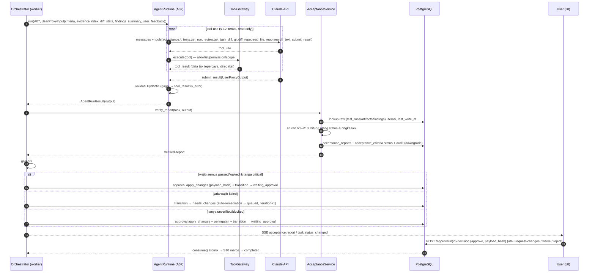

# KodeKantor — User Proxy Acceptance Contract (M14)

> Sumber: PRD v1.0 §5.5 (modul pembeda, wajib sejak MVP), §4.1 #10, §6 A07, §6.2 (registry contract), §3.3 ("status tidak boleh dibuat-buat"), §10.4, §12.1 AC-11/AC-12/AC-18, R-04; ARCHITECTURE §5.2 (S8–S10); DATA_MODEL (requirements, acceptance_criteria, acceptance_reports, approvals); API_CONTRACTS §5, §8; `backend/app/agents/contracts.py` (`UserProxyInput`, `UserProxyOutput`); ADR-006, ADR-013.
> Bagian bertanda *(turunan)* adalah keputusan desain yang tidak tertulis eksplisit di PRD. Kode acuan: `app/services/acceptance.py` (verifikasi & gate), `app/workflow/steps.py::validate`, `app/api/routes/acceptance.py`.

## 1. Prinsip

1. **User Proxy bukan chatbot penebak selera.** Ia menerima requirement baseline yang disetujui, mengumpulkan evidence aktual, dan melaporkan hasil **per kriteria** (PRD §5.5).
2. **Evidence over claims.** Status `passed` hanya bertahan bila didukung referensi evidence nyata yang diverifikasi **backend** (§5). Output LLM tidak pernah langsung menjadi status final (ARCHITECTURE P1, R-04).
3. **Rekomendasi ≠ keputusan.** User Proxy dapat merekomendasikan acceptance, tetapi tidak menggantikan keputusan eksplisit pengguna (PRD §5.5 *Final acceptance*, §10.4). Profil A07: `filesystem: read_only`, `sandbox: deny`, `approval_grant: deny`; tidak ada tool untuk memutuskan approval atau mengubah status kriteria.
4. **Kegagalan objektif → perbaikan; perubahan scope → requirement change** (PRD §5.5 *Gap routing*).

## 2. Requirement baseline

| Aspek | Aturan |
|---|---|
| Pembuatan | S1 intake: A02 menghasilkan `IntakeOutput.requirements[]` (`REQ-n`) masing-masing dengan `acceptance_criteria[]` (`AC-n`, unik per task). Disimpan sebagai baseline **v1**, `requirements.status = draft`, `created_by = agent:A02`. |
| Sumber | `requirements.source_message_id` (pesan chat asal) dan `created_by` (`user:<id>` / `agent:A02`) — memenuhi "setiap requirement menyimpan sumber". |
| Wajib/opsional | `requirements.priority ∈ {must, should, could}`; setiap kriteria punya `mandatory: bool`. Default *(turunan)*: kriteria dari requirement `must` → `mandatory: true`; `should`/`could` → `mandatory: false` kecuali A02/user menyatakan lain. Gate memakai flag `mandatory` per kriteria. |
| Metode verifikasi | `verification_method ∈ {test, api, browser, review, manual}` per kriteria. |
| Persetujuan | Baseline menjadi `approved` saat plan disetujui user (`POST /tasks/{tid}/plan/approve`) atau, bila `plan_approval_required=false`, otomatis saat `planned → queued` dengan audit `requirements.approved_by_policy` *(turunan)*. |
| Versi | `requirements.baseline_version`. `PUT /tasks/{tid}/requirements` (user) membuat **v+1**; semua baris versi lama → `superseded`. Kriteria versi baru mulai `pending`; evidence iterasi sebelumnya tidak dibawa. |
| Requirement change | Perubahan scope (dari user atau dari gap bertipe scope) **selalu** lewat baseline baru, dicatat dengan alasan dan ditautkan ke iterasi task (`tasks.iteration`). |

## 3. Status kriteria & siapa yang boleh menetapkannya

| Status | Arti | Ditetapkan oleh | Catatan |
|---|---|---|---|
| `pending` | Belum dievaluasi pada baseline/iterasi ini | Sistem (pembuatan baseline, iterasi baru) | Tidak pernah muncul di output A07. |
| `passed` | Terpenuhi dan didukung evidence terverifikasi | A07 **mengusulkan** → backend **memverifikasi** (§5); atau user via feedback `ok` untuk kriteria subjektif/manual (§6) | Bila verifikasi gagal → `unverified` (`downgraded=true`). |
| `failed` | Tidak terpenuhi (objektif) | A07 (dengan rationale + gap); user via feedback `not_ok` | Kegagalan diterima apa adanya (konservatif); wajib punya `rationale`. |
| `unverified` | Tidak dapat dibuktikan dengan evidence yang ada | A07; backend (hasil downgrade/tidak dievaluasi) | Tidak sama dengan gagal; gate memperlakukannya sebagai peringatan (§8). |
| `blocked` | Tidak dapat dievaluasi karena hambatan (mis. butuh browser/E2E yang belum tersedia, environment rusak) | A07 | Butuh tindakan user/sistem. |
| `waived_by_user` | Dikecualikan secara sadar oleh pengguna | **Hanya user** via `POST /tasks/{tid}/acceptance/criteria/{cid}/waive` (permission `approval:decide`, CSRF, `reason` wajib) | `CriterionResult.status` di kontrak A07 **tidak** mengizinkan nilai ini (Literal `passed/failed/unverified/blocked`); A07 tidak dapat waive. Dicatat `waived_by`, `waived_at`, audit `acceptance.criterion_waived`, dan baris `approvals(action_type=waive_criterion)` yang langsung `consumed` oleh user yang sama *(turunan, untuk keseragaman jejak keputusan)*. |

Hanya `app/services/acceptance.py` yang menulis `acceptance_criteria.status` (analog `workflow/states.py` untuk status task).

## 4. Evidence: jenis & format referensi

| Jenis evidence PRD §5.5 | Rekaman | Format ref | Diperoleh A07 lewat |
|---|---|---|---|
| Test result | `test_runs` (status, exit code, counts, junit artefak) | `test_run:<uuid>` | `acceptance.list_evidence`, `tests.get_run` |
| API response | artefak `other`/`test_report` (respons tersimpan dari test/API check) | `artifact:<uuid>` | `acceptance.list_evidence` |
| Screenshot, browser trace | artefak `screenshot`/`other` dari E2E (C19, **P1**) | `artifact:<uuid>` | `acceptance.list_evidence` |
| Diff | diff worktree task terhadap `base_commit` | `diff:<task_uuid>` | `review.get_task_diff`, `git.diff` |
| Catatan review | `findings` (code_review / security / static) | `finding:<uuid>` | `acceptance.list_evidence` |
| Feedback user (subjektif/manual) | artefak `other` dengan `metadata.kind=user_feedback` *(turunan)* | `artifact:<uuid>` | dibuat oleh `POST …/criteria/{cid}/feedback` |

Regex ref: `^(test_run|artifact|finding):[0-9a-f]{8}-[0-9a-f]{4}-[0-9a-f]{4}-[0-9a-f]{4}-[0-9a-f]{12}$` atau `^diff:<uuid>$`. Di API (`EvidenceRef`) setiap ref diperkaya menjadi `{ref, type, label, url}` agar laporan berisi tautan (AC-11).

`acceptance.list_evidence` hanya mengembalikan evidence **milik task ini** (dengan `iteration`, `status`, `created_at`), sehingga A07 tidak perlu — dan tidak dapat — menebak ID.

## 5. Verifikasi evidence oleh backend

Setelah A07 memanggil `submit_result` dengan `UserProxyOutput` yang valid secara skema, `services/acceptance.verify_report(task, output)` menjalankan aturan berikut **per kriteria** sebelum apa pun disimpan. Setiap downgrade menyimpan `downgraded: true` + `downgrade_reason` di `acceptance_reports.criteria_results` (JSONB) dan menulis audit `acceptance.evidence_rejected`.

| # | Kondisi pada hasil yang diusulkan `passed` | Hasil | `downgrade_reason` |
|---|---|---|---|
| V1 | `evidence_refs` kosong | `unverified` | `no_evidence` |
| V2 | Ada ref dengan format tidak valid | `unverified` | `malformed_ref` |
| V3 | Ada ref yang tidak ada di DB | `unverified` | `unknown_ref` |
| V4 | Ada ref milik task/project lain (`diff:` ≠ task ini, atau `test_run/artifact/finding.task_id` ≠ task ini) | `unverified` | `foreign_ref` |
| V5 | Ada `test_run:` yang direferensikan dengan status ≠ `passed` (failed/error/timeout/cancelled/running) | `unverified` | `failed_test_run` |
| V6 | `verification_method = test` tetapi tidak ada `test_run:` berstatus `passed` **dari iterasi berjalan** (`test_run.started_at ≥ checkpoint.iteration_started_at`) | `unverified` | `missing_current_test_run` |
| V7 *(turunan)* | `verification_method = test` dan semua `test_run` passed yang dirujuk dimulai **sebelum** perubahan workspace terakhir di iterasi ini (tool call `code.*` sukses terakhir) — evidence basi terhadap diff final | `unverified` | `stale_test_run` |
| V8 *(turunan)* | `verification_method = browser` tanpa `artifact:` screenshot/trace dari iterasi berjalan; `api` tanpa `artifact:` atau `test_run:` passed | `unverified` | `missing_method_evidence` |
| V9 *(turunan)* | `verification_method = manual` — A07 tidak dapat meluluskan kriteria manual; hanya feedback user | `unverified` | `manual_requires_user` |

Aturan pelengkap:

- **V10 — kriteria tidak dievaluasi:** kriteria baseline yang tidak ada di `criteria_results` → `unverified` (`not_evaluated`). `criterion_key` yang tidak dikenal diabaikan dan dicatat di log.
- **`failed` / `blocked` / `unverified` usulan A07** diterima apa adanya (konservatif); ref di dalamnya tetap divalidasi (ref invalid dibuang + audit), tetapi status tidak dinaikkan.
- **Kriteria `waived_by_user`** tidak dievaluasi ulang selama baseline sama (tetap waived; A07 boleh memberi catatan).
- **Konsistensi status laporan:** `report.status` **dihitung ulang** dari status final kriteria wajib (precedence: ada `failed` → `needs_changes`; else ada `blocked` → `blocked`; else ada `unverified` → `unverified`; else `passed`). Status usulan A07 yang tidak konsisten diabaikan (dicatat).
- **Confidence:** bila ada downgrade, `confidence` disimpan `low` *(turunan)*.
- **Hanya backend** yang menghitung angka ringkasan (`passed/failed/unverified/waived/blocked`) untuk event `acceptance.report`.

```python
# app/services/acceptance.py (sketsa kontrak)
def verify_criterion(c: Criterion, r: CriterionResult, ev: EvidenceIndex, it: IterationInfo) -> Verified:
    if r.status != "passed":
        return Verified(r.status, refs=ev.valid_refs(r.evidence_refs), downgraded=False)
    if not r.evidence_refs:                       return downgrade("no_evidence")
    for ref in r.evidence_refs:
        if not REF_RE.match(ref):                 return downgrade("malformed_ref")
        obj = ev.lookup(ref)
        if obj is None:                           return downgrade("unknown_ref")
        if obj.task_id != it.task_id:             return downgrade("foreign_ref")
        if obj.kind == "test_run" and obj.status != "passed":
                                                  return downgrade("failed_test_run")
    if c.verification_method == "test":
        runs = [ev.lookup(x) for x in r.evidence_refs if x.startswith("test_run:")]
        cur = [t for t in runs if t.started_at >= it.iteration_started_at]
        if not cur:                               return downgrade("missing_current_test_run")
        if it.last_write_at and all(t.started_at < it.last_write_at for t in cur):
                                                  return downgrade("stale_test_run")
    if c.verification_method == "manual":         return downgrade("manual_requires_user")
    ...
    return Verified("passed", refs=r.evidence_refs, downgraded=False)
```

## 6. Preferensi subjektif

PRD: untuk "terlalu ramai", "mudah dipakai", dan preferensi subjektif lain, agent menjelaskan penilaiannya dan meminta feedback bila tidak jelas.

1. A07 menandai `CriterionResult.subjective = true`, menjelaskan penilaian di `rationale` (merujuk evidence yang ada, mis. diff/screenshot), dan biasanya memberi status `unverified` dengan `next_actions` berupa pertanyaan ke user.
2. UI (layar 10) menampilkan kriteria subjektif terpisah dengan tombol **OK / Tidak OK / Tunda**.
3. `POST /tasks/{tid}/acceptance/criteria/{cid}/feedback {verdict, feedback}`:
   - `ok` → status `passed` dengan evidence `artifact:<feedback>` (actor = user) — ini **bukan** downgrade-able karena keputusan manusia;
   - `not_ok` → status `failed` + gap berisi feedback → jalur remediation (§7);
   - *Tunda (defer)* = tidak mengirim feedback: kriteria tetap `unverified`; gate memperlakukannya sebagai peringatan (§8) dan user tetap dapat apply, waive, atau meminta perbaikan.
4. Feedback disimpan sebagai `user_feedback` di iterasi berikutnya (`IntakeInput.user_feedback`, `PlanInput.user_feedback`, `ImplementInput.gap_feedback`, `UserProxyInput.user_feedback`).

## 7. Gap routing & siklus revalidation

| Jenis gap | Deteksi | Routing |
|---|---|---|
| Kegagalan objektif (kriteria wajib `failed`) | hasil verifikasi | `needs_changes` → auto-remediation bila `iteration_auto_count < TASK_AUTO_REMEDIATION_MAX` (default 1) dan `projects.settings.auto_remediation ≠ false`: `queued`, `iteration+1`, `gap_feedback = gaps[].description + suggested_fix`; tambahkan langkah plan baru "Perbaiki gap: …" (B14, membawa `gap_feedback`) lalu S4–S9 — **tanpa** re-plan penuh (ADR-027). Re-plan S1–S3 hanya bila baseline requirement diubah. Setelah batas habis → tetap `needs_changes`, menunggu user. |
| Permintaan perbaikan user | `POST /tasks/{tid}/request-changes {feedback, criterion_ids?}` (dari `needs_changes`, `waiting_approval`, atau `completed` — reopen) | `queued`, `iteration+1`, feedback → `gap_feedback`; siklus sama. |
| Perubahan scope | user mengubah requirement / gap A07 menyatakan "di luar baseline" | **requirement change**: `PUT /tasks/{tid}/requirements` → baseline v+1 (lama `superseded`); kriteria `pending`; lalu iterasi baru. A07 tidak mengubah baseline sendiri — ia hanya merekomendasikan di `next_actions`. |
| `blocked` | hasil A07 | ditampilkan dengan penyebab; user memilih: perbaiki environment/plan (request-changes), waive, atau apply dengan peringatan. |
| `unverified` | hasil A07/downgrade | peringatan eksplisit di approval `apply_changes`; user dapat meminta test tambahan (request-changes) atau `POST /tasks/{tid}/acceptance/revalidate`. |
| Finding `critical` terbuka *(turunan)* | S7 review/security | diperlakukan sebagai gap objektif (`finding:<id>`) → `needs_changes`, kecuali user men-*dismiss* finding (tercatat). |

**Revalidation tanpa implementasi:** `POST /tasks/{tid}/acceptance/revalidate` menjalankan ulang S8 (A07) + S9 terhadap evidence terkini (mis. setelah user menjalankan test manual via `POST /projects/{id}/test-runs` dengan `target: task:<id>`), tanpa B14/C20.

**Batas siklus (AC-18 "terbatas"):** otomatis ≤ `TASK_AUTO_REMEDIATION_MAX`; setiap siklus juga dibatasi `TASK_MAX_DEBUG_ATTEMPTS` per iterasi dan budget task (`BudgetGuard` → `waiting_approval(budget_increase)`). Siklus atas permintaan user selalu eksplisit (satu permintaan = satu iterasi). Contoh PRD §6.2 `limits.max_iterations: 3` ditafsirkan sebagai batas siklus revalidation per task *(turunan; diputuskan: `TASK_MAX_ITERATIONS` (default 3) ditambahkan ke CONFIGURATION sebagai batas keras total iterasi per task, termasuk iterasi atas permintaan user; melewatinya memerlukan reopen sebagai task baru)*.

## 8. Gate (ARCHITECTURE §5.2 S9)

Input gate = status final kriteria wajib setelah verifikasi + findings terbuka.

| Kondisi (kriteria **wajib**) | Status task berikutnya | Approval | Catatan |
|---|---|---|---|
| Semua `passed`/`waived_by_user` **dan** tidak ada finding `critical` terbuka | `waiting_approval` | `apply_changes` (payload: diff stats, branch/commit, ringkasan report) | Kriteria opsional yang gagal ditampilkan sebagai gap non-blocking. |
| ≥ 1 `failed` (atau finding `critical` terbuka) | `needs_changes` | — (**tidak ada** approval `apply_changes`) | Auto-remediation (§7) atau menunggu user: request-changes / waive / cancel. AC-12. |
| Tidak ada `failed`, tetapi ada `unverified`/`blocked` | `waiting_approval` | `apply_changes` dengan **peringatan eksplisit**; daftar kriteria unverified/blocked masuk payload (ikut di-hash) | Approve = "penyelesaian parsial disetujui" (PRD §3.3) → `completed`; laporan tetap menandai unverified. |
| Setelah user waive kriteria `failed` terakhir | `needs_changes → waiting_approval` (ADR-006) | `apply_changes` | Waiver tercatat (audit + approvals). |

Tidak ada jalur ke `completed` selain approval `apply_changes` yang `consumed` dan merge berhasil (S10). `workflow/states.py` menolak transisi lain (`INVALID_TRANSITION`).

## 9. Format laporan & ekspor Markdown

Disimpan di `acceptance_reports` (satu baris per iterasi/revalidation) + artefak `acceptance_report`. `GET /tasks/{tid}/acceptance/report.md` menghasilkan:

```markdown
# Acceptance Report — {task.title}

| Task | Iterasi | Baseline | Status | Confidence | Dibuat |
|---|---|---|---|---|---|
| {task.id} | {iteration} | v{baseline_version} | **{STATUS}** | {confidence} | {created_at} |

> Rekomendasi User Proxy **bukan** persetujuan. Penerapan perubahan tetap memerlukan keputusan Anda.
> Agent run: {agent_run_id} · Model: {model} · Provider: {provider|scripted}

## Ringkasan
| passed | failed | unverified | waived_by_user | blocked | total |
|---|---|---|---|---|---|
| {n} | {n} | {n} | {n} | {n} | {n} |

{summary}

## Kriteria
| Key | Requirement | Kriteria | Wajib | Metode | Status | Evidence | Catatan |
|---|---|---|---|---|---|---|---|
| AC-1 | REQ-1 {title} | {criterion} | ya | test | passed | [test_run:…]({url}) | {rationale} |
| AC-2 | REQ-1 {title} | {criterion} | ya | test | unverified ⚠ diturunkan: no_evidence | — | {rationale} |

## Gap
- **AC-3** — {description}. Usulan perbaikan: {suggested_fix}

## Risiko
- {risk}

## Findings terbuka
| Severity | Judul | Lokasi | Ref |
|---|---|---|---|

## Next actions
- {next_action}

## Indeks evidence
- test_run:{id} — {profile} · {status} · exit {code} · {started_at}
- diff:{task_id} — {files} file, +{add}/−{del}
```

## 10. Titik integrasi API & event

| Kebutuhan | Endpoint / event (API_CONTRACTS) |
|---|---|
| Baca baseline & status | `GET /tasks/{tid}/requirements`, `GET /tasks/{tid}/acceptance` |
| Ubah baseline (requirement change) | `PUT /tasks/{tid}/requirements` |
| Revalidation | `POST /tasks/{tid}/acceptance/revalidate` |
| Waive | `POST /tasks/{tid}/acceptance/criteria/{cid}/waive` |
| Feedback subjektif | `POST /tasks/{tid}/acceptance/criteria/{cid}/feedback` |
| Minta perbaikan | `POST /tasks/{tid}/request-changes` |
| Ekspor | `GET /tasks/{tid}/acceptance/report.md` |
| Keputusan apply | `POST /approvals/{aid}/decision` (`apply_changes`) |
| Event | `acceptance.report`, `task.status_changed`, `approval.requested`, `approval.decided` |

## 11. Diagram urutan



## 12. Skenario test (AC-11, AC-12, AC-18)

Lokasi: `backend/tests/unit/test_evidence_verification.py`, `backend/tests/unit/test_acceptance_gate.py`, `backend/tests/integration/test_user_proxy_step.py`, `backend/tests/integration/test_remediation_cycle.py`, `tests/e2e/acceptance-remediation.spec.ts`. Semua memakai `ScriptedProvider` (ADR-015) untuk output A07 yang ditentukan.

| ID | AC | Setup | Aksi | Hasil yang diharapkan |
|---|---|---|---|---|
| UPA-01 | AC-11 | Kriteria `test`; `test_run` passed iterasi ini setelah write terakhir | A07 `passed` + ref run | `passed`, `downgraded=false`; ref di laporan menjadi tautan `url` |
| UPA-02 | AC-11 | — | A07 `passed` tanpa ref | `unverified`, `no_evidence`; audit `acceptance.evidence_rejected` |
| UPA-03 | AC-11 | `test_run` failed | A07 `passed` + ref run failed | `unverified`, `failed_test_run` |
| UPA-04 | AC-11 | `test_run` milik task lain | A07 `passed` + ref asing | `unverified`, `foreign_ref` |
| UPA-05 | AC-11 | — | A07 `passed` + UUID acak | `unverified`, `unknown_ref` |
| UPA-06 | AC-11 | Kriteria `test`, hanya ada `diff:` | A07 `passed` + `diff:<task>` | `unverified`, `missing_current_test_run` |
| UPA-07 | AC-11 | `test_run` passed dari iterasi 1, task iterasi 2 | A07 `passed` + run lama | `unverified`, `missing_current_test_run` |
| UPA-08 | AC-11 | `test_run` passed, lalu `code.apply_patch` sukses | A07 `passed` + run tsb | `unverified`, `stale_test_run` |
| UPA-09 | AC-11 | Kriteria `manual` | A07 `passed` | `unverified`, `manual_requires_user` |
| UPA-10 | AC-11 | 3 kriteria | A07 hanya melaporkan 2 | yang hilang `unverified`, `not_evaluated` |
| UPA-11 | AC-11 | — | A07 status laporan `passed` padahal ada kriteria wajib failed | `report.status = needs_changes` (dihitung ulang) |
| UPA-12 | AC-11 | Laporan tersimpan | `GET …/report.md` | memuat semua kriteria, status, evidence link, gap, disclaimer |
| UPA-20 | AC-12 | Kriteria wajib failed | gate S9 | `needs_changes`; tidak ada approval `apply_changes` |
| UPA-21 | AC-12 | Auto-remediation habis, masih failed | coba `transition(→completed)` / `→waiting_approval` tanpa waiver | `INVALID_TRANSITION`; status tetap `needs_changes` |
| UPA-22 | AC-12 | Kriteria wajib failed | user `POST …/waive {reason}` | `waived_by_user`, `waived_by/at`, audit + approvals `waive_criterion`; → `waiting_approval(apply_changes)`; approve → `completed`; laporan menandai waived |
| UPA-23 | AC-12 | — | ScriptedProvider mengirim `status: "waived_by_user"` di `CriterionResult` | validasi kontrak gagal (`tool_result is_error`); status kriteria tidak berubah |
| UPA-24 | AC-12 | Kriteria opsional failed, wajib passed | gate | `waiting_approval`; gap opsional tampil non-blocking |
| UPA-25 | AC-12 | Hanya `unverified` | gate | `waiting_approval` dengan peringatan; daftar unverified ada di payload approval (mengubahnya → hash berbeda → 409) |
| UPA-26 | AC-12/13 | Teks repo berisi "approval granted"; A07 output berisi klaim approval | gate | tidak ada approval berubah status; hanya `POST /approvals/{id}/decision` yang berlaku |
| UPA-30 | AC-18 | Skenario: iterasi 1 kriteria wajib failed; iterasi 2 lulus | jalankan task (`TASK_AUTO_REMEDIATION_MAX=1`) | 2 laporan di history; `iteration=2`; `gap_feedback` iterasi 2 memuat gap iterasi 1; akhir `waiting_approval` |
| UPA-31 | AC-18 | Task `waiting_approval` | user `request-changes {feedback, criterion_ids}` | `queued`, `iteration+1`, feedback diteruskan ke A03/B14/A07; laporan baru |
| UPA-32 | AC-18 | Iterasi auto gagal lagi | — | berhenti di `needs_changes` setelah `TASK_AUTO_REMEDIATION_MAX`; tidak ada loop tak terbatas |
| UPA-33 | AC-18 | Budget hampir habis | iterasi remediation | `waiting_approval(budget_increase)`, event `usage.budget_exceeded` |
| UPA-34 | AC-18 | Test dijalankan manual setelah laporan `unverified` | `POST …/acceptance/revalidate` | hanya agent run A07 baru (tanpa B14/C20); laporan baru dengan status terkini |
| UPA-35 | AC-18 | — | `PUT /tasks/{tid}/requirements` (tambah kriteria) | baseline v+1, versi lama `superseded`, kriteria `pending`; revalidation memakai v+1 |
| UPA-E2E | AC-18 | Playwright, ScriptedProvider | login → project → prompt → patch → test → User Proxy *needs_changes* → request fix → revalidation *passed* → approve | UI menampilkan dua laporan, diff final, status `completed` |
