# Rancangan Sistem Pengembangan KodeKantor

| | |
|---|---|
| Tanggal | 24 Oktober 2026 |
| Status | **Draft, menunggu persetujuan**. Bagian yang menunggu keputusan diberi tanda ⏳. |
| Cakupan | Cara repo ini dikembangkan: struktur repo, alur kerja agent, konfigurasi Claude Code, tracker, review, CI, gate. **Bukan** rancangan produk; produk dirancang di PRD v2.2 dan dokumen turunannya. |
| Masukan | `docs/PRD_v2.2.md` (identik dengan DOCX/PDF 23 Okt 2026 kecuali satu cacat konversi, §8 #20), 25 dokumen di `docs/` + `docs/mockups/` + sumber WBS, `agents/registry.v2.yaml`, workbook WBS v2.2. |
| Skill | Superpowers (`brainstorming`, `writing-plans`), mattpocock/skills (`setup-matt-pocock-skills`, `domain-modeling`, `writing-for-agents`), ECC (agent reviewer dan rules, diadaptasi). |

---

## 1. Kebenaran yang perlu diketahui lebih dulu

1. **Repo ini mulai dari nol; kode yang diasumsikan dokumen tidak ada.** [Pasti] PRD, tracker, IMPLEMENTATION_DESIGN_V2, dan WBS mengasumsikan "kode snapshot 21 Okt 2026", antara lain:
   - backend 1316 test lulus, 2 gagal;
   - frontend 259 test;
   - sandbox_manager 207 + 23 test Docker;
   - `infra/compose.yml`, `scripts/validate_registry.py`, `agents/registry.yaml` v1, CLAUDE.md asli.

   Tidak satu pun ikut diserahkan; ZIP hanya berisi dokumen. Akibatnya, status "Selesai/Snapshot/Sebagian" di WBS untuk WP yang menghasilkan kode (P1–P5, wave W1–W2) **tidak berlaku** untuk repo ini. Status WP dokumen (P0) tetap berlaku.
2. **Implementasi terakhir dihentikan oleh PO.** [Pasti] Kutipan dari IMPLEMENTATION_TRACKER: "jalankan rancangannya saja, jangan sampai implementasi". Tracker §5 juga menunda keputusan apakah snapshot dipakai atau dibuang. Rancangan ini tidak membuka implementasi produk; itu keputusan PO (⏳ Q2).
3. **Gate G0 belum lulus.** [Pasti] FR turunan (ADR-020) dan ADR *Proposed* belum diputuskan:
   - 9 ADR v1;
   - ADR-036..068 (seluruh v2+).

   Menurut ROADMAP Phase 0, sebelum G0 "tidak ada kode aplikasi selain kontrak".
4. **Tiga set skill yang diminta tumpang-tindih.** [Pasti] Ketiganya punya alur TDD, code review, dan perencanaan sendiri. Bila semuanya aktif penuh, agent menerima instruksi yang saling bersaing. Plugin ECC penuh menambahkan:
   - 311 skill dan 71 agent ke daftar konteks;
   - 27 hook yang berjalan di setiap pemanggilan tool.

   Rancangan ini memberi setiap tahap satu pemilik (§5).
5. **Dokumen saling bertentangan di ±26 titik.** [Pasti] Daftarnya ada di §8. Beberapa memengaruhi urutan kerja, misalnya scope MVP vs monitoring P6, jadwal aktivasi agent ganda, dan tiga versi rantai migrasi.

## 2. Maksud dan alasan

PO ingin KodeKantor dibangun oleh tim delivery agentik (AG-00..AG-21) dengan gate manusia, berbasis bukti, dan dapat ditelusuri dari FR sampai test. Sistem pengembangan harus membuat cara kerja itu **dapat dijalankan dan diulang di Claude Code**, sehingga:

- agent tahu sumber kebenaran, batas path, dan definisi selesai tanpa diberi tahu ulang tiap sesi;
- pekerjaan 137 WP dapat dilacak dan diurutkan menurut dependensi, tanpa memuat semuanya ke satu konteks;
- klaim "selesai" selalu disertai output perintah nyata, sesuai prinsip produk sendiri: *evidence over claims*;
- keputusan manusia (G0–G16, ADR, sign-off 🔒) tidak dapat dilewati agent.

### Tujuan

- G-1: Satu CLAUDE.md ringkas yang menunjuk ke kontrak, bukan menyalin isinya.
- G-2: Alur per WP yang jelas: desain → rencana → eksekusi TDD → review → verifikasi → PR → gate.
- G-3: Tracker yang memetakan WBS (WP, dependensi, gate, pemilik) ke GitHub Issues secara bertahap.
- G-4: Review independen yang spesifik KodeKantor (keamanan T1–T28, kontrak backend/frontend, silent failure).
- G-5: Konfigurasi ikut ke setiap sesi cloud yang membuka repo ini.

### Non-goal

- Tidak memutuskan hal yang menjadi wewenang PO: ADR, scope MVP, vendor, threshold.
- Tidak men-scaffold kode produk atau CI produk sebelum ada keputusan Q1/Q2 (§7).
- Tidak memperbaiki konflik dokumen secara sepihak; konflik dicatat untuk G0.

### Anti-goal (gagal walau secara teknis "jalan")

- Agent yang menandai WP selesai tanpa output test.
- Tiga framework yang masing-masing menyuruh agent melakukan TDD/review dengan cara berbeda.
- Konteks agent penuh oleh ratusan skill yang tidak relevan.
- Rantai keputusan yang memungkinkan agent melewati gate atau mengubah kontrak tanpa ADR.

## 3. Batasan dari dokumen (mengikat)

- **Struktur repo** mengikuti `ARCHITECTURE.md` §3:

  ```
  backend/  frontend/  sandbox_manager/  sandbox-images/  infra/
  tests/e2e/  scripts/  config/  agents/  docs/
  ```

  Tidak ada tool monorepo tambahan: `uv` per proyek Python, npm untuk frontend (ADR-001, ADR-049).
- **Kualitas.** Ruff, Pyright, import-linter, pytest, Vitest + RTL, Playwright, gitleaks, Semgrep, Trivy, pip-audit, dan npm audit, dengan job CI sesuai `TEST_STRATEGY.md` §6.
- **Delivery.**
  - Roster AG-00..AG-21 dengan path milik.
  - Hanya AG-00 yang mengintegrasikan.
  - Laporan wajib memuat output aktual.
  - Gate dan WP manusia tidak dapat dilewati.

  Sumber: ROADMAP §2, IMPLEMENTATION_DESIGN_V2 §11.3, workbook *Agent Roster/RACI/Gates*.
- **Test.**
  - Tanpa panggilan vendor nyata (ScriptedProvider, respx, FakeSandbox).
  - Lokasi file test adalah kontrak.
  - Setiap bug keamanan mendapat test regresi.
- **ADR** tetap di `docs/DECISIONS.md` dengan penomoran berlanjut. Puluhan dokumen dan WBS merujuk ID ADR-xxx.
- **Bahasa** dokumen Indonesia; label keyakinan `[Pasti]` / `[Kemungkinan Besar]` / `[Menebak]`.

## 4. Pendekatan yang dipertimbangkan

### 4.1 Titik awal basis kode (⏳ Q1, keputusan kamu/PO)

| | Pendekatan | Untung | Rugi |
|---|---|---|---|
| **A** | **Pulihkan snapshot Wave 2** (`backend/`, `frontend/`, `sandbox_manager/`, `infra/`, `scripts/`, `agents/registry.yaml`, CLAUDE.md asli). Masukkan sebagai satu PR "import snapshot", jalankan seluruh suite, lalu lanjut dari W3 (WP-INT-01..08) → W4 (E2E/SEC) → G3. | Pekerjaan P1–P5 (±6,3 juta token, ±637 menit agent) tidak diulang; dokumen sudah selaras dengannya. | Kode belum terintegrasi E2E dan belum pernah direview per PR; perlu review AG-13 sebelum G1/G2. |
| **B** | **Greenfield dari Phase 1** dengan dokumen sebagai kontrak, dimulai dari *walking skeleton* vertikal: login → project → prompt → patch (scripted) → test di sandbox → diff → approval. WBS W1–W2 aslinya horizontal per lapisan. | Setiap baris direview lewat PR; sejarah bersih; cocok dengan disiplin vertical slice. | Membangun ulang P1–P5 (porsi terbesar WBS); kalender mundur beberapa minggu [Menebak]. |
| **C** | **Hibrida**: snapshot disimpan di branch referensi, lalu di-port modul demi modul lewat PR per WP dengan review dan test. | Review per bagian, tetap memanfaatkan snapshot. | Lebih lambat dari A; risiko salin-tempel tanpa pemahaman. |

**Rekomendasi: A bila snapshot masih ada dan suite-nya dapat dijalankan; B bila tidak.** A menghemat pekerjaan terbesar dan dokumen ditulis untuknya; risiko kualitasnya ditutup oleh WP-INT dan WP-SEC-01 yang memang sudah dijadwalkan. C hanya layak bila review snapshot menemukan masalah luas.

### 4.2 Komposisi tiga set skill (diputuskan, panggilan saya)

| | Pendekatan | Kenapa |
|---|---|---|
| X | Ketiganya aktif penuh, termasuk plugin ECC dan hook runtime-nya. | Ditolak: konteks membengkak (311 skill, 71 agent), 27 hook di setiap tool call, dan tiga alur TDD/review/plan bersaing. |
| **Y** | **Satu pemilik per tahap** (§5): Superpowers untuk alur per WP; Pocock untuk bahasa domain, tracker, dan PR; ECC sebagai agent reviewer dan rules yang diadaptasi ke kontrak KodeKantor. | **Dipilih.** Setiap kemampuan yang diminta tetap dipakai, tanpa instruksi yang bertabrakan. |
| Z | Hanya satu framework (mis. Superpowers saja). | Lebih sederhana, tetapi kehilangan `wayfinder`/`to-tickets` (cocok untuk 137 WP) dan reviewer yang paham stack. |

ECC dipakai selektif seperti yang README ECC sendiri sarankan saat footprint konteks penting. Rules bahasa ECC tidak disalin mentah karena bertentangan dengan kontrak:

| ECC | Kontrak KodeKantor |
|---|---|
| black/isort | Ruff |
| mypy | Pyright (ADR-017) |
| bandit | Semgrep |
| `{success, data, error}` | envelope `{request_id, status, data, error, meta}` |
| `process.env` untuk secret | secret per peran proses |

## 5. Alur kerja (sudah dikonfigurasi di repo)

```mermaid
flowchart LR
  G0{{"Gate PO"}} --> MAP["/wayfinder + /to-tickets<br/>WP → GitHub Issues<br/>(frontier gate berikutnya)"]
  MAP --> BR["superpowers:brainstorming<br/>spec WP"]
  BR --> PL["superpowers:writing-plans<br/>plan WP"]
  PL --> EX["superpowers:subagent-driven-development<br/>+ peran AG-xx (delivery-roster)<br/>TDD per task"]
  EX --> RV["review per task (superpowers)<br/>+ kk-*-reviewer + /code-review"]
  RV --> SEC{"WP 🔒?"}
  SEC -->|ya| AG13["kk-security-reviewer<br/>sign-off"]
  SEC -->|tidak| VF
  AG13 --> VF["verification-before-completion<br/>output nyata"]
  VF --> PR["PR (template pocock pr)<br/>CI hijau, manusia merge"]
  PR --> G1{{"Gate PO berikutnya"}}
  PR --> RETRO["/retro → CLAUDE.md/rules"]
```



- **Bahasa domain**: `GLOSSARY.md` (format Pocock). Diisi dari PRD §17 dan SYSTEM_SPEC, dengan pembedaan wajib *runtime agent* (A01–S52) vs *delivery agent* (AG-xx), yang paling mudah tertukar.
- **Tracker**: GitHub Issues, satu issue per WP, judul diawali ID WP.
  - Label tambahan: `phase:Pn`, `gate:Gn`, `prio:P0|P0e|P1|P2`, `owner:AG-nn`, `security-signoff`.
  - Milestone = gate. Dependensi WBS menjadi edge *blocked-by* native.
  - Issue dibuat bertahap per frontier gate berikutnya, bukan 137 sekaligus.
  - Pembagian peran Pocock dan sumber status: §6 #8–#9.
- **Delivery roster**: AG-00 = sesi utama. AG-01..21 = baris peran yang disisipkan ke brief implementer (`docs/agents/delivery-roster.md`), bukan 21 file subagent. Peran terikat fase dan kebanyakan belum aktif; satu tabel lebih mudah dirawat.
- **Reviewer tetap** (`.claude/agents/`):
  - `kk-security-reviewer` (AG-13, Opus, sign-off 🔒 berbasis SECURITY_MODEL T1–T28);
  - `kk-backend-reviewer`;
  - `kk-frontend-reviewer`;
  - `kk-silent-failure-hunter`.
- **Rules per path** (`.claude/rules/`): `backend.md`, `frontend.md`, `infra.md`, `docs-and-contracts.md`. Dimuat hanya saat file yang cocok disentuh.
- **Pagar**:
  - permission `deny` untuk membaca/menulis `.env`, `*.pem`, `*.key`, `infra/secrets/**`;
  - hook `guard_bash.py` memblokir force push, `reset --hard` ke ref bersama, `prune --volumes`, dan membaca file secret lewat shell.
- **Plugin**: Superpowers dan mattpocock-skills diaktifkan di `.claude/settings.json` (scope project). Sesi yang membuka repo ini ditawari atau memasang keduanya [Kemungkinan Besar, belum diuji di sesi cloud baru]. Cadangannya, dua perintah `claude plugin install` di setup script environment.

## 6. Keputusan yang saya ambil (cek saat membaca)

1. Komposisi skill Y (§4.2) dan tabel "satu pemilik per tahap" di CLAUDE.md.
2. **Usulan ADR-069 — kebijakan git untuk delivery agent** (⏳ PO). Dokumen asli: hanya Lead yang commit. Diusulkan:
   - implementer boleh commit **hanya** di worktree task-nya sendiri;
   - hanya Lead yang merge ke branch WP, push, dan membuka PR;
   - merge ke `main` oleh manusia.

   Alasan: Superpowers memakai worktree terisolasi per task, sehingga risiko tabrakan yang dulu dicegah aturan itu sudah tertangani oleh isolasi.
3. ADR tetap di `docs/DECISIONS.md`; `docs/adr/README.md` hanya pointer, karena skill Pocock mencari folder itu.
4. CLAUDE.md asli hilang. Prinsip "#1–#8" yang dirujuk dokumen direkonstruksi dari `ARCHITECTURE.md` §0 P1–P8 [Kemungkinan Besar]. Bila CLAUDE.md asli ditemukan, isinya yang berlaku.
5. CI produk dan scaffolding kode **ditunda** sampai Q1/Q2 diputuskan. Job CI ditambahkan bersama kode yang diujinya.
6. Branch: `main` dilindungi.
   - Satu branch per WP (`wp/<id>-<slug>`; di sesi cloud memakai branch `claude/*` yang ditetapkan).
   - Satu PR per WP, merge oleh manusia, tanpa force push ke branch bersama.
   - Prefix `kk/` **tidak** dipakai karena itu namespace branch milik produk di repo pengguna.
7. Dokumen sumber diimpor apa adanya, termasuk mockup (±25 MB PNG) dan workbook WBS. PDF/DOCX tidak di-commit karena turunan dari `PRD_v2.2.md`.
8. **Unit issue = satu WP.** Issue WP dibangkitkan secara deterministik dari `docs/wbs/wbs_data.py` oleh script (D3), bukan disintesis LLM. Alasannya, traceability WP → FR → gate dan aturan path milik bergantung pada ID WP.
   - `/to-tickets` hanya dipakai untuk memecah satu WP yang terlalu besar menjadi tiket vertical slice sebagai **sub-issue** WP tersebut.
   - `/wayfinder` hanya dipakai untuk peta keputusan per gate (pertanyaan terbuka, fog), bukan untuk WP.
   - Bila Q1 = B dan WBS dipotong ulang, ID WP baru harus disetujui PO sebelum issue dibuat.
9. **Satu sumber per jenis catatan:**

   | Catatan | Tempat | Pengubah |
   |---|---|---|
   | Rencana: scope, pemilik, dependensi, estimasi | `docs/wbs/wbs_data.py` | AG-00 lewat PR |
   | Status kerja harian | GitHub Issues + milestone | — |
   | Bukti per modul/AC, sign-off 🔒, keputusan gate | `docs/IMPLEMENTATION_TRACKER.md` | Diperbarui di PR yang sama dengan WP-nya |

   Kolom status di `wbs_data.py` hanya disinkronkan AG-00 dari issue saat gate.
10. **WP 🔒 dibangun agent.** Label `ready-for-agent` + `security-signoff`; `ready-for-human` hanya untuk WP yang hasilnya keputusan atau aksi manusia.
    - `kk-security-reviewer` di sesi yang sama memberi pra-review.
    - **Sign-off formal AG-13** untuk gate G4/G9/G11/G13–G16 dijalankan di **sesi terpisah** yang tidak membangun WP itu, lalu ditandatangani bersama PO.
    - Bukti yang butuh Docker nyata (`-m docker`, isolasi sandbox) diambil dari CI, bukan dari sesi cloud.
11. **Default cara kerja sesi** (⏳ Q5 untuk konfirmasi):
    - Satu sesi per WP, dimulai manusia, tidak paralel lintas sesi.
    - Di sesi cloud, branch `claude/*` yang ditetapkan menjadi branch WP; implementer memakai worktree lokal di dalam sesi itu.
    - Tidak ada sesi tanpa pengawasan (Actions/terjadwal) sampai ada keputusan soal API key dan budget.

## 7. Pertanyaan yang hanya bisa dijawab kamu/PO

- **Q1** (⏳, mengubah semua langkah berikutnya): apakah kode snapshot Wave 2 masih ada (di mesin lokal, repo lain, atau arsip)? Pilih A, B, atau C di §4.1.
- **Q2** (⏳): apakah instruksi PO "rancangan saja, jangan implementasi" sudah dicabut? Akun GitHub mana yang berperan sebagai PO, OPS, dan reviewer/merger PR?
  - GitHub tidak mengizinkan akun menyetujui PR-nya sendiri. Bila agent membuka PR atas nama akun yang sama dengan pemberi approval, "manusia me-merge" dan "hanya PO yang menutup milestone" hanya bisa berupa konvensi, bukan branch protection/CODEOWNERS.
  - Bila PO adalah "Tira", dia butuh akses repo.
- **Q3** (⏳): izin membuat branch `main` dari commit akar repo ini agar PR dapat dibuka. Saat ini remote belum punya branch default.
- **Q4** (⏳): setuju ECC dipakai selektif (§4.2), atau tetap ingin plugin ECC penuh?
- **Q5** (⏳): konfirmasi default §6 #11.
  - Apakah sesi berjalan di cloud, lokal, atau keduanya?
  - Apakah boleh ada sesi paralel atau tanpa pengawasan?
  - Apakah ada batas budget token? Batas ini menentukan berapa reviewer Opus per WP.
- **G0** (bukan keputusan sistem pengembangan, tetapi memblokir implementasi): 25 keputusan di PRD v2.2 §15.3, 9 ADR v1 *Proposed*, review FR turunan, dan konflik §8 butir 5–11.

## 8. Konflik dan celah dokumen yang ditemukan

Butir 1–4 memblokir. Butir 5–11 mengubah urutan kerja dan perlu diputuskan di G0. Sisanya diperbaiki oleh pemilik dokumen (AG-00/AG-05).

### Memblokir

1. **Kode snapshot dirujuk tetapi tidak ada.** Rujukan: PRD "Kebenaran" #1, TRACKER §1/§4–5, IMPL_DESIGN_V2 §2.1/Lampiran A, POLYGLOT §1.2. DoD WP-9.0 ("≥ 1316 test lulus") tidak dapat dipenuhi apa adanya.
2. **Instruksi PO "jangan implementasi"** masih tercatat (TRACKER header).
3. **CLAUDE.md asli tidak ada**, padahal dirujuk sebagai "CLAUDE.md #1–#8" dan "konvensi frontend". Rujukan: SYSTEM_SPEC C-06..C-09, SDLC_SCALE §3.1, FR_CATALOG.
4. **File yang dirujuk tetapi tidak ada**: `agents/registry.yaml` (v1, 42 entri), `scripts/validate_registry.py` + `_v1.py` + test-nya, `agents/prompts/*`, `sandbox-images/sandbox-profiles.yaml`, `backend/app/agents/contracts.py`.

### Urutan dan scope

5. **Scope MVP.** WP-6.9 (monitoring, P0ᵉ untuk G6) dan WP-6.10 jatuh **sebelum** G3, bertentangan dengan "perluasan hanya setelah G3" (PRD Kebenaran #1/#5) dan definisi P0ᵉ "bukan P0 MVP".
6. **FR-287** (alert budget program/organisasi/capability) P0ᵉ di P6, padahal entitas program (P13), organisasi (P14), dan capability registry (P10) baru ada belakangan.
7. **Nomor gate tidak kronologis.** G3 (MVP DoD) datang setelah G4–G7; prasyarat P15 "G4" adalah gate egress.
8. **Jadwal aktivasi agent ganda.**
   - WBS P8 (WP-8.1–8.4) vs AGENT_CATALOG §13.2/§14.4 (P13–P16).
   - D24/B11 di P14 (SDLC_SCALE K8/K9, IMPL_DESIGN §13.8) vs P15/P16 (PRD §6.5).
   - Jumlah agent *planned*: 22 (AG-15, R-06) vs 33 (registry).
9. **Tiga versi rantai migrasi** (IMPL_DESIGN §7.0 vs §13.5 vs §14.5). Migrasi 0002 di-land di WP-INT-02 (§7.0) vs WP-9.0 (PRD §9.3).
10. **Dependensi P16.** P16 bergantung pada WP-13.7 (node tier M), tetapi diagram PRD §14.1 hanya menunjukkan G15.
11. **Pack SQL** (WP-15.9) butuh DB ephemeral di P15, sedangkan lingkungan multi-container baru ada di P16 / tier M.

### Kontrak teknis

12. **`ANTHROPIC_API_KEY` di `api` untuk smoke test**, sementara `api` tidak punya akses outbound. Rujukan: SECURITY_MODEL §1/§6.1 vs §7, API_CONTRACTS §13.8, IMPL_DESIGN §3.2 vs §3.4.
13. **Kedaluwarsa approval** berbeda:

    | | `apply_changes` | `tool_r3` |
    |---|---|---|
    | API_CONTRACTS §11.1 | 7 hari | 24 jam |
    | SECURITY_MODEL §5 | 24 jam | 1 jam |

    Status `waive_criterion` (approval atau bukan) juga tidak konsisten.
14. **Egress.** SECURITY_MODEL §4 masih memakai `egress-proxy` dengan allowlist Squid; ADR-064 menggantinya dengan `dep-proxy` per ekosistem.
15. **Pin image**: digest (SECURITY_MODEL §11) vs `--pull` (RUNBOOK §6) vs tag (RUNBOOK §12).
16. **Path tidak konsisten:**
    - test: `backend/tests/...` (v1) vs `tests/...` (v2.x);
    - prompt: `agents/prompts/` vs `app/agents/prompts/`;
    - `contracts.py`;
    - konfigurasi: `config/` vs `backend/config/`.
17. **DATA_MODEL melanggar konvensinya sendiri** di sejumlah tabel (`created_at`, `ON DELETE`, `owner_id`). Mekanisme purge audit 365 hari bertentangan dengan trigger append-only dan belum ditentukan.
18. **Terminal**: API_CONTRACTS §7 "read-only, tanpa shell" vs §13.4/§13.6 terminal interaktif (ADR-059).
19. **RBAC v2.1/v2.2 masih usulan.** `/budgets` memakai role `org_admin` seolah permission.
20. **Cacat konversi PDF/DOCX** §6.4 kartu K51: `portfolio.<domain>` menjadi "portfolio." (PDF hlm. 40).
21. **Mockup screen-24b / Gambar 5** menampilkan `kb_qa` "Claude + pgvector", bertentangan dengan ADR-046.
22. **SDLC_SCALE_DESIGN** menunjuk "§9 KONTRAK" untuk kontraknya sendiri; kontrak sebenarnya di §6.
23. **Batas debug attempt**: per task (FR-091) vs per iterasi (USER_PROXY_ACCEPTANCE §7).
24. **"AC" dipakai untuk dua hal**: kriteria per task `AC-n` vs kriteria produk AC-01..AC-20.
25. **Header workbook usang**: sheet *Ringkasan* masih "PRD v1.0", *Status Modul* "20 modul".
26. **Snapshot compose** `docker-socket-proxy INFO:1` vs ADR-026 `INFO=0` (sudah dicatat sebagai temuan tertunda).
27. **Token reset password**: API_CONTRACTS §2 menulis token "dicatat di audit/log dev", sedangkan SECURITY_MODEL §6.2 melarang secret masuk DB/log, dan audit disimpan 365 hari. WP-1.1d menulis token hanya di log saat `APP_ENV=development` dan tidak pernah di audit. Menunggu keputusan PO.

### Celah untuk sistem pengembangan (tidak ditentukan dokumen)

- Versi Node.js.
- Formatter TypeScript.
- Penyedia CI (tersirat GitHub Actions dari `.github/workflows/packs.yml`).
- Sumber OpenAPI untuk API KodeKantor sendiri. Ini dibutuhkan supaya test lintas scope dapat menelusuri semua route.
- Tool contract test.
- Stack metrik/tracing dan SLO.
- Kalender dan durasi.
- Model ID Claude (ditetapkan OPS di WP-INT-07).

## 9. Rencana penerapan sistem pengembangan

| Tahap | Isi | Siapa | Selesai bila |
|---|---|---|---|
| D0 (PR ini) | Impor dokumen; CLAUDE.md, GLOSSARY.md, `docs/agents/*`, `.claude/` (settings, rules, agents, hook), spec ini | AG-00 | PR di-review kamu |
| D1 | Jawaban Q1–Q4; ADR-069 diputuskan; paket keputusan G0 disiapkan dari §7 dan §8 (`/to-questionnaire` Pocock) | kamu/PO + AG-00 | G0 diputuskan |
| D2 | Basis kode sesuai Q1 (A: PR impor snapshot + jalankan suite; B: walking skeleton). Job CI pertama (lint/type/unit/security-scan) masuk bersama kodenya. Perintah nyata ditulis ke CLAUDE.md "Perintah". | AG-00 + AG-01/04/06 | CI hijau di `main`; G1 |
| D3 | Script `wbs_data.py` → issue WP untuk frontier gate berikutnya (label, milestone, edge blocked-by); `/wayfinder` untuk peta keputusan gate; `/to-tickets` hanya untuk memecah WP besar | AG-00 | Issue frontier siap, `ready-for-agent` / `ready-for-human` |
| D4 | Loop per WP (§5) sampai gate | tim | Gate diputuskan PO |

## 10. Yang diserahkan ke pelaksana

- Isi job CI dan nama perintah (dari `TEST_STRATEGY.md` §6) saat kode ada.
- Pemetaan detail WP → issue (judul, body, edge) saat D3, dengan review kamu sesuai langkah "quiz the user" di `/to-tickets`.
- Perluasan reviewer: tambah `kk-*` lain hanya bila review yang sama berulang dan tidak tertutup reviewer yang ada.
