# Rancangan Sistem Pengembangan KodeKantor

| | |
|---|---|
| Tanggal | 24 Oktober 2026 |
| Status | **Draft, menunggu persetujuan**. Bagian yang menunggu keputusan diberi tanda ⏳. |
| Cakupan | Cara repo ini dikembangkan: struktur repo, alur kerja agent, konfigurasi Claude Code, tracker, review, CI, gate. **Bukan** rancangan produk; produk dirancang di PRD v2.2 dan dokumen turunannya. |
| Masukan | `docs/PRD_v2.2.md` (identik dengan DOCX/PDF 23 Okt 2026 kecuali satu cacat konversi, §8 #20), 25 dokumen di `docs/` + `docs/mockups/` + sumber WBS, `agents/registry.v2.yaml`, workbook WBS v2.2. |
| Skill | Superpowers (`brainstorming`, `writing-plans`), mattpocock/skills (`setup-matt-pocock-skills`, `domain-modeling`, `writing-for-agents`), ECC (agent reviewer dan rules, diadaptasi). |

---

## 1. Kebenaran yang perlu diketahui lebih dulu

1. **Repo ini mulai dari nol; kode yang diasumsikan dokumen tidak ada.** [Pasti] PRD, tracker, IMPLEMENTATION_DESIGN_V2, dan WBS mengasumsikan "kode snapshot 21 Okt 2026", antara lain:
   - backend 1316 test lulus, 2 gagal;
   - frontend 259 test;
   - sandbox_manager 207 + 23 test Docker;
   - `infra/compose.yml`, `scripts/validate_registry.py`, `agents/registry.yaml` v1, CLAUDE.md asli.

   Tidak satu pun ikut diserahkan; ZIP hanya berisi dokumen. Akibatnya, status "Selesai/Snapshot/Sebagian" di WBS untuk WP yang menghasilkan kode (P1–P5, wave W1–W2) **tidak berlaku** untuk repo ini. Status WP dokumen (P0) tetap berlaku.
2. **Implementasi terakhir dihentikan oleh PO.** [Pasti] Kutipan dari IMPLEMENTATION_TRACKER: "jalankan rancangannya saja, jangan sampai implementasi". Tracker §5 juga menunda keputusan apakah snapshot dipakai atau dibuang. Rancangan ini tidak membuka implementasi produk; itu keputusan PO (⏳ Q2).
3. **Gate G0 belum lulus.** [Pasti] FR turunan (ADR-020) dan ADR *Proposed* belum diputuskan:
   - 9 ADR v1;
   - ADR-036..068 (seluruh v2+).

   Menurut ROADMAP Phase 0, sebelum G0 "tidak ada kode aplikasi selain kontrak".
4. **Tiga set skill yang diminta tumpang-tindih.** [Pasti] Ketiganya punya alur TDD, code review, dan perencanaan sendiri. Bila semuanya aktif penuh, agent menerima instruksi yang saling bersaing. Plugin ECC penuh menambahkan:
   - 311 skill dan 71 agent ke daftar konteks;
   - 27 hook yang berjalan di setiap pemanggilan tool.

   Rancangan ini memberi setiap tahap satu pemilik (§5).
5. **Dokumen saling bertentangan di ±26 titik.** [Pasti] Daftarnya ada di §8. Beberapa memengaruhi urutan kerja, misalnya scope MVP vs monitoring P6, jadwal aktivasi agent ganda, dan tiga versi rantai migrasi.

## 2. Maksud dan alasan

PO ingin KodeKantor dibangun oleh tim delivery agentik (AG-00..AG-21) dengan gate manusia, berbasis bukti, dan dapat ditelusuri dari FR sampai test. Sistem pengembangan harus membuat cara kerja itu **dapat dijalankan dan diulang di Claude Code**, sehingga:

- agent tahu sumber kebenaran, batas path, dan definisi selesai tanpa diberi tahu ulang tiap sesi;
- pekerjaan 137 WP dapat dilacak dan diurutkan menurut dependensi, tanpa memuat semuanya ke satu konteks;
- klaim "selesai" selalu disertai output perintah nyata, sesuai prinsip produk sendiri: *evidence over claims*;
- keputusan manusia (G0–G16, ADR, sign-off 🔒) tidak dapat dilewati agent.

### Tujuan

- G-1: Satu CLAUDE.md ringkas yang menunjuk ke kontrak, bukan menyalin isinya.
- G-2: Alur per WP yang jelas: desain → rencana → eksekusi TDD → review → verifikasi → PR → gate.
- G-3: Tracker yang memetakan WBS (WP, dependensi, gate, pemilik) ke GitHub Issues secara bertahap.
- G-4: Review independen yang spesifik KodeKantor (keamanan T1–T28, kontrak backend/frontend, silent failure).
- G-5: Konfigurasi ikut ke setiap sesi cloud yang membuka repo ini.

### Non-goal

- Tidak memutuskan hal yang menjadi wewenang PO: ADR, scope MVP, vendor, threshold.
- Tidak men-scaffold kode produk atau CI produk sebelum ada keputusan Q1/Q2 (§7).
- Tidak memperbaiki konflik dokumen secara sepihak; konflik dicatat untuk G0.

### Anti-goal (gagal walau secara teknis "jalan")

- Agent yang menandai WP selesai tanpa output test.
- Tiga framework yang masing-masing menyuruh agent melakukan TDD/review dengan cara berbeda.
- Konteks agent penuh oleh ratusan skill yang tidak relevan.
- Rantai keputusan yang memungkinkan agent melewati gate atau mengubah kontrak tanpa ADR.

## 3. Batasan dari dokumen (mengikat)

- **Struktur repo** mengikuti `ARCHITECTURE.md` §3:

  ```
  backend/  frontend/  sandbox_manager/  sandbox-images/  infra/
  tests/e2e/  scripts/  config/  agents/  docs/
  ```

  Tidak ada tool monorepo tambahan: `uv` per proyek Python, npm untuk frontend (ADR-001, ADR-049).
- **Kualitas.** Ruff, Pyright, import-linter, pytest, Vitest + RTL, Playwright, gitleaks, Semgrep, Trivy, pip-audit, dan npm audit, dengan job CI sesuai `TEST_STRATEGY.md` §6.
- **Delivery.**
  - Roster AG-00..AG-21 dengan path milik.
  - Hanya AG-00 yang mengintegrasikan.
  - Laporan wajib memuat output aktual.
  - Gate dan WP manusia tidak dapat dilewati.

  Sumber: ROADMAP §2, IMPLEMENTATION_DESIGN_V2 §11.3, workbook *Agent Roster/RACI/Gates*.
- **Test.**
  - Tanpa panggilan vendor nyata (ScriptedProvider, respx, FakeSandbox).
  - Lokasi file test adalah kontrak.
  - Setiap bug keamanan mendapat test regresi.
- **ADR** tetap di `docs/DECISIONS.md` dengan penomoran berlanjut. Puluhan dokumen dan WBS merujuk ID ADR-xxx.
- **Bahasa** dokumen Indonesia; label keyakinan `[Pasti]` / `[Kemungkinan Besar]` / `[Menebak]`.

## 4. Pendekatan yang dipertimbangkan

### 4.1 Titik awal basis kode (⏳ Q1, keputusan kamu/PO)

| | Pendekatan | Untung | Rugi |
|---|---|---|---|
| **A** | **Pulihkan snapshot Wave 2** (`backend/`, `frontend/`, `sandbox_manager/`, `infra/`, `scripts/`, `agents/registry.yaml`, CLAUDE.md asli). Masukkan sebagai satu PR "import snapshot", jalankan seluruh suite, lalu lanjut dari W3 (WP-INT-01..08) → W4 (E2E/SEC) → G3. | Pekerjaan P1–P5 (±6,3 juta token, ±637 menit agent) tidak diulang; dokumen sudah selaras dengannya. | Kode belum terintegrasi E2E dan belum pernah direview per PR; perlu review AG-13 sebelum G1/G2. |
| **B** | **Greenfield dari Phase 1** dengan dokumen sebagai kontrak, dimulai dari *walking skeleton* vertikal: login → project → prompt → patch (scripted) → test di sandbox → diff → approval. WBS W1–W2 aslinya horizontal per lapisan. | Setiap baris direview lewat PR; sejarah bersih; cocok dengan disiplin vertical slice. | Membangun ulang P1–P5 (porsi terbesar WBS); kalender mundur beberapa minggu [Menebak]. |
| **C** | **Hibrida**: snapshot disimpan di branch referensi, lalu di-port modul demi modul lewat PR per WP dengan review dan test. | Review per bagian, tetap memanfaatkan snapshot. | Lebih lambat dari A; risiko salin-tempel tanpa pemahaman. |

**Rekomendasi: A bila snapshot masih ada dan suite-nya dapat dijalankan; B bila tidak.** A menghemat pekerjaan terbesar dan dokumen ditulis untuknya; risiko kualitasnya ditutup oleh WP-INT dan WP-SEC-01 yang memang sudah dijadwalkan. C hanya layak bila review snapshot menemukan masalah luas.

### 4.2 Komposisi tiga set skill (diputuskan, panggilan saya)

| | Pendekatan | Kenapa |
|---|---|---|
| X | Ketiganya aktif penuh, termasuk plugin ECC dan hook runtime-nya. | Ditolak: konteks membengkak (311 skill, 71 agent), 27 hook di setiap tool call, dan tiga alur TDD/review/plan bersaing. |
| **Y** | **Satu pemilik per tahap** (§5): Superpowers untuk alur per WP; Pocock untuk bahasa domain, tracker, dan PR; ECC sebagai agent reviewer dan rules yang diadaptasi ke kontrak KodeKantor. | **Dipilih.** Setiap kemampuan yang diminta tetap dipakai, tanpa instruksi yang bertabrakan. |
| Z | Hanya satu framework (mis. Superpowers saja). | Lebih sederhana, tetapi kehilangan `wayfinder`/`to-tickets` (cocok untuk 137 WP) dan reviewer yang paham stack. |

ECC dipakai selektif seperti yang README ECC sendiri sarankan saat footprint konteks penting. Rules bahasa ECC tidak disalin mentah karena bertentangan dengan kontrak:

| ECC | Kontrak KodeKantor |
|---|---|
| black/isort | Ruff |
| mypy | Pyright (ADR-017) |
| bandit | Semgrep |
| `{success, data, error}` | envelope `{request_id, status, data, error, meta}` |
| `process.env` untuk secret | secret per peran proses |

## 5. Alur kerja (sudah dikonfigurasi di repo)

```mermaid
flowchart LR
  G0{{"Gate PO"}} --> MAP["/wayfinder + /to-tickets<br/>WP → GitHub Issues<br/>(frontier gate berikutnya)"]
  MAP --> BR["superpowers:brainstorming<br/>spec WP"]
  BR --> PL["superpowers:writing-plans<br/>plan WP"]
  PL --> EX["superpowers:subagent-driven-development<br/>+ peran AG-xx (delivery-roster)<br/>TDD per task"]
  EX --> RV["review per task (superpowers)<br/>+ kk-*-reviewer + /code-review"]
  RV --> SEC{"WP 🔒?"}
  SEC -->|ya| AG13["kk-security-reviewer<br/>sign-off"]
  SEC -->|tidak| VF
  AG13 --> VF["verification-before-completion<br/>output nyata"]
  VF --> PR["PR (template pocock pr)<br/>CI hijau, manusia merge"]
  PR --> G1{{"Gate PO berikutnya"}}
  PR --> RETRO["/retro → CLAUDE.md/rules"]
```



- **Bahasa domain**: `GLOSSARY.md` (format Pocock). Diisi dari PRD §17 dan SYSTEM_SPEC, dengan pembedaan wajib *runtime agent* (A01–S52) vs *delivery agent* (AG-xx), yang paling mudah tertukar.
- **Tracker**: GitHub Issues, satu issue per WP, judul diawali ID WP.
  - Label tambahan: `phase:Pn`, `gate:Gn`, `prio:P0|P0e|P1|P2`, `owner:AG-nn`, `security-signoff`.
  - Milestone = gate. Dependensi WBS menjadi edge *blocked-by* native.
  - Issue dibuat bertahap per frontier gate berikutnya, bukan 137 sekaligus.
  - Pembagian peran Pocock dan sumber status: §6 #8–#9.
- **Delivery roster**: AG-00 = sesi utama. AG-01..21 = baris peran yang disisipkan ke brief implementer (`docs/agents/delivery-roster.md`), bukan 21 file subagent. Peran terikat fase dan kebanyakan belum aktif; satu tabel lebih mudah dirawat.
- **Reviewer tetap** (`.claude/agents/`):
  - `kk-security-reviewer` (AG-13, Opus, sign-off 🔒 berbasis SECURITY_MODEL T1–T28);
  - `kk-backend-reviewer`;
  - `kk-frontend-reviewer`;
  - `kk-silent-failure-hunter`.
- **Rules per path** (`.claude/rules/`): `backend.md`, `frontend.md`, `infra.md`, `docs-and-contracts.md`. Dimuat hanya saat file yang cocok disentuh.
- **Pagar**:
  - permission `deny` untuk membaca/menulis `.env`, `*.pem`, `*.key`, `infra/secrets/**`;
  - hook `guard_bash.py` memblokir force push, `reset --hard` ke ref bersama, `prune --volumes`, dan membaca file secret lewat shell.
- **Plugin**: Superpowers dan mattpocock-skills diaktifkan di `.claude/settings.json` (scope project). Sesi yang membuka repo ini ditawari atau memasang keduanya [Kemungkinan Besar, belum diuji di sesi cloud baru]. Cadangannya, dua perintah `claude plugin install` di setup script environment.

## 6. Keputusan yang saya ambil (cek saat membaca)

1. Komposisi skill Y (§4.2) dan tabel "satu pemilik per tahap" di CLAUDE.md.
2. **Usulan ADR-069 — kebijakan git untuk delivery agent** (⏳ PO). Dokumen asli: hanya Lead yang commit. Diusulkan:
   - implementer boleh commit **hanya** di worktree task-nya sendiri;
   - hanya Lead yang merge ke branch WP, push, dan membuka PR;
   - merge ke `main` oleh manusia.

   Alasan: Superpowers memakai worktree terisolasi per task, sehingga risiko tabrakan yang dulu dicegah aturan itu sudah tertangani oleh isolasi.
3. ADR tetap di `docs/DECISIONS.md`; `docs/adr/README.md` hanya pointer, karena skill Pocock mencari folder itu.
4. CLAUDE.md asli hilang. Prinsip "#1–#8" yang dirujuk dokumen direkonstruksi dari `ARCHITECTURE.md` §0 P1–P8 [Kemungkinan Besar]. Bila CLAUDE.md asli ditemukan, isinya yang berlaku.
5. CI produk dan scaffolding kode **ditunda** sampai Q1/Q2 diputuskan. Job CI ditambahkan bersama kode yang diujinya.
6. Branch: `main` dilindungi.
   - Satu branch per WP (`wp/<id>-<slug>`; di sesi cloud memakai branch `claude/*` yang ditetapkan).
   - Satu PR per WP, merge oleh manusia, tanpa force push ke branch bersama.
   - Prefix `kk/` **tidak** dipakai karena itu namespace branch milik produk di repo pengguna.
7. Dokumen sumber diimpor apa adanya, termasuk mockup (±25 MB PNG) dan workbook WBS. PDF/DOCX tidak di-commit karena turunan dari `PRD_v2.2.md`.
8. **Unit issue = satu WP.** Issue WP dibangkitkan secara deterministik dari `docs/wbs/wbs_data.py` oleh script (D3), bukan disintesis LLM. Alasannya, traceability WP → FR → gate dan aturan path milik bergantung pada ID WP.
   - `/to-tickets` hanya dipakai untuk memecah satu WP yang terlalu besar menjadi tiket vertical slice sebagai **sub-issue** WP tersebut.
   - `/wayfinder` hanya dipakai untuk peta keputusan per gate (pertanyaan terbuka, fog), bukan untuk WP.
   - Bila Q1 = B dan WBS dipotong ulang, ID WP baru harus disetujui PO sebelum issue dibuat.
9. **Satu sumber per jenis catatan:**

   | Catatan | Tempat | Pengubah |
   |---|---|---|
   | Rencana: scope, pemilik, dependensi, estimasi | `docs/wbs/wbs_data.py` | AG-00 lewat PR |
   | Status kerja harian | GitHub Issues + milestone | — |
   | Bukti per modul/AC, sign-off 🔒, keputusan gate | `docs/IMPLEMENTATION_TRACKER.md` | Diperbarui di PR yang sama dengan WP-nya |

   Kolom status di `wbs_data.py` hanya disinkronkan AG-00 dari issue saat gate.
10. **WP 🔒 dibangun agent.** Label `ready-for-agent` + `security-signoff`; `ready-for-human` hanya untuk WP yang hasilnya keputusan atau aksi manusia.
    - `kk-security-reviewer` di sesi yang sama memberi pra-review.
    - **Sign-off formal AG-13** untuk gate G4/G9/G11/G13–G16 dijalankan di **sesi terpisah** yang tidak membangun WP itu, lalu ditandatangani bersama PO.
    - Bukti yang butuh Docker nyata (`-m docker`, isolasi sandbox) diambil dari CI, bukan dari sesi cloud.
11. **Default cara kerja sesi** (⏳ Q5 untuk konfirmasi):
    - Satu sesi per WP, dimulai manusia, tidak paralel lintas sesi.
    - Di sesi cloud, branch `claude/*` yang ditetapkan menjadi branch WP; implementer memakai worktree lokal di dalam sesi itu.
    - Tidak ada sesi tanpa pengawasan (Actions/terjadwal) sampai ada keputusan soal API key dan budget.

## 7. Pertanyaan yang hanya bisa dijawab kamu/PO

- **Q1** (⏳, mengubah semua langkah berikutnya): apakah kode snapshot Wave 2 masih ada (di mesin lokal, repo lain, atau arsip)? Pilih A, B, atau C di §4.1.
- **Q2** (⏳): apakah instruksi PO "rancangan saja, jangan implementasi" sudah dicabut? Akun GitHub mana yang berperan sebagai PO, OPS, dan reviewer/merger PR?
  - GitHub tidak mengizinkan akun menyetujui PR-nya sendiri. Bila agent membuka PR atas nama akun yang sama dengan pemberi approval, "manusia me-merge" dan "hanya PO yang menutup milestone" hanya bisa berupa konvensi, bukan branch protection/CODEOWNERS.
  - Bila PO adalah "Tira", dia butuh akses repo.
- **Q3** (⏳): izin membuat branch `main` dari commit akar repo ini agar PR dapat dibuka. Saat ini remote belum punya branch default.
- **Q4** (⏳): setuju ECC dipakai selektif (§4.2), atau tetap ingin plugin ECC penuh?
- **Q5** (⏳): konfirmasi default §6 #11.
  - Apakah sesi berjalan di cloud, lokal, atau keduanya?
  - Apakah boleh ada sesi paralel atau tanpa pengawasan?
  - Apakah ada batas budget token? Batas ini menentukan berapa reviewer Opus per WP.
- **G0** (bukan keputusan sistem pengembangan, tetapi memblokir implementasi): 25 keputusan di PRD v2.2 §15.3, 9 ADR v1 *Proposed*, review FR turunan, dan konflik §8 butir 5–11.

## 8. Konflik dan celah dokumen yang ditemukan

Butir 1–4 memblokir. Butir 5–11 mengubah urutan kerja dan perlu diputuskan di G0. Sisanya diperbaiki oleh pemilik dokumen (AG-00/AG-05).

### Memblokir

1. **Kode snapshot dirujuk tetapi tidak ada.** Rujukan: PRD "Kebenaran" #1, TRACKER §1/§4–5, IMPL_DESIGN_V2 §2.1/Lampiran A, POLYGLOT §1.2. DoD WP-9.0 ("≥ 1316 test lulus") tidak dapat dipenuhi apa adanya.
2. **Instruksi PO "jangan implementasi"** masih tercatat (TRACKER header).
3. **CLAUDE.md asli tidak ada**, padahal dirujuk sebagai "CLAUDE.md #1–#8" dan "konvensi frontend". Rujukan: SYSTEM_SPEC C-06..C-09, SDLC_SCALE §3.1, FR_CATALOG.
4. **File yang dirujuk tetapi tidak ada**: `agents/registry.yaml` (v1, 42 entri), `scripts/validate_registry.py` + `_v1.py` + test-nya, `agents/prompts/*`, `sandbox-images/sandbox-profiles.yaml`, `backend/app/agents/contracts.py`.

### Urutan dan scope

5. **Scope MVP.** WP-6.9 (monitoring, P0ᵉ untuk G6) dan WP-6.10 jatuh **sebelum** G3, bertentangan dengan "perluasan hanya setelah G3" (PRD Kebenaran #1/#5) dan definisi P0ᵉ "bukan P0 MVP".
6. **FR-287** (alert budget program/organisasi/capability) P0ᵉ di P6, padahal entitas program (P13), organisasi (P14), dan capability registry (P10) baru ada belakangan.
7. **Nomor gate tidak kronologis.** G3 (MVP DoD) datang setelah G4–G7; prasyarat P15 "G4" adalah gate egress.
8. **Jadwal aktivasi agent ganda.**
   - WBS P8 (WP-8.1–8.4) vs AGENT_CATALOG §13.2/§14.4 (P13–P16).
   - D24/B11 di P14 (SDLC_SCALE K8/K9, IMPL_DESIGN §13.8) vs P15/P16 (PRD §6.5).
   - Jumlah agent *planned*: 22 (AG-15, R-06) vs 33 (registry).
9. **Tiga versi rantai migrasi** (IMPL_DESIGN §7.0 vs §13.5 vs §14.5). Migrasi 0002 di-land di WP-INT-02 (§7.0) vs WP-9.0 (PRD §9.3).
10. **Dependensi P16.** P16 bergantung pada WP-13.7 (node tier M), tetapi diagram PRD §14.1 hanya menunjukkan G15.
11. **Pack SQL** (WP-15.9) butuh DB ephemeral di P15, sedangkan lingkungan multi-container baru ada di P16 / tier M.

### Kontrak teknis

12. **`ANTHROPIC_API_KEY` di `api` untuk smoke test**, sementara `api` tidak punya akses outbound. Rujukan: SECURITY_MODEL §1/§6.1 vs §7, API_CONTRACTS §13.8, IMPL_DESIGN §3.2 vs §3.4.
13. **Kedaluwarsa approval** berbeda:

    | | `apply_changes` | `tool_r3` |
    |---|---|---|
    | API_CONTRACTS §11.1 | 7 hari | 24 jam |
    | SECURITY_MODEL §5 | 24 jam | 1 jam |

    Status `waive_criterion` (approval atau bukan) juga tidak konsisten.
14. **Egress.** SECURITY_MODEL §4 masih memakai `egress-proxy` dengan allowlist Squid; ADR-064 menggantinya dengan `dep-proxy` per ekosistem.
15. **Pin image**: digest (SECURITY_MODEL §11) vs `--pull` (RUNBOOK §6) vs tag (RUNBOOK §12).
16. **Path tidak konsisten:**
    - test: `backend/tests/...` (v1) vs `tests/...` (v2.x);
    - prompt: `agents/prompts/` vs `app/agents/prompts/`;
    - `contracts.py`;
    - konfigurasi: `config/` vs `backend/config/`.
17. **DATA_MODEL melanggar konvensinya sendiri** di sejumlah tabel (`created_at`, `ON DELETE`, `owner_id`). Mekanisme purge audit 365 hari bertentangan dengan trigger append-only dan belum ditentukan.
18. **Terminal**: API_CONTRACTS §7 "read-only, tanpa shell" vs §13.4/§13.6 terminal interaktif (ADR-059).
19. **RBAC v2.1/v2.2 masih usulan.** `/budgets` memakai role `org_admin` seolah permission.
20. **Cacat konversi PDF/DOCX** §6.4 kartu K51: `portfolio.<domain>` menjadi "portfolio." (PDF hlm. 40).
21. **Mockup screen-24b / Gambar 5** menampilkan `kb_qa` "Claude + pgvector", bertentangan dengan ADR-046.
22. **SDLC_SCALE_DESIGN** menunjuk "§9 KONTRAK" untuk kontraknya sendiri; kontrak sebenarnya di §6.
23. **Batas debug attempt**: per task (FR-091) vs per iterasi (USER_PROXY_ACCEPTANCE §7).
24. **"AC" dipakai untuk dua hal**: kriteria per task `AC-n` vs kriteria produk AC-01..AC-20.
25. **Header workbook usang**: sheet *Ringkasan* masih "PRD v1.0", *Status Modul* "20 modul".
26. **Snapshot compose** `docker-socket-proxy INFO:1` vs ADR-026 `INFO=0` (sudah dicatat sebagai temuan tertunda).
27. **Token reset password**: API_CONTRACTS §2 menulis token "dicatat di audit/log dev", sedangkan SECURITY_MODEL §6.2 melarang secret masuk DB/log, dan audit disimpan 365 hari. WP-1.1d menulis token hanya di log saat `APP_ENV=development` dan tidak pernah di audit. Menunggu keputusan PO.
28. **`sessions.csrf_token` disimpan mentah**:
    - DATA_MODEL mendefinisikan kolom `csrf_token varchar(64)`.
    - SECURITY_MODEL §6.1 meminta token CSRF disimpan sebagai sha256.
    - `.claude/rules/backend.md` melarang kolom yang berisi token.
    - WP-1.1d mengikuti DATA_MODEL. Risikonya rendah, karena token CSRF tidak berguna tanpa cookie sesi.
    - Menunggu keputusan Lead.
29. **Nama cookie `kk_session` / `kk_csrf`** (API_CONTRACTS §2) vs usul prefix `__Host-`:
    - Prefix `__Host-` melindungi dari cookie yang ditanam subdomain saudara, misalnya preview P1.
    - Pre-review keamanan WP-1.1d mengusulkan agar ini diputuskan sebelum fitur preview.
30. **Kenaikan `iteration`:**
    - API_CONTRACTS §5 menulis `request-changes (needs_changes/waiting_approval/completed → queued, iteration+1)`.
    - `waiting_approval → queued` juga berarti "approval disetujui → resume", yang tidak menaikkan iterasi.
    - WP-1.1e hanya menaikkan iterasi dari `completed` dan `needs_changes`. Pemanggil `waiting_approval → queued` di WP-3.x butuh penanda eksplisit.
    - Menunggu keputusan Lead.
31. **`task_dependencies.created_at`:** konvensi DATA_MODEL (baris 3) menyatakan semua tabel punya `created_at`, tetapi daftar kolom tabel ini tidak memilikinya. Implementasi mengikuti daftar kolom.
32. **ON DELETE yang tidak tertulis di DATA_MODEL:**
    - `tasks.parent_task_id` dan `tasks.conversation_id` memakai SET NULL.
    - `tasks.created_by` dan `conversations.user_id` memakai RESTRICT.
    - Spec WP-1.1e menandainya [Menebak]. Lead perlu mencatat keputusannya di DATA_MODEL.
33. **Search/index:** WBS menaruhnya di WP-2.1, `IMPLEMENTATION_ROADMAP` R2.2 di Workspace & Git. WP-1.2 mengikuti WBS.
34. **Lokasi fixture arsip:** `TEST_STRATEGY` §4 menyebut `tests/fixtures/archives/`, §2.1/§5 menaruh test di `backend/tests/security/`. WP-1.2b membangkitkan fixture di folder tmp dari `conftest.py`.
35. **`.env*` vs `.env.example`:** ARCHITECTURE §7 menolak tulis `.env*`, sehingga `.env.example` tidak bisa diedit lewat IDE. WP-1.2a mengikuti kontrak; perlu keputusan PO bila mengganggu.
36. **Artefak run read-only (ADR-033, ARCHITECTURE §8):** dokumen meminta `/workspace/.kk` berupa tmpfs yang dibaca lewat Docker archive API, dan "mount hanya" workspace. Diukur di Docker 29/runc (WP-1.3): tmpfs di dalam bind read-only gagal tanpa mountpoint, dan archive API tidak membaca isi tmpfs. WP-1.3 memakai bind kedua: folder baru per run `<WORKSPACE_ROOT>/<project>/.kk-runs/<run_id>` → `/workspace/.kk`, di dalam folder project agar kuota XFS per project mencakupnya. Folder ini dibatasi watchdog (8 MiB, kill → `DISK_LIMIT`), dihitung dalam batas pertumbuhan untuk semua run, dibaca manager dengan `O_NOFOLLOW`, lalu dihapus. Akibatnya ARCHITECTURE §8 ("mount hanya workspace") dan ADR-033 ("archive API", tmpfs) perlu diamandemen; perlu keputusan PO (AG-00 pemilik dokumen).
37. **Klien sandbox `wait=true` vs `on_log`:** spec WP-1.3 awal menulis `run()` memakai `wait=true`, tetapi kontrak `SandboxClient.run(..., on_log=...)` di ARCHITECTURE §4.2 butuh log berjalan. WP-1.3 mengikuti kontrak: submit lalu polling `/logs`.
38. **API_CONTRACTS §10 tertinggal dari WP-1.3** (temuan review). Field tambahan:
    - request `read_only` (ADR-033) dan `client_request_id`;
    - respons POST `timeout_s`;
    - `/logs` `status`, dengan `done` hanya setelah semua chunk terkirim;
    - record `log_incomplete`, `artifact_status`, `error_code`;
    - `/healthz` `images`;
    - `/v1/tasks/{id}/kill` `failed`.

    Selain itu, `wait=true` setelah `timeout_s + 30` dtk mengembalikan run apa adanya, bukan selalu final. Semua penambahan bersifat aditif, tetapi kontrak perlu diperbarui oleh AG-00.

39. **Satu sandbox-manager per daemon Docker (usulan ADR, review keamanan F4):** saat start manager menghapus semua container `kk.managed=1` milik daemon itu, termasuk milik instance lain bila ada. Desain tier S memang satu node dan satu manager, tetapi asumsi ini belum tertulis sebagai ADR. Tier M/L (node executor, ADR-060) perlu memutuskan apakah sapuan dibatasi label `kk.manager`.
40. **Pemegang `ANTHROPIC_API_KEY`:** ADR-004 dan DEPLOYMENT §7 memberikannya ke `worker` dan `api` (smoke test), sedangkan ARCHITECTURE §2 menyebut worker "satu-satunya pemegang". `api` tidak berada di network `outbound`, jadi kunci di sana tidak bisa dipakai. WP-1.5a memberikannya hanya ke worker; smoke test dijalankan lewat `docker compose exec worker`.
41. **Flag `INFO` docker-socket-proxy:** DEPLOYMENT §2 menulis `INFO=1`, ADR-026 (3) dan `.claude/rules/infra.md` menulis `INFO=0`. WP-1.5a memakai `INFO=0`; sandbox-manager tidak memanggil `/info` (`test_only_allowed_endpoints`).
42. **Job CI `infra-config`** belum ada di tabel TEST_STRATEGY §6. Kebijakan compose perlu dicek di setiap PR, sedangkan `clean-install` (ada di tabel) nightly. WP-1.5a menjalankan `clean-install` juga pada PR.
43. **Role DB runtime:** CONFIGURATION hanya mengenal `POSTGRES_PASSWORD`, dan DATA_MODEL tidak menyebut role. Agar audit guard WP-1.1b terpenuhi, WP-1.5a menambah role `kodekantor_app` dengan `DB_APP_PASSWORD`; migrate tetap memakai owner. Kontrak perlu diperbarui oleh AG-00.
44. **Jaringan token sandbox-manager:** SECURITY_MODEL §4 (baris Worker/API ↔ sandbox-manager) menulis "network `exec` privat", sedangkan ARCHITECTURE §2 dan DEPLOYMENT §5 menaruh port 8100 sandbox-manager di network `app`, dan api/worker tidak boleh bergabung ke `exec` (infra.md). WP-1.5a mengikuti ARCHITECTURE: token bearer melintas di `app`; `exec` hanya memuat sandbox-manager dan docker-socket-proxy. Temuan review AG-13 WP-1.5a; SECURITY_MODEL perlu diperbarui oleh AG-00.
45. **Produk egress-proxy:** ADR-007 (Proposed) menulis "Squid/tinyproxy", DEPLOYMENT §2 "tinyproxy, alpine 3.24", dan IMPLEMENTATION_DESIGN_V2 §15 "Squid". WP-1.5b mengikuti DEPLOYMENT (paling spesifik: image, uid 100, healthcheck). Klien proxy adalah kode sandbox yang tidak tepercaya, sedangkan tinyproxy pernah punya bug memori yang bisa dieksploitasi klien (CVE-2023-49606) [Kemungkinan Besar]. PO/AG-00 perlu memutuskan apakah tinyproxy tetap dipakai sampai dep-proxy WP-15.0.
46. **Daftar network ARCHITECTURE §12** ("`public`, `app`, `exec`, `sandbox-none`") tertinggal dari daftar mengikat §2 dan DEPLOYMENT §3 (`edge`, `outbound`, `kk-egress`, `egress-out`). WP-1.5a/1.5b mengikuti §2.
47. **Install dependency belum bisa jalan walau egress hidup** (untuk WP-6.5):
    - SECURITY_MODEL §4 mengunci env sandbox ke `HOME`, `PATH`, `LANG`, `CI=1`, jadi alamat proxy harus lewat argv profil (`--proxy http://egress-proxy:3128`); v2.2 `client_env` (IMPLEMENTATION_DESIGN_V2 §15) justru menyuntik env.
    - `sandbox-images/node/Dockerfile` memasang `NPM_CONFIG_OFFLINE=true`, bertentangan dengan profil `node.npm_ci`.
    - TOOL_CATALOG `pip install --target /workspace/.kk/site` menulis ke `.kk` yang per run, 8 MiB, dan dihapus (lihat #36).
    - Nilai profil `network`: TOOL_CATALOG `egress`, kode `egress-allowed`.
48. **Variabel infra baru belum ada di CONFIGURATION:** `COMPOSE_PROFILES` (menyalakan egress-proxy), `KK_EDGE_SUBNET`, `KK_EDGE_IP_RANGE`, `KK_EDGE_CADDY_IP` (IP Caddy yang dipercaya api, temuan L1). Daftar image Trivy di SECURITY_MODEL §11 belum memuat `egress-proxy`. Kontrak perlu diperbarui oleh AG-00.
49. **Risiko sisa egress belum tercatat di SECURITY_MODEL** (review AG-13 WP-1.5b, M2): allowlist CONNECT tidak mencegah eksfiltrasi lewat CDN multi-tenant (SNI) atau penulisan ke `registry.npmjs.org`. SECURITY_MODEL §4/§13 dan gate G4 perlu memuat syarat "dep-proxy read-only (ADR-064) atau SNI splice + install tanpa skrip sebelum profil `egress-allowed` pertama". Rinciannya di spec WP-1.5b bagian "Risiko sisa".
50. **Restore RUNBOOK §7.2 mendahului pemisahan role DB:** `dropdb`/`createdb` menghapus ACL database (`REVOKE … FROM PUBLIC`, `GRANT CONNECT … TO kodekantor_app`) yang hanya dibuat skrip init. Urutan role terhadap `pg_restore` di cluster baru juga tidak disebut. WP-1.5c memasang ulang ACL di `restore.sh`, mensyaratkan role sudah ada, dan menyelaraskan RUNBOOK §7. DATA_MODEL/CONFIGURATION perlu memuat role runtime (lihat #43).
51. **Isi `manifest.json`:** RUNBOOK §7.3 membandingkan jumlah project/task "dengan `manifest.json`", tetapi §7.1 hanya mencantumkan waktu, commit, image tag, revisi alembic, dan ukuran. WP-1.5c menambah `counts` (users, projects, tasks, audit_events) dan memakai nama `alembic_revision`.
52. **Restore vs audit append-only:** restore memutar balik `audit_events` ke waktu backup, dan tidak ada dokumen yang mengatur hal ini atau aksi audit untuknya. WP-1.5c mencatat `ops.restore` (actor `restore.sh`) di DB hasil restore. AG-00 perlu memasukkan aksi itu ke katalog audit dan memutuskan apakah putaran balik ini diterima (terkait #17).
53. **Drill restore Fase 1 vs drill operasional:** DoD WP-1.5 (W1) meminta "drill restore lulus", sedangkan RUNBOOK §7.3 mendefinisikan drill bulanan di VM staging dari salinan off-site oleh Operator (WP-7.1, G7). Frekuensi "bulanan" hanya ada di RUNBOOK; PRD §7.5/§8.1 menulis "berkala". WP-1.5c memaknai DoD sebagai drill otomatis di CI (`infra/tests/restore_drill.sh`); drill operasional tetap milik Operator + PO di G7.
54. **Enkripsi dan cakupan backup:**
    - SECURITY_MODEL V14 meminta "backup terenkripsi di host", sedangkan RUNBOOK hanya mengenkripsi salinan off-site, dan IMPLEMENTATION_DESIGN_V2/WBS menaruh enkripsi `backup.sh` di WP-14.4 (tier L). WP-1.5c: salinan lokal 0700/0600 milik root, tanpa enkripsi.
    - PRD §7.5/§8.1 menulis "metadata workspace", sedangkan RUNBOOK/DEPLOYMENT/ADR-005 meminta isi penuh. WP-1.5c mem-backup isi penuh.
    - IMPLEMENTATION_DESIGN_V2 §8.4 merujuk "prosedur secret snapshot" yang tidak didefinisikan di dokumen mana pun.
55. **Risiko sisa restore (review AG-13 WP-1.5c, M1):** `pg_restore` berjalan sebagai `kodekantor`, superuser bootstrap. `SHA256SUMS` hanya membuktikan integritas, bukan keaslian, sehingga dump yang dimanipulasi bisa menjalankan SQL sebagai superuser. WP-1.5c memitigasi dengan dua hal: menolak role baru atau superuser setelah load, dan menulis di RUNBOOK bahwa keaslian bergantung pada alat off-site yang terautentikasi. Yang masih terbuka dan perlu ditulis AG-00 di SECURITY_MODEL §13:
    - restore lewat role owner non-superuser (terkait utang "migrate non-superuser" WP-1.5a);
    - tanda tangan `SHA256SUMS`.
56. **Perintah Trivy literal vs CVE tanpa perbaikan (WP-1.5d):** SECURITY_MODEL §11 menulis `trivy image --severity HIGH,CRITICAL --exit-code 1` dengan kriteria "0 critical/high tanpa exception". Pada 31 Okt 2026, setiap image Debian 13 membawa 43–44 HIGH yang belum punya perbaikan dari Debian, sehingga perintah itu merah permanen. WP-1.5d memakai gate `infra/security/scan_gate.py`:
    - CRITICAL selalu memblokir;
    - HIGH yang punya perbaikan memblokir;
    - HIGH tanpa perbaikan dicetak dan dibolehkan oleh EX-02 (kedaluwarsa 2027-01-31).

    Usul: §11 merujuk aturan gate itu, bukan perintah literal. Keputusan PO: setujui atau tolak EX-02..EX-05.
57. **Cakupan Trivy (WP-1.5d):** §11 hanya menyebut image api/worker/web/sandbox-manager/sandbox-python/sandbox-node. WP-1.5d men-scan semua image yang dijalankan compose, termasuk caddy (publik), postgres, redis, docker-socket-proxy, dan egress-proxy. Temuan yang hanya bisa diperbaiki upstream dicatat sebagai EX-03 per CVE, kedaluwarsa 30 hari. Biayanya:
    - pengecekan ulang bulanan (RUNBOOK §12.1);
    - CVE baru di image upstream membuat PR merah sampai digest dinaikkan atau exception ditulis.

    Keputusan PO: pertahankan cakupan ini, atau batasi ke daftar §11.
    - **Catatan 7 Nov 2026 (keputusan PO atas EX-03):** caddy dan docker-socket-proxy kini dibangun sendiri (`kodekantor/caddy`, `kodekantor/socket-proxy`), sehingga entri EX-03 keduanya dihapus; yang tersisa hanya npm bawaan `kodekantor/sandbox-node`. Pertanyaan cakupan scan di atas tetap terbuka.
58. **Redis 7.4 di OS end of life (WP-1.5d):** `redis:7.4.11-alpine`, dan image 7.4 terbaru (7.4.12, 26 Okt), dibangun di Alpine 3.21. Dukungan Alpine 3.21 berakhir 1 Nov 2026 [Kemungkinan Besar], sehingga gate Trivy memblokir image itu (EOSL). Sementara ini dicatat sebagai EX-06 sampai 2026-11-30. Pilihannya:
    - Redis 8.x (lisensi tri: AGPLv3/SSPLv1/RSALv2);
    - Valkey (fork BSD dari Redis 7.2/7.4; API kompatibel untuk broker Celery dan cache);
    - perpanjang exception selama upstream 7.4 masih memakai Alpine 3.21.

    Keputusan PO; ADR-001/stack menyebut Redis 7.
59. **Catatan review AG-13 WP-1.5d:**
    - `.claude/rules/infra.md` menulis "docker.sock hanya di-mount ke docker-socket-proxy". Scanner Trivy di CI (`infra/security/scan-images.sh`) juga memegang socket itu. Aturan tersebut dimaksudkan untuk stack runtime; skrip scan dibatasi ke CI dan mesin pengembang (RUNBOOK §12.1 langkah 8). Usul: perjelas bunyi aturannya. Alternatif yang lebih aman: `docker save` lalu `trivy image --input`.
    - Dua pin digest lebih muda dari aturan umur dua minggu: nginx-unprivileged 1.30-alpine (19 Okt) dan node 22-trixie-slim (28 Okt). Alasannya perbaikan keamanan mengalahkan umur, mengikuti preseden certifi dan uv 0.13.4. Perlu dicatat oleh PO/AG-00.
    - EX-02 berlaku sebagai kelas untuk semua image. Usul untuk konflik #56: baseline jumlah per image, dan kenaikan memblokir sampai diakui.
60. **Toolchain frontend tidak ditentukan dokumen (WP-1.4a).** Keputusan Lead:
    - Node 22 LTS, Prettier 3, TypeScript 6.0.3, ESLint 9, React Router 7.18. TS 7 dan ESLint 10 belum didukung `typescript-eslint` dan `eslint-plugin-react`.
    - Lockfile ditulis npm 11.21.0, karena npm 10.9 crash pada graf peer vitest.
    - msw tetap di 2.x agar `npm ci` npm 10 menerima lockfile.
    - zod 4.6.7 dan vitest 4.1.12 melewati aturan umur sebagai perbaikan keamanan.
61. **Nilai token desain tidak ada di dokumen (WP-1.4a).** PRD v2.2 §4 hanya menyebut grup `brand-*`/`sidebar-*`/`status-*` dan font Inter. Nilainya diturunkan dari mockup: sidebar `#1f2f49`, aksi utama `#c84712`, kanvas `#f3f5f9`, teks `#0f1428`. Mockup tampak memakai font selain Inter [Menebak]; Inter dipakai sesuai PRD.
62. **SSE (WP-1.4a).** IMPLEMENTATION_DESIGN_V2 menyebut "EventSource + Last-Event-ID". `EventSource` tidak bisa mengirim header pada sambungan manual dan tidak memperlihatkan heartbeat `: ping`, jadi klien memakai `fetch` + `ReadableStream`, dengan `after_seq` dan `Last-Event-ID`. Penamaan diseragamkan menjadi `src/api/sse/eventStream.ts` + `src/api/hooks/useTaskEvents.ts`. Konflik lain dari ringkasan kontrak masih terbuka untuk WP berikutnya:
    - path komponen Markdown;
    - aturan link (`mailto`, `nofollow`);
    - endpoint CSRF awal (dipenuhi oleh GET `/auth/me`);
    - `compose.e2e.yml` belum ada.
63. **Cakupan WP-1.4 (WP-1.4b).** WBS WP-1.4 dan rencana lanjutan U10 memasukkan layar dashboard, projects, agents, dan approvals. Backend baru punya route `auth` dan `health`, jadi layar itu hanya bisa dibangun di atas mock. Keputusan Lead: WP-1.4b berisi login, logout, lupa/reset/ganti password, penjaga sesi, dan menu pengguna; layar lain dibangun bersama WP backend-nya (WP-2.1, WP-3.1, WP-INT-03) dalam satu PR.
64. **Email reset password belum ada (WP-1.4b).** Alur lupa password mengandaikan email, tetapi pengiriman email dijadwalkan di P1. Backend hanya mencetak tautan ke log pada `APP_ENV=development`; produksi tidak mengirim apa pun. Layar tidak mengklaim "terkirim" dan menyuruh menghubungi admin. Perlu keputusan PO: majukan email ke P0, atau sediakan reset oleh admin/CLI.
65. **Cakupan WP-2.1 (WP-2.1a).** WBS WP-2.1 mencakup projects, workspace/git, search/index, knowledge, dashboard, admin, dan audit sekaligus. Keputusan Lead: WP-2.1 dipecah menjadi 2.1a–2.1e (P0: projects inti, import arsip, workspace/git API, indeks/pencarian, dashboard). Yang ditunda:
    - hapus project (FR-018, R3) menunggu tabel dan handler approval (WP-3.1);
    - import `git_https` (FR-016, P1) menunggu egress internet dan gate G4; `api` tidak berada di network `outbound`, jadi clone dilakukan worker;
    - knowledge (M16) dan admin user/policy serta audit viewer (M20) berprioritas P1, dikerjakan setelah jalur P0.
66. **Versi Python di CI.**
    - `.claude/rules/backend.md` menulis "Python 3.12 (CI juga 3.13)", tetapi semua job CI memin `UV_PYTHON: "3.12"`, dan `backend/` tidak punya `.python-version`.
    - AG-13 (review WP-2.1a) menemukan `tests/unit/test_paths.py::test_deep_symlink_chain_is_a_violation` gagal di 3.13 ("DID NOT RAISE PathViolation"). Ini bukti T2 dari WP-1.2.
    - Menunggu keputusan Lead/PO:
      - tambah job 3.13 dan perbaiki perilakunya, atau
      - hapus "CI juga 3.13" dari aturan dan pin `.python-version` 3.12.
    - Sampai diputuskan, `uv sync` tanpa pin dapat memilih 3.13 dan memberi hasil T2 yang berbeda.
    - **Diputuskan PO (7 Nov 2026):** pin `.python-version` 3.12 (`backend/` ditambahkan, `sandbox_manager/` sudah ada); "CI juga 3.13" dihapus dari `.claude/rules/backend.md`. Bukti: `tests/unit/test_paths.py` 201 passed di 3.12.3. Perilaku T2 di 3.13 diselesaikan saat Python dinaikkan (bukan sekarang).
67. **Sumber `upload` untuk project dari arsip (WP-2.1b).**
    - API_CONTRACTS §3 `POST /projects` hanya mencantumkan sumber `blank`, `template`, `git_https`. Endpoint `POST /projects/{id}/imports` butuh project yang sudah ada, dan DATA_MODEL `repositories.provider` sudah punya nilai `upload`.
    - Keputusan Lead: tambah `{type:"upload"}`. Project dibuat dengan `sync_state = importing` tanpa folder workspace, lalu arsip diunggah ke `/imports`.
    - Import ke project blank/template ditolak (409 `repository_not_empty`, FR-015 "tanpa overwrite").
    - Usulan perubahan kontrak: tambahkan sumber `upload` di §3, dan `error` repository berisi kode (`archive_rejected:<reason>`, `import_git_failed`, `import_failed`, `import_not_started`, `import_expired`, `import_incomplete`). Alasan 409 route import: `repository_not_empty`, `not_an_upload_project`, `import_running`, `project_archived`, `import_expired`, `cleanup_failed`.
    - Jawaban 202 route import: `{repository, job_id, upload: {filename, size, sha256}}` (§11 #14), sedangkan §3 hanya menyebut `{repository}`. Usulan: §3 mengikuti §11 #14.
    - **Diputuskan PO (7 Nov 2026):** usulan Lead diterima; API_CONTRACTS §3 memuat sumber `upload`, kode `repository.error`, alasan 409 route import, dan bentuk 202 §11 #14.
68. **HTTP 408 untuk unggahan yang macet atau putus (WP-2.1b).**
    - Tabel error API_CONTRACTS §1 tidak punya 408. Route `/imports` menjawab 408 dengan kode yang sudah ada, `BAD_REQUEST`, dan `details.reason` ∈ `upload_stalled` (tidak ada byte 60 detik), `upload_too_slow` (belum selesai setelah 30 menit) atau `client_disconnected`.
    - Alasannya: middleware idempotency tidak menyimpan 408 (§1 "respons transien"), sehingga retry dengan key yang sama berjalan lagi. Jawaban 400 akan tersimpan 24 jam dan memutar ulang penolakan untuk unggahan yang sebenarnya sah.
    - Usulan perubahan kontrak: tambahkan baris `408 | BAD_REQUEST` (atau kode baru `REQUEST_TIMEOUT`) di §1. Keputusan Lead.
    - **Diputuskan PO (7 Nov 2026):** baris `408 | BAD_REQUEST` dengan `details[0].reason` ditambahkan di API_CONTRACTS §1 (tanpa kode baru).

69. **Indeks dan pencarian (WP-2.1d).** Spec: `docs/superpowers/specs/2026-11-04-wp-2.1d-index-search-design.md`.
    - `GET /projects/{id}/search`: API_CONTRACTS §3 hanya punya `q`, `mode`, `glob`. FR-020 meminta literal **dan** regex serta batas hasil, dan TOOL_CATALOG `repo.search_text` punya `regex`/`max_results`. Ditambahkan `regex`, `ignore_case`, `kind` (mode symbol), dan `limit` (≤ 200), plus `meta: {truncated, index_commit, indexed_at}`. Regex = POSIX ERE. Usulan: §3 mencantumkan parameter ini.
    - `repo_index_entries.sha256` diisi null: ls-tree hanya memberi id objek git, bukan sha256 isi. Usulan: kolom tetap nullable sampai ada pemakai (v2.1).
    - `repositories.sync_state = indexing` tidak dipakai: job indeks tidak menulis status repository, supaya IDE tetap bisa dipakai selama indeks berjalan dan sesuai syarat masuk AG-13 dari WP-2.1b. Usulan: Lead memutuskan apakah nilai `indexing` dihapus dari DATA_MODEL atau dicadangkan untuk v2.1.
    - Indeks = isi commit HEAD, bukan working tree; cari teks = working tree. Kegagalan indeks hanya tercatat di audit `project.index result=error` dan log, karena `Project.repository` tidak punya field status indeks. Usulan: Lead menilai perlu tidaknya `repository.index_error`.
    - `POST /index` saat job berjalan → 202 dengan `job_id` yang sedang berjalan (`meta.reused`), bukan 409.
    - **Review WP-2.1d:** `repositories.index_truncated` (boolean, default false) ditambahkan, belum ada di DATA_MODEL: indeks yang berhenti di batas harus terlihat dan dibangun ulang (temuan silent-failure H2). Pencarian menambah `meta.skipped`, `meta.index_truncated`, 422 `regex_unsupported` (backreference dan `{m,n}`), serta 429 untuk pencarian teks yang masih berjalan. Usulan: DATA_MODEL dan API_CONTRACTS §3 mencantumkannya.
70. **Dashboard (WP-2.1e).** Spec: `docs/superpowers/specs/2026-11-04-wp-2.1e-dashboard-design.md`.
    - **Antrean di respons:** FR-010 meminta antrean task gagal di dashboard, tetapi bentuk `GET /dashboard` di §3 tidak memuatnya. Ditambahkan `failed_queue: [TaskSummary]` (maks 10; status `failed`, `interrupted`, `needs_changes`, `waiting_approval`) dan `meta.failed_queue_total`.
    - **Nama project di task:** `TaskSummary` ditambah `project_name`, karena layar menampilkan nama project di bawah setiap task.
    - **Bagian tanpa sumber data:** `meta.unavailable` (`agent_activity`, `usage`) menandai bagian yang tabelnya belum ada (`agent_runs`, `usage_records`). Layar menampilkannya sebagai "tidak tersedia", bukan 0 atau daftar kosong; `agent_activity` tetap berupa daftar.
    - **Bentuk periode usage:** `usage.period` = `{start, end}`, yaitu bulan kalender berjalan dalam UTC, setengah terbuka.
    - **Arti metrik:** `running_tasks` = `running` + `validating`. `waiting_approval` dan `has_pending_approval` diturunkan dari `tasks.status` sampai tabel approval ada (WP-3.1).
    - **Ditunda ke WP-3.1:** quick create task dinonaktifkan, dan aksi antrean (resume/retry/putuskan approval) hanya **Buka**, sampai API task dan approval ada.
    - **Beda dengan mockup:** mockup screen-02 memuat kartu keenam "Dalam antrean", yang tidak ada di kontrak, jadi tidak dibuat.
    - **Usulan:** API_CONTRACTS §3 dan §11 mencantumkan `failed_queue`, `project_name`, `meta.unavailable`, dan bentuk `period`.
    - **Review WP-2.1e:** layar dan klien mengikuti `meta.unavailable`, dan jawaban yang mencantumkan suatu bagian tetapi tetap mengirim datanya ditolak. `AgentRunSummary` divalidasi menurut §11. Biaya hanya tampil bersama `cost_status`. Usulan: §3 menyatakan bahwa bagian yang tercantum di `meta.unavailable` berisi daftar kosong dan nilai null.

71. **Layar IDE (WP-2.2).** Spec: `docs/superpowers/specs/2026-11-04-wp-2.2-ide-design.md`.
    - **Chat dan terminal pindah WP:** WBS WP-2.2 memuat chat (FR-033–040) dan terminal read-only (FR-077–083), tetapi backend keduanya belum ada (conversations, task, SSE task: WP-3.1/3.2; API run sandbox: WP-4.1). Keputusan Lead, dengan prinsip #63: chat dibangun bersama WP-3.2, terminal bersama WP-4.1. WP-2.2 menjadi 2.2a (explorer + editor + cari) dan 2.2b (panel git).
    - **Simpan eksplisit:** tanpa autosave. Konflik `VERSION_CONFLICT` diselesaikan lewat dialog (lihat perbedaan / muat versi server / timpa dengan sha server yang baru dibaca).
    - **Dependensi WBS di luar mandat:** WP-SEC-01 (prasyarat WP-4.3/G4) bergantung pada WP-INT-03 (ports, handler approval) dan WP-INT-05 (redaksi). Keduanya tidak termasuk mandat "P2, P3, P4". Perlu keputusan PO sebelum P4: masukkan keduanya ke mandat, atau kurangi syarat SEC-01.
    - **Diputuskan PO (7 Nov 2026):** bagian WP-INT-03 yang dipenuhi WP-3.1c1 (transaksi handler approval ADR-024) dan WP-3.1d1 (ToolPorts ADR-022, kontrak import-linter) dihitung sebagai pemenuhan; WP-INT-05 (redaksi ADR-030) diverifikasi sebelum P4. Verifikasi 7 Nov 2026: setiap butir ADR-030 punya test positif dan negatif di `tests/unit/test_redaction.py` (20 kasus, lulus); rincian di tracker.

72. **Agentic core (WP-3.1).** Spec: `docs/superpowers/specs/2026-11-05-wp-3.1-agentic-core-design.md` (bagian "Konflik kontrak", 14 butir).
    - **Pembagian:** WP-3.1 dipecah menjadi 3.1a–3.1f (port LLM; registry agent; approval + hapus project; ToolGateway + builtin; pengaturan provider + readiness + kill switch; runtime + budget + usage). Layar ikut WP backend-nya (#63).
    - **WP-INT:** kode baru langsung mengikuti ADR-021..035 (ToolPorts, transaksi handler approval, enum ADR-025, bentuk API §11, ADR-031/032/034). Baris WP-INT ditulis untuk kode snapshot yang tidak ada; statusnya tidak diubah agent. Tracker mencatat bagian mana yang terpenuhi oleh sub-WP mana, sebagai bukti untuk keputusan PO atas #71.
    - **Yang belum didefinisikan dokumen:** isi registry yang dipakai (hanya `registry.v2.yaml` skema 2 yang ada; FR-041/ARCHITECTURE §6/`AGENT_REGISTRY_PATH` merujuk `registry.yaml` skema 1), field kontrak I/O agent, isi dan cara memilih skenario `generic`/`calc`/`calc-debug`/`calc-gap`, perilaku budget saat `cost_status=unavailable`. Diputuskan di sub-WP pemiliknya.
    - **Dokumen yang saling bertentangan:** path tarif (`config/pricing.yaml` vs `backend/config/pricing.yaml`; keduanya terpenuhi oleh `/app/config/pricing.yaml` di image), jawaban smoke test (§9 `{job_id}` vs §11 #8 sinkron), kedaluwarsa approval (#13), `usage:read` tidak ada di RBAC v1, layering tools → llm (`ToolDef`), tiga batas iterasi yang tumpang-tindih, batas konteks 64 KB / 256 KB / 60 KB, FR-158 di luar daftar FR WP-3.1.
    - **TEST_STRATEGY §3 (`respx`):** SDK resmi yang boleh dipakai (`anthropic` 1.13.0) memakai `httpx2`, sehingga adapter diuji dengan `httpx2.MockTransport`. Usulan: §3 menyebut transport tiruan tanpa nama library.
    - **Lapisan test contract:** ARCHITECTURE §13.4 menyebut `tests/contract/test_llm_provider.py`, tetapi tabel lapisan TEST_STRATEGY §2 tidak punya lapisan contract. 3.1a mengikuti ARCHITECTURE (urutan sumber kebenaran lebih tinggi). Usulan: TEST_STRATEGY §2 menambah baris `backend/tests/contract/`.
    - **3.1a:** tabel tarif awal hanya memuat empat model yang ID API-nya tercantum di halaman harga resmi (dibaca 5 Nov 2026), `verify_before_production: true`. Model lain berbiaya `unavailable`.
    - **3.1b** (spec `docs/superpowers/specs/2026-11-05-wp-3.1b-agent-registry-design.md`, bagian "Konflik"):
      - Registry: `agents/registry.v2.yaml` disalin ke `/app/agents/registry.yaml` di image; `AGENT_REGISTRY_PATH` tidak berubah. AGENT_CATALOG §12.9 menaruh loader v2 di WP-9.0; 3.1b membutuhkannya sekarang karena hanya file v2 yang ada.
      - Status `not_ready` + `status_reasons` memperluas enum FR-045 / API §6 (`ready|disabled|planned`): "siap" tanpa runtime, readiness provider, dan tool adalah klaim tanpa bukti (prinsip #1).
      - Kolom di luar DATA_MODEL: `purpose`, `triggers`, kontrak I/O, field v2, `registry_hash`, `in_registry`, `created_at`, `agent_runs.cost_status`. `permission_profile` di API berisi 8 field, bukan 6.
      - `GET /agents` tanpa paginasi (registry terbatas), dengan `meta.counts` dan filter `status` (FR-044).
      - `agent_profiles.slug` unik hanya di antara agent aktif registry (index parsial), bukan `unique` penuh seperti DATA_MODEL: baris agent pensiun disimpan dan slug-nya boleh dipakai lagi. CHECK `approval_grant = 'deny'` di tabel adalah tambahan.
      - Mockup screen-05 dan PRD v2.2 menyebut 42 agent; registry v2 berisi 53. Layar mengikuti data.
      - `scripts/test_validate_registry.py` ("17 test") yang disebut README, AGENT_CATALOG, dan TEST_STRATEGY tidak ada. Paritas loader–validator diuji di `backend/tests/unit/test_registry_loader.py`.
    - **3.1c** (spec `docs/superpowers/specs/2026-11-05-wp-3.1c-approvals-design.md`, bagian "Konflik"; 3.1c1 = backend, 3.1c2 = layar):
      - Kedaluwarsa API §11.1 (7 hari / 24 jam / 4 jam / 7 hari) vs SECURITY_MODEL §5 "(turunan)" 24 jam / 1 jam (#13): §11.1 dipakai (ADR-034).
      - `waive_criterion`: ada di CHECK DATA_MODEL, "bukan approval" menurut §11.1/ADR-034, baris approval yang langsung dikonsumsi menurut USER_PROXY_ACCEPTANCE:34, aksi R3 menurut SECURITY_MODEL §3. Tetap di CHECK, tidak pernah dibuat.
      - Jawaban `DELETE /projects/{id}`: §3 `{approval}` vs §11 #14 `{approval, project}`: §11 dipakai.
      - `target` dan `canonical_json` tidak didefinisikan: `target = {project_id, task_id}`, JSON kanonik dengan kunci terurut tanpa float. Payload hapus §11 #6 vs SECURITY_MODEL §5 (ukuran, retensi): payload §11 #6, retensi 7 hari di `summary`, ukuran workspace belum dihitung.
      - FR-018 (`active → archived → deleting_pending_approval`) vs `previous_status` di payload: hapus boleh dari `active` atau `archived`.
      - Tambahan di luar DATA_MODEL: `approvals.updated_at` (jam backoff), `projects.deleted_at` (jam purge), CHECK `requested_by`/`payload_hash`/`decision_note`/`risk_level`, index unik parsial satu `project_delete` terbuka per project; index handler ADR-024 diperluas ke `expired` (pemulihan project) dan `consumed` (pemulihan crash). Filter `superseded` di `GET /approvals`.
      - Izin keputusan: `approval:decide` (§8) vs "izin sesuai `action_type`" (§11.1, ARCHITECTURE): keduanya diterapkan, di service (route hanya menuntut sesi). Aturan SECURITY_MODEL §5 "requester … role lebih rendah" tidak jelas dan tidak diterapkan; `four_eyes` (P1) belum ada, owner tunggal boleh memutus permintaannya sendiri.
      - Replay keputusan atas hapus project yang sudah dijalankan menjawab 404 (project dan approval-nya tidak terlihat lagi), bukan 409 `consumed`.
      - 3.1c2: `Approval` di respons ditambah `project_name` (nama project sekarang; payload menyimpan nama yang ditinjau), di luar bentuk API §8. Approval milik project yang sudah dihapus hilang dari riwayat `/approvals` bersama project-nya; jejaknya hanya di audit. `summary` server untuk `project_delete` berbahasa Inggris; layar menyusun ringkasan dari payload dalam bahasa UI.
    - **3.1d** (spec `docs/superpowers/specs/2026-11-07-wp-3.1d-tool-gateway-design.md`, bagian "Konflik"; 3.1d1 = gateway + `tool_calls` + `tool_r3`, 3.1d2 = builtin + pembungkus):
      - `tool_calls` di luar DATA_MODEL: status `running`/`cancelled`, kolom `agent_id`, `tool_use_id`, `error_code`, `updated_at`; `output_ref` tanpa FK sampai `artifacts` ada.
      - `ToolContext` beda dari ARCHITECTURE §4.2: tanpa `db` (gateway punya sesi sendiri), `grant` (registry tervalidasi) menggantikan `agent_id`/`permissions`, tambah `offered`; `ToolResult.status` tambah `cancelled`.
      - Urutan SECURITY_MODEL §3: kuota diperiksa sebelum risk/approval, supaya panggilan yang pasti ditolak tidak meminta keputusan manusia.
      - `tool_r3`: kedaluwarsa tidak diatur §11.1 (diperlakukan seperti tolak); resume ke `draft` bila diparkir dari `draft` (ADR-021) vs §11.1 "resume → queued"; satu `tool_r3` terbuka per task (index unik parsial); trigger penjaga status `approvals` (tambahan).
      - Batas konteks 64 KB / 256 KB / 60 KB (konflik 12) diputuskan sebagai tiga ukuran berbeda: satu `tool_result`, file yang tidak pernah dikirim, paket konteks per request.
      - MVP tidak punya tool R3 yang hidup (P2 `disabled`, registry melarang R3 untuk agent llm/profile); jalur `tool_r3` diuji dengan tool R3 uji.
      - Kontrak Python lain vs ARCHITECTURE §4.2: `ToolSpec` tanpa `capability` dengan `write_paths`, `ToolOutput` tanpa `artifacts`, `tool_defs_for(grant)`, `execute(raw_input: object)`; trigger `approvals` juga membekukan kolom isi approval; R3 hanya dari agent run dan tanpa secret di input. Semua dicatat sebagai **ADR-070**.
      - **Diputuskan PO (7 Nov 2026):** ADR-070 Accepted; ARCHITECTURE §4.2/§6.1, SECURITY_MODEL §3 dan DATA_MODEL `tool_calls` diselaraskan. Catatan: "R3 hanya dari agent run" ditinjau ulang di WP-9.0 (approval diikat ke `job_id` untuk job tool-mode).
    - **3.1d2a** (spec 3.1d, Goals/Keputusan Lead 3.1d2): `TaskWorkspace` membawa `repo`/`branch`/`base_commit` dan memakai `.agentignore` gabungan worktree + `repo/` (ARCHITECTURE §4.2 diselaraskan); `ToolOutput.untrusted` (pembungkus `<untrusted_content>` ditulis gateway); `*.env` menjadi nama secret (kontrak `.env*` hanya awalan; berlaku juga untuk tulis user); `security.scan_secrets` dibangun di 3.1d2 walau konflik 4 spec induk menaruhnya di luar WP-3.1; hit pencarian agent dari file > `AGENT_READ_LIMIT` dibuang; `git grep` (user dan agent) di bawah `prlimit --as` 512 MiB. Belum ada siklus hidup worktree task (`create_worktree` tanpa pemanggil, `Task.base_commit` tidak ditulis): builtin baru berguna setelah engine/runtime (3.1f/3.2) membuat worktree.
    - **3.1e** (spec `docs/superpowers/specs/2026-11-08-wp-3.1e-provider-readiness-design.md`, bagian "Konflik"; 3.1e1 = backend, 3.1e2 = layar; ADR-073): pemegang `ANTHROPIC_API_KEY` (ADR-004, SECURITY_MODEL §1/§6.1, CONFIGURATION, DEPLOYMENT, IMPLEMENTATION_DESIGN_V2 menyebut `api` untuk smoke vs ARCHITECTURE §2, SECURITY_MODEL §7, ADR-053, compose: worker saja; diputuskan worker saja, smoke = job worker); jawaban smoke (§9 `{job_id}` vs §11 #8 sinkron vs §11.3; diputuskan tunggu terbatas `SMOKE_WAIT_S` → bentuk §11 #8, lewat batas `202 {job_id}`, `409` bila smoke lain berjalan); DATA_MODEL `provider_configs` tanpa `llm_provider_mode`/kolom status key dan `base_url` di PATCH §9 (kolom ditambah; `base_url` ditolak, disimpan tanpa user info/query); `provider_calls_enabled` tidak ada di `projects.settings` dan FR-158 di luar daftar FR WP-3.1 (ditambah); pemegang kill switch: UC-10/GLOSSARY (admin) vs `PATCH /projects` (`project:write`) vs AC-01 (admin global tidak melihat project orang lain) — diputuskan mematikan oleh penulis project, menyalakan kembali hanya `settings:providers` (Keputusan Lead 3.1e #10); `PROVIDER_DISABLED` tidak ada di API §1 (ditambah sebagai kode error task); check kesembilan `pricing_verified` di luar 8 kunci §11 #8 (aditif); `/agents` menambah alasan `provider_disabled` dan `meta.provider`. Dari `/code-review` 3.1e1: `.claude/rules/backend.md` meminta 202 + SSE untuk operasi panjang dan §11 #8 menyebut "tidak ada endpoint polling", sedangkan smoke yang lewat batas dibaca lewat `GET .../readiness` (§11.3) tanpa SSE (belum ada kanal SSE untuk pengaturan); dan aturan "setiap variabel di CONFIGURATION ada di `Settings`" vs bagian baru CONFIGURATION untuk variabel yang dibaca library di worker (`SSL_CERT_FILE`, `HTTPS_PROXY`, `ANTHROPIC_LOG`), yang memang bukan setting aplikasi.
    - **3.1e2** (plan `docs/superpowers/plans/2026-11-11-wp-3.1e2-provider-settings-screen.md`, Keputusan Lead 3.1e2): kalimat penutup pernyataan data flow SECURITY_MODEL §7 ("Anda dapat menonaktifkan pemanggilan provider per project di Settings") menyebut layar yang belum ada (pengaturan project adalah non-goal 3.1e); teks di layar dan SECURITY_MODEL §7 kini menyebut yang ada: sakelar provider di `/settings/providers` dan penghentian per project lewat pengaturan project (saat ini API; layarnya menyusul); penegakan keduanya di runtime 3.1f (AG-13 3.1e2 M1). "Pemegang `settings:*`" ditafsirkan sebagai pemegang salah satu izin global halaman pengaturan (`settings:providers`, `usage:read_all`, `admin:users`, `admin:policies`, `audit:read`); izin di klien hanya untuk tampilan. Spec Goal 2 menyebut "landing `/settings`", API §11 #18 "mengarah ke sub-halaman pertama yang diizinkan": diikuti kontrak (redirect).
    - **3.1f1** (spec `docs/superpowers/specs/2026-11-11-wp-3.1f-runtime-budget-usage-design.md`, Keputusan Lead 3.1f #1–#14; plan `docs/superpowers/plans/2026-11-11-wp-3.1f1-usage-budget.md`): budget project = default per task (API §9), bukan plafon kumulatif FR-132 "per project"/`BudgetView` v2.2, yang tidak dibangun (A); satu baris ledger per percobaan, unik `(call_id, attempt)`, vs DATA_MODEL `retry_count` dan v2.2 "satu `usage_records` per panggilan" (B); `usage:read_all` (API §2) tidak memperluas `/usage` di v1 karena AC-01 (F); smoke test di luar ledger (`project_id` NOT NULL), menyimpang dari FR-133 (I); agregasi `cost_status` yang tidak didefinisikan dokumen diputuskan di Keputusan Lead 3.1f #5 dan API §11 #9 (K); `numeric(20,10)` vs `numeric(12,6)` DATA_MODEL, dan uang di API sebagai string desimal vs DTO dashboard `float` (L); `cache_read` di luar plafon token, ditanggung plafon biaya; kecocokan `TASK_MAX_TOKENS=400000` untuk loop 40 iterasi [Menebak]: muat hanya dengan prompt caching, karena tanpa cache input dihitung ulang tiap iterasi dan `bound(next)` menghitung seluruh `input_token_bound`, termasuk bagian yang nanti dibaca dari cache; diuji ulang dengan runtime 3.1f2. M (retry sampai 5 percobaan vs "sebelum setiap request") diselesaikan hook `before_attempt`; N tidak berlaku (tanpa plafon kumulatif); O = CASCADE (jejak tetap di audit `project.deleted`). Temuan plan: `started_at` masih NULL saat planning di `draft`, jadi durasi tidak diperiksa sebelum task pertama `running` (Keputusan Lead 3.1f #11; planning dibatasi `timeout_seconds` per run di 3.1f2); `agent_runs.estimated_cost` `numeric(12,6)` dilebarkan ke `numeric(20,10)` di 0010 (#12); serializer `Decimal` Pydantic menulis eksponen (`"5.000E-7"`), jadi API memakai tipe `Money`; `Intl` membulatkan biaya kecil ke `US$0,00`, jadi layar menampilkan "< US$0,01" (#13); JSONB membaca angka kembali sebagai float, jadi `max_cost_usd` disimpan sebagai string (3.2 memakai `dump_budget` saat menyalin ke `tasks.budget_limit`); ARCHITECTURE §5.4 `check_before_call(task)` diselaraskan menjadi `check_before_attempt(task_id, CallBound)` lewat `before_attempt` (#14). Dari review per WP (13 Nov): token `null` bila tak satu pun baris melaporkan token, sedangkan API §3 menulis "token integer" (kontrak diperbarui); `.claude/rules/backend.md` meminta `response_model` di setiap endpoint data, sedangkan tidak satu pun route repo memakainya (route baru mengikuti praktik repo); batas `BUDGET_MAX_*` juga berlaku untuk `tasks.budget_limit`, sehingga 3.2 wajib memvalidasi usulan `budget_increase` terhadapnya; PRD v2/v2.1/v2.2 dan IMPLEMENTATION_DESIGN_V2 masih menyebut tag `postgres:16.15-alpine`, sedangkan compose kini `16.16-alpine` (13 Nov: perbaikan libxslt CVE-2026-125350 dan krb5; EX-03 postgres dihapus).
    - **3.1f2** (spec `docs/superpowers/specs/2026-11-11-wp-3.1f-runtime-budget-usage-design.md` bagian "3.1f2 — rancangan", Keputusan Lead 3.1f #15–#46; plan `docs/superpowers/plans/2026-11-13-wp-3.1f2a-agent-runtime.md`; ADR-075): transisi task saat budget habis, kill switch mati, atau provider belum siap, termasuk task yang sudah `running`, bukan milik runtime: runtime hanya mengakhiri agent run (C, D; #15); penulis `tasks.error_code` adalah engine 3.2, sedangkan kode run masuk kolom baru `agent_runs.error_code` dengan dua belas kode, termasuk `internal_error` dan `worker_cancelled`; `interrupted` hanya untuk recovery (P; #15, #35, #38); `GET /tasks/{id}/agent-runs` tidak di 3.1f2 (E); agent `tools_unavailable` tetap dijalankan dengan tool yang dibangun saja, dan `/agents` tetap menyebutnya `not_ready` (G; #22); runtime di `app/agents/runtime.py` lewat delapan port, adaptor di `app/services/agent_runtime.py`, menggantikan `run(agent_id, task: Task, …)` ARCHITECTURE §4.2 (H; #21); T1/T5 tingkat agent run, bukan bukti T1/AC-15 penuh, dengan gateway LOW-2 ditarik ke 3.1f2a sehingga `.env` `denied` tanpa xfail (J; #29, #31); resume `tool_r3` tidak di 3.1f2, run berhenti `approval_required` dengan tool yang menunggu (Q; #23); lease diperpanjang sebelum setiap percobaan dan tool, ditambah heartbeat latar karena lease 60 dtk lebih pendek dari timeout request 120 dtk (R; #18, #33); `agent.delta` diredaksi atas seluruh teks yang terkumpul, bukan prefiks saja, menahan kandidat secret yang masih terbuka, dan mendapat field aditif `reset` yang menggantikan seluruh teks run di klien; aturan awal "teks terkirim tidak pernah ditulis ulang" (API §5.1 di PR yang sama) diganti (S; #24, #34, #37, #44); klaim `passed` A07 tanpa bukti dan ref A07 yang formatnya salah tetap valid secara skema, sehingga downgrade + audit `acceptance.evidence_rejected` USER_PROXY_ACCEPTANCE §5 V1/V2 tetap tercapai; perintah Lead di putaran review yang sempat menolaknya di kontrak dibatalkan, dan AGENT_CATALOG §7 diselaraskan (#36, #45); prompt di `backend/app/agents/prompts/<agent_id>.md`, bukan `agents/prompts/` (#16/T; #26); runtime tidak menulis `tasks.title` (WP-2.1e I2; #30). Syarat untuk 3.2: engine mentransisi task dari hasil run, dan task `running` yang provider-nya belum siap menjadi `interrupted` dengan `status_reason=provider_not_ready` karena `running → draft` tidak ada (#15); resume `tool_r3` pada run yang sama beserta penyimpanan transkripnya diputuskan di 3.2, karena syarat 3.1d1 #22 menyebut run yang sama (#23); `GET /tasks/{id}/agent-runs` dibangun di 3.2 (E); penulis `tasks.title` dari output A02 wajib meredaksi (#30); `services/acceptance.verify_report` dengan V1–V10 dan test UPA-02 (#36, #45); AG-13 3.1f2a INFO-5 (`worker_id` unik per proses, `TaskWorkspace` dibangun dari baris task yang sama, penulis `AgentRunResult.output`/`pending_tool` wajib meredaksi, transkrip resume diredaksi) (#41).

### Celah untuk sistem pengembangan (tidak ditentukan dokumen)

- Versi Node.js.
- Formatter TypeScript.
- Penyedia CI (tersirat GitHub Actions dari `.github/workflows/packs.yml`).
- Sumber OpenAPI untuk API KodeKantor sendiri. Ini dibutuhkan supaya test lintas scope dapat menelusuri semua route.
- Tool contract test.
- Stack metrik/tracing dan SLO.
- Kalender dan durasi.
- Model ID Claude (ditetapkan OPS di WP-INT-07).

## 9. Rencana penerapan sistem pengembangan

| Tahap | Isi | Siapa | Selesai bila |
|---|---|---|---|
| D0 (PR ini) | Impor dokumen; CLAUDE.md, GLOSSARY.md, `docs/agents/*`, `.claude/` (settings, rules, agents, hook), spec ini | AG-00 | PR di-review kamu |
| D1 | Jawaban Q1–Q4; ADR-069 diputuskan; paket keputusan G0 disiapkan dari §7 dan §8 (`/to-questionnaire` Pocock) | kamu/PO + AG-00 | G0 diputuskan |
| D2 | Basis kode sesuai Q1 (A: PR impor snapshot + jalankan suite; B: walking skeleton). Job CI pertama (lint/type/unit/security-scan) masuk bersama kodenya. Perintah nyata ditulis ke CLAUDE.md "Perintah". | AG-00 + AG-01/04/06 | CI hijau di `main`; G1 |
| D3 | Script `wbs_data.py` → issue WP untuk frontier gate berikutnya (label, milestone, edge blocked-by); `/wayfinder` untuk peta keputusan gate; `/to-tickets` hanya untuk memecah WP besar | AG-00 | Issue frontier siap, `ready-for-agent` / `ready-for-human` |
| D4 | Loop per WP (§5) sampai gate | tim | Gate diputuskan PO |

## 10. Yang diserahkan ke pelaksana

- Isi job CI dan nama perintah (dari `TEST_STRATEGY.md` §6) saat kode ada.
- Pemetaan detail WP → issue (judul, body, edge) saat D3, dengan review kamu sesuai langkah "quiz the user" di `/to-tickets`.
- Perluasan reviewer: tambah `kk-*` lain hanya bila review yang sama berulang dan tidak tertutup reviewer yang ada.
